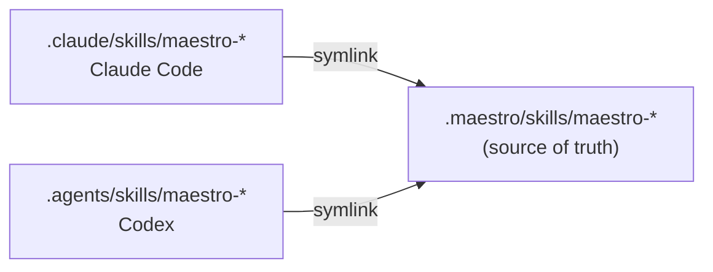

# Install Maestro

Maestro lives in one folder, `.maestro/`, at your repo's root. Every skill sits there with its references and scripts. Claude Code and Codex find the skills through symlinks, so `.maestro/` is the only copy.

```
your-repo/
├── .maestro/
│   ├── VERSION                  # Maestro commit you installed
│   └── skills/
│       ├── maestro-planner/     # SKILL.md, references/, scripts/
│       ├── maestro-qa-lead/
│       └── ...
├── .claude/skills/
│   └── maestro-planner -> ../../.maestro/skills/maestro-planner
└── .agents/skills/
    └── maestro-planner -> ../../.maestro/skills/maestro-planner
```



## What you need

- `git`, `bash`, `jq`, and the GitHub CLI `gh`, signed in to your repo's remote.
- Claude Code, Codex, or both, ideally in T3. Run sessions with all permissions: Claude Code in `bypassPermissions`, Codex with `approval_policy = "never"`.
- For UI checks by QA, engineers and the designer: Node and `playwright-cli` with Playwright's Chromium.

## Install

Run this from your repo's root:

```bash
set -euo pipefail
src=$(mktemp -d)
git clone --depth 1 https://github.com/ProlesDei/maestro.git "$src"

mkdir -p .maestro/skills .claude/skills .agents/skills
rm -rf .maestro/skills/maestro-*
cp -R "$src"/skills/maestro-* .maestro/skills/
git -C "$src" rev-parse HEAD > .maestro/VERSION

for dir in .claude/skills .agents/skills; do
  for link in "$dir"/maestro-*; do
    if [ -L "$link" ] && [ ! -e "$link" ]; then rm "$link"; fi
  done
  for skill in .maestro/skills/maestro-*; do
    name=$(basename "$skill")
    if [ -e "$dir/$name" ] && [ ! -L "$dir/$name" ]; then
      echo "skipped $dir/$name: a folder Maestro didn't place"
      continue
    fi
    ln -sfn "../../.maestro/skills/$name" "$dir/$name"
  done
done
rm -rf "$src"
```

It replaces only what Maestro placed: the `maestro-*` folders in `.maestro/skills/` and the `maestro-*` symlinks. It never touches your own skills.

Then commit `.maestro/`, `.claude/skills/` and `.agents/skills/` to your default branch. Don't gitignore them: each ticket runs in its own git worktree, and a worktree holds only tracked files.

On Windows, use WSL, or turn on Developer Mode and set `git config core.symlinks true` before you clone.

## Tell the agents about your project

The skills read your repo's `AGENTS.md` or `CLAUDE.md` (the "agent notes") for anything specific to your project. Add what applies:

- **Main branch**, if it isn't the remote's default.
- **Ticket board**: GitHub Issues, Beads, Linear or other, and how to reach it.
- **Start the app**: the command, its port, and how to run two copies at once without a clash.
- **Outside steps**: anything a person must do first, such as a VPN, a login or a feature flag.
- **Sensitive paths**: code where a change needs a closer look, such as auth, billing or migrations.
- **Critical flows**: the user journeys QA must always check.
- **Browser tool**, if not `playwright-cli`.
- **Who proves the work**: say so if engineers prove their own work instead of QA.

## Run it

Start a session in your repo and call the chief of staff:

- Claude Code: `/maestro-chief-of-staff`
- Codex: `$maestro-chief-of-staff`

It talks with you one decision at a time, sets goals and hands them to the planner. [skills/README.md](skills/README.md) lists every skill.

## Update

Run the install block again, then commit. `.maestro/VERSION` changes to the new commit.

Don't edit files in `.maestro/skills/`: the next update replaces them. Put your own skills straight in `.claude/skills/` and `.agents/skills/`, named without `maestro-`.

## Uninstall

```bash
rm -rf .maestro
find .claude/skills .agents/skills -maxdepth 1 -name 'maestro-*' -type l -delete
```
