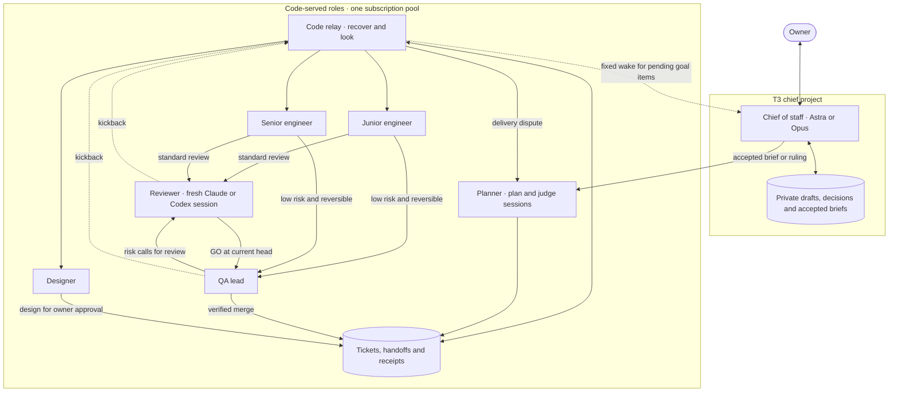
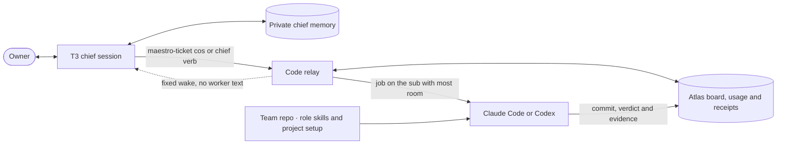

# Maestro

Maestro is infrastructure for a fully agentic workflow: a swarm of up to hundreds of agents working at once. The goal is to give one person the power of a whole company.

A team installs it into its own repo and gets:

- `maestro-ticket`, a ticket store and CLI.
- 19 `maestro-*` skills, and seven role profiles.

## Who drives it

T3 chief sessions work with the owner on goals. Code starts the planner and workers, routes fixed handoffs and recovers interrupted work. Every job draws on the Claude or Codex subscription with the most room through its reset windows. One OS user runs it all, on one board in MongoDB Atlas. [Install](INSTALL.md)

## How work moves

1. The **chief of staff** talks to the owner, one decision at a time, sets direction and hands goals to the planner. It never touches code or tickets and never starts runs.
2. The **planner** runs the team day to day, as product owner and project manager in one. It turns goals into tickets with `/maestro-planner`, each tagged junior or senior, hands out builds by tier with one `maestro-ticket look` per wake, sends what needs reading to a judge session, and reports status and the blocks it can't settle to the chief of staff.
3. Engineers build screens directly. The designer prepares options for owner approval when the owner asks or the planner identifies a costly choice that a first implementation would settle too late.
4. The **senior engineer** (Opus) takes senior-tier tickets and a junior's ticket sent back twice; the **junior engineer** (Sonnet) takes junior-tier ones. Either runs `/maestro-software-engineer <id>` in a Claude Code session, which takes one ticket to an open PR in its own worktree. Low-risk, reversible work can go straight to QA. Other builds go to review.
5. The **reviewer**, in a fresh session that shares no context with the author, runs `/maestro-code-review`. GO goes straight to QA with a `Review: GO` note; NO-GO goes straight back to the engineer with a `Kickback:` note.
6. The QA lead checks the changed behavior in the running app. QA can send a direct handoff to review if the diff carries more risk than the planner expected. A pass merges the PR and closes the ticket. Users try the finished goal or demo.
7. A block climbs one rung at a time until someone can answer it: a junior build's stuck session goes on, on Opus; then the planner's judge session, the chief of staff, the owner. A review's block leaves an `Escalation:` note; the answer goes on the ticket and the ticket goes back to review.

The planner sends product decisions to the goal’s chief and handles delivery questions itself. A review verdict covers the branch head and ticket criteria the reviewer read.

<!-- Source: docs/team.mermaid. Edit that file, then copy it here. -->

## What we hold to

- **Least friction for your team.** Every session runs with all permissions, since a headless run can't stop to ask.
- **Rules in code first.** A rule goes in code, a schema or a lint before it goes in prose.
- **Proof over claims.** A review or QA verdict covers one head sha. A worker's report is a claim until a run shows it.
- **Never clash with your setup.** Every shipped skill is named `maestro-*`. The installer never writes over a file it didn't place, and you pick where the skills live.
- **Read your setup, don't assume it.** Your main branch and checks come from `.maestro/project/project-setup.md`.
- **Built for many teams.** We read all feedback, and change Maestro where a fix helps most teams. A need only your team has belongs in your `project-setup.md` or your own skills ([decisions](docs/decisions.md), 17).
- **Small and plain.** Cut what only exists to look impressive.

## Install

Tell your agent (Claude Code or Codex), in your repo: *"Follow INSTALL.md in github.com/ProlesDei/maestro."* [INSTALL.md](INSTALL.md) has it ask you only what your repo can't answer, one call at a time: where the skills live, your checks, your board on Atlas, your subscriptions. It writes your answers to `.maestro/project/install.yaml` and `project-setup.md`, and leaves the exact building and copying to [scripts/install.sh](scripts/install.sh), which never writes over a file of yours.

It needs git 2.38+, Go 1.26+, bash 4.4+, `jq`, `gh` with access to this repo, Claude Code, T3 Code and a MongoDB Atlas account; Codex is optional.

What you get:

- Maestro pinned to one commit in `.maestro/src/`, hidden from git.
- `maestro-ticket` on your `PATH`, one copy for every repo on the machine.
- The skills in `.claude/skills/` and `.agents/skills/`: committed, or hidden from git.
- `.maestro/project/project-setup.md`: your main branch, checks, how to run the app.
- The board on MongoDB Atlas, and your Claude and Codex logins in one pool.
- A T3 project for the chief of staff, outside your repo.
- Run stats: numbers about each run in `stats.db` beside the ticket store, never text, kept on your machine ([decisions](docs/decisions.md), 24). [The views](tools/maestro-ticket/README.md#run-stats) are for you and the sessions you start.

The same guide updates Maestro to a newer commit and uninstalls it.

Optional: a code graph. With [codebase-memory-mcp](https://github.com/DeusData/codebase-memory-mcp) as an MCP server, sessions find symbols and callers before they grep, which costs fewer reads. INSTALL.md offers it.

For an app with screens: [Playwright CLI](https://playwright.dev/agent-cli/introduction), the browser QA sessions open pages with. Each QA run gets its own headless browser, so many runs test at once without sharing cookies, storage or files. On Linux its system libraries need root once: INSTALL.md never has an agent wait on a sudo password, so a person installs them, unless sudo needs none.

## Use

Every job is a skill, in Claude Code (or headless: `claude -p "/maestro-code-review 12" --permission-mode bypassPermissions --output-format json`):

- `/maestro-planner <goal>` writes a short spec, slices it into ordered, testable tickets, tags each junior or senior, and creates them. Given a ticket id, it splits or rewrites that ticket. `judge <ids>` makes the planner's calls that need reading: blocks, disputes, parked tickets, a shared cause. It also carries out the planner's rulings on blocks, finishes a split, drop or merge that stopped short, checks a plan, finds what keeps the board from running in parallel, or answers a code question a plan turns on.
- `/maestro-create-ticket <what needs doing>` drafts the ticket, creates it in `maestro-ticket` and prints its id.
- `/maestro-qa-lead <id or pr>` is the last check before production, and it tests only a head sha that review passed. It builds that sha on today's main the way production does, walks each criterion and the critical flows in a browser, tries harder angles as the risk goes up (upgrade from old data, rollback, a second user, a dependency down), and reruns the project's checks. A pass adds a `QA: pass` comment with evidence, merges the PR and moves the ticket to `done`. A fail moves it back to `in_progress` with a `Kickback: QA fail` note. It blocks a ticket when it can't test it, GitHub refuses the merge, or the PR already merged. `/maestro-qa-lead <ask>` does the QA lead's other jobs: a second look at a verdict, a bug reproduced, a ticket checked before it's built, a test plan.
- `/maestro-code-review <pr>` reviews the PR at its head sha, in a fresh session apart from the author. GO adds a `Review: GO` comment and leaves the ticket in `in_review` for QA; review never merges. NO-GO moves it back to `in_progress` with a `Kickback:` note, and the engineer runs the ticket again with that feedback. ESCALATE blocks the ticket with an `Escalation:` note when the change needs the owner's yes (a dependency, CI or hook change, or one a revert can't undo) or a third kickback would repeat the last two. The review's depth follows the PR's risk: a docs fix gets one pass, an auth or migration change all nine. Add `--report-only` for the report alone.
- `/maestro-chief-of-staff <question or id>` is the chief of staff thinking inside the repo while the swarm runs. The chief of staff runs it to check a report or get a second opinion on a call. It drafts the `Answer:` texts, the owner's next card and the messages to send. It changes nothing and hands back no commands.
- `/maestro-software-engineer <id or change>` takes a ticket to an open PR, or makes a change by hand, always in its own worktree kept up to date with main: plan, build, self-review. Every build job runs it on its ticket, and any session that writes code loads it.

## Your own skills

Maestro ships 19 skills, each with the `maestro-` prefix so they stay clear of your own: the ticket and review commands, one per role, working tools such as `/maestro-unslop` and `/maestro-figure-it-out`, and four on how to build. [skills/README.md](skills/README.md) lists them. Your own skills go in your repo's `.claude/skills/` or `.agents/skills/`, named without `maestro-`.

## How a job runs

How the chief, the code relay and each job connect:

<!-- Source: docs/bot-anatomy.mermaid. Edit that file, then copy it here. -->

## Tools

- [tools/maestro-ticket](tools/maestro-ticket/README.md): the ticket store and CLI, on MongoDB Atlas; leases and fencing tokens.

## Credits

Two builders shape how Maestro works. Kun Chen's [firstmate](https://github.com/kunchenguid/firstmate), [no-mistakes](https://github.com/kunchenguid/no-mistakes) and [treehouse](https://github.com/kunchenguid/treehouse) gave us the chief of staff, the checks, review and QA every PR passes, and a worktree per change. Lauren Tan's [pstack](https://github.com/cursor/plugins/tree/main/pstack) gave our skills their form and many of their names.
