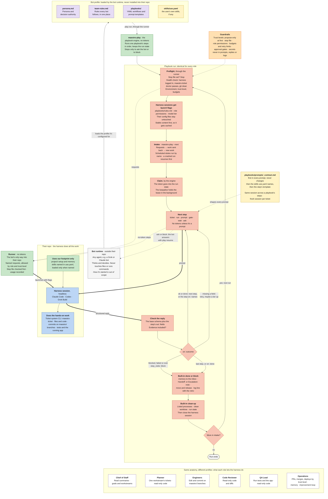

# maestro

An automated agentic workflow that takes products from plan to ship, packaged so you can install it into any project.

maestro bundles a full suite of agent roles, playbooks and tools. Install it, give it context about your project, and the workflow is ready to run. No per-project setup of agents, prompts, or tooling.

## What's included

| Part | What it is |
|---|---|
| Roles | Agent definitions. Each role owns one part of the delivery process. |
| Playbooks | Each role's jobs as YAML workflows in `playbooks/<role>/`: typed steps for ticket writes, runner requests, checks, waits, questions for the bot, and prompts rendered from the templates in `playbooks/prompts/`. `maestro-play` runs one per ticket, all its prompt steps in one harness session. See `playbooks/README.md`. |
| Skills | Yours. `skills/` holds your own skills, and `skills/use.yaml` says which prompt steps and bots name them and which install as slash commands. Maestro's playbooks, templates and personas name none, so nothing depends on a skill. See `skills/README.md`. |
| Tools | Commands that do the work. `tools/maestro-play/` is the playbook engine. `tools/maestro-ticket/` is the ticket system: a CLI over a SQLite store shared by every worktree, with leases, versioned transitions, an event log and a generated `Backlog.md`. See `tools/maestro-ticket/README.md`. `tools/maestro-usage/` records usage and checks budgets. |
| Evals | One golden task per playbook in `evals/<role>/`, the situation and the result it must produce, for catching regressions once the eval runner exists. `maestro-play lint` checks the playbooks; `evals/check.py` checks the tasks and docs. See `evals/README.md`. |
| Bot profiles | One folder per bot at `bot-profiles/<name>/persona.md`, plus any supporting files in that folder, and `bot-profiles/team-rules.md` shared by all of them. Outside tools, such as Grok, read a folder and copy it to create the bot. |

## How it works

1. **Install** maestro into your project.
2. **Add project context**: what you're building, the stack, build and test commands, conventions.
3. **Run the workflow.** The agents plan, build, check, and ship.

### The agent team

You talk to one agent: the Chief of Staff. It turns your goals into workstreams, each run by its own Planner session, which writes the tickets. Engineers pick up tickets from the ticket system (`maestro-ticket`). Ship tickets pass automated checks, a code review and QA before the Operations Manager releases them, within the trust level you set; scout tickets end at an evidenced report. Each role runs on the cheapest model tier that can do the job; color marks the tier. The rules every bot follows are in `bot-profiles/team-rules.md`.

<!-- Source: docs/team.mermaid. Edit that file, then copy it here. -->


### Bot anatomy

An outside bot runtime, for example Grok Bot, creates a bot for each persona in `bot-profiles/`. Every persona operates under this same anatomy. The bot runtime loads the role's profile (`persona.md`, the team rules and the role's playbooks) outside the user's repo. The bot starts each job with the runner's `play` request, and `maestro-play` runs the rest: preflight, intake, the claim, each step, the structured reply checked against the step's schema, the handoff or escalation, the log line and clean-up. The bot decides only where the playbook asks it to, and handles escalations. It never touches the repo: harness sessions do the hands-on work, and the runner (`docs/runner.md`) checks every request against the role's permissions and the trust level.

<!-- Source: docs/bot-anatomy.mermaid. Edit that file, then copy it here. -->


## Install

From a clone of this repo, with the target already a git repo; give the top of its work tree:

```sh
scripts/install.sh /path/to/your-repo
```

It copies every folder in `skills/` into the target's `.claude/skills/` (Claude Code) and `.agents/skills/` (Codex, Grok Build), creates `.maestro/project/` and `.maestro/local/`, hides the skill folders and `.maestro/local/` from git through `.git/info/exclude`, and creates the ticket store if `maestro-ticket` is on your PATH. If any of those skill folders already exists it stops and writes nothing, and if a later step fails it removes what it wrote. Then run `chief-of-staff/setup-project`. To uninstall, run the lines at the top of `scripts/install.sh` in the target repo; the second also deletes your tickets. Decisions 0880 and 0881 say why the installer is this small.

## Supported harnesses

maestro runs on the three main coding agents:

- Claude Code
- Codex
- Grok Build

Installed sessions get Maestro's rules through launch flags and never rely on, or edit, your `AGENTS.md` or `CLAUDE.md`. In this repo, `AGENTS.md` holds the instructions for developing Maestro itself; `CLAUDE.md` imports it.

## Status

Early. The roles, playbooks, the playbook engine and the ticket store are written; `scripts/install.sh` installs the skills and folders (see Install). The runner and the wake loop aren't built yet.
