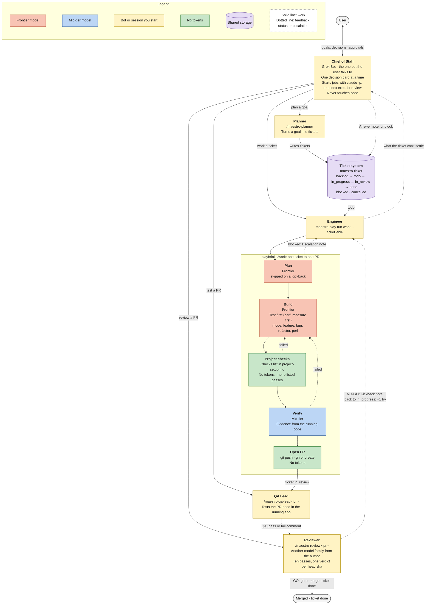
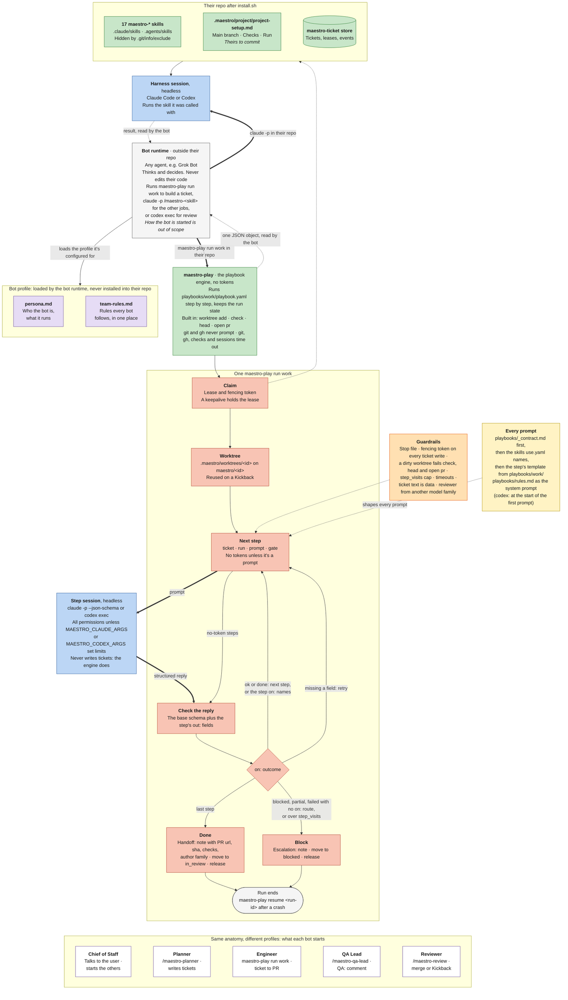

# Maestro

Maestro takes a ticket to a merged pull request with coding agents. It is tooling only: files you install into a repo and commands you run. One playbook, a ticket tool, 17 skills and five bot personas. Nothing in it runs on its own; a person or a bot starts every job ([decisions](docs/decisions.md)).

## Install

Needs git 2.31+, Go 1.26+, `gh`, and Claude Code or Codex.

```sh
(cd tools/maestro-ticket && go install ./cmd/maestro-ticket)
(cd tools/maestro-play && go install ./cmd/maestro-play)
scripts/install.sh <target-repo>
export MAESTRO_PLAYBOOKS=<maestro>/playbooks
```

The installer copies each folder in `skills/` into the target's `.claude/skills/` and `.agents/skills/`, writes `.maestro/project/project-setup.md` from [templates/project-setup.md](templates/project-setup.md), creates the ticket store and hides its copies from git. It refuses, writing nothing, if a skill folder already exists. Fill in `project-setup.md`: the main branch and the check commands the work playbook runs.

`maestro-play` finds the playbook through `MAESTRO_PLAYBOOKS`, the full path to this repo's `playbooks/` folder. Put the `export` in your shell profile; `maestro-play run work` stops without it.

Sessions run with all permissions. To limit them, set `MAESTRO_CLAUDE_ARGS` or `MAESTRO_CODEX_ARGS`.

Runs time out: a session after 30m, a check after 15m, a git or gh call after 5m. Set `MAESTRO_SESSION_TIMEOUT` and `MAESTRO_CHECK_TIMEOUT` to change them; details in [tools/maestro-play](tools/maestro-play/README.md).

To use your own ticket method, add `--tickets <dir>`: a folder with `maestro-create-ticket/` and its `SKILL.md`. The installer copies it in place of Maestro's. Keep that name: the personas call it.

## Use

Build a ticket from the shell in the target repo. It's a playbook, so no Claude session wraps it:

```sh
maestro-play run work --ticket T-12   # or no --ticket: the next one, sent back first, then todo
```

It claims the ticket, makes a worktree on `maestro/<id>`, plans, builds, runs the checks, verifies each criterion, opens a PR and moves the ticket to `in_review`. The ticket's type picks the mode: feature, bug, refactor or perf. When a run blocks, the ticket moves to `blocked` with an `Escalation:` note; answer it and run again as [Unblock](skills/maestro-chief-of-staff/SKILL.md#unblock) shows. [playbooks/work](playbooks/work/README.md) has the steps and exit codes.

The other jobs are skills, in Claude Code (or headless: `claude -p "/maestro-review 12" --output-format json`):

- `/maestro-planner <goal>` writes a short spec, slices it into ordered, testable tickets and creates them. Given a ticket id, it splits or rewrites that ticket.
- `/maestro-create-ticket <what needs doing>` drafts the ticket, creates it in `maestro-ticket` and prints its id.
- `/maestro-qa-lead <pr>` starts the app at the PR's head sha, walks each criterion and adds a `QA: pass` or `QA: fail` comment with evidence. It moves no ticket; `/maestro-review` reads the comment as evidence.
- `/maestro-review <pr>` reviews the PR at its head sha, from another model family than the author when one is installed. GO merges the PR and moves the ticket to `done`. NO-GO moves it back to `in_progress` with a `Kickback:` note, and the next `maestro-play run work` takes it first and starts again at build with that feedback.
- `/maestro-chief-of-staff <id>` settles a blocked ticket: answers what the facts settle and puts it back, or writes up the owner's call.
- `/maestro-software-engineer <id or change>` makes a change by hand in your own session: plan, test first, self-review. It writes no ticket.

## Your own skills

Maestro ships 17 skills, each with the `maestro-` prefix so they stay clear of your own: the ticket and review commands, one per role, working tools such as `/maestro-unslop` and `/maestro-figure-it-out`, and three that prompt steps load. [skills/README.md](skills/README.md) lists them. To add your own, put `skills/<name>/SKILL.md` here and name it in `skills/use.yaml` if prompt steps should load it.

## Personas

[bot-profiles/](bot-profiles/README.md) holds five personas for bot tools such as Grok Bot, plus the [team rules](bot-profiles/team-rules.md) every bot follows:

- `chief-of-staff`: the one agent the owner talks to. Drives Claude with the commands above; settles blocked tickets with `/maestro-chief-of-staff`; never touches code.
- `planner`: turns a goal into tickets with `/maestro-planner` and `/maestro-create-ticket`.
- `engineer`: runs the work playbook and unblocks a run that stops.
- `qa-lead`: tests a PR in the running app with `/maestro-qa-lead` before review.
- `reviewer`: runs `/maestro-review` on PRs another model family wrote.

## How it works

Who does what, and how work moves between them:

<!-- Source: docs/team.mermaid. Edit that file, then copy it here. -->


How each bot works, and what one `maestro-play run work` does:

<!-- Source: docs/bot-anatomy.mermaid. Edit that file, then copy it here. -->


## Tools

- [tools/maestro-play](tools/maestro-play/README.md): the playbook engine. Runs, resumes, renders and lints playbooks. The one playbook is [playbooks/work](playbooks/work/README.md); the format is in [playbooks/README.md](playbooks/README.md).
- [tools/maestro-ticket](tools/maestro-ticket/README.md): the ticket store and CLI. SQLite, leases and fencing tokens.
