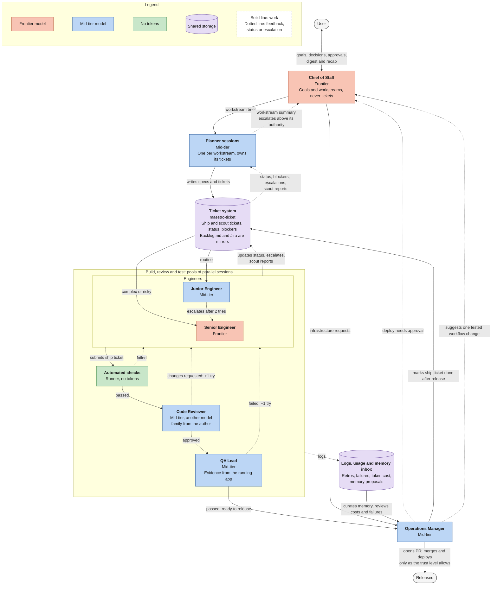
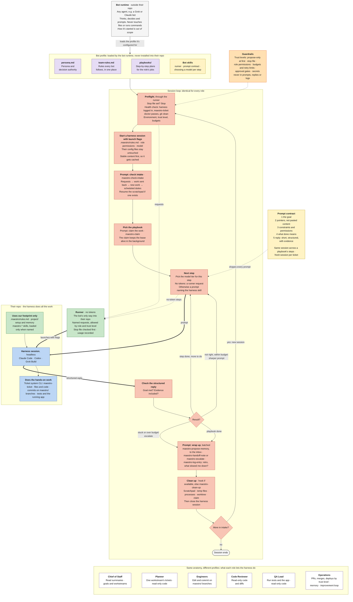

# maestro

An automated agentic workflow that takes products from plan to ship, packaged so you can install it into any project.

maestro bundles a full suite of agent roles, skills, and tools. Install it, give it context about your project, and the workflow is ready to run. No per-project setup of agents, prompts, or tooling.

## What's included

| Part | What it is |
|---|---|
| Roles | Agent definitions. Each role owns one part of the delivery process. |
| Skills | Reusable instructions. Bot skills (`skills/bot/`) teach the bots how to prompt and judge, and stay with the bot runtime. Harness skills (`skills/harness/`, `maestro-*`) teach a harness session one step; they install into your harness's skill folder and run only when a prompt names them. See `skills/README.md`. |
| Playbooks | Step-by-step plans for each role's jobs, in `playbooks/<role>/`. The bot runtime picks one per ticket and runs its steps in one harness session. See `playbooks/README.md`. |
| Tools | Scripts and commands the agents call to do the work. `tools/maestro-ticket/` is the ticket system: a CLI over a SQLite store shared by every worktree, with leases, versioned transitions, an event log and a generated `Backlog.md`. See `tools/maestro-ticket/README.md`. |
| Evals | One golden task per playbook in `evals/<role>/`, the situation and the result it must produce, for catching regressions once the eval runner exists. `evals/check.py` checks the format of the playbooks, tasks, skills and docs. See `evals/README.md`. |
| Bot profiles | One folder per bot at `bot-profiles/<name>/persona.md`, plus any supporting files in that folder, and `bot-profiles/team-rules.md` shared by all of them. Outside tools, such as Grok, read a folder and copy it to create the bot. |

## How it works

1. **Install** maestro into your project.
2. **Add project context**: what you're building, the stack, build and test commands, conventions.
3. **Run the workflow.** The agents plan, build, check, and ship.

### The agent team

You talk to one agent: the Chief of Staff. It turns your goals into workstreams, each run by its own Planner session, which writes the tickets. Engineers pick up tickets from the ticket system (`maestro-ticket`). Ship tickets pass automated checks, a code review and QA before the Operations Manager releases them, within the trust level you set; scout tickets end at an evidenced report. Each role runs on the cheapest model tier that can do the job; color marks the tier. The rules every bot follows are in `bot-profiles/team-rules.md`.

<!-- Source: docs/team.mermaid. Edit that file, then copy it here. -->

### Bot anatomy

An outside bot runtime, for example Grok Bot, creates a bot for each persona in `bot-profiles/`. Every persona operates under this same anatomy. The bot runtime loads the role's profile (`persona.md`, the team rules, playbooks and bot skills) outside the user's repo. It runs the standard session loop: preflight, starting a headless harness session with launch flags, checking intake, claiming work, prompting steps under the prompt contract, checking structured replies with evidence, batched wrap-up, and cleanup. The bot never touches the repo: harness sessions do the hands-on work, and the runner (`docs/runner.md`) runs every no-token step within the role's permissions and the trust level.

<!-- Source: docs/bot-anatomy.mermaid. Edit that file, then copy it here. -->

## Supported harnesses

maestro runs on the three main coding agents:

- Claude Code
- Codex
- Grok Build

Installed sessions get Maestro's rules through launch flags and never rely on, or edit, your `AGENTS.md` or `CLAUDE.md`. In this repo, `AGENTS.md` holds the instructions for developing Maestro itself; `CLAUDE.md` imports it.

## Status

Early. The roles, skills, playbooks and the ticket store are written; the runner, the wake loop and the installer aren't built yet, so nothing installs today. Install steps will land here once they are.
