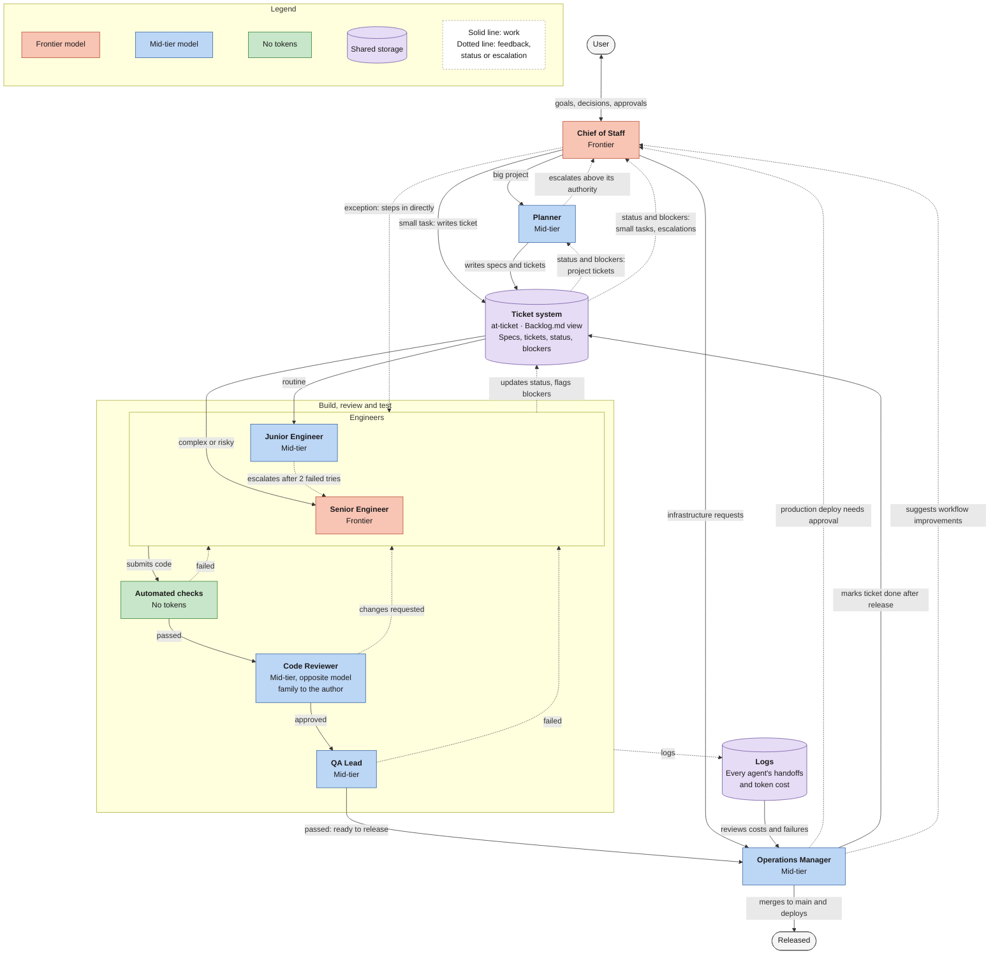
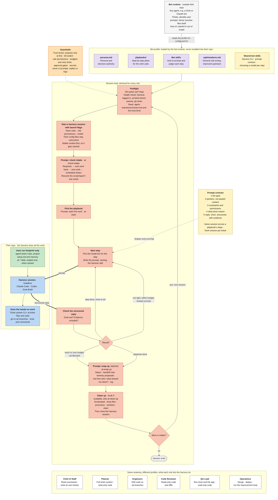

# maestro

An automated agentic workflow that takes products from plan to ship, packaged so you can install it into any project.

maestro bundles a full suite of agent roles, skills, and tools. Install it, give it context about your project, and the workflow is ready to run. No per-project setup of agents, prompts, or tooling.

## What's included

| Part | What it is |
|---|---|
| Roles | Agent definitions. Each role owns one part of the delivery process. |
| Skills | Reusable instructions in `skills/<name>/SKILL.md`. `at-*` harness skills install into your repo under `.agent-team/` and the harness loads one only when a prompt names it. Bot skills (prompt contract, harness CLI, model selection) stay with the bot runtime. See `skills/README.md`. |
| Playbooks | Step-by-step plans for each role's jobs, in `playbooks/<role>/`. The bot runtime picks one per ticket and runs its steps in one harness session. See `playbooks/README.md`. |
| Tools | Scripts and commands the agents call to do the work. `tools/at-ticket/` is the ticket system: a CLI over a SQLite store shared by every worktree, with leases, versioned transitions, an event log and a generated `Backlog.md`. See `tools/at-ticket/README.md`. |
| Bot profiles | One folder per bot at `bot-profiles/<name>/persona.md`, plus any supporting files in that folder. Outside tools, such as Grok, read a folder and copy it to create the bot. |

## How it works

1. **Install** maestro into your project.
2. **Add project context**: what you're building, the stack, build and test commands, conventions.
3. **Run the workflow.** The agents plan, build, check, and ship.

### The agent team

You talk to one agent: the Chief of Staff. It hands big projects to the Planner and writes tickets for small tasks itself. Engineers pick up tickets from the ticket system (`at-ticket`), and their code passes automated checks, a code review, and QA before the Operations Manager releases it. Each role runs on the cheapest model tier that can do the job; color marks the tier.

<!-- Source: docs/agent-team.mermaid. Edit that file, then copy it here. -->

### Bot anatomy

An outside bot runtime, for example Grok Bot, creates a bot for each persona in `bot-profiles/`. Every persona operates under this same anatomy. The bot runtime loads the role's profile (`persona.md`, playbooks, bot skills, optimizations, and shared skills) outside the user's repo. It runs the standard session loop: preflight, starting a headless harness session with launch flags, checking intake, claiming work, prompting steps under the prompt contract, checking structured replies with evidence, batched wrap-up, and cleanup. It enforces guardrails and role-specific permissions while the coding harness does the hands-on work inside the repo.

<!-- Source: docs/bot-anatomy.mermaid. Edit that file, then copy it here. -->

## Supported harnesses

maestro runs on the three main coding agents:

- Claude Code
- Codex
- Grok Build

`AGENTS.md` holds the shared instructions. Codex and Grok Build read it directly. `CLAUDE.md` imports it for Claude Code.

## Status

Early. The workflow exists and works; this repo is where it gets packaged for install. Install steps will land here once packaging is done.
