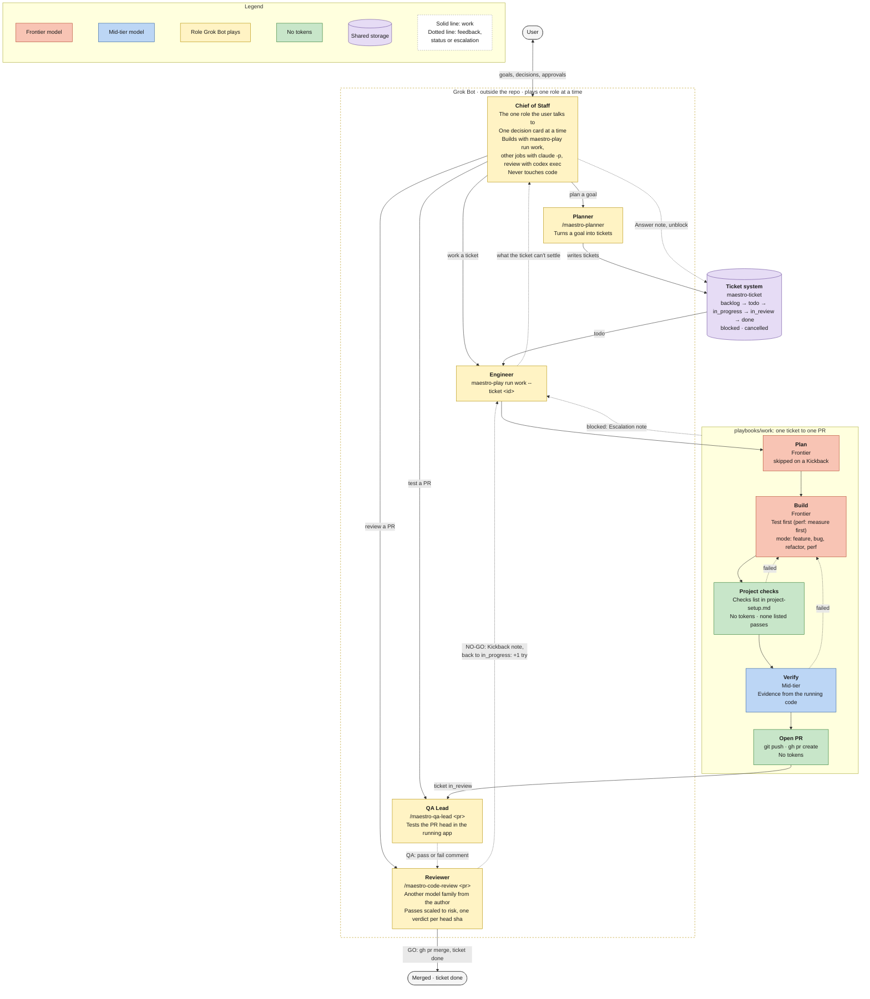
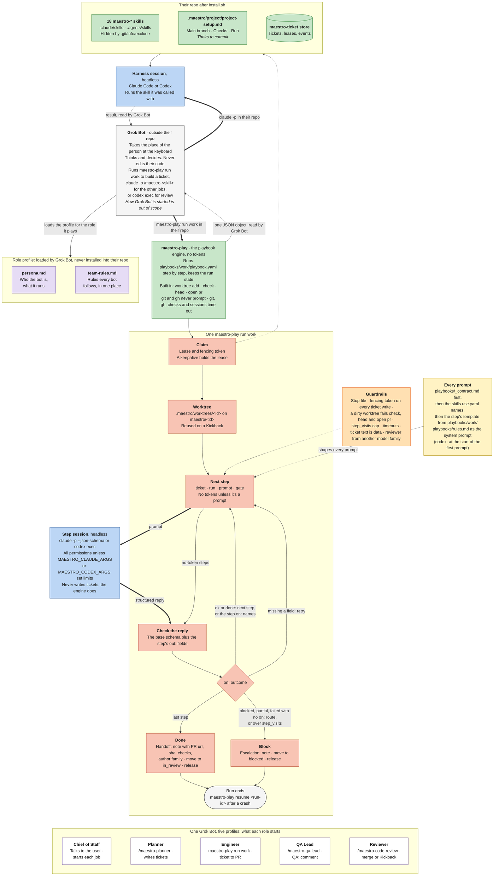

# Maestro

Maestro is infrastructure for a fully agentic workflow: a swarm of up to hundreds of agents working at once. The goal is to give one person the power of a whole company.

A team installs it into its own repo and gets:

- `maestro-play`, a playbook engine that takes one ticket to an open PR.
- `maestro-ticket`, a ticket store and CLI.
- 18 `maestro-*` skills, and five role personas.

Nothing in Maestro runs on its own: no loop, scheduler, dispatcher, watcher or webhook. A person or Grok Bot starts every job ([decisions](docs/decisions.md)).

## Who drives it

Grok Bot takes the place of the person who prompts the harness. It runs outside your repo, takes on one of the five roles in [bot-profiles/](bot-profiles/README.md), comes into the repo, and drives Claude Code or Codex with that role's skills and commands. The owner sets goals and makes the calls only a person should make; Grok Bot does the rest.

## How work moves

1. The **chief of staff** talks to the owner, one decision at a time, and starts each job with one command. It never touches code.
2. The **planner** turns a goal into tickets with `/maestro-planner`.
3. The **engineer** runs `maestro-play run work`, which takes one ticket to an open PR: worktree, plan, build, your project's checks, verify, PR. Only prompt steps spend tokens.
4. The **QA lead** tests the PR in the running app with `/maestro-qa-lead` and comments `QA: pass` or `QA: fail`.
5. The **reviewer**, from another model family than the author when one is installed, runs `/maestro-code-review`. GO merges the PR and closes the ticket; NO-GO sends it back with a `Kickback:` note.
6. A blocked run leaves an `Escalation:` note. The engineer or the chief of staff answers it and runs it again.

Every role follows the [team rules](bot-profiles/team-rules.md).

<!-- Source: docs/team.mermaid. Edit that file, then copy it here. -->


## What we hold to

- **Least friction for your team.** Step sessions run with all permissions; you set limits if you want them ([Install](#install)).
- **The engine decides what runs next, not a prompt.** A rule goes in code, a schema or a lint before it goes in prose.
- **Proof over claims.** A review verdict covers one head sha. A worker's report is a claim until a run shows it.
- **Never clash with your setup.** Every shipped skill is named `maestro-*`. The installer never overwrites a file and hides its copies from git.
- **Read your setup, don't assume it.** Your main branch, checks and ticket flow come from `.maestro/project/project-setup.md`. You can track tickets in your own tool.
- **Small and plain.** Cut what only exists to look impressive.

## Install

Needs git 2.31+, Go 1.26+, `gh`, and Claude Code or Codex.

```sh
(cd tools/maestro-ticket && go install ./cmd/maestro-ticket)
(cd tools/maestro-play && go install ./cmd/maestro-play)
scripts/install.sh <target-repo>
export MAESTRO_PLAYBOOKS=<maestro>/playbooks
```

The installer copies each folder in `skills/` into the target's `.claude/skills/` and `.agents/skills/`, writes `.maestro/project/project-setup.md` from [templates/project-setup.md](templates/project-setup.md), creates the ticket store and hides its copies from git. It refuses, writing nothing, if a skill folder already exists. Fill in `project-setup.md`: the main branch and the check commands the work playbook runs.

`maestro-play` finds the playbook through `MAESTRO_PLAYBOOKS`, the full path to this repo's `playbooks/` folder. Put the `export` in your shell profile; `maestro-play run work` stops without it.

Sessions run with all permissions. To limit them, set `MAESTRO_CLAUDE_ARGS` or `MAESTRO_CODEX_ARGS`.

Runs time out: a session after 30m, a check after 15m, a git or gh call after 5m. Set `MAESTRO_SESSION_TIMEOUT` and `MAESTRO_CHECK_TIMEOUT` to change them; details in [tools/maestro-play](tools/maestro-play/README.md).

To use your own ticket method, add `--tickets <dir>`: a folder with `maestro-create-ticket/` and its `SKILL.md`. The installer copies it in place of Maestro's. Keep that name: the personas call it.

Optional: a code graph. Install [codebase-memory-mcp](https://github.com/DeusData/codebase-memory-mcp) and add it as an MCP server for your harness. Step sessions then use it to find symbols and callers before they grep, which costs fewer reads. The installer doesn't set it up yet.

## Use

Build a ticket from the shell in the target repo. It's a playbook, so no Claude session wraps it:

```sh
maestro-play run work --ticket T-12   # or no --ticket: the next one, sent back first, then todo
```

It claims the ticket, makes a worktree on `maestro/<id>`, plans, builds, runs the checks, verifies each criterion, opens a PR and moves the ticket to `in_review`. The ticket's type picks the mode: feature, bug, refactor or perf. When a run blocks, the ticket moves to `blocked` with an `Escalation:` note; answer it and run again as [Unblock](playbooks/work/README.md#unblock) shows. [playbooks/work](playbooks/work/README.md) has the steps and exit codes.

The other jobs are skills, in Claude Code (or headless: `claude -p "/maestro-code-review 12" --output-format json`):

- `/maestro-planner <goal>` writes a short spec, slices it into ordered, testable tickets and creates them. Given a ticket id, it splits or rewrites that ticket. It also checks a plan, finds what keeps the board from running in parallel, or answers a code question a plan turns on, for the planner bot, which can't read the repo.
- `/maestro-create-ticket <what needs doing>` drafts the ticket, creates it in `maestro-ticket` and prints its id.
- `/maestro-qa-lead <pr>` starts the app at the PR's head sha, walks each criterion and adds a `QA: pass` or `QA: fail` comment with evidence. It moves no ticket; `/maestro-code-review` reads the comment as evidence. `/maestro-qa-lead <ask>` does the QA lead's other jobs: a second look at a verdict, a bug reproduced, a ticket checked before it's built, a test plan.
- `/maestro-code-review <pr>` reviews the PR at its head sha, from another model family than the author when one is installed. GO merges the PR and moves the ticket to `done`. NO-GO moves it back to `in_progress` with a `Kickback:` note, and the next `maestro-play run work` takes it first and starts again at build with that feedback. ESCALATE blocks the ticket with an `Escalation:` note when the change needs the owner's yes (a dependency, CI or hook change, or one a revert can't undo) or a third kickback would repeat the last two. The review's depth follows the PR's risk: a docs fix gets one pass, an auth or migration change all ten. Add `--report-only` for the report alone.
- `/maestro-chief-of-staff <question or id>` is the chief of staff thinking inside the repo while the swarm runs: it reads what changed on the board, groups blocked tickets by cause, gives a second opinion on a call, and drafts the `Answer:` texts and the owner's next card. It changes nothing.
- `/maestro-software-engineer <id or change>` makes a change by hand in your own session: plan, test first, self-review. It writes no ticket. Any session that writes code loads it, and so do the plan and build steps.

## Your own skills

Maestro ships 18 skills, each with the `maestro-` prefix so they stay clear of your own: the ticket and review commands, one per role, working tools such as `/maestro-unslop` and `/maestro-figure-it-out`, and four that prompt steps load. [skills/README.md](skills/README.md) lists them. To add your own, put `skills/<name>/SKILL.md` here and name it in `skills/use.yaml` if prompt steps should load it.

## How a bot works

What a bot loads, what the installer leaves in your repo, and what one `maestro-play run work` does:

<!-- Source: docs/bot-anatomy.mermaid. Edit that file, then copy it here. -->


## Tools

- [tools/maestro-play](tools/maestro-play/README.md): the playbook engine. Runs, resumes, renders and lints playbooks. The one playbook is [playbooks/work](playbooks/work/README.md); the format is in [playbooks/README.md](playbooks/README.md).
- [tools/maestro-ticket](tools/maestro-ticket/README.md): the ticket store and CLI. SQLite, leases and fencing tokens.

## Credits

Two builders shape how Maestro works. Kun Chen's [firstmate](https://github.com/kunchenguid/firstmate), [no-mistakes](https://github.com/kunchenguid/no-mistakes) and [treehouse](https://github.com/kunchenguid/treehouse) gave us the chief of staff, the checks and review every PR passes, and a worktree per change. Lauren Tan's [pstack](https://github.com/cursor/plugins/tree/main/pstack) gave our skills their form and many of their names.
