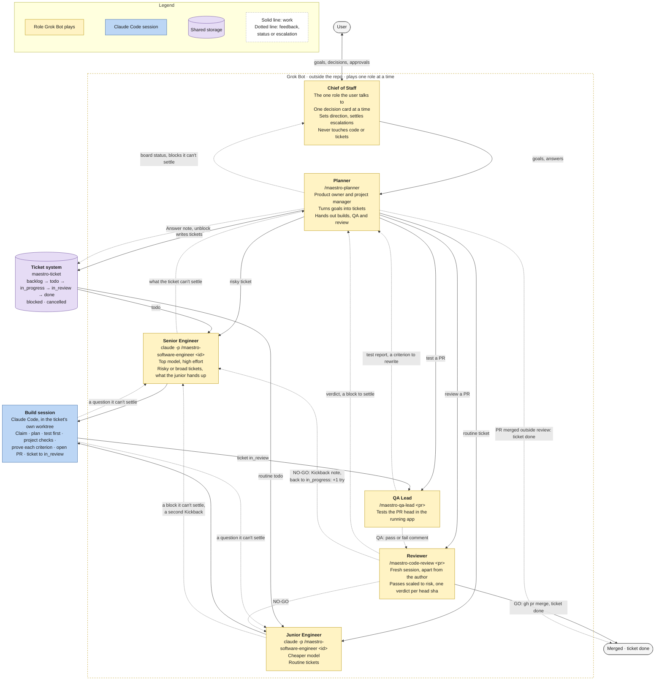
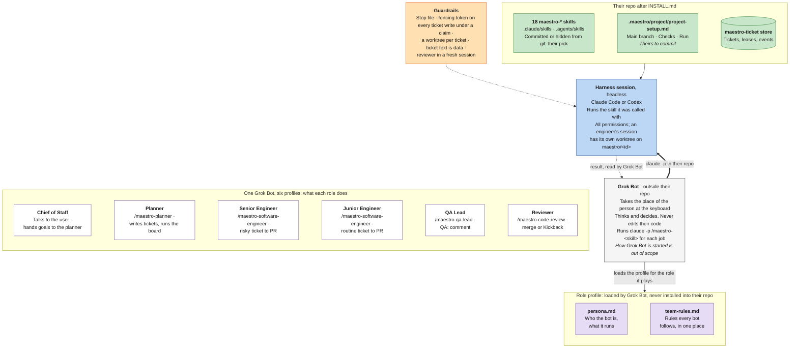

# Maestro

Maestro is infrastructure for a fully agentic workflow: a swarm of up to hundreds of agents working at once. The goal is to give one person the power of a whole company.

A team installs it into its own repo and gets:

- `maestro-ticket`, a ticket store and CLI.
- 18 `maestro-*` skills, and six bot profiles.

Nothing in Maestro runs on its own: no loop, scheduler, dispatcher, watcher or webhook. A person or Grok Bot starts every job ([decisions](docs/decisions.md)).

## Who drives it

Grok Bot takes the place of the person who prompts the harness. It runs outside your repo, takes on one of the six profiles in [bot-profiles/](bot-profiles/README.md), comes into the repo, and drives Claude Code with that role's skills and commands. The owner sets goals and makes the calls only a person should make; Grok Bot does the rest.

## How work moves

1. The **chief of staff** talks to the owner, one decision at a time, sets direction and hands goals to the planner. It never touches code or tickets and never starts runs.
2. The **planner** runs the team day to day, as product owner and project manager in one. It turns goals into tickets with `/maestro-planner`, hands each ticket's build, QA and review to the right bot, and reports status and the blocks it can't settle to the chief of staff.
3. The **senior engineer** (top model, high effort) takes risky or broad tickets; the **junior engineer** (a cheaper model) takes routine ones. Either runs `/maestro-software-engineer <id>` in a Claude Code session, which takes one ticket to an open PR in its own worktree.
4. The **QA lead** tests the PR in the running app with `/maestro-qa-lead` and comments `QA: pass` or `QA: fail`.
5. The **reviewer**, in a fresh session that shares no context with the author, runs `/maestro-code-review`. GO merges the PR and closes the ticket; NO-GO sends it back with a `Kickback:` note.
6. A block climbs one rung at a time (junior engineer, senior engineer, planner, chief of staff, owner) until someone can answer it. A review's block leaves an `Escalation:` note; the planner posts the answer and the ticket goes back to review.

Every role follows the [team rules](bot-profiles/team-rules.md).

<!-- Source: docs/team.mermaid. Edit that file, then copy it here. -->

## What we hold to

- **Least friction for your team.** Every bot's sessions run with all permissions, since a headless run can't stop to ask.
- **Rules in code first.** A rule goes in code, a schema or a lint before it goes in prose.
- **Proof over claims.** A review verdict covers one head sha. A worker's report is a claim until a run shows it.
- **Never clash with your setup.** Every shipped skill is named `maestro-*`. The installer never writes over a file it didn't place, and you pick where the skills live.
- **Read your setup, don't assume it.** Your main branch and checks come from `.maestro/project/project-setup.md`.
- **Small and plain.** Cut what only exists to look impressive.

## Install

Tell your agent (Claude Code, Codex or Grok), in your repo: *"Follow INSTALL.md in github.com/ProlesDei/maestro."* [INSTALL.md](INSTALL.md) has it ask you each call, one at a time: which harnesses, where the skills live, your checks, each bot's starting memories. It writes your answers to `.maestro/project/install.yaml` and `project-setup.md`, and leaves the exact copying to [scripts/install.sh](scripts/install.sh), which never writes over a file of yours.

It needs git 2.31+, Go 1.26+, bash 4.4+, `jq`, `gh` with access to this repo, and Claude Code; Codex is optional.

What you get:

- Maestro pinned to one commit in `.maestro/src/`, hidden from git.
- `maestro-ticket` on your `PATH`, one copy for every repo on the machine.
- The skills in `.claude/skills/` and `.agents/skills/`: committed, or hidden from git.
- `.maestro/project/project-setup.md`: your main branch, checks, how to run the app.
- One paste-ready block per Grok bot in `.maestro/bots/`.

The same guide updates Maestro to a newer commit and uninstalls it.

Optional: a code graph. With [codebase-memory-mcp](https://github.com/DeusData/codebase-memory-mcp) as an MCP server, sessions find symbols and callers before they grep, which costs fewer reads. INSTALL.md offers it.

## Use

Every job is a skill, in Claude Code (or headless: `claude -p "/maestro-code-review 12" --permission-mode bypassPermissions --output-format json`):

- `/maestro-planner <goal>` writes a short spec, slices it into ordered, testable tickets and creates them. Given a ticket id, it splits or rewrites that ticket. It also checks a plan, finds what keeps the board from running in parallel, or answers a code question a plan turns on, for the planner bot, which can't read the repo.
- `/maestro-create-ticket <what needs doing>` drafts the ticket, creates it in `maestro-ticket` and prints its id.
- `/maestro-qa-lead <pr>` is the last check before production. It builds the PR's head sha the way production does, walks each criterion and the critical flows in a browser, tries harder angles as the risk goes up (upgrade from old data, rollback, a second user, a dependency down), and adds a `QA: pass` or `QA: fail` comment with evidence. It moves no ticket; `/maestro-code-review` merges only on a `QA: pass` at the PR's head. `/maestro-qa-lead <ask>` does the QA lead's other jobs: a second look at a verdict, a bug reproduced, a ticket checked before it's built, a test plan.
- `/maestro-code-review <pr>` reviews the PR at its head sha, in a fresh session apart from the author. GO merges the PR and moves the ticket to `done`. NO-GO moves it back to `in_progress` with a `Kickback:` note, and the engineer runs the ticket again with that feedback. ESCALATE blocks the ticket with an `Escalation:` note when the change needs the owner's yes (a dependency, CI or hook change, or one a revert can't undo) or a third kickback would repeat the last two. The review's depth follows the PR's risk: a docs fix gets one pass, an auth or migration change all ten. Add `--report-only` for the report alone.
- `/maestro-chief-of-staff <question or id>` is the chief of staff thinking inside the repo while the swarm runs. The chief of staff runs it to check a bot's report or get a second opinion on a call; the planner runs it to group blocked tickets by cause. It drafts the `Answer:` texts, the owner's next card and the messages to send. It changes nothing and hands back no commands.
- `/maestro-software-engineer <id or change>` takes a ticket to an open PR, or makes a change by hand, always in its own worktree kept up to date with main: plan, test first, self-review. The engineer bots run it on each ticket, and any session that writes code loads it.

## Your own skills

Maestro ships 18 skills, each with the `maestro-` prefix so they stay clear of your own: the ticket and review commands, one per role, working tools such as `/maestro-unslop` and `/maestro-figure-it-out`, and four on how to build. [skills/README.md](skills/README.md) lists them. Your own skills go in your repo's `.claude/skills/` or `.agents/skills/`, named without `maestro-`.

## How a bot works

What a bot loads and what the installer leaves in your repo:

<!-- Source: docs/bot-anatomy.mermaid. Edit that file, then copy it here. -->

## Tools

- [tools/maestro-ticket](tools/maestro-ticket/README.md): the ticket store and CLI. SQLite, leases and fencing tokens.

## Credits

Two builders shape how Maestro works. Kun Chen's [firstmate](https://github.com/kunchenguid/firstmate), [no-mistakes](https://github.com/kunchenguid/no-mistakes) and [treehouse](https://github.com/kunchenguid/treehouse) gave us the chief of staff, the checks and review every PR passes, and a worktree per change. Lauren Tan's [pstack](https://github.com/cursor/plugins/tree/main/pstack) gave our skills their form and many of their names.
