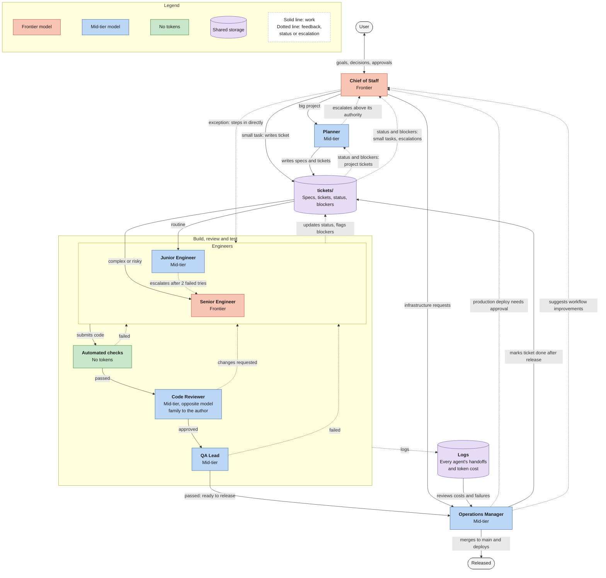

# maestro

An automated agentic workflow that takes products from plan to ship, packaged so you can install it into any project.

maestro bundles a full suite of agent roles, skills, and tools. Install it, give it context about your project, and the workflow is ready to run. No per-project setup of agents, prompts, or tooling.

## What's included

| Part | What it is |
|---|---|
| Roles | Agent definitions. Each role owns one part of the delivery process. |
| Skills | Reusable instructions agents load for specific tasks. |
| Tools | Scripts and commands the agents call to do the work. |
| Bot profiles | Bot definitions in `bot-profiles/` that outside tools, such as Grok, read and copy to create bots. |

## How it works

1. **Install** maestro into your project.
2. **Add project context**: what you're building, the stack, build and test commands, conventions.
3. **Run the workflow.** The agents plan, build, check, and ship.

### The agent team

You talk to one agent: the Chief of Staff. It hands big projects to the Planner and writes tickets for small tasks itself. Engineers pick up tickets from `tickets/`, and their code passes automated checks, a code review, and QA before the Operations Manager releases it. Each role runs on the cheapest model tier that can do the job; color marks the tier.

<!-- Source: docs/agent-team.mermaid. Edit that file, then copy it here. -->

## Supported harnesses

maestro runs on the three main coding agents:

- Claude Code
- Codex
- Grok Build

`AGENTS.md` holds the shared instructions. Codex and Grok Build read it directly. `CLAUDE.md` imports it for Claude Code.

## Status

Early. The workflow exists and works; this repo is where it gets packaged for install. Install steps will land here once packaging is done.
