# Data collection: a spec for Maestro run data

**Status:** draft spec, no code yet. Lives at `docs/design/data-collection.md`.
**Labels:** **[code]** means the claim was checked in the source at the `file:line` given. **(guess)** means a run must confirm it before we build on it. Section 16 lists each guess.

## 0. The point

1. Go code that already runs (the supervisor, `job`, `check`, `look`, `pickup`) writes typed facts to a new local file, `stats.db`, next to the ticket store. It costs 0 model tokens and 0 Grok tokens, and that zero is enforced by code-level output pins, not by prose.
2. Most of the data exists today and gets thrown away: the result object's turns, subtype and spend per model; the run's outcome, the reason for its model, its slot wait, how it was killed. We keep it. We add one new source, Claude's `stream-json` output, read in memory only for Claude jobs.
3. Free text can't reach `stats.db`. Fact tables are SQLite `STRICT` tables whose enum columns are integer ids into a `codes` table that only Go's fixed lists can fill. A marker test plants lowercase, hex and model-shaped markers everywhere and greps both `stats.db` and every bundle.
4. Nothing leaves the machine on its own. `stats bundle` writes a file and prints only its path, size and sha256. Bots can't run it, a person reads it, and a person sends it. A feedback report gets a **case bundle** for the one ticket it names.
5. We ship in about 8 small PRs after one cheap probe (R0), with 5 views first: `outcomes`, `waste`, `kickbacks`, `case`, `health`, plus new `costs --by` keys.

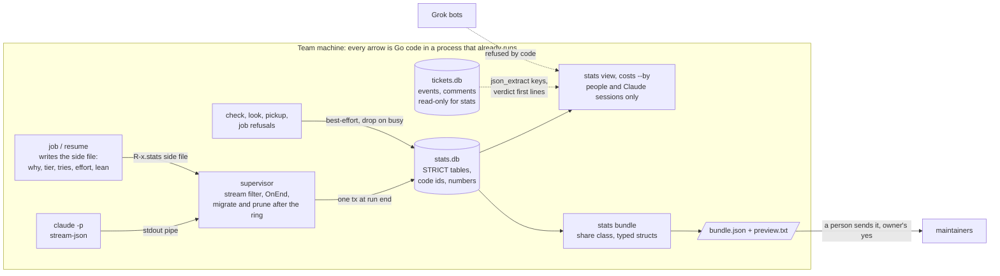

---

## 1. Rules this design keeps

This section links each rule and says how the design keeps it. It does not restate the rules.

| Rule | How this design keeps it |
|---|---|
| [Decision 1](../decisions.md) | No daemon, cron or uploader. Writes happen in the supervisor, which already lives as long as its run, or in a command someone typed. The ring body stays the same, and tests pin it (9.5, item 7). |
| [Decision 15](../decisions.md) | Capture follows `job`/`resume` under `launch` and keys on the run ids `launch` issues. |
| [Decision 17](../decisions.md) | Bundles carry versions and an install id, so maintainers can count across teams. A case bundle shows one team's case as a case. |
| [Decision 19](../decisions.md) | No bot step is added. `look`, `pickup`, `job`, `check` and `ack` print the same bytes on stdout and stderr, text and `--json`, and a test enforces this under each stats failure (10.2). Code refuses `stats` views to bots (section 8). |
| [Decision 9](../decisions.md) | Enum lists live once, in Go. `stats.db` holds a copy that grows by insert and never by table rebuild (5.0). The rule that stats stay local goes in a new decision (23, added in C1). This doc links to it and does not restate it. |
| [Decision 8](../decisions.md) | `install.sh check` stays read-only. `apply` gains one key, `stats:` (6.2). |
| [Decision 12](../decisions.md) | All sessions run as one user with all permissions, so the run-id gate on `bundle` only guards against slips. The real guards are the lack of send code and the share-only content (9.6). |
| Swarm scale (AGENTS.md) | No prompt, skill or persona grows. A CLI write waits at most 250 ms and is dropped on busy. Migration and prune run only in the supervisor, after its first ring. |
| Runs in someone else's repo | Nothing goes in the work tree. Stats refuses to start if the store dir sits inside a work tree and isn't git-ignored. We never touch `.claude/settings.json` or hooks. |
| Rule in code before prose | STRICT tables, a schema lint, a reflect lint on bundle types, a registered-value check, a marker test, a never-reads SQL test, a deps test and output pins (9.5). |

---

## 2. Questions this answers

Every field answers at least one question here. "v1" means the view ships in the first 8 PRs. "Later" means its view waits until a feedback case needs it. Until then, `stats case` shows the same facts for one ticket, and the appendix query runs in `sqlite3` against `stats.db`.

| # | Question | Command | Ships | Answered by |
|---|---|---|---|---|
| Q1 | Where do tokens and dollars go, by job, model, route and cache TTL? | `costs --by model` (also `job`, `why`, `lean`) | v1 | `run_models`, `run_facts` |
| Q2 | Why do kickbacks happen? | `stats kickbacks` | v1 | `findings`, QA verdict counts |
| Q3 | Which skill steps fail or stall? | `stats steps` | later | `run_steps`, `run_tail`, `open_code` |
| Q4 | What share of runs end badly, and how? | `stats outcomes` | v1 | `outcome`, `reason`, `subtype`, `stop` |
| Q5 | Where do tickets stall, how long do results sit unseen, and do lost rings explain it? | `stats stalls` | later | events, `first_shown_at`, `acked_at`, `rang`, `ring_err` |
| Q6 | How high do escalations climb, and how long does each rung take? | `stats escalations` | later | parsed verdicts, `nudge`, `why` |
| Q7 | How long from created to done, and how many loops? | `stats lead` | later | events |
| Q8 | Which review GOs fail QA later at the same sha, and on what? | `stats misses` | later | parsed verdicts joined on sha |
| Q9 | Which kickback findings were false (dropped or refuted), by id? | `stats kickbacks --false` | v1 | `findings` with `fid`, kind `dropped` |
| Q10 | Which checks are slow or flaky? | `stats checks` | later | `check_log` |
| Q11 | How much spend goes to reruns, dead runs included? | `stats waste` | v1 | `run_models` deltas, `cost_src`, links |
| Q12 | How often do refusals and usage-limit storms happen? | `stats storms` | later | `tally`, `pauses` |
| Q13 | Did a release make things better or worse? | `stats outcomes --by version` | v1 | `v_maestro`, `v_tool`, `v_claude` |
| Q14 | How much text do bots read, and which look cost the most and why? | `stats bots` | later | `tally` kind `out`, `look_log`, `n_tickets` |
| Q15 | How often is the owner asked, and how fast do they answer? | `stats owner` | later | parsed `Sent up:` and `Answer:` |
| Q16 | How big do contexts get, and how often do sessions compact, retry or fan out? | `stats context` | later | `ctx_peak`, `compactions`, `retries`, `subagents` |
| Q17 | Is the machine near its limits when runs fail, and is capture healthy? | `stats health` | v1 | `disk_free_pct`, `inode_free_pct`, `live_runs`, drop counts, missing rows |
| Q18 | What happened on the one ticket a feedback report names? | `stats case T-12`, `stats bundle --case T-12` | v1 | every table, for that ticket |

Q2, Q3, Q8 and Q11 come from the live retros: 42 of 66 kickbacks said a test missed the change, 30 of 66 cited defects already on main, reruns cost 40% of spend, and 71 of 144 handoffs bounced (git 7636851, 614d111). Q17 covers the Nov 12 inode exhaustion (git ea768d6). Q18 is how feedback reaches the data: reports name a ticket, a PR or a time.

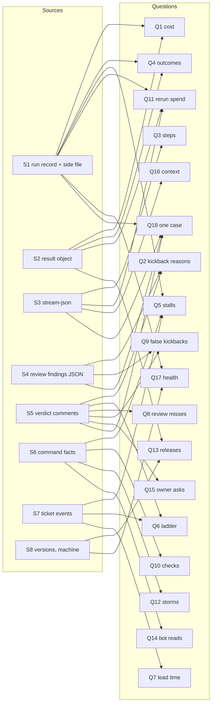

---

## 3. Data sources

No source here costs model tokens. Claude Code's harness writes the result object and the stream, not the model. Everything else is Go.

| # | Source | What it gives | How it is captured | Token cost | Privacy class | Status |
|---|---|---|---|---|---|---|
| S1 | Run record, plus a new side file `<id>.stats` | job, model, limit, start, end, exit, state, resume_of, nudge, after_death, rang. New: why (enum), tier, tries, effort, lean, again_of, n_tickets, slot-wait ms, term or kill, escaped count, drop ids | `job` writes the side file at start. The supervisor adds its end facts. `endRun` copies both into `run_facts`. The side file keeps new fields out of `Record`, so `--json` output of `runs` and `pickup` stays the same. `runs.Prune` gains `.stats` in its list **[code: runs/runs.go:409]** | 0 | Share (ids Local) | Partly stored, pruned 7 days after ack |
| S2 | Claude's result object | subtype, is_error, stop_reason, duration_ms, duration_api_ms, num_turns, per-model `modelUsage` with costUSD | `endRun` already reads it. Widen `claudeReply` **[code: cli/runs.go:20-33]** | 0 | Share; cost is opt-in in bundles | On disk; today only 4 token sums and total cost are parsed |
| S3 | `stream-json` events, Claude jobs only | step codes, tool errors and ms, the call open at a kill, Maestro skill and reference reads, `maestro-ticket` subcommands, setup commands by index, subagent turns, API retries, compactions (guess), peak context, per-turn usage (guess), Claude version (guess) | The supervisor reads stdout through a pipe and folds lines into counters in memory (section 4) | 0, proven by the exact R0 test (section 11) | Share (fixed code lists only) | New |
| S4 | Review findings JSON in the reply | per finding: id, pass, severity, action, prior; per run: verdict, tier, mode; counts of out-of-scope and dropped lines | `endRun` parses the reply it already holds **[format: skills/maestro-code-review/references/passes.md:31-36]** | 0 | Share | In the reply, pruned after 7 days |
| S5 | Verdict comments | kind, tier, blockers, majors, sha, escalation kind, QA item counts by kind, flow pass and fail counts, check exit codes, rate n/3 | Parsed at read time from `tickets.db` by a stats-only parser (5.7). Only enums and numbers come out. | 0 | Share (sha Local) | Stored forever as text |
| S6 | Command facts | `check` result and ms; `job` refusals by reason; first pickup time and route action; output bytes of `look`, `pickup` and `job`; one `look_log` row per look; usage-limit pauses | One best-effort write in each command, dropped on busy | 0; output bytes pinned | Share (check name Local) | Printed, never stored |
| S7 | Ticket events | time in each status, send-backs, claims, lease expiries, actor role | Read at `stats` time through `json_extract` on fixed keys only (5.7) | 0 | Share (ids Local) | Stored forever |
| S8 | Versions and machine | maestro-sha, maestro-ticket `vcs.revision`, Claude Code version, OS, arch, disk and inode free %, live runs | `install.yaml`'s `maestro-sha`, `debug.ReadBuildInfo`, the stream's init line (guess), one statfs at run end | 0 | Share, after the checks in 9.3 | Not recorded |

**Sources we turn down:**

| Source | Why not |
|---|---|
| Claude transcripts (`~/.claude/projects/*/<session>.jsonl`) | The format is internal and can change. It holds every prompt, file and tool output, so it is the riskiest source. `stream-json` gives the same counts through a documented interface. |
| Command hooks via `--settings` | One process per tool call across 300 sessions. A team's `disableAllHooks` or `--bare` turns them off without a word, so missing data looks like a clean run. They merge with the team's own hooks. Hook output can also enter model context on every tool call (SessionStart or UserPromptSubmit stdout, exit 2 stderr, `additionalContext`). Any hook capture would need a test that it prints nothing and exits 0. |
| OpenTelemetry | No file exporter. `otlp` needs a listener: a daemon (decision 1) or a new host. Custom skill names turn into `custom`. A team's own `OTEL_*` env stays as it is. |
| Install facts from `install.sh` (choices, warn ids, time) | No question uses them. Only `maestro-sha` is kept, read from `install.yaml`. |
| `doctor`'s untracked count, `slot` queue depth, `denials`, web searches, `ack` writes | No question uses them. `bypassPermissions` makes denials about always 0 **[code: cli/job.go:107]**. `acked_at` is copied from the run record at prune time (6.3), so `ack` writes nothing. |
| Signals that cost tokens (finding category tags, one-line retros, a chief-of-staff card log) | Priced in section 11. They wait for the owner (open calls 9 and 10). The review escalation code word is dropped: Go derives its causes for free (5.6). |

---

## 4. The stream filter (S3)

**Scope.** The filter runs only when the record's command carries `--output-format stream-json`, which only `claudeCommand` sets **[code: cli/job.go:101-107]**. Every other run keeps today's path: raw stdout goes to `.out`, and the row says `stream=off`. That covers a plain `launch -- <cmd>` and old records that `job again` and `resume` copy with `--output-format json`.

**Plumbing**, pinned by tests:
- Use `os.Pipe`. Pass the write end as `cmd.Stdout`, then close the parent's copy right after `Start`. With an `*os.File` stdout, `cmd.Wait` never waits on the pipe, so a grandchild that keeps the write end open can't hold `done` back.
- Once `done` fires, join the reader with a bounded wait (2 s). If the reader hasn't finished by then, the supervisor stops waiting for it and the row says `stream=partial`. The kill path already takes care of escaped processes **[code: runs/supervise.go:182-205]**.
- `ParseOutput` gets the result line the reader held in memory, so it never races a write to `.out`. `.out` is still written for the orphan path and for readers of `runs`.
- **The read loop does no DB work, no fsync and no lock.** It only folds counters and appends to `.out`. It keeps draining after a parse error or a skipped line. Today stdout goes straight to a file, so Claude never waits on Maestro **[code: runs/supervise.go:124]**. A stalled reader would block Claude's writes, and a stall past a lean job's 5-minute cache TTL **[code: cli/job.go:103-105]** turns the next turn's 0.1x cache read into a 1.25x rewrite. A test runs the filter against a `stats.db` held locked and asserts that the pipe never stalls.

**What `.out` holds:** the `result` line, plus any non-JSON lines (crash text), capped at 64 KB. **Never the init line.** Today `ParseOutput` accepts any line that has a `session_id` and scans from the end **[code: runs/runs.go:446-470]**. An init line would give every crashed or stopped run a session id. `endRun` then skips `freeRunClaim` for `Failed` runs with a session id **[code: cli/launch.go:394]**, so the claim would sit until the lease ran out and pickup would print different lines. The init line also carries `cwd`, MCP server names, slash commands and plugins. The filter decodes it in memory into a struct with only the version field and drops the rest. Tests:
- `.out` never holds `"subtype":"init"`.
- A stopped run whose stream had only an init line frees its claim and gives the same pickup bytes as today.
- `.out` is no larger than today's single result object, plus crash text.

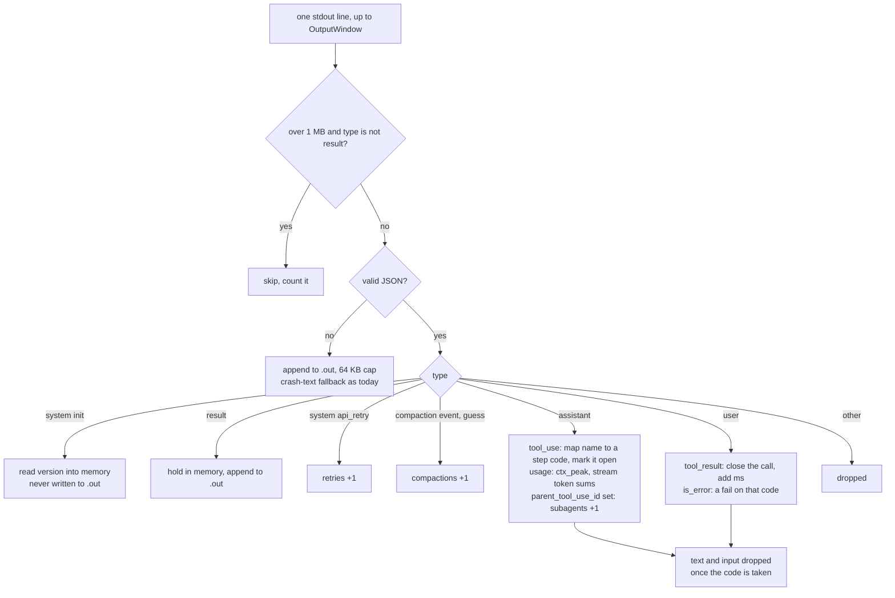

**Step codes, from fixed lists in Go:**

| Seen in the stream | Code stored | Fallback |
|---|---|---|
| Built-in tool (Bash, Read, Edit, Write, Grep, Glob, Task or Agent, WebFetch, ...) | the tool name, from a generated list | `mcp` for `mcp__*`, else `other` |
| Skill tool naming one of the 19 shipped skills | `S:maestro-code-review` | `S:other` |
| Read of a shipped `SKILL.md` or `references/<file>.md` | `R:maestro-code-review/passes` (skill plus file stem, from a `go generate` list over `skills/`) | `Read` |
| Bash running a shipped script: `bash .../maestro-<skill>/scripts/<file>.sh` | `X:maestro-code-review/review-prep` | `Bash` |
| Bash that exactly matches a backticked command under `## Run`, `## QA` or `## Checks` in `project-setup.md` | `setup:run`, `setup:qa`, `setup:check:<n>` (the index, never the text) | next rows |
| Bash whose first word is `maestro-ticket` | `mt:<sub>`, from the CLI's command table | `Bash` |
| Bash whose first word is `git` or `gh` | `git:<sub>` or `gh:<sub>` from a short list: push, commit, merge, worktree, pr, checks | `Bash` |
| Bash whose first word is on a short list: npm, pnpm, yarn, go, make, pytest, cargo, docker, playwright-cli | `Bash:<word>` | `Bash` |

The filter strips a leading `cd <x> &&` before it matches. The supervisor reads `project-setup.md` once, at start, from the run's directory. It compares in memory and keeps only the index (guess: the parse of backticked lines holds up across teams).

**At run end** the filter hands over:
- counters per code (calls, fails, ms sum and max);
- the last 24 codes, each with a fail mark;
- the call still open, if any (`open_code`, `open_ms`). For a killed run, that is the call that hung;
- summed per-turn usage (`stream_*` tokens), used as the cost of a run with no result line (5.2).

**Failure modes:**
- **The supervisor dies mid-run.** On Linux, Pdeathsig sends SIGTERM to the child **[code: runs/sys_linux.go:8-10]**. The orphan path marks the run died. The counters are lost, and the row says `stream=lost`.
- **macOS.** A broken pipe hits the child where today it would keep writing to a file. The run is an orphan either way (guess, tested in R0).
- **A long line.** A `result` line is never skipped. It is kept up to `OutputWindow` (8 MB) as today **[code: runs/runs.go:444]**. Other lines over 1 MB are skipped and counted.

---

## 5. What is captured

**Class key.** **S**: Share, may go in a bundle. **L**: Local, stays on the machine; a bundle carries only its hash or a duration. Never-class data has no column at all.

### 5.0 How values are stored

- **Every fact table is `STRICT`.** SQLite then refuses a text value in an INTEGER column (guess: SQLite 3.37 or later, which modernc.org/sqlite v1.61.0 should bundle **[code: go.mod:7]**; R0 confirms).
- **Enum columns are INTEGER ids into `codes(id, kind, name)`.** Go's fixed lists (job kinds, roles, step codes, reasons, and so on) are the only source of names (decision 9). Go's `code(kind, name)` maps any name off its list to `other` before insert.
- **`codes` grows by insert, never by rebuild.** The supervisor seeds the binary's lists with `INSERT OR IGNORE` when it opens the file. A new job kind (like `design` on Nov 14) needs no stats migration. A CLI writer that finds its name missing from `codes` stores `other`.
- **The few TEXT columns are id-shaped**, each with an exact GLOB. Run id: `R-` plus 8 of `[a-z2-7]` **[code: runs/runs.go:113]**. Session: uuid. Sha and tree: 40 hex. Check name: the shape `check` already enforces (lowercase, digits, single hyphens) **[code: cli/check.go:63]**.
- **A binary that finds `stats.db` newer than it knows** (`user_version` higher) drops the write and counts it. A supervisor started before an upgrade, which can live for 24 hours, falls in this case.

### 5.1 `run_facts`: one row per run, written by `endRun`

| Field | Values | Source | Class |
|---|---|---|---|
| `run`, `session`, `ticket` | id shapes, int | S1 | L |
| `role` | 7 profile names, `person`, `other`: one Go function, exact match, run before any write | launcher **[code: cli/launch.go:273]** | S |
| `job` | the `jobKinds` list | S1 **[code: cli/job.go:55-80]** | S |
| `model`, `effort`, `lean` | `opus-5.5`, `sonnet-5.5`, ... or `other` (5.2); effort list; bool | side file (today effort and lean sit only in argv **[code: cli/job.go:101-107]**) | S |
| `why` | tier_senior, tier_junior, tier_none, sent_back, route_light, route_full, fixed: set as an enum where `startJob` decides, never parsed from today's text | side file **[code: cli/job.go:356-383]** | S |
| `tier`, `tries`, `diff_lines`, `limit_s`, `n_tickets` | int; `n_tickets` = len(Record.Tickets) for a judge run **[code: runs/runs.go:66-68]** | side file | S |
| `resume_of`, `again_of` | run id; `again_of` is new | side file | L |
| `nudge`, `after_death` | opus, escalate, decide, none / bool | S1 | S |
| `started_at`, `ended_at` | unix ms | S1 | L (durations only in a bundle) |
| `wall_ms`, `wait_ms`, `wait_capped` | int, int, bool | supervisor, before `removeWaits` | S |
| `state`, `exit`, `stop`, `escaped` | list / int / none, term, kill / int | supervisor kill path | S |
| `outcome` | done, question, usage_limit, disk_full, timed_out, died, refused, failed | `outcomeOf` **[code: cli/route.go:93-121]** | S |
| `reason` | 5.6 | Go | S |
| `subtype`, `stop_reason`, `is_error` | lists, bool | S2 | S |
| `claude_ms`, `api_ms`, `turns` | int | S2 | S |
| `head` | fixed list: `review:go`, `review:nogo`, `review:escalate`, `qa:pass`, `qa:fail`, `judge:done`, ..., `other`, mapped in Go | reply first line | S |
| `verdict`, `v_tier`, `mode`, `mode_why` | from S4 JSON. `mode_why`: no_verdict, not_in_history, redone, incremental, from a key=value file review-prep writes in the run's folder (guess; today it prints free text with a sha **[code: skills/maestro-code-review/scripts/review-prep.sh:307-354]**) | S4 | S |
| `cost_usd`, `cost_src`, `cost_lost` | this run's spend; result, stream, split; bool | 5.2 | S, opt-in in bundles |
| `prompt_bytes`, `reply_bytes` | int | `.in` size, reply length | S |
| `stream` | ok, partial, lost, off | S3 | S |
| `ctx_peak`, `compactions`, `retries`, `subagents`, `tool_calls`, `tool_fails` | int | S3 | S |
| `open_code`, `open_ms` | step code id, int | S3 | S |
| `first_shown_at`, `route_action` | ms; send_role, do_kind, wrote, mismatch, reply (each an id) | first `pickup` | S (as durations) |
| `acked_at` | ms | copied from the record at prune (6.3) | S (as durations) |
| `rang`, `ring_err` | bool; none, timeout, dns, http4xx, http5xx, other (for Q5) | S1 | S |
| `v_maestro`, `v_tool`, `v_claude` | checked as in 9.3 | S8 | S |
| `os`, `arch`, `disk_free_pct`, `inode_free_pct`, `live_runs` | list, list, int | S8 | S |

### 5.2 `run_models`: one row per run per model

Fields: `input`, `output`, `cache_read`, `cache_write`, `cost_usd`, each kept as the session total (`*_cum`, which is what the result reports **[code: cli/runs.go:20-21]**) and as this run's own delta. Model names map to a generated list of families and versions, `opus-5.5`, `sonnet-5.5` and the like. Go accepts only ids shaped `claude-(opus|sonnet|haiku)-<digits and dots>[-<8-digit date>]`, and everything else becomes `other`. A proxy id such as `claude-acme-finetune-prod` becomes `other`.

How the delta works:
- Delta = this result's `*_cum` minus the highest earlier `*_cum` for the same session and model.
- If the earlier row is missing because a write was dropped, the delta is NULL. We never guess it.
- A negative delta is stored as NULL with `cost_lost=1`.
- **Runs with no result line** (timed out, killed, died) get their tokens from the stream sums, with `cost_src=stream` and USD left NULL. The result object's totals don't include them, so the next resume's delta takes in the dead run's spend. At read time, `stats` splits that delta: the dead run gets the share its stream tokens hold of the delta's weighted tokens (5x output, 0.1x cache read, 1.25x cache write), and the resume keeps the rest (`cost_src=split`). This rests on per-turn usage being real, which R0 checks.
- The `runs` table in `tickets.db` stays as it is, so `costs` keeps working.

### 5.3 `run_steps` and `run_tail`

- `run_steps(run, code, calls, fails, ms_sum, ms_max)`: about 10 to 30 rows per run (guess).
- `run_tail(run, pos, code, fail)`: the last 24 codes as rows, so each code passes through the same `codes` id. It shows where the run ended and where its errors were.

### 5.4 `findings` (S4)

`run`, `fid` (`F` plus 1 to 3 digits, else NULL), `kind` (finding, follow_up, dropped; follow_up is one counted row for the lines under the report's `## Follow-ups`, read by the same function pickup files them with), `pass` (1-10, named as in passes.md), `sev`, `action`, `prior` (new, still_present), `n`.
- Finding rows have `n=1`.
- Out-of-scope lines get one row with a count.
- Each `--drop` id becomes a `dropped` row with its `fid`. The reason text from `--drop-file` is never stored.

A finding keeps its id across rounds **[format: passes.md:29-31]**, so `stats case` shows each finding's life: raised in round 1, still present in round 2, dropped in round 3. File, line, evidence, impact and fix are never decoded.

### 5.5 Small tables (S6)

| Table | Fields | Written by |
|---|---|---|
| `check_log` | at, run, job, name (L), tree (L), result (pass, fail, carried), exit, took_ms, wait_ms | `check`. Failures get a row too; today a failure only deletes the pass file **[code: cli/check.go:93-97]** |
| `look_log` | at, bytes, sends, judge_rows, builds_started, errors, took_ms | `look`, best-effort |
| `tally` | day, kind, reason, job, role, cmd (each an id), n, bytes, max_bytes; PK on all keys | kinds: `refusal` (reasons stopped, paused, wrong_status, claimed, going), `out` (look, pickup, job), `drop` (folded in at prune, 6.3) |
| `pauses` | at, resets_at | the usage-limit pause. `resets_at` comes from the epoch form only **[code: cli/route.go:67,102]**, never from the free-text form **[code: cli/route.go:66,107]** |
| `daily` | day, job, model, outcome, n, cost_usd, tokens, ms_p50, ms_p90 | the prune, before it deletes detail rows |
| `meta` | key (id), value (int): last_prune | supervisor |

The schema version lives in `PRAGMA user_version`. Peak runs come from `launches` at read time, so `job` does no new directory read.

### 5.6 Reason codes: free text to enums, no new model output

| Where | Code, worked out by Go |
|---|---|
| outcome `failed` | `no_result`, `max_turns`, `api_error`, `budget`, `stopped` (the launcher stopped), `asked` (`maestro-ticket stop`, error `stopped by`), `exit_nonzero`, `is_error` |
| outcome `timed_out` | `limit`; `frozen` when the record says the machine froze past the limit (`Record.Frozen`) |
| outcome `died` | `reboot` (the launch's boot stamp changed **[code: sqlitestore/sqlitestore.go:248]**, guess), `supervisor` |
| review finding (S4) | pass, sev, action, prior, fid |
| review ESCALATE (S4 plus the first line) | `repeat`: every surviving blocker and major has prior `still present`. `outside_step`: the `outside step:` marker. `merged`: first line `Escalation: review at <H>: PR <url> merged as`. `approval`: what is left. |
| QA verdict (S5) | counts per verdict: items by kind (`pass`, `fail`, `not_checked`, `not_checkable`, `waived`, `carried`), flows pass and fail, check exit codes from `Checks:` **[format: skills/maestro-qa-lead/references/test-a-pr.md:54-67]**. Derived: `setup_fail` when every item is `not_checked` and the flows failed, `flaky` (rate under 3/3), `regress` (`on main: works`), `preexisting` (`on main: same`), `check_red`. |
| escalation written by pickup | `timeout` (`ran past` **[code: cli/route.go:609,837]**), `no_verdict` **[:666]**, `no_handoff` **[:735]**, `tries`, `design_ready`, `qa`, `live`, else `unknown` |
| answer | `approved`, `changes` |

The `setup:run` step code and its `is_error` from the stream back up `setup_fail`. "The app never came up" and "a criterion failed" then look different.

### 5.7 Derived at read time

- **Verdicts (S5).** A stats-only parser turns comment first lines and QA item lines into an in-memory `verdicts` table of enums and numbers. Routing today makes about 16 ad hoc prefix checks, and no shared parser exists (**[code: cli/route.go:385,425,571,576,964; cli/look.go]**). So this parser ships on its own, behind a fixture test that runs the shipped formats (SKILL.md, test-a-pr.md) through both it and route's checks. Moving route onto it is a later PR of its own, with golden pickup output. Until then we make no claim that the two can't drift.
- **One function reads comment bodies.** `verdictRows` is the only stats code that selects `comments.body`. It passes each body straight to the parser and keeps no string.
- **Verdict-to-run link, in this order:**
  1. The `Posted-by: pickup R-x` line **[code: cli/route.go:756]**. The review time-out note at **cli/route.go:609** lacks this line, so PR 5 adds it (one short line on a rare comment, pinned by route_test).
  2. Ticket, author role, and a comment time inside the run's start and end.
  `stats health` counts links made each way, so a bad link rate shows.
- **Events (S7).** Stats reads `events` only through `json_extract(data,'$.from')`, `'$.to'`, `'$.tries'` and `'$.actor_role'`, plus `type` and `created_at`. `actor` goes through `CASE actor WHEN <7 profile names> ... ELSE 'person' END` in SQL. The `data` blob also holds title, note, owner, holder and claim token **[code: sqlitestore/sqlitestore.go:74-81]**. Stats never calls `scanEvent` or `Store.Events`. A test fails if stats SQL names `data` outside `json_extract`, names `actor` outside that CASE, or names `title`, `note` or `body` outside `verdictRows`.
- **Lead times, loops and time in each status** come from these event keys (Q7).

---

## 6. Where it is stored

### 6.1 Files

`<store dir>/stats.db` (SQLite, WAL, `auto_vacuum=INCREMENTAL` set at creation), beside `tickets.db`. The store dir follows `--store` and `MAESTRO_TICKET_STORE` **[code: scripts/install.sh:343]**. Next to it go `stats.salt` (mode 0600) and `stats/` (the `drops` file and bundles).

**Guards:**
- Stats starts only if the store dir is outside every git work tree, or `git check-ignore` covers `stats.db` and `stats.salt`. The check runs once, when the supervisor creates the file. Otherwise stats stays off, and `stats health` says why.
- Uninstall leaves the stats files with `tickets.db`, as it leaves the store. INSTALL.md's uninstall step says how to remove both.

Why a separate file and not new tables in `tickets.db`:
1. Stats writes never take the one write lock that claims need **[code: sqlitestore/sqlitestore.go:311-316]**.
2. `export`, `backup` and pre-migration snapshots never copy stats.
3. `rm stats.db*` wipes collected data and leaves work state alone.
4. Stats migrations take no snapshot. Losing stats is fine.

**Who migrates:** only the supervisor (at open) and the `stats` command. `check`, `look`, `pickup` and `job` open the file only if it exists at their schema. Otherwise they drop the write. They never create the file and never migrate it.

### 6.2 The off switch

- `install.yaml` gains `stats: on|off`. Today `install.sh` dies on any unknown key **[code: scripts/install.sh:138]**, and the Go tool never reads `install.yaml`.
- `apply` writes or removes a marker file, `STATS_OFF`, beside the store. This works the same way as the `STOP` file **[code: sqlitestore/sqlitestore.go:334-341]**.
- Every stats write first checks for the marker with one `Lstat`. `MAESTRO_TICKET_STATS=off` turns stats off for one shell.
- INSTALL.md gains the key in step 4's table and in the Update flow. It also gains one line telling the person what `stats.db` holds locally, and that nothing leaves without `stats bundle` and a person.
- `install_test.sh` tests on, off and the switch from one to the other.

### 6.3 Tables

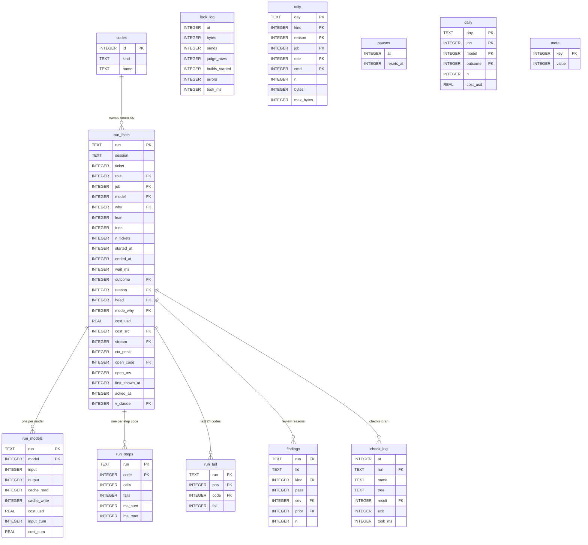

**Schema rules, each enforced by a test:**
- Every fact table is `STRICT`. The schema lint walks `sqlite_master`. It fails on a non-STRICT table, on a TEXT column outside `codes` that lacks an exact-shape GLOB CHECK, and on an enum column that isn't an INTEGER.
- No column holds prompt, reply, stderr, title, body, note, path, URL, host, user or command text.
- `codes.name` takes only names that Go's registered lists hold. A test diffs the table against those lists after seeding.

### 6.4 Retention and prune

| Data | Cap | How |
|---|---|---|
| Detail rows | 90 days, or 256 MB of **live** pages: `(page_count - freelist_count) * page_size` | the prune below |
| `daily` | 400 days | rolled up before detail rows go |
| `tally`, `pauses`, `look_log` | 90 days | same prune |
| `stats/drops` | folded into `tally` kind `drop` at each prune | same prune |
| Bundles in `stats/` | last 10 | on `stats bundle` |

**The prune** runs in the supervisor, after its first ring, so neither a bot's turn nor a ring waits on it:
1. Claim it in one statement: `UPDATE meta SET value=:now WHERE key=last_prune AND value < :now - 3600000`. Only the supervisor whose update changed a row prunes.
2. Roll detail into `daily`.
3. Delete the oldest rows in 1,000-row transactions. Repeat until the file is under the cap and the 90-day age, or 2 s pass. Short transactions let CLI writers in between.
4. Copy `AckedAt` from run records still on disk into `acked_at`, so `ack` needs no stats write. Run files live 7 days after ack **[code: cli/launch.go:34]**, so an hourly prune has days to catch each one.
5. Rename `stats/drops` to `drops.fold`, count its codes into `tally`, and delete it. An append that races the rename lands in one file or the other. At most a few counts go missing.
6. Run `PRAGMA incremental_vacuum(2000)`, then a `PASSIVE` WAL checkpoint, so no writer is stalled.
7. Prune and deletes still run on low disk. Only inserts stop (section 10).

Rows in this design: about 50 per run, with `run_tail`. At 9,600 runs a day, the prune must remove about 480k rows a day, about 20k an hour. One claimed pass an hour, deleting in batches until under the cap, keeps up (guess; PR 1 measures it).

---

## 7. One run, start to end

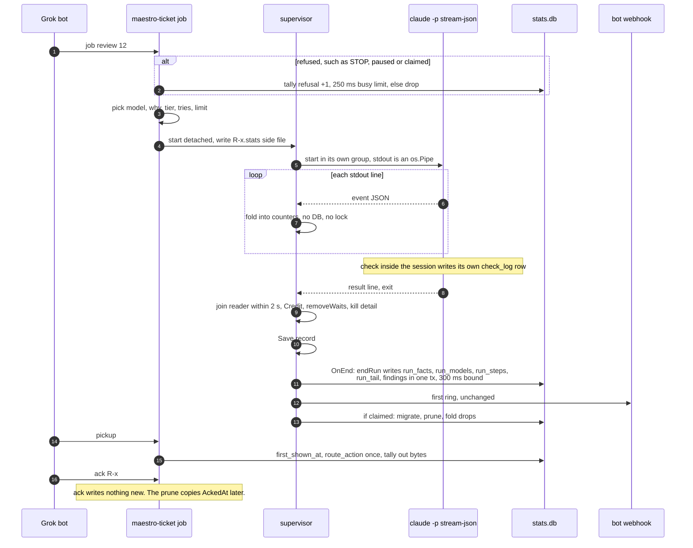

**Capture order:**
- **Slot wait.** `run()` calls `removeWaits` at **runs/supervise.go:181** and computes `Credit` only when the timer fires **[:160-165]**. The supervisor must call `Credit` once before `removeWaits` and put the result in the side file.
- **Kill detail.** The kill path sets no field today **[:182-205]**. The supervisor adds `stop` and `escaped` to the side file.
- **Ordering.** `Supervise` saves, then calls `OnEnd`, then rings **[code: runs/supervise.go:77-89]**. The run-end tx is bounded at 300 ms. Prune and migration run after the first ring.
- **Orphans.** `ringOrphans` calls `endRun` from `pickup` and `doctor`, 8 at a time, only for `Died` runs **[code: cli/launch.go:405-462]**. In that path the stats write follows the CLI rule: 250 ms, then drop, no retries. The row says `stream=lost`.
- **The gap.** A run that ended Done, but whose supervisor died between Save and `OnEnd`, never gets `endRun`. `stats health` counts ended runs on disk that have no `run_facts` row, so the gap shows.
- **Warnings.** `endRun` prints warnings to `c.env.Stderr`, which reaches the bot in `pickup`. So a stats error never prints. It appends `<unix s> <code>\n` to `stats/drops` with `O_APPEND`. The code comes from a fixed list, never `err.Error()`, whose SQLite and OS messages carry paths.

**From a session's start to an export:**

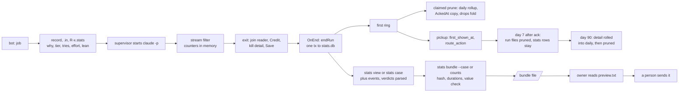

---

## 8. Reading it

| Command | Prints |
|---|---|
| `stats` | one line listing the views |
| `stats outcomes\|waste\|kickbacks\|health [--since D] [--by k] [--json]` | at most 20 rows, after one header line with drop counts |
| `stats case <ticket\|run>` | one local timeline: each run in order with job, model, why, outcome, reason, tail, open call, checks, verdict kinds, findings by id, wait and limit |
| `stats runs [--ticket T] [--job J]` | one line per run |
| `costs --by model\|job\|why\|lean` | new keys on the existing command **[code: cli/runs.go:186-196]**, read from `stats.db` |
| `stats bundle [--case T] [--since D] [--level counts\|rows] [--cost] [--out F]` | path, size, sha256 and `nothing was sent`. Never the body. |
| `stats bundle --explain <field>` | one field's type and why it is safe. `--explain --all` lists every field. |

- `--since` uses the same parser and help text as `costs` (a date, or a Go duration such as `72h`) **[code: cli/runs.go:189]**. `14d` is not accepted.
- `--by` on a view groups only by a fixed list of keys.
- The usage text gains one line: `stats [view]   local run data (see stats --help)`. The rest sits behind `stats --help`. Today the usage text is about 5 KB and prints in full on `--help` **[code: cli/cli.go:64-140]**.

**Who may run them, in code:**
- Views exit 4 with one line when `MAESTRO_TICKET_ACTOR` is one of the 7 profile names and `MAESTRO_RUN_ID` is unset. That is a Grok bot in its own shell, where every step rereads the whole chat **[code: bot-profiles/team-rules.md:7]**. Claude sessions, including a chief-of-staff `job cos` run, may run views.
- `stats bundle` exits 4 when either variable says a bot or a run.
- The chief-of-staff persona keeps pointing at `costs` **[code: bot-profiles/chief-of-staff/persona.md:27]**, and its default output doesn't change. A new `--by` key prints rows the same size as today's. `stats cost` is not added: one command answers cost questions.

```text
$ maestro-ticket stats kickbacks --since 336h
drops 14d: pickup 0.4%, check 0.1%
kickbacks 14d: 66 (review 41, qa 25) on 38 tickets
code          sev      prior          n  tickets
tests         blocker  new           27     21
spec          major    still_present 14     11
follow_up     -        -             30     19   (shipped as follow-ups)
regress       -        -              6      5   (qa: works on main, broken at H)
setup_fail    -        -              4      4   (qa: app never came up)
```

```text
$ maestro-ticket stats case 12
T-12  4 runs  3 kickbacks  $41.20 (2 runs with no result: cost from stream)
R-ab3k  build   sonnet  tier_junior  done       turns 38  checks test:pass
R-cd7q  review  opus    route_full   done       NO-GO  F1 tests/blocker new, F2 spec/major new
R-ef2m  build   sonnet  sent_back    timed_out  open Bash:npm 1,140 s  tail ... Edit Bash:npm!
R-gh9p  review  opus    route_full   done       NO-GO  F1 still_present, F3 new  mode_why redone
```

The numbers above are made up, to show the shape.

---

## 9. Privacy model

### 9.1 Classes

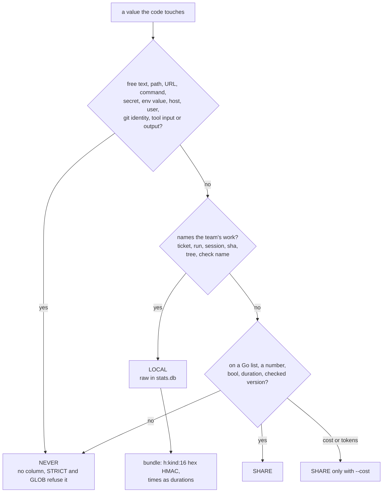

| Class | Examples | In stats.db | In a bundle |
|---|---|---|---|
| Never | prompt, reply, stderr, ticket title, body, comment, note, `--drop-file` reason, paths, file:line, diffs, check commands, `cwd`, MCP server names, slash commands, branch, PR URL, repo or org, webhook URL, launcher text, git name, raw model ids off the list | no | no |
| Local | ticket, run and session ids, sha, tree, check name, clock times | yes | hashed, or as durations |
| Share | job, model family, effort, tier, outcome, reason, step codes, verdict kinds, finding ids, counts, ms, bytes, checked versions, OS, arch, disk % | yes | yes |
| Share, opt-in | USD and tokens. Spend shows team size and budget. | yes | only with `--cost` |

### 9.2 Narrow decoders

- **Every reader decodes into a struct that declares only the fields it keeps.**
- **The stream filter** reads `type`, `subtype`, usage numbers, content block `type` and `name`, `tool_use_id`, `is_error` and `parent_tool_use_id`. For Bash, it reads the command only long enough to match it against the lists in section 4. It drops the line once it has the code.
- **The verdict parser** returns typed enums and numbers.
- **The launcher reduction** is one Go function. It compares exact strings with the 7 profile names and sends everything else to `person`, before any write.

### 9.3 Hashing and versions

- **Salt.** `stats.salt` holds 32 random bytes, mode 0600. It is written to a temp file and linked without replace, so two first writers agree. It is never printed. Mode 0600 doesn't stop the same user (decision 12). The salt keeps hashes from being looked up off the machine.
- **Hash.** `h:<kind letter>:` plus the first 16 hex of `HMAC-SHA256(salt, kind + "\0" + value)`. Kind letters: `t` ticket, `r` run, `s` session, `c` check, `g` sha or tree, `i` install. A raw sha can't take this form. `Hash` is a struct with an unexported field, and only the HMAC function can build one.
- **Install id.** `h:i:...` of an empty value.
- **`v_maestro`** is accepted only when it equals `install.yaml`'s `maestro-sha` and `git -C .maestro/src cat-file -e` finds it. **`v_tool`** gets the same check. Any other value becomes `other`. A raw team commit sha would point to a public repo and name the team.
- **`v_claude`** must be strict semver, digits and dots only.

### 9.4 Bundles

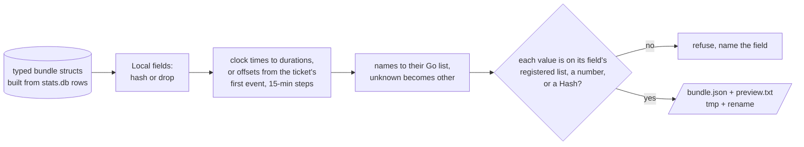

- **`--case T`** packs the share-class rows of one ticket's runs: the `stats case` timeline with hashed ids. It prints the case hash it used (`case h:t:a3f9c1e02b7d4410`), so the owner can name the case in the feedback. **This is the default answer to a feedback report.**
- **`--level counts`** (default for trends) is built only from typed structs with fixed group keys. It never uses a view's printed rows or a user-chosen `--by`.
- **`--level rows`** adds per-run rows with hashed ids.
- **No absolute time goes in a bundle.** The header gives the span as a day count. `daily` rows carry the UTC date only. `pauses.resets_at` goes as a duration rounded to the hour.
- **`preview.txt`** is capped at about 2 KB of counts a person can read. `bundle.json` is meant for maintainers' tools, not for a model to read.
- **`stats --from`** (merging bundles) waits until 2 or more bundles arrive. When it lands, it runs the same check on every file it reads and refuses one that fails. Bundles from other teams are outside content.

### 9.5 Enforced in code

1. **Schema lint.** STRICT tables, integer enums, GLOB on every id-shaped TEXT column (6.3).
2. **Bundle type lint.** A reflect test walks every bundle struct. Allowed: `int64`, `float64`, `bool`, `Duration`, `Enum[T]` with a registered list, `Hash`. A plain `string` fails the build.
3. **Value check.** Before writing, and on every file `--from` reads, each value must be on its field's registered list, be a number, or parse as `h:<letter>:<16 hex>`. A bare 12-hex or 40-hex string fails.
4. **Marker test.** Plant markers that pass every allowed shape:
   - a lowercase word, `zqmark7`;
   - the hex values `deadbeefcafe` and a 40-hex sha;
   - the model id `claude-zqmark`;
   - a raw 12-hex tree.

   Plant them in titles, bodies, notes, comments, replies, prompts, stderr, `--drop-file` reasons, launcher and actor names, check names, MCP server names, team skill names, slash commands, the init line's `cwd`, branch names, `ANTHROPIC_MODEL`, `Dir`, `Host`, and tool input and output. Grep every bundle **and `stats.db`** for them. Never-class markers must miss both.
5. **Never-reads test.** Stats code never opens `.in`, `.err`, `notify/`, `backups/`, `handouts/` or `~/.claude`. It reads `project-setup.md` only for the index match (section 4). The SQL rules from 5.7 apply.
6. **Deps test.** `go list -deps` of the stats package holds no `net`, `net/http` or `runs`. `cli` passes it plain typed structs.
7. **Ring pins.** A reflect test checks that `runs.Notification` has exactly Text, Run, Ticket, Launcher and State **[code: runs/notify.go:151-158]**. A golden test pins `Notice()` text.
8. **Bot and run guards** from section 8. They guard against slips, not a hostile session: any session can `env -u` a variable or read `stats.db` straight off disk. A renamed bot also gets past them.
9. **Output pins** (10.2).

### 9.6 Trust boundary

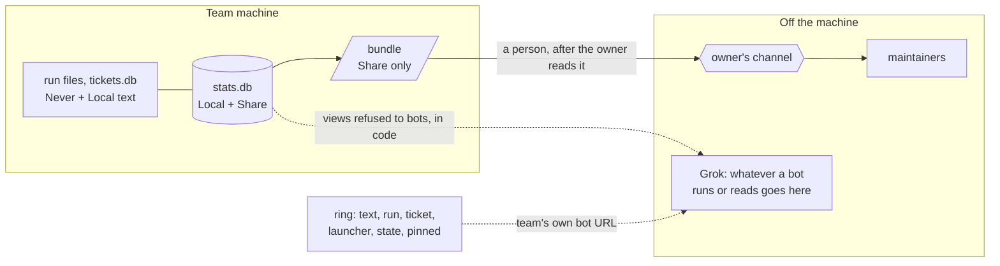

- **Grok is off the machine.** What a bot runs, it sends upstream. So the bot refusal in section 8 is code, not prose.
- **The shared Maestro repo:** every team's gh login can read the private ProlesDei/maestro repo (INSTALL.md:20,29). An issue there would show one team's bundle to every other team. The channel is the owner's call (open call 3).
- **Out of scope here:** raw text Maestro already keeps forever (open call 11).

---

## 10. At swarm scale (300 sessions)

### 10.1 Pressure and bounds

| Pressure | What happens | Bound |
|---|---|---|
| 300 runs end in one minute | each supervisor writes one tx of about 50 rows | about 1-3 ms each, so under 1 s of lock in total (guess); `tickets.db` untouched |
| Stream filtering | one goroutine per supervisor, nothing shared, no DB in the loop | about 4 KB of counters per run |
| Refusal storm (14,321 in an hour in the load test, git f37477f) | one upsert each | about 4 writes a second; dropped on busy |
| `look`, `pickup`, `job` | one `out` tally upsert, plus one `look_log` row per look | about 1 row per role per command per day, plus one per look |
| Busy lock | `busy_timeout` 250 ms. The CLI drops the write and appends a code to `stats/drops`. The supervisor retries twice with jitter inside that bound. | stats never fails or blocks a command |
| Low disk | inserts stop when `envcheck.Headroom` fails **[code: envcheck/disk.go:50-69]**. Deletes and prune go on. | stats never fills a disk. Low-disk refusals go uncounted; `health` shows disk % from `run_facts`. |
| Growth | about 2 KB per run (guess) | 9,600 runs a day is about 19 MB a day. The 256 MB live cap holds about 13 days; `daily` keeps the trend. |
| Names | one `stats.db`, one salt, rows keyed by run id or day; bundles named `bundle-<install hash>-<date>-<rand4>.json` | nothing collides, no file per session |
| Drop bias | drops cluster under load, when stalls happen | each view's header prints drop counts, so Q5 and Q12 show their gaps |

### 10.2 Tests

**Concurrency test** (shared state): 300 processes run `endRun` against one `stats.db` while 50 claim and transition on `tickets.db` and 20 run `check`, all under `-race`. Pass means:
- 300 `run_facts` rows;
- zero command failures;
- a drop rate under 1%;
- claim p99 latency within 5% of a run with stats off;
- one prune per hour, however many supervisors try.

**Output pin.** Golden tests (added in PR 1; none exist today) cover `check`, `job` (including refusals), `look`, `pickup`, `ack` and `runs`, text and `--json`, and a failed run as well as done ones. Each is run with `stats.db` missing, locked, corrupt, read-only and on an old or newer schema, and with `STATS_OFF`. Stdout and stderr must match the stats-off run byte for byte. A stray 15-token warning in `check`, which a review or QA session runs 3-8 times, would cost 13k-36k tokens per 300 sessions before rereads, and could also send a model off to look into it.

---

## 11. Token cost

**Weights.** Cache read 0.1x, cache write 1.25x, output 5x the input price. "Weighted" below means input-equivalent tokens. Dollars = weighted × the team's input price. The $ column assumes $5 per million input tokens as an example only (guess; use the team's plan).

| Item | Per session | × 300 sessions | Grok tokens |
|---|---|---|---|
| Run-end capture (S1, S2, S4, S8) | 0: Go, after exit | 0 | 0 |
| Stream filter (S3) | 0, proven by the exact test below | 0 | 0 |
| Command facts (S6) | 0: output pinned (10.2) | 0 | 0 |
| Read-time parsing (S5, S7) | 0 | 0 | 0 |
| `stats` views and bundles | 0 in bot loops: code refuses bots | 0 | 0 |
| One extra usage line | about 12 tokens, only when a session reads `--help` | about 0 | 0 |
| **Total** | **0** | **0** | **0** |

**R0 exact token test** (replaces the 5 + 5 sampling, which noise of 10-50% between agentic runs could not decide):
- Run one fixed prompt with `--max-turns 1`, once with `--output-format json --verbose` (whose array holds the first assistant message **[code: cli/runs.go:36-38]**) and once with `stream-json --verbose`.
- Assert that the first assistant message's input + cache_creation + cache_read are equal.
- Diff the `.err` bytes of the two flags on a failing fixture too. They must be equal, since stderr reaches bots: a 2 KB tail goes into `r.Error` **[code: runs/supervise.go:236-240]**, pickup prints it, and `outcomeOf` matches disk-full text in it.
- Cost: 2 short runs of about one system prompt each (guess: 20-30k tokens per Claude version). PR 6 reruns it on built code. `stats health` flags any `v_claude` that hasn't been probed. A maintainer reruns the probe script then; nothing runs on its own.

**Priced options we turn down for now** (all guesses; a 60-turn session at 50-100k context is about 300k-600k weighted tokens, for scale):

| Option | Cache read | Cache write | Output | Weighted × 300 | $ × 300 at the example price |
|---|---|---|---|---|---|
| Category tag on each review finding (30 tokens of skill text, 3 output per finding, about 8 findings) | 30 × 60 turns × 300 = 540k | 30 × 300 = 9k | 24 × 300 = 7.2k | 54k + 11k + 36k ≈ 101k | ≈ $0.51 |
| One-line retro on the final reply (25 tokens of prompt, 30 output) | 25 × 60 × 300 = 450k | 7.5k | 9k | 45k + 9k + 45k ≈ 99k | ≈ $0.50 |
| Chief of staff logs each owner card | one extra Grok step per card, priced at the chat's size then: 20-50k Grok tokens per card | | | 10 cards a day ≈ 200k-500k Grok tokens a day | Grok price |
| Bots running `stats` views (now refused in code) | one view of about 250 tokens, reread over about 40 later steps ≈ 10k Grok tokens a call; a full dump of about 3k tokens ≈ 120k | | | avoided | avoided |

The escalation code word is gone: Go derives those causes for free (5.6).

---

## 12. How data reaches maintainers

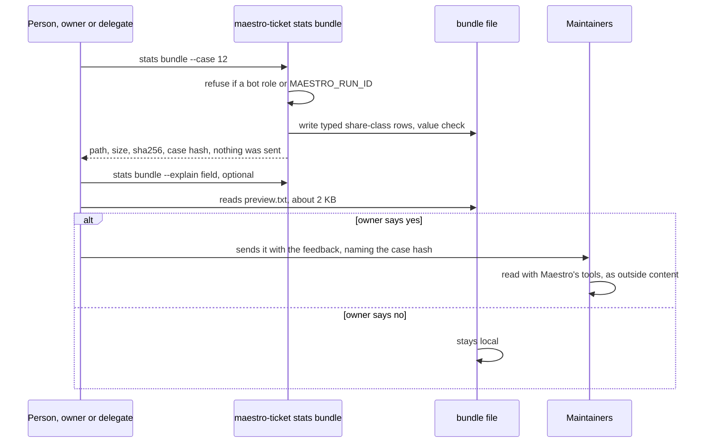

- **Bundle header:** install hash, `bundle_schema`, checked `v_maestro` and `v_tool`, the Claude versions seen, the span in days, the flags used, and a sha256 of the body.
- **No send code**: see decision 23, backed by the deps test (9.5, item 6).
- **Maintainers treat bundles as data**, under AGENTS.md "Outside content".

---

## 13. Rollout

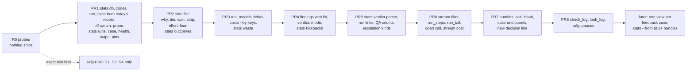

| Step | Change | Proof before it ships |
|---|---|---|
| **R0** | Nothing ships. Probes in a scratch repo. | Exact token test and `.err` diff (section 11). JSON keys (`modelUsage`, `costUSD`, `stop_reason`). Init line version field. A compaction event. Real per-turn usage. `vcs.revision` from `go install`. EPIPE on macOS. STRICT in modernc. |
| **PR1** | `stats.db`, `codes`, STRICT schema, `run_facts` from fields the Record already has, prune (6.4), off switch (`install.sh`, INSTALL.md), the work-tree guard, `stats runs\|case\|health`, `stats/drops` | `go test -race ./...`, schema lint, output pins under every failure (10.2), deps test, ring pins, concurrency test, `bash scripts/install_test.sh`, shellcheck |
| **PR2** | `<id>.stats` side file, `runs.Prune` removes it, the `why` enum at its decision sites, `stats outcomes` | `job_test` env unchanged. `--json` output of `runs` and `pickup` unchanged. |
| **PR3** | `run_models` with deltas, `costs --by model\|job\|why\|lean`, `stats waste` | Two runs of one resumed session sum to the session total. Zero-cost crash clamp. Default `costs` output unchanged. |
| **PR4** | Findings with `fid`, drop ids, verdict, tier, mode, `mode_why` from review-prep's key file, `stats kickbacks` | Fixtures from passes.md. Marker test on `--drop-file` text. |
| **PR5** | Stats-only verdict parser, `verdictRows`, run links, `Posted-by` on the review time-out note, QA counts, escalation kinds | Fixtures run through both the parser and route's checks. route_test pins the new comment line. SQL never-reads test. |
| **PR6** | `stream-json --verbose` in `claudeCommand`, the filter, `run_steps`, `run_tail`, open call, stream token sums | R0 exact test on built code. `.out` holds no init line. A stopped init-only run frees its claim with today's pickup bytes. A grandchild that holds the pipe doesn't delay `done`. A slow `stats.db` never stalls the pipe. `job_test` pins the flag **[code: cli/job_test.go:139-150]**. The generated skill list matches `skills/`. |
| **PR7** | Salt, `Hash`, typed bundles, `--case`, counts, `--cost`, preview cap, `--explain <field>`, the new decision line | Reflect lint, value check, marker test on bundles and `stats.db`, bot and run refusals |
| **PR8** | `check_log`, `look_log`, `tally`, `pauses` | Output pins on `check`, `look`, `job`. Concurrency test with `check`. |

Each PR runs `go test -race ./...`, `gofmt -l .` and `go vet ./...` in `tools/maestro-ticket/`.

---

## 14. Open calls for the owner

1. **Local capture on by default?** *Recommend yes.* `stats: off` in `install.yaml` turns it off (6.2), and INSTALL.md tells the person what is kept. It holds no Never-class data and costs 0 tokens.
2. **Switch Claude jobs to `stream-json` once R0's exact test passes?** *Recommend yes.* It is the only free source of step data, and it is scoped to `claudeCommand`.
3. **Which channel carries bundles?** *Recommend by hand, to a place only maintainers read,* such as email or a per-team private intake repo. Not issues on the shared private repo, which every team can read.
4. **Cost in bundles?** *Recommend opt-in with `--cost`.* Spend shows team size and budget.
5. **Default bundle?** *Recommend `--case` for a feedback report and `counts` for a trend.* Use `rows` only when a maintainer asks for a join across teams.
6. **Times in bundles?** *Recommend durations, offsets from a ticket's first event in 15-minute steps, and UTC dates.* No clock time, so no working hours or time zone.
7. **Stable salt or a new one per bundle?** *Recommend stable,* so trends and case hashes match across bundles. `--rotate-salt` gives a fresh start.
8. **Retention: 90 days or 256 MB of live detail, 400 days of `daily`?** *Recommend as written.*
9. **Signals that cost tokens** (finding category tag, one-line retro)? *Recommend no for v1.* Each is about 100k weighted tokens per 300 sessions (section 11). After 30 days, check whether the derived reasons in 5.6 answer Q2 well enough.
10. **A chief-of-staff log of owner cards?** *Recommend not yet.* Each card costs a Grok step at the chat's size, 20-50k tokens. `Sent up:` and `Answer:` verdicts cover what reaches tickets.
11. **Cap the raw text Maestro keeps forever today** (unacked run files, `idempotency` results, pre-schema snapshots)? *Recommend yes, as a separate ticket.*
12. **If R0's exact test fails?** *Recommend shipping PR1-PR5 and PR7-PR8 without step data,* and no localhost OTel receiver. It would be a new listener in every supervisor, and it turns custom skill names into `custom`.
13. **Add `Posted-by:` to the review time-out note (cli/route.go:609)?** *Recommend yes, in PR5.* It is one line on a rare comment, and it makes the run link exact.

---

## 15. What Maestro still can't see

- **Grok-side spend.** We count only the bytes Maestro prints to bots (Q14).
- **Owner chat and chief-of-staff memory**, which live in Grok.
- **Which skill phase a session was in**, beyond the step trail. `R:`, `X:` and `mt:` codes come close.
- **Why a renamed bot or a hostile session did something.** The guards stop slips, not intent (9.5, item 8).

---

## 16. Verified vs assumed

| Claim | Status |
|---|---|
| `ParseOutput` takes any line with a `session_id`, scanning from the end | **[code: runs/runs.go:446-470]** |
| `endRun` keeps the claim for a `Failed` run with a session id | **[code: cli/launch.go:394]** |
| Today stdout goes straight to a file, and the supervisor reads `.out` right after `done` | **[code: runs/supervise.go:124, 146, 219-220]** |
| `OnEnd` runs after Save and before the first ring | **[code: runs/supervise.go:77-89]** |
| `removeWaits` runs in `run()`, and `Credit` only when the timer fires | **[code: runs/supervise.go:160-165, 181]** |
| `claudeCommand` passes `--output-format json`, plus effort and lean, only in argv | **[code: cli/job.go:101-107]** |
| `install.sh` dies on an unknown `install.yaml` key | **[code: scripts/install.sh:138]** |
| The `STOP` marker sits beside the store and is checked with `Lstat` | **[code: sqlitestore/sqlitestore.go:334-341]** |
| The low-disk test is `envcheck.Headroom` | **[code: envcheck/disk.go:50-69]** |
| `events` holds `type`, `actor`, `data`, `created_at`, and comments carry no run id column | **[code: sqlitestore/sqlitestore.go:65-81]** |
| `postedBy` exists, and the review time-out note at route.go:609 lacks it | **[code: cli/route.go:609, 756]** |
| `resetEpoch` and `resetText` both exist | **[code: cli/route.go:66-67]** |
| `runs.Prune` removes a fixed list of extensions | **[code: runs/runs.go:409]** |
| Check names are lowercase, digits and hyphens | **[code: cli/check.go:63]** |
| `costs --since` takes a date or a Go duration | **[code: cli/runs.go:189]** |
| The ring body has 5 fields | **[code: runs/notify.go:151-174]** |
| `ticket.Roles` has 6 roles; bots use the 7 profile names as actor | **[code: ticket/ticket.go:296; bot-profiles/*/persona.md]** |
| The chief of staff runs `costs` itself | **[code: bot-profiles/chief-of-staff/persona.md:27]** |
| Grok rereads the whole chat each step | **[code: bot-profiles/team-rules.md:7]** |
| review-prep prints `mode_why` as free text with a sha | **[code: skills/maestro-code-review/scripts/review-prep.sh:307-354]** |
| Golden output tests exist today | No. PR1 adds them. |
| CLI result keys match the SDK type (`modelUsage.*.costUSD`, `stop_reason`) | (guess) R0 |
| `stream-json` leaves model tokens and stderr unchanged | (guess) R0 exact test |
| The init line carries the version; a compaction event exists | (guess) R0. Fallback: one cached `claude --version` a day |
| Per-turn usage in assistant messages is real | (guess) R0 |
| modernc.org/sqlite v1.61.0 supports STRICT | (guess) R0 |
| `go install` stamps `vcs.revision` | (guess) R0 |
| EPIPE on macOS ends a run that is an orphan anyway | (guess) R0 |
| Backticked lines under `## Run`, `## QA` and `## Checks` parse well enough for the index match | (guess) PR6 |
| Row counts, write time, growth and prune throughput | (guess) PR1 measures |
| A died run with a changed boot stamp means a reboot | (guess) PR2 |

---

## Appendix: sample queries

`v_*` are SQL views that join `codes` to show names. `stats` works out medians and p90 in Go, as `costs` does. `verdicts` is the in-memory table from 5.7. `events` comes from `tickets.db`, attached read-only, through `json_extract` only.

**Q1: where tokens go** (behind `costs --by`)
```sql
SELECT f.job, f.why, f.lean, m.model, count(DISTINCT f.run) runs,
  sum(m.input+m.output+m.cache_read+m.cache_write) tokens, round(sum(m.cost_usd),2) usd,
  round(1.0*sum(m.cache_read)/nullif(sum(m.input+m.cache_read+m.cache_write),0),2) cache_hit
FROM v_run_facts f JOIN v_run_models m USING(run)
WHERE f.started_at > :since GROUP BY 1,2,3,4 ORDER BY usd DESC LIMIT 20;
```

**Q2 and Q9: kickback reasons, and the findings that fell**
```sql
SELECT r.kind, r.pass, r.sev, r.prior, sum(r.n) n, count(DISTINCT f.ticket) tickets
FROM v_findings r JOIN v_run_facts f USING(run)
WHERE f.head = 'review:nogo' AND f.started_at > :since
GROUP BY 1,2,3,4 ORDER BY n DESC LIMIT 20;

SELECT f.ticket, r.fid, r.pass, r.sev FROM v_findings r JOIN v_run_facts f USING(run)
WHERE r.kind = 'dropped' AND f.started_at > :since;
```

**Q3: where bad runs ended**
```sql
SELECT job, outcome, reason, open_code, count(*) n, avg(open_ms)/1000 open_s
FROM v_run_facts WHERE outcome <> 'done' AND started_at > :since
GROUP BY 1,2,3,4 ORDER BY n DESC LIMIT 20;

SELECT f.job, s.code, sum(s.calls) calls, sum(s.fails) fails, sum(s.ms_sum)/1000 secs
FROM v_run_facts f JOIN v_run_steps s USING(run) WHERE f.started_at > :since
GROUP BY 1,2 ORDER BY fails DESC LIMIT 20;
```

**Q5: results nobody saw, and lost rings**
```sql
SELECT role, rang, ring_err, count(*) n,
  avg(first_shown_at - ended_at)/60000.0 unseen_min, avg(acked_at - ended_at)/60000.0 ack_min
FROM v_run_facts WHERE ended_at > :since GROUP BY 1,2,3;
```

**Q8: a GO, then a QA fail at the same sha**
```sql
SELECT gf.why route, q.code, count(*) n
FROM verdicts g
JOIN verdicts q ON q.ticket = g.ticket AND q.sha = g.sha AND q.kind = 'kickback_qa' AND q.at > g.at
LEFT JOIN v_run_facts gf ON gf.run = g.run
WHERE g.kind = 'review_go' AND g.at > :since GROUP BY 1,2 ORDER BY n DESC;
```

**Q10: slow and flaky checks**
```sql
SELECT name, count(*) runs, sum(result='fail') fails, sum(result='carried') carried,
  avg(took_ms)/1000 avg_s, max(took_ms)/1000 max_s,
  (SELECT count(*) FROM (SELECT tree FROM v_check_log c2 WHERE c2.name = c.name
     GROUP BY tree HAVING sum(result='pass') > 0 AND sum(result='fail') > 0)) flaky_trees
FROM v_check_log c WHERE at > :since GROUP BY name ORDER BY max_s DESC;
```

**Q11: spend on reruns** (the dead-run split from 5.2 is applied in Go)
```sql
SELECT CASE WHEN resume_of IS NOT NULL THEN 'resume:'||coalesce(nudge,'plain')
            WHEN again_of IS NOT NULL THEN 'again' WHEN after_death THEN 'after_death'
            WHEN tries > 0 THEN 'send_back' ELSE 'first' END kind,
  cost_src, count(*) runs, round(sum(cost_usd),2) usd
FROM v_run_facts WHERE started_at > :since GROUP BY 1,2 ORDER BY usd DESC;
```

**Q13: releases**
```sql
SELECT v_maestro, v_claude, job, count(*) n, round(avg(outcome='done'),2) done_rate,
  round(avg(cost_usd),2) usd, avg(turns) turns
FROM v_run_facts WHERE started_at > :since GROUP BY 1,2,3 ORDER BY 1 DESC;
```

**Q14: the costliest looks**
```sql
SELECT at, bytes, sends, judge_rows, builds_started, errors, took_ms
FROM look_log WHERE at > :since ORDER BY bytes DESC LIMIT 20;
```
