# Data collection: a spec for Maestro run data

**Status:** approved for v1, Nov 15 2026; open calls 1-4 and 9 accepted (section 14). This doc describes what v1 built. Section 13 lists the build steps, and the work left for later is marked "later" where it comes up.
**Labels:** **[code]** means the claim was checked in the source at the `file:line` given. **(R0)** means a real Claude Code run checked it (section 11). **(guess)** means no run has confirmed it yet. Section 16 lists each one.

## 0. The point

1. Go code that already runs writes typed facts to `stats.db`, beside the ticket store: each run's supervisor at the run's end, and `pickup` or `doctor` for a run whose supervisor died. It costs 0 model tokens and 0 Grok tokens. Output pins taken from main before any stats code hold every byte a bot or a session reads (10.2).
2. Most of the data existed and got thrown away: the result object's turns, subtype and spend per model; the run's outcome, why it got its model, its slot wait, how it was stopped. We keep it. One source is new: Claude's `stream-json` output. On Linux the supervisor sends it to `runs/<id>.stream`, reads that file once the command exits, and removes it once the run's row is written.
3. Free text can't reach `stats.db`. Every table is `STRICT`. Enum columns hold integer ids into a `codes` table that only Go's lists fill, and each TEXT column has a GLOB check on its shape. Marker tests plant words, hex, model ids and numbers (a ticket id, an epoch) everywhere, then grep `stats.db`, its WAL and every bundle.
4. Nothing leaves the machine on its own. Maestro has no send code ([decision 24](../decisions.md)). `stats bundle --case T` writes one ticket's runs to a file, with labels for ids and 15-minute offsets for times, and prints only its path, size, sha256 and row counts. Only a person runs it, and a person sends the file after the owner's yes.
5. v1 shipped on one branch as one probe (R0), seven build steps (C0-C6) and a merge of main, with three views (`stats case`, `stats health`, `stats costs`) and the case bundle.

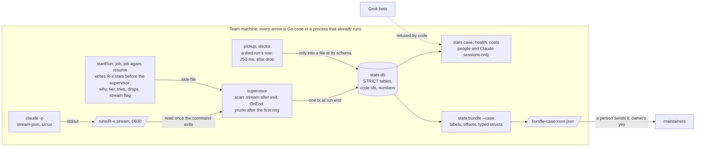

---

## 1. Rules this design keeps

This section links each rule and says how the design keeps it. It does not restate the rules.

| Rule | How this design keeps it |
|---|---|
| [Decision 1](../decisions.md) | No daemon, cron or uploader. Writes happen in the supervisor, which already lives as long as its run, or in `pickup` and `doctor`, which already end a died run. The ring body stays the same; `TestNotificationFields` and `TestNoticeGolden` pin it. |
| [Decision 15](../decisions.md) | Capture follows `job`, `job again` and `resume` under `launch`, keyed on the run ids `launch` issues. |
| [Decision 17](../decisions.md) | A bundle carries versions, so maintainers can tell teams' releases apart. A case bundle shows one team's case as a case. |
| [Decision 19](../decisions.md) | No bot step is added. `pickup`, `doctor`, `runs`, `job`, `job again`, `resume`, `look`, `check`, `ack`, `costs` and `--help` print the same bytes, text and `--json`, against masked goldens taken from main (C0): `pickup`, `doctor`, `runs`, `ack`, `costs` and `check` under all seven stats states, and `job`, `job again`, `resume` and `look` under off and broken (10.2), and `--help` once (`TestPinUsage`). Records keep `--output-format json`; the supervisor swaps in `stream-json --verbose` only when it starts the command (section 4). Code refuses `stats` views to bots (section 8). |
| [Decision 9](../decisions.md) | Enum lists live once, in Go. `stats.db` holds a copy that grows by insert, never by rebuild (5.0). The rule that stats stay local is [decision 24](../decisions.md), added in C1; this doc links to it. |
| [Decision 8](../decisions.md) | `install.sh check` stays read-only. `apply` gains one key, `stats:` (6.2). |
| [Decision 12](../decisions.md) | All sessions run as one user with all permissions, so the bot and run checks on views and `bundle` guard only against slips. The real guards are the lack of send code and what a bundle can hold (9.6). |
| Swarm scale (AGENTS.md) | No prompt, skill or persona grows. The only writer outside a supervisor is the orphan path in `pickup` and `doctor`: 250 ms, then drop. Create and migrate happen only in a supervisor. Prune runs after the first ring. |
| Runs in someone else's repo | Nothing goes in the work tree; stats files sit beside the store, which defaults to the git dir. A store on a filesystem that failed its checks gets no stats. We never touch `.claude/settings.json` or hooks. |
| Rule in code before prose | STRICT tables and a schema lint, narrow decoders with field allowlist tests, a reflect lint on bundle types, a value check, marker tests, deps and import scans, and output pins (9.5). |

---

## 2. Questions this answers

Every field answers at least one question here. In the v1 column, **view** means a command answers it, **data** means v1 stores the facts and `stats case` or an appendix query in `sqlite3` answers it, and **later** means the data or its source isn't built yet.

| # | Question | Answered with | v1 | Answered by |
|---|---|---|---|---|
| Q1 | Where do tokens and dollars go, by job, model, route and cache TTL? | `stats costs --by model\|job\|why\|lean` | view | `run_models`, `run_facts` |
| Q2 | Why do kickbacks happen? | `stats case`, appendix | data, review findings only | `findings` |
| Q3 | Which skill steps fail or stall? | appendix | data | `run_steps`, `tail`, `open_code` |
| Q4 | What share of runs end badly, and how? | `stats case`, appendix | data | `outcome`, `reason`, `subtype`, `stop` |
| Q5 | Where do tickets stall, how long do results sit unseen, and do lost rings explain it? | | later | events, `rang`, `ring_err` (v1 stores these two) |
| Q6 | How high do escalations climb, and how long does each rung take? | | later | parsed verdicts, `nudge`, `why` |
| Q7 | How long from created to done, and how many loops? | | later | events |
| Q8 | Which review GOs fail QA later at the same sha, and on what? | | later | parsed verdicts joined on sha |
| Q9 | Which kickback findings were false (dropped), by id? | `stats case`, appendix | data | `findings` with `fid`, kind `dropped` |
| Q10 | Which checks are slow or flaky? | | later | `check_log` |
| Q11 | How much spend goes to reruns, dead runs included? | appendix | data | `run_models`, `cost_src`, `resume_of`, `again_of` |
| Q12 | How often do refusals and usage-limit storms happen? | | later | `tally`, `pauses` |
| Q13 | Did a release make things better or worse? | appendix | data | `v_maestro`, `v_tool`, `v_claude` |
| Q14 | How much text do bots read, and which look cost the most and why? | | later | `tally` kind `out`, `look_log` |
| Q15 | How often is the owner asked, and how fast do they answer? | | later | parsed `Sent up:` and `Answer:` |
| Q16 | How big do contexts get, and how often do sessions compact, retry or fan out? | appendix | data | `ctx_peak`, `compactions`, `retries`, `subagents` |
| Q17 | Is the machine near its limits when runs fail, and is capture healthy? | `stats health` | view | `disk_free_pct`, `inode_free_pct`, missing rows |
| Q18 | What happened on the one ticket a feedback report names? | `stats case T-12`, `stats bundle --case T-12` | view | every table, for that ticket |

Q2, Q3, Q8 and Q11 come from the live retros: 42 of 66 kickbacks said a test missed the change, 30 of 66 cited defects already on main, reruns cost 40% of spend, and 71 of 144 handoffs bounced (git 7636851, 614d111). Q17 covers the Nov 12 inode exhaustion (git ea768d6). Q18 is how feedback reaches the data: reports name a ticket, a PR or a time.

The later questions wait on sources v1 doesn't read. Verdict comments (S5) and ticket events (S7) stay in `tickets.db` forever, so a later parser covers all past data. Command facts (S6) start only when their writer ships.

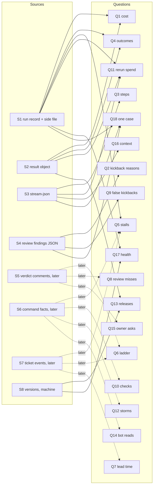

---

## 3. Data sources

No source here costs model tokens. Claude Code's harness writes the result object and the stream, not the model. Everything else is Go.

| # | Source | What it gives | How it is captured | Privacy class | v1 |
|---|---|---|---|---|---|
| S1 | Run record, plus a side file `<id>.stats` | From the record: job, start, end, exit, state, resume_of, nudge, after_death, rang. Model, effort and lean, parsed from `Record.Command` by one function (`argvFacts`). From the side file: why, tier, tries, again_of, drop ids, prompt_bytes, the stream flag. From the supervisor: slot wait, stop kind, escaped count | `startRun` writes the side file through tmp + rename after `runs.Create` and before the supervisor starts, so a run that ends at once still has it; a plain `launch` writes an empty one, which only marks that stats were on as it started; stats off writes none. The supervisor's end facts sit on `Record.End`, tagged `json:"-"`, so no record, `runs` or `pickup` byte changes. `runs.Prune` removes `.stats` | Share (ids Local) | built |
| S2 | Claude's result object | subtype, is_error, stop_reason, duration_ms, duration_api_ms, num_turns, per-model `modelUsage` with costUSD | `endRun` already reads it; `claudeReply` gained fields whose decode never fails | Share; cost is opt-in in bundles | built |
| S3 | `stream-json` events, `job`, `job again` and `resume` runs on Linux | step codes, tool calls and fails with ms, the call open at the end, the last 24 calls, subagents, API retries, compactions, peak context, per-turn usage, Claude Code version | stdout goes to `runs/<id>.stream`; the supervisor scans it once the command exits (section 4) | Share (fixed code lists only) | built |
| S4 | Review findings JSON in the reply | per finding: id, pass, severity, action, prior; per run: verdict, tier, mode; a count of `## Follow-ups` lines; dropped ids | `endRun` reads the reply it already holds (`cli/statsreview.go`) **[format: skills/maestro-code-review/references/passes.md]** | Share | built |
| S5 | Verdict comments | kind, blockers, sha, escalation kind, QA item counts | Read-time parse of `tickets.db` (5.7) | Share (sha Local) | later |
| S6 | Command facts | `check` result and ms, `job` refusals, first pickup, output bytes, look log, usage-limit pauses | A best-effort write in each command | Share | later |
| S7 | Ticket events | time in each status, send-backs, claims, lease expiries | Read at view time through `json_extract` on fixed keys (5.7) | Share (ids Local) | later |
| S8 | Versions and machine | `install.yaml`'s maestro-sha, maestro-ticket's `vcs.revision`, Claude Code's version, OS, arch, disk and inode free % | `stats.sha` (apply writes it), `debug.ReadBuildInfo`, the stream's init line, one statfs at run end | Share, after the checks in 9.3 | built |

**Sources we turn down:**

| Source | Why not |
|---|---|
| Claude transcripts (`~/.claude/projects/*/<session>.jsonl`) | The format is internal and can change. It holds every prompt, file and tool output, so it is the riskiest source. `stream-json` gives the same counts through a documented interface. |
| Command hooks via `--settings` | One process per tool call across 300 sessions. A team's `disableAllHooks` or `--bare` turns them off without a word, so missing data looks like a clean run. They merge with the team's own hooks, and hook output can enter model context. |
| OpenTelemetry | No file exporter. `otlp` needs a listener: a daemon (decision 1) or a new host. Custom skill names turn into `custom`. |
| Install facts from `install.sh` (choices, warn ids, time) | No question uses them. Only `maestro-sha` is kept, through `stats.sha`. |
| `doctor`'s untracked count, `slot` queue depth, `denials`, web searches, `ack` writes | No question uses them. `bypassPermissions` makes denials about always 0. |
| Signals that cost tokens (finding category tags, one-line retros, a chief-of-staff card log) | Priced in section 11. The owner said no for v1 (call 9). Go works out the review escalation causes for free (5.6). |

---

## 4. The stream filter (S3)

**Scope.** A run streams only when its side file asks for it. `startRun` sets the flag when stats are on, the OS is Linux, and the store's disk passes the same headroom test `claim` uses (`streamOK`). Only `job`, `job again` and `resume` set the flag, so a plain `launch -- <cmd>` never streams. The supervisor then swaps the exact `--output-format json` pair for `--output-format stream-json --verbose` when it starts the command (`runs.StreamArgv`). The record keeps json, so `runs`, `pickup` and `job again` read the same command as before, and a command already on stream-json is left alone. Every other run keeps today's path, and its row says `stream=off`.

**Plumbing: a file, not a pipe.** Claude's stdout goes to `runs/<id>.stream` (mode 0600), as it went to `.out` before. Nothing reads it while the command runs, so Claude never waits on Maestro, a grandchild that keeps fd 1 open can't hold `done` back (`TestStreamGrandchildHoldsStdout`), and there is no pipe to break. After `done`, and after the kill path:
1. `streamfilter.Scan` reads the file once and returns a Summary and the bytes `.out` keeps.
2. The supervisor writes those bytes to `.out`, then runs today's `ReadTail` and `ParseOutput` on it. `endRun` reads the same `.out`.
3. The Summary goes on `Record.Stream`, tagged `json:"-"`.
4. The supervisor removes `.stream` after `OnEnd`. `pickup` and `doctor` remove one a dead supervisor left whenever they adopt its run, after they read it into an empty `.out` as the supervisor would have (`runs.RecoverStream`, `TestOrphanReadsStream`), and `runs.Prune` lists `.stream` too.

**Reading rules.** `Scan` reads with `bufio.Reader.ReadSlice`. It decodes each whole line into a narrow struct and takes `type` from that decode, never from a fixed prefix: R0 found that a result object's first key is not `type`. Any line may be up to 8 MB (`OutputWindow`, as today), so a big tool result still closes its call; a line past 8 MB is skipped. A last chunk with no newline is read as a line.

**What `.out` holds:** the command's own text, as it printed it (a crash message, blank lines and a last line with no newline included, 64 KB cap), then the last whole result line: the bytes `--output-format json` would have printed. A line that starts as JSON but isn't whole is a stream line cut short, the first one too, and is dropped: on stream-json, Claude Code prints no text of its own that starts with `{`. **Never the init line**, so a crashed or stopped run gets no session id from one, and `ParseOutput` reads `.out` as before **[code: runs/runs.go, `TestParseOutputRawStream`]**. A command run on stream-json itself is never swapped, and its raw stream is read as main reads it. `TestStreamInitOnlyFreesClaim`, `TestStreamPickupBytesMatchJSON` and `TestStreamTextMatchesJSON` pin this.

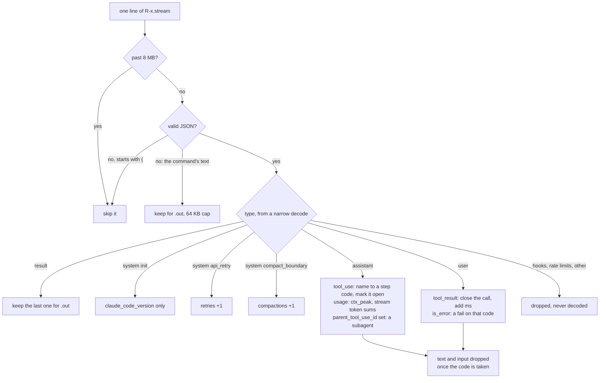

**Step codes, from fixed lists in Go** (`streamfilter/codes.go`):

| Seen in the stream | Code stored | Fallback |
|---|---|---|
| A built-in tool (Bash, Read, Edit, Write, Grep, Glob, Task, Agent, WebFetch, ...) | the tool name, from a hand-kept list | `mcp` for `mcp__*`, else `other` |
| The Skill tool naming one of the 19 shipped skills | `S:maestro-code-review` | `S:other` |
| Read of a shipped skill's `SKILL.md` or `references/<file>.md` | `R:maestro-code-review` or `R:maestro-code-review/passes`: the path shape `maestro-<skill>/references/<stem>.md`, kept only for a skill and stem on the hand-kept list | `Read` |
| Bash running a shipped script: `[bash\|sh] .../maestro-<skill>/scripts/<stem>.sh` | `X:maestro-code-review/review-prep`, kept only for a listed stem | `Bash` |
| Bash whose first word is `maestro-ticket` | `mt:<sub>`, from the CLI's command table, which `cli` passes in | `Bash` |
| Bash whose first word is `git` or `gh` | `git:<sub>` for push, commit, merge, worktree; `gh:pr-<sub>` for `gh pr` checks, comment, create, diff, edit, merge, ready, review, view, and `gh:pr` for any other `gh pr` | `Bash` |
| Bash whose first word is npm, pnpm, yarn, go, make, pytest, cargo, docker or playwright-cli | `Bash:<word>` | `Bash` |

The filter strips leading `cd <x> &&` and `VAR=value` words before it matches. `TestSkillListMatchesRepo` holds the hand-kept skill list to `skills/`, so a new skill or file shows up as a failing test, and until the list catches up it reads as `S:other`, `Read` or `Bash`, never as text. Team setup commands get no code of their own: that would need a parse of each team's `project-setup.md` (later).

**At run end** the filter hands over:
- counters per code (calls, fails, ms sum and max);
- the last 24 calls, each with a fail mark;
- for a run with no result line, the oldest call still open, if any (`open_code`, `open_ms`): for a killed run, the call that hung (`TestStreamTimedOutKeepsOpenCall`);
- summed per-turn usage per model family, which becomes the run's `run_models` rows (`cost_src=stream`) when it gave no result.

**Failure modes:**
- **The supervisor dies mid-run.** On Linux, Pdeathsig sends SIGTERM to the child **[code: runs/sys_linux.go]**. `pickup` or `doctor` marks the run died, reads `.stream` into an empty `.out` as the supervisor would have, so a result Claude printed still logs its cost, then removes it. The row says `stream=ok` or `no_result`, or `stream=lost` when the file is gone and the command had started (a pid on the record); one that never started had no stream, and says `off`.
- **No result line** (timed out, killed, a result past 8 MB): the row says `stream=no_result`, and the claim is freed as for any run with no result (`TestStreamHugeResult`).
- **macOS and the BSDs.** No Pdeathsig, so a dead supervisor would leave Claude writing to a file no one reads. They keep json (later, once a Mac can run the probe).
- **Disk.** A whole transcript sits on disk until the run ends. R0 put the largest session on this box at 16.8 MB; 300 of those is about 5 GB, under `envcheck.FloorBytes` (10 GB), and the stream flag needs headroom at the run's start. A run that hits ENOSPC fails as `disk_full`, as today.

---

## 5. What is captured

**Class key.** **S**: Share, may go in a bundle. **L**: Local, stays on the machine; a bundle carries a label or an offset in its place, or leaves it out. Never-class data has no column at all.

### 5.0 How values are stored

- **Every table is `STRICT`.** SQLite then refuses a text value in an INTEGER column (R0: modernc.org/sqlite v1.61.0 bundles SQLite 3.54.1; `TestStrictRefusesText`).
- **Enum columns are INTEGER ids into `codes(id, kind, name)`, UNIQUE on (kind, name).** Go's fixed lists (`statsLists` in `cli/statsrun.go`) are the only source of names (decision 9). Any name off its list is stored as `other`.
- **`codes` grows by insert, never by rebuild.** `Prepare` seeds the lists with `INSERT OR IGNORE`, and only when `meta.codes_version` differs from the hash of the lists. A name a later binary drops keeps its id, so old rows still read. A new job kind needs no migration.
- **Create and migrate** run under BEGIN IMMEDIATE, with `user_version` read again inside the transaction, so many supervisors can race at once (`TestPrepareRace`).
- **The few TEXT columns are id-shaped**, each with an exact GLOB, and Go checks the same shape first so a bad value goes in as NULL. Run id: `R-` plus 8 of `[a-z2-7]`. Session: uuid. `v_tool`: 40 hex. `v_maestro`: 7 to 40 hex. `v_claude`: digits and dots. `fid`: `F` plus 1 to 3 digits. `tail`: code ids, spaces and `!`.
- **Every write checks `user_version` inside its transaction.** A binary that finds `stats.db` at a newer schema drops its write (`TestNewerSchemaDrops`); a supervisor started before an upgrade, which can live 24 hours, falls in this case.

### 5.1 `run_facts`: one row per run

| Field | Values | Source | Class |
|---|---|---|---|
| `run`, `session`, `ticket` | id shapes, int | S1, S2 | L |
| `role` | 7 profile names, `person`, `other`: one Go function, exact match, run before any write | launcher | S |
| `job` | `launch` plus the `jobKinds` list | S1 | S |
| `model`, `effort`, `lean` | model family (`opus`, `sonnet`, `opus-5.5`, ... or `other`), a Bedrock or Vertex id mapped as the API's own; effort list; bool | parsed from `Record.Command` by `argvFacts` | S |
| `why` | tier_senior, tier_junior, tier_none, sent_back, route_light, route_full, fixed, override (`--model` changed the pick), again, resume: set where `startJob` decides | side file | S |
| `tier`, `tries` | junior, senior, none; int. Again and resume copy them from the parent's side file | side file | S |
| `again_of`, `resume_of` | run id | side file, record | L |
| `prompt_bytes`, `drops` | int: the prompt's size, the count of `--drop` ids | side file | S |
| `nudge`, `after_death` | none, opus, escalate, decide; bool | S1 | S |
| `started_at`, `ended_at`, `wall_ms` | unix ms, ms | S1 | L (bundles carry offsets and ms only) |
| `wait_ms`, `wait_capped` | int, bool: `Credit` read once more before `removeWaits` | supervisor | S |
| `stop`, `escaped` | none, term, kill; how many processes outside the group the SIGTERM reached, NULL off Linux, where no scan counts them | supervisor kill path | S |
| `state`, `exit`, `outcome` | list; int; done, question, usage_limit, disk_full, timed_out, died, refused, failed (`outcomeOf`) | S1 | S |
| `reason` | 5.6 | Go | S |
| `subtype`, `stop_reason`, `is_error` | lists, bool | S2 | S |
| `claude_ms`, `api_ms`, `turns` | int | S2 | S |
| `head` | `<word>:<status>` from the first line the shipped skills ask a reply to open with (`review:go`, `test:pass`, `judge:done`, `design:ready`, ...), else `other`; NULL for no reply | reply first line | S |
| `verdict`, `v_tier`, `mode` | go, nogo, escalate; 0-2; full, incremental, ruling | S4 | S |
| `reply_bytes` | int | reply length | S |
| `stream` | ok, no_result, lost, off | S3 | S |
| `ctx_peak`, `compactions`, `retries`, `subagents`, `tool_calls`, `tool_fails` | int | S3 | S; `ctx_peak` is opt-in in bundles |
| `open_code`, `open_ms` | step code id, int | S3 | S |
| `tail` | the last 24 calls as code ids, `!` after a failed one: `12 7! 3` | S3 | S |
| `rang`, `ring_err` | bool; none, timeout, dns, http4xx, http5xx, other: set after the first ring | supervisor | S |
| `v_maestro`, `v_tool`, `v_claude` | checked as in 9.3 | S8 | S |
| `os`, `arch`, `disk_free_pct`, `inode_free_pct` | list, list, int, int | S8 | S |

### 5.2 `run_models`: one row per run per model family

Fields: `input_cum`, `output_cum`, `cache_read_cum`, `cache_write_cum`, `cost_cum`, `cost_src` (result or stream). From a result, each is the session's running total, which is what the result reports; from a stream, each is the run's own turns summed. Model ids map to a family list; Go accepts only ids shaped like `claude-(opus|sonnet|haiku)-<major>[-<minor>][-<8-digit date>][[1m]]` or the older `claude-3-5-sonnet-...` order, and everything else becomes `other` (`TestModelFamily`: `claude-acme-finetune-prod` is `other`). Two raw ids of one family make one row.

**A run's own spend is worked out at read time**, never stored: its session's total less the run before it in that session, by `LAG()` over (session, model). One CTE (`spendCTE` in `stats/prune.go`) does it for both the views and the prune, and `TestReadSpendMatchesPrune` holds the two to the same sums.
- A fresh session's first run, a run with no session, and a model new to a known session count their whole total.
- Once prune deletes a session's runs, `pruned_cum` keeps its last totals per model for 30 days past the 90-day line, so a later resume still counts only what it added (`TestPruneResumeAcrossPrunes`).
- A resume with no trace of its session's past has an unknown spend: NULL.
- **Runs with no result** (timed out, killed, died with a stream) get their tokens from the stream's per-turn usage, `cost_src=stream`, and no dollars; the row takes the session its command names (`--session-id` or `--resume`), since Claude gave none. Those tokens count whole. The next resume's result total takes in the dead run's spend, so its dollars and tokens are NULL (`TestSpendAfterDeadRun`, `TestDeadRunKeepsSession`). `stats costs` counts such runs in its header instead of guessing a split.
- The `runs` table in `tickets.db` stays as it is, so `costs` keeps working.

### 5.3 `run_steps` and `tail`

- `run_steps(run, code, calls, fails, ms_sum, ms_max)`: one row per step code a run used, 256 at most.
- `run_facts.tail`: the last 24 codes as ids in one TEXT column, so each code still passes through `codes`. It shows where the run ended and where its errors were.

### 5.4 `findings` (S4)

`run`, `fid` (`F` plus 1 to 3 digits, else NULL), `kind` (finding, follow_up, dropped), `pass` (1-10, else NULL), `sev`, `action`, `prior` (new, still_present), `n`.
- Only a review run's reply is read. Its findings JSON is found from the end of the reply and decoded through loose types that never fail: id, severity, action, pass and prior only (`TestReviewDecoderFields`). Sha, file, line, evidence, impact and fix are never decoded.
- Finding rows have `n=1`. The lines under the report's `## Follow-ups` make one `follow_up` row with a count; route's `followUpLines`, the function pickup files them with, counts them.
- Each `--drop` id in the side file becomes a `dropped` row with its `fid`. The `--drop-file` reason is never read.
- Out-of-range values are NULL, not clamped to a bound: `pass: 4815162342` is NULL (`TestFindingsClamp`). A run keeps 256 finding rows at most.

A finding keeps its id across rounds **[format: passes.md]**, so `stats case` shows each finding's life: raised in round 1, still present in round 2, dropped in round 3.

### 5.5 Small tables

| Table | Fields | Written by |
|---|---|---|
| `daily` | day (days since the epoch, UTC), job, model, outcome, n, cost_usd, tokens, ms_p50, ms_p90, cost_unknown, tok_unknown. A run with any model's spend unknown is unknown, as the views count it: cost_usd and tokens sum the known runs, and the two counts hold the rest | the prune, before it deletes detail rows |
| `pruned_cum` | session, model, ended_at, cost_cum, tok_cum | the prune: each pruned session's last totals, kept 30 days past the line |
| `meta` | key, value: `last_prune`, `codes_version` | `Prepare` seeds both; the prune claims `last_prune` |

The schema version lives in `PRAGMA user_version` (1 in v1). Later, with S6: `check_log`, `look_log`, `tally` and `pauses`.

### 5.6 Reason codes: free text to enums, no new model output

| Where | Code, worked out by Go (`reasonOf`, `escalateCause`) |
|---|---|
| outcome `failed` | `stopped` (the launcher stopped), `asked` (`maestro-ticket stop`), both from the cause the supervisor puts on its end facts, `no_result`, `max_turns`, `budget`, `api_error`, `is_error`, `exit_nonzero` |
| outcome `timed_out` | `limit`; `frozen` when the record says the machine froze past the limit (`Record.Frozen`) |
| outcome `died` | `supervisor`. (`reboot`, from a changed boot stamp, is on the list but not yet set.) |
| review finding (S4) | pass, sev, action, prior, fid |
| review ESCALATE (S4 plus the reply) | `merged`: `Escalation: review at <H>: PR <url> merged as`. `outside_step`: the `outside step:` marker. `repeat`: every blocker and major still present. `approval`: what is left. |
| QA verdict, pickup escalations, answers (S5) | later: `setup_fail`, `flaky`, `regress`, `preexisting`, `check_red`; `timeout`, `no_verdict`, `no_handoff`; `approved`, `changes` |

The cites behind `stopped` and `asked` are **[code: runs/supervise.go:319-321]**.

### 5.7 Derived at read time (later)

All of 5.7 is later. Since the spec was written, main added the parser it needs, which changes the plan:
- **Main's `maestro-ticket verdict` checks every review and QA note before it writes** (`cli/verdict.go`). One table, `fixedNotes`, holds the opening words of each note kind, `noteOpening` reads a first line against it, `kickbackHead` reads a review kickback's count and sha, and `findingLine` reads each finding's id and severity. `verdictKind` refuses a note whose sha, count, finding lines or `Return-role:` are off.
- **So S5 needs no second parser.** It reads first lines through `noteOpening`, as C3's head codes already do **[code: cli/statsreview.go:119]**, and a kickback's count and sha through `kickbackHead`. The risk the spec named, a stats parser drifting from route's checks, goes away for the note kinds.
- **Notes posted through `verdict` have a checked shape**, so counts over them hold. Older comments, and notes a skill still posts with `comment` (re-posting a GO on a head reviewed before **[code: skills/maestro-code-review/SKILL.md:24]**), may not; they count as `other`.
- **QA item lines and `Checks:` exit codes are not in `verdictKind`.** The QA reasons still need new parsing code. It belongs in `verdict.go`, beside `verdictKind`, so one file holds the note formats.
- **Route still makes its own prefix checks** **[code: cli/route.go:383,385,425,431,475,571]**. Moving it onto `noteOpening` is a small change of its own, with golden pickup output, and stats doesn't wait on it.
- **Verdict-to-run link.** Notes carry no run id. The order stays: the `Posted-by: pickup R-x` line pickup writes, then ticket, author role and a comment time inside the run's start and end. The review time-out note **[code: cli/route.go:613]** still lacks `Posted-by:`.
- **Events (S7).** Read `events` only through `json_extract(data,'$.from')`, `'$.to'`, `'$.tries'` and `'$.actor_role'`, plus `type` and `created_at`, and reduce `actor` to the 7 profile names or `person` in SQL. The `data` blob also holds title, note, owner, holder and claim token, so a test must fail on any other read.

---

## 6. Where it is stored

### 6.1 Files

Beside `tickets.db`, in the store dir that `--store` and `MAESTRO_TICKET_STORE` pick (by default `maestro/` under the git common dir) **[code: cli/cli.go:468-504, `resolveStore`]**:

| File | Who writes it | What it holds |
|---|---|---|
| `stats.db`, `-wal`, `-shm` | a supervisor creates and migrates it; `pickup` and `doctor` write rows only | the tables in 6.3 (WAL, `auto_vacuum=INCREMENTAL` from creation) |
| `STATS_OFF` | `maestro-ticket stats off` | a marker: while it exists, nothing is written |
| `stats.sha` | `maestro-ticket stats on\|off --maestro-sha S` | `install.yaml`'s maestro-sha, 7 to 40 hex |
| `runs/<id>.stats` | `startRun` | the side facts, as JSON; `runs.Prune` removes it with the run |
| `runs/<id>.stream` | Claude's stdout, mode 0600 | the raw stream, removed after the run's row is written |

Stats are off, and nothing is written, while `STATS_OFF` exists, while `MAESTRO_TICKET_STATS=off`, or when the store's filesystem failed its checks and was let through (`envcheck.AllowEnv` or a flagged check). `stats health` says which. Uninstall leaves the stats files with the store; INSTALL.md lists them.

Why a separate file and not new tables in `tickets.db`:
1. Stats writes never take the one write lock that claims need.
2. `export`, `backup` and pre-migration snapshots never copy stats.
3. `rm stats.db*` wipes collected data and leaves work state alone.
4. Stats migrations take no snapshot. Losing stats is fine.

**Who creates and migrates:** only a supervisor. It starts `Prepare` in a goroutine when it starts (2 s budget), and if that failed, tries once more at the run's end (300 ms), since the ring waits on it. `pickup` and `doctor` open the file only if it exists, is a regular file with data, and sits at their schema; they wait 250 ms at most, then drop the row (`TestOrphanPathNeverCreates`, `TestOrphanBusyDrops`). Views open it read-only.

### 6.2 The off switch

- `install.yaml` gains `stats: on|off`. An absent key is never refused, and leaves the marker as it is: on at first, and off once a person ran `stats off`. Any other value, or the key twice, is refused. A key sets the marker at every `apply`, whoever made it; when `stats: on` removes one, `apply` says so.
- `apply` runs `maestro-ticket stats on|off --maestro-sha <sha>` after `doctor`, or `stats --maestro-sha <sha>` with no key. `stats off` makes the `STATS_OFF` marker; `stats on` removes it; all three write `stats.sha`. `apply` says on or off from the marker. `check` doesn't touch stats.
- Every write checks for the marker with one `Lstat`. Off stops every write, the side file and the stream included, and leaves `stats.db` as it is.
- INSTALL.md writes no key without asking, so `maestro-ticket stats off` lasts, and tells the person what `stats.db` holds and how to turn it off. An update from before stats tells them too.
- `install_test.sh` covers: no key (no refusal, no marker), on, off (marker made), off then on (marker gone), `maybe` and an empty value refused, the key twice refused, and uninstall leaving `stats.db` and the marker.

### 6.3 Tables

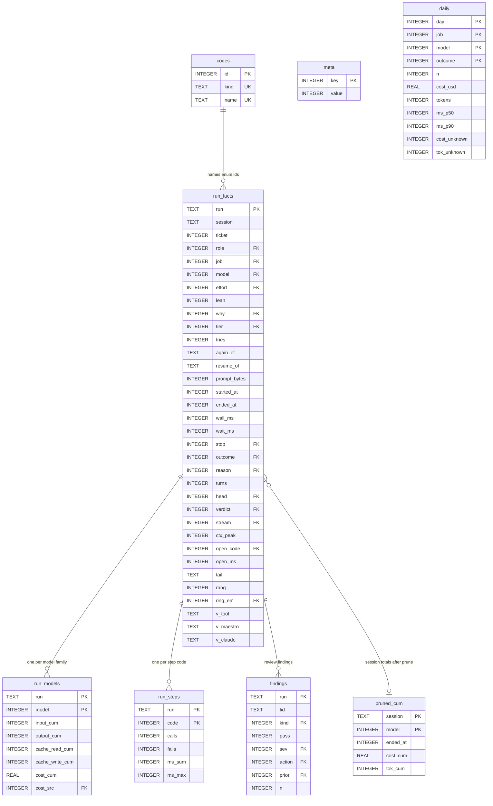

The diagram leaves out some `run_facts` columns; 5.1 lists them all, and `stats/schema.go` is the source.

**Schema rules, each enforced by a test:**
- Every table is `STRICT`. `TestSchemaLint` walks `sqlite_master` and fails on a non-STRICT table, on a TEXT column outside `codes` without a shape CHECK, and on an enum column that isn't INTEGER.
- No column holds prompt, reply, stderr, title, body, note, path, URL, host, user or command text.
- `codes.name` takes only names Go's lists hold; `TestCodesMatchGoLists` diffs the table against them after seeding.

### 6.4 Retention and prune

| Data | Cap | How |
|---|---|---|
| Detail rows | 90 days, or 256 MB of **live** pages: `(page_count - freelist_count) * page_size` | the prune below |
| `daily` | 400 days | rolled up before detail rows go |
| `pruned_cum` | 30 days past the 90-day line | same prune |

**The prune** runs in a supervisor, after its first ring, so neither a bot's turn nor a ring waits on it:
1. Claim it in one statement: an upsert on `meta.last_prune` that changes the row only when the last prune is over an hour old, or over an hour ahead, from a clock set wrong. Only the supervisor whose upsert changed a row prunes (`TestPruneClaimOnce`: 50 goroutines, one winner).
2. Roll a batch of the oldest runs into `daily`, keep each pruned session's last totals in `pruned_cum`, and delete the batch, in one transaction. The first holds 50 runs; each next is sized to hold the lock about 50 ms, 1,000 runs at most. After each, rest 75 ms. Repeat until the file is under the cap and the age, or 2 s pass. A run's write waits 250 ms on the lock and sleeps 50 ms at most between tries, so each one gets in during a rest (`TestPruneLetsWritesIn`).
3. Delete old `daily` and `pruned_cum` rows.
4. Run `PRAGMA incremental_vacuum(2000)`, then a `PASSIVE` WAL checkpoint, so no writer is stalled.

A run makes about 15 to 35 rows: one `run_facts`, a few `run_models`, 10 to 30 `run_steps`, and findings for a review (guess). At 9,600 runs a day, the hourly prune removes about 15k rows; `MAESTRO_STATS_LOAD=1` wrote 300 run ends over 3 s in 3.45 s with no stderr (C1).

---

## 7. One run, start to end

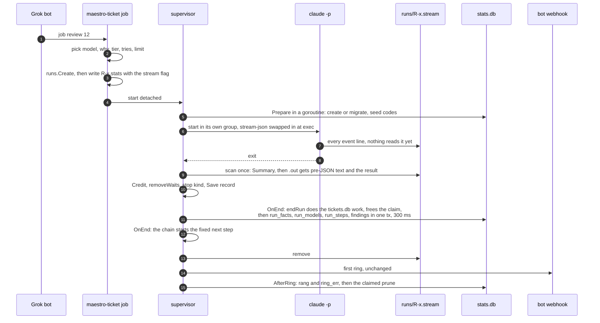

**Capture order:**
- **Facts are held in memory.** The side file holds what the job knew at the start. The supervisor's end facts (wait, stop kind, escaped count) and the stream Summary sit on the record, tagged `json:"-"`, so they reach `endRun` and never a record byte (`TestEndFactsNotInRecordJSON`, `TestRecordJSONKeys`).
- **Slot wait.** The supervisor reads `Credit` once more right before `removeWaits` **[code: runs/supervise.go:259-260]** (`TestWaitMsCredit`).
- **Ordering.** `Supervise` saves, then calls `OnEnd`, then rings. `OnEnd` runs `endRun`, then the chain that starts the run's fixed next step (`cli/chain.go`). `endRun` writes the stats row last, in a `defer` that runs after `freeRunClaim`. The write takes 300 ms at most. A run that ends while its start's `Prepare` still retries a busy lock first waits for that (2 s at most), then a 300 ms retry, so the chain waits about 2.6 s at worst, and 300 ms once `stats.db` is ready. Prune waits for the first ring.
- **Orphans.** `pickup` and `doctor` end a `Died` run through `endRun` too, after reading its stream as above. There the stats write is 250 ms, then drop, no retries. A run with no side file, a plain launch's included, started with stats off in its shell, so they write no row of it (`TestStatsOffFollowsOrphan`, `TestStatsOffFollowsLaunchOrphan`).
- **The gap.** A run whose supervisor died between Save and `OnEnd`, or whose write was dropped, has no row. `stats health` counts ended runs on disk that have no `run_facts` row, but a command that never started and a run started with stats off, so the gap shows (`TestStatsHealthMissingRows`).
- **Stats errors print nothing.** `endRun`'s warnings reach the bot in `pickup`, so a stats error is swallowed, and `stats health` is where losses show.

**From a session's start to a bundle:**

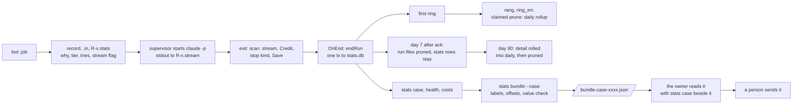

---

## 8. Reading it

The [tool's README](../../tools/maestro-ticket/README.md#run-stats) is the reference for each view's output and the bundle's fields. This section says what v1 offers and who may run it.

| Command | Who | Prints |
|---|---|---|
| `stats`, `stats --help` | anyone | the list of views |
| `stats case <ticket\|run>` | people and Claude sessions | a head line with runs and spend, then one line per run |
| `stats health` | same | stats on or off and why; schema, rows, size and last prune; ended runs on disk with no row; disk and inodes free |
| `stats costs [--by model\|job\|why\|lean] [--since D]` | same | header `per run, from stats.db; N runs with no delta`, then `costs`' columns and a token total |
| `stats bundle --case T [--cost] [--out F]` | a person only | path, size, sha256, row counts, `nothing was sent`, and a `stats case T` pointer |
| `stats on\|off [--maestro-sha S]` | `apply`, or a person | nothing on success |

- With stats off, or before any row, `case` and `costs` print one line and exit 0.
- `--since` uses the same parser as `costs` (a date, or a Go duration such as `72h`). Views read detail rows, so 90 days at most.
- The new cost keys live in `stats costs`, not in `costs`: the chief of staff reads `costs`, and its help, refusals and output stay byte for byte.
- The top usage text gains no line, so `--help` bytes don't change (`TestPinUsage`).

**Who may run them, in code:**
- Views return `forbidden` (exit 2) when `MAESTRO_TICKET_ACTOR` or `--actor` is one of the 7 profile names and `MAESTRO_RUN_ID` is unset: a Grok bot in its own shell, where every step rereads the whole chat **[code: bot-profiles/team-rules.md:7]**. Claude sessions, a chief-of-staff `job cos` run included, may run views (`TestStatsRefusesBots`).
- `stats bundle` returns `forbidden` for a bot actor and for any shell with `MAESTRO_RUN_ID` set (`TestBundleRefusals`).

```text
$ maestro-ticket stats case T-12
T-12: 4 runs, $41.20 (1 with no delta)
R-ab3kq2xz  Nov 14 09:02  build   sonnet high  tier_junior  done       38m  $6.10   turns 38  tools 212, 9 failed
R-cd7qm4wp  Nov 14 09:47  review  opus high    route_full   done       21m  $9.80   turns 51  verdict nogo  F1 blocker new, F2 major new, 3 follow_up
R-ef2mt6yr  Nov 14 10:15  build   sonnet high  sent_back    timed_out  2h   $?      reason limit  tries 1  tools 310, 22 failed  open Bash:npm 19m  tail Edit Bash:npm!  stream no_result
R-gh9pv5nk  Nov 14 12:30  review  opus high    route_full   done       17m  $25.30  turns 44  verdict nogo  F1 blocker still_present, F3 blocker new
```

The numbers above are made up, to show the shape. Later views (outcomes, waste, kickbacks, steps) wait for a feedback case that needs one; the data lands in v1, and the appendix queries answer them for now.

---

## 9. Privacy model

### 9.1 Classes

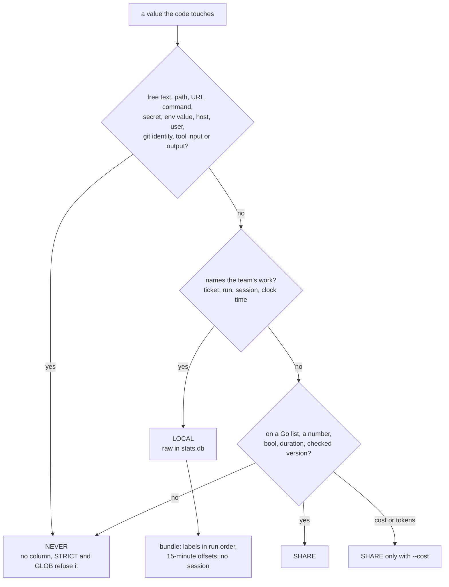

| Class | Examples | In stats.db | In a bundle |
|---|---|---|---|
| Never | prompt, reply, stderr, ticket title, body, comment, note, `--drop-file` reason, paths, file:line, diffs, commands, `cwd`, MCP server names, slash commands, hook output, branch, PR URL, repo or org, webhook URL, launcher text, git name, raw model ids | no | no |
| Local | ticket, run and session ids, clock times, the binary's own commit | yes | runs and the ticket as labels (`T1`, `R1`...), start times as 15-minute offsets, no session; the binary's commit only as `tool_at_pin` |
| Share | job, model family, effort, tier, outcome, reason, step codes, verdict kinds, finding ids, counts, ms, bytes, checked versions, OS, arch, disk % | yes | yes |
| Share, opt-in | USD, tokens and `ctx_peak`: spend shows team size and budget | yes | only with `--cost` |

**A default bundle still shows run volume and rough session size**: how many runs a ticket took, how long they ran, and the size of their prompts and replies. Decision 24 says so, and the owner reads each bundle before it leaves.

### 9.2 Narrow decoders

- **Every reader decodes into a struct that declares only the fields it keeps**, and a test holds each struct to an allowlist: `TestStreamDecoderFields`, `TestReviewDecoderFields`.
- **The stream filter** reads `type`, `subtype`, `claude_code_version`, `timestamp`, `parent_tool_use_id`, message `id`, `model` and usage numbers, content block `type`, `id`, `name`, `tool_use_id` and `is_error`, and from a tool's input only `command`, `file_path` and `skill`, each just long enough to pick a code. The init line's `cwd`, MCP servers, slash commands and plugins, hook stdout and stderr, message text and tool results are never decoded. `TestSummaryHoldsNoText` checks the Summary's types.
- **The review reader** decodes verdict, tier, mode, and per finding id, severity, action, pass and prior.
- **The launcher reduction** is one Go function. It compares exact strings with the 7 profile names and sends everything else to `person`, before any write.

### 9.3 Labels and versions

- **Labels, not hashes.** A bundle names the case `T1` and its runs `R1`, `R2`, ... in run order. Only the relabeler builds a `Label`, and read-side `RunID`, `TicketID` and `EpochMs` are opaque types that convert only to a `Label` or an `Offset15m`, so a raw id can't be copied into a bundle field and compile. A label means something only inside its file, which is all a hand-sent case needs; no salt or install id exists.
- **`v_tool`** is maestro-ticket's `vcs.revision`, kept only if it is 40 hex. A bundle never carries it, only `tool_at_pin`: whether it equals `v_maestro`.
- **`v_maestro`** is `install.yaml`'s maestro-sha, from `stats.sha`, which `apply` writes. A Maestro commit names no team.
- **`v_claude`** must be digits and dots, from the init line.

### 9.4 Bundles

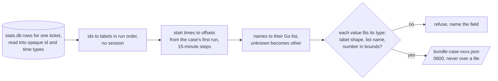

- **`--case T` is the only bundle in v1**, and the default answer to a feedback report. It holds the share-class facts of one ticket's runs, with their steps, tail and findings.
- **No clock time goes in.** Starts become offsets from the case's first run, rounded down to 15 minutes; the span is whole days; durations are ms.
- **`--cost`** adds a cost section: each run's own dollars and tokens per model family, and `ctx_peak`.
- The file is JSON, written whole through a temp file, mode 0600, as `bundle-case-<rand4>.json` in `bundles/` beside the store, outside the work tree, where no `git add -A` takes it, or where `--out` says. `stats case T` is the readable preview; there is no `preview.txt` and no `--explain`.
- Later: `--level counts|rows` for trends, and `stats --from` to read bundles, once 2 or more arrive. Bundles from other teams are outside content. Nothing keeps old bundles; the person deletes them.

### 9.5 Enforced in code

1. **Schema lint.** `TestSchemaLint`, `TestStrictRefusesText`, `TestCodesMatchGoLists` (6.3).
2. **Narrow decoders.** `TestStreamDecoderFields`, `TestReviewDecoderFields`, `TestSummaryHoldsNoText` (9.2).
3. **Bundle type lint.** `TestBundleTypesLint` walks every bundle struct. Allowed: `Label`, `Enum`, `Ver`, `Count`, `Ms`, `Bytes`, `Pct`, `Offset15m`, `Day`, `bool`; `USD` and `Tokens` only under the cost section. A bare `int64`, `float64` or `string` fails.
4. **Value check.** `Bundle.Check` runs before every write: labels match `[TR][1-9][0-9]{0,3}`, names are on their list, numbers are in bounds (ms under 400 days) (`TestBundleValueCheck`). A number in `stats.db` off its bounds is left out of the bundle (`TestBundleDropsOffBounds`).
5. **Marker tests.** Markers that pass every allowed shape (a lowercase word, hex, a 40-hex sha, a model id such as `claude-zqmark`) go in titles, bodies, comments, prompts, replies, stderr, `--drop-file` reasons, launcher, `Dir`, `Host`, `ANTHROPIC_MODEL`, tool input and output, the init line's `cwd`, MCP names, slash commands and team skill names. They must miss `stats.db`, its WAL (before and after a checkpoint and VACUUM), `.out` and every bundle: `TestMarkersMissStatsDB` (C1), `TestFindingsMarkers` (C3), `TestStreamMarkers` and `TestStreamPickupBytesMatchJSON` (C4), `TestBundleMarkers` (C6). Bundles also miss a ticket id and an epoch as number and text, and cost markers miss without `--cost` and appear with it (`TestBundleCostOptIn`).
6. **Never-reads and imports.** `stats` and `streamfilter` import the standard library only and no `net`, `os/exec`, `crypto/tls`, `runs`, `cli` or `sqlitestore` (`TestStatsDeps`, `TestStreamfilterDeps`); `cli/stats*.go` imports no `net` or `os/exec` (`TestStatsCLIImports`). Stats code names no `.in`, `.err`, `notify`, `backups`, `handouts`, `.claude` or `project-setup` (`TestStatsNeverReads`), and no package but `runs` names `.stream` (`TestStreamNeverReads`).
7. **Ring pins.** `TestNotificationFields` (exactly Text, Run, Ticket, Launcher, State) and `TestNoticeGolden`.
8. **Bot and run guards** from section 8. They guard against slips, not a hostile session: any session can `env -u` a variable or read `stats.db` off disk. A renamed bot also gets past them.
9. **Output pins** (10.2).

### 9.6 Trust boundary

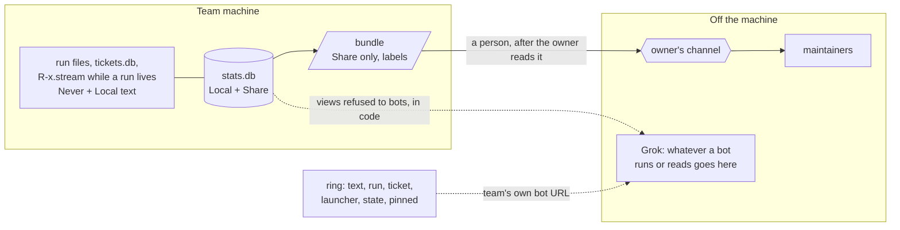

- **Grok is off the machine.** What a bot runs, it sends upstream. So the bot refusal in section 8 is code, not prose.
- **The shared Maestro repo:** every team's gh login can read the private ProlesDei/maestro repo (INSTALL.md). An issue there would show one team's bundle to every other team. The owner said bundles go by hand (call 3).
- **Out of scope here:** raw text Maestro already keeps forever (open call 11).

---

## 10. At swarm scale (300 sessions)

### 10.1 Pressure and bounds

| Pressure | What happens | Bound |
|---|---|---|
| 300 runs end in one minute | each supervisor writes one tx of about 15-35 rows, after its claim is freed | 300 ms per tx; C1's load run wrote 300 rows over 3 s in 3.45 s; `tickets.db` untouched |
| 300 supervisors start at once | each runs `Prepare` in a goroutine; codes are seeded only when the lists' hash changed | BEGIN IMMEDIATE with a re-read; `TestPrepareRace` (20 processes, one schema, no duplicate codes) |
| Stream capture | each run writes its own `.stream`; one scan per supervisor after exit, nothing shared | a few KB of counters per run; the file goes at the run's end |
| `.stream` on disk | 300 live transcripts | R0: p99 5.0 MB, max 16.8 MB per session; about 1.5 GB at p99, 5 GB at max, under the 10 GB floor; the stream flag needs headroom |
| Busy lock | `busy_timeout` 250 ms. The orphan path drops its row; a supervisor's write has 300 ms | stats never fails or blocks a command |
| Prune | one claimed supervisor an hour, after its ring | 2 s of transactions of about 50 ms each, with 75 ms rests, 3 s in all |
| Growth | about 2 KB per run (guess) | 9,600 runs a day is about 19 MB a day; the 256 MB live cap holds about 13 days, and `daily` keeps the trend |
| Names | one `stats.db`; rows keyed by run id or day; one `<id>.stats` and `<id>.stream` per run; bundles named `bundle-case-<rand4>.json`, linked without replace | nothing collides |
| Missing rows | dropped writes cluster under load | `stats health` counts ended runs with no row |

### 10.2 Tests

**Output pins (C0).** Masked goldens taken from main before any stats code: `pickup` (text, `--json`, `--full`; done, failed, stopped, timed out, died with no supervisor), `doctor`, `runs` (text, `--json`), `job` start, `job again`, every `job`, again and resume refusal, `resume` with each flag, `look`, `check` (pass, carried, fail), `ack`, `costs` (each `--by`, a bad key) and the usage and help texts. Run and session ids, times, elapsed times, pids, hosts and temp paths are masked; ids keep their order. `TestClaudeArgvEveryKind` pins the record's command, argv, stdin and env for every job kind. Where main later changed an output on purpose, the goldens follow main, never stats code.

**Differential modes (C1, C4).** `TestStatsModesKeepOutput` runs the pinned commands in process under seven stats states (off, fresh, missing, locked, corrupt, newer schema, broken) against the same goldens. `TestStatsModesKeepJobOutput` does the same for `job`, `job again`, `resume` and `look` with stats off and broken. `TestStreamPickupBytesMatchJSON` runs one fake claude in both formats: masked `pickup` and `runs --json` are identical.

**Concurrency (C1).** `TestStatsConcurrentRunEnds`: 40 processes end runs over 3 s, every row lands, stderr stays empty; with `MAESTRO_STATS_LOAD=1`, 300. `TestStatsBurstBalances`: rows plus drops equal the runs. `TestPruneClaimOnce`: one prune per hour, however many try.

---

## 11. Token cost

**Weights.** Cache read 0.1x, cache write 1.25x, output 5x the input price. "Weighted" below means input-equivalent tokens. The $ column assumes $5 per million input tokens as an example only (use the team's plan).

| Item | Per session | × 300 sessions | Grok tokens |
|---|---|---|---|
| Run-end capture (S1, S2, S4, S8) | 0: Go, after exit | 0 | 0 |
| Stream capture (S3) | 0 (R0) | 0 | 0 |
| `stats` views and bundles | 0 in bot loops: code refuses bots | 0 | 0 |
| Usage text | 0: no line added | 0 | 0 |
| **Total** | **0** | **0** | **0** |

**R0** (Claude Code 2.1.322, Sonnet at high effort, `--max-turns 1`, a scratch repo, Nov 15 2026), with arm A today's exact `claudeCommand` argv and arm B the same argv with the swap:
- **Tokens.** First-turn input + cache write + cache read: json 37678-37683 over 6 runs, stream-json 37677-37683 over 5. Same spread, no cost from the switch. The opt-in probe in C4 read 38707 and 38710, with 16 output tokens in both.
- **stderr** is byte-identical in both arms, on success and on a bad `--model` (exit 1 in both). stderr reaches bots: its tail goes into `r.Error`, pickup prints it, and `outcomeOf` matches disk-full text in it.
- **Startup stdout.** No text before the first JSON line in either arm on a bad model.
- **Keys.** The result has `subtype`, `stop_reason`, `num_turns`, `duration_api_ms` and `modelUsage.<model>.costUSD` in both arms; stream-json's also has `model_usage_since_last_result`. A result object's first key is `duration_api_ms`, not `type`.
- **Stream lines seen:** `system/hook_started`, `system/hook_response` (hook stdout and stderr: Never class, dropped), `system/init` (only `claude_code_version` kept), `rate_limit_event`, `assistant` (per-turn usage is real), `user` (`tool_result.is_error` is true when a Bash command exits nonzero), `result`.
- **Not seen:** a compaction event or an API retry (both need a long session); `go build` stamps `vcs.revision`.
- The probe is `TestProbeClaude` in `cli/probe_test.go`, run only with `MAESTRO_PROBE_CLAUDE=1`. A maintainer reruns it on a new Claude Code version; nothing runs it on its own.

**Priced options we turn down** (all guesses; a 60-turn session at 50-100k context is about 300k-600k weighted tokens, for scale):

| Option | Cache read | Cache write | Output | Weighted × 300 | $ × 300 at the example price |
|---|---|---|---|---|---|
| Category tag on each review finding (30 tokens of skill text, 3 output per finding, about 8 findings) | 30 × 60 turns × 300 = 540k | 30 × 300 = 9k | 24 × 300 = 7.2k | 54k + 11k + 36k ≈ 101k | ≈ $0.51 |
| One-line retro on the final reply (25 tokens of prompt, 30 output) | 25 × 60 × 300 = 450k | 7.5k | 9k | 45k + 9k + 45k ≈ 99k | ≈ $0.50 |
| `mode_why` from a key file review-prep writes | a shipped-skill change: skill text in every review | | | small, not zero | owner said no for v1 |
| Chief of staff logs each owner card | one extra Grok step per card, 20-50k Grok tokens | | | 10 cards a day ≈ 200k-500k Grok tokens a day | Grok price |
| Bots running `stats` views (refused in code) | one view of about 250 tokens, reread over about 40 later steps ≈ 10k Grok tokens a call | | | avoided | avoided |

---

## 12. How data reaches maintainers

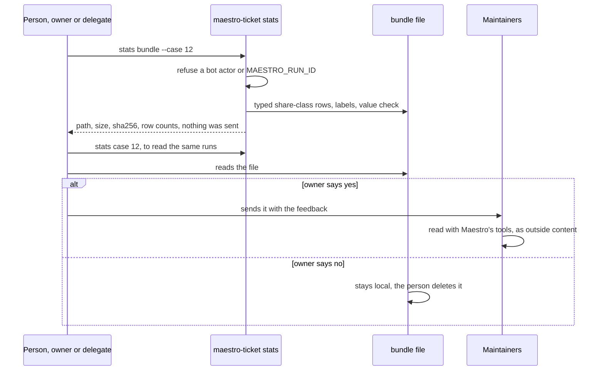

- **Bundle header:** `bundle_schema`, `stats_schema`, the case label, `with_cost` and the span in days. Each run carries its checked `v_maestro` and `v_claude`.
- **No send code**: [decision 24](../decisions.md), backed by the deps test (9.5, item 6).
- **Maintainers treat bundles as data**, under AGENTS.md "Outside content".

---

## 13. The v1 build

One branch, a commit per step (C5 and the merge each have a fix commit after them). Each commit ran `go test -race ./...`, `gofmt -l .` and `go vet ./...` in `tools/maestro-ticket/`; commits that touched `scripts/` also ran `install_test.sh` and shellcheck; and `git diff --stat main -- skills bot-profiles templates` stayed empty.

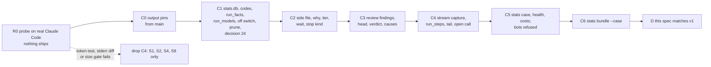

| Step | Change | Proof |
|---|---|---|
| **R0** | Probes in a scratch repo, on today's argv against the swapped argv | Token totals, stderr and startup stdout equal; result keys; init version; per-turn usage; `is_error` on a Bash exit; `.stream` size against `FloorBytes` (section 11). Gate for C4: all pass. They did. |
| **C0** | Masked goldens of every byte a bot or session reads; reflect pins on `Record` and `Notification`; argv pins | 10.2 |
| **C1** | `stats` package, schema v1, `Prepare`, `Write`, `Prune`, `stats on\|off`, the `stats:` key in `install.sh`, INSTALL.md, decision 24 | schema lint, differential modes, marker test, deps and import scans, prepare race, prune claim, concurrency, `install_test.sh` |
| **C2** | `runs/<id>.stats` from `startRun`; `why` at each decision site; `Credit` before `removeWaits`; stop kind and escaped count on `Record.End` | `TestSideFileBeforeSupervisor`, `TestWhyEveryDecision`, `TestWhyOverride`, `TestWhyAgainResume`, `TestEndFactsNotInRecordJSON`, C0 pins |
| **C3** | Head codes, findings, verdict, tier, mode, dropped rows, escalation causes | `TestHeadCodes`, `TestFindingsFromReply`, `TestFindingsClamp`, `TestEscalateCause`, `TestFindingsMarkers`, `TestReviewDecoderFields` |
| **M** | Merge main; review formats read through main's `followUpLines` and `noteOpening`; reasons `asked` and `frozen` | goldens follow main, proven on a detached main worktree |
| **C4** | `streamfilter`, the argv swap at exec, `.stream`, the scan after exit, `ParseOutput`'s result rule, the opt-in probe | section 4's tests, `TestStreamPickupBytesMatchJSON`, `TestStreamKilledMidToolResult`, `TestStreamGrandchildHoldsStdout`, `TestSkillListMatchesRepo` |
| **C5** | `stats case`, `health`, `costs`; the bot refusal | `TestStatsCase`, `TestStatsHealthMissingRows`, `TestStatsCostsUnits`, `TestStatsCostsOff`, `TestStatsRefusesBots`, C0 usage and costs pins |
| **C6** | `stats bundle --case` | `TestBundleTypesLint`, `TestBundleValueCheck`, `TestBundleMarkers`, `TestBundleCostOptIn`, `TestBundleRefusals`, `TestBundlePrintsOnly` |

---

## 14. Open calls for the owner

1. **Local capture on by default?** Accepted. `stats: off` in `install.yaml` turns it off (6.2), and INSTALL.md tells the person what is kept.
2. **Switch Claude jobs to `stream-json`?** Accepted, after R0 passed. The swap happens at exec, on Linux, for `job`, `job again` and `resume` runs only.
3. **Which channel carries bundles?** Accepted: by hand, to a place only maintainers read, such as email or a per-team private intake repo; not issues on the shared private repo. Maestro has no send code.
4. **Cost in bundles?** Accepted: opt-in with `--cost`.
5. **Default bundle?** `--case` only in v1. Counts and rows bundles wait for a trend question.
6. **Times in bundles?** As built: offsets from the case's first run in 15-minute steps, whole days for the span, ms for durations. No clock time, so no working hours or time zone.
7. **Stable salt?** Moot for v1: labels replace hashes. It comes back only with bundles that join across files.
8. **Retention: 90 days or 256 MB of live detail, 400 days of `daily`?** Built as written.
9. **Signals that cost tokens?** Accepted: no for v1. After 30 days, check whether the derived reasons in 5.6 answer Q2 well enough.
10. **A chief-of-staff log of owner cards?** *Recommend not yet.* Each card costs a Grok step at the chat's size, 20-50k tokens.
11. **Cap the raw text Maestro keeps forever today** (unacked run files, `idempotency` results, pre-schema snapshots)? *Recommend yes, as a separate ticket.*
12. **Review limit for the branch.** v1 is one branch of several thousand lines, past the review's 1,000-line, 2-hour cap. *Recommend* a reviewer reads it commit by commit in one session with a longer `--limit`; the other choices are stacked PRs or an escalation.

---

## 15. What Maestro still can't see

- **Grok-side spend.** Maestro counts only what it prints to bots, and v1 doesn't count that yet (Q14).
- **Owner chat and chief-of-staff memory**, which live in Grok.
- **Which skill phase a session was in**, beyond the step trail. `R:`, `X:` and `mt:` codes come close.
- **Team setup commands.** They read as `Bash` or `Bash:<word>`.
- **Runs off Linux** have no stream data.
- **Why a renamed bot or a hostile session did something.** The guards stop slips, not intent (9.5, item 8).

---

## 16. Verified vs assumed

| Claim | Status |
|---|---|
| A streamed run's `.out` holds no stream line but its result, so `ParseOutput` reads it as before | **[code: runs/runs.go, streamfilter; `TestParseOutputRawStream`, `TestStreamInitOnlyFreesClaim`]** |
| `endRun` keeps the claim for a `Failed` run with a session id | **[code: cli/launch.go, `endRun`]** |
| `OnEnd` runs after Save and before the first ring | **[code: runs/supervise.go, `Supervise`]** |
| `Credit` is read once more before `removeWaits` | **[code: runs/supervise.go:259-260]** |
| `stopped` and `asked` come from the record's error text | **[code: runs/supervise.go:319-321]** |
| Model, effort and lean live only in argv | **[code: cli/statsrun.go, `argvFacts`]** |
| `install.sh` refuses a bad or doubled `stats:` key | **[code: scripts/install.sh:161-162; install_test.sh]** |
| The low-disk test is `envcheck.Headroom`, with a 10 GB floor | **[code: envcheck/disk.go]** |
| `events` holds `type`, `actor`, `data`, `created_at`, and comments carry no run id column | **[code: sqlitestore/sqlitestore.go]** |
| The review time-out note lacks `Posted-by:` | **[code: cli/route.go:613]** |
| `verdict` checks each note's opening, sha, count and finding lines before it writes | **[code: cli/verdict.go]** |
| The ring body has 5 fields | **[code: runs/notify.go; `TestNotificationFields`]** |
| Grok rereads the whole chat each step | **[code: bot-profiles/team-rules.md:7]** |
| Golden output tests of bot-facing bytes exist | Added in C0 |
| `stream-json --verbose` leaves model tokens, stderr and startup stdout unchanged | (R0) |
| Result keys: `modelUsage.*.costUSD`, `subtype`, `stop_reason`, `num_turns`, `duration_api_ms` | (R0) |
| A result object's first key is not `type` | (R0): the filter decodes each line |
| The init line carries `claude_code_version` | (R0) |
| Per-turn usage in assistant messages is real | (R0) |
| `tool_result.is_error` is set on a Bash nonzero exit | (R0) |
| modernc.org/sqlite v1.61.0 supports STRICT | (R0): SQLite 3.54.1 |
| `go build` stamps `vcs.revision` | (R0) |
| `.stream` size at 300 sessions fits the disk floor | (R0): p99 5.0 MB, max 16.8 MB, from 568 local sessions |
| The compaction event is `system/compact_boundary`, the retry event `system/api_retry` | (guess): neither seen; the counts stay 0 until one is |
| A died run with a changed boot stamp means a reboot | (guess): `reboot` is listed but not set |
| Row counts per run and growth per day | (guess) |

---

## Appendix: sample queries

Run them with `sqlite3 -readonly stats.db`. `stats.db` stores code ids, so first make a temp view that joins `codes` (a temp view lives outside the file):

```sql
CREATE TEMP VIEW f AS SELECT r.*,
  (SELECT name FROM codes WHERE id = r.job) job_n,
  (SELECT name FROM codes WHERE id = r.model) model_n,
  (SELECT name FROM codes WHERE id = r.why) why_n,
  (SELECT name FROM codes WHERE id = r.outcome) outcome_n,
  (SELECT name FROM codes WHERE id = r.reason) reason_n,
  (SELECT name FROM codes WHERE id = r.head) head_n,
  (SELECT name FROM codes WHERE id = r.open_code) open_n
FROM run_facts r;
```

**Q1 and Q11: each run's own spend.** `stats costs` answers Q1; its rule, with the cases a plain `LAG` misses (a pruned parent, a resume with no known past), is `spendCTE` in `stats/prune.go`. The core is:
```sql
SELECT f.run, f.job_n, f.why_n, f.resume_of IS NOT NULL resumed, f.again_of IS NOT NULL again,
  m.cost_src, m.cost_cum - CASE WHEN f.resume_of IS NULL OR f.session IS NULL THEN 0
    ELSE LAG(m.cost_cum) OVER (PARTITION BY f.session, m.model ORDER BY f.ended_at, f.run) END usd
FROM run_models m JOIN f USING (run) WHERE f.started_at > :since;
```

**Q2 and Q9: review findings, and the ones dropped**
```sql
SELECT (SELECT name FROM codes WHERE id = x.kind) kind, x.pass,
  (SELECT name FROM codes WHERE id = x.sev) sev, (SELECT name FROM codes WHERE id = x.prior) prior,
  sum(x.n) n, count(DISTINCT f.ticket) tickets
FROM findings x JOIN f USING (run)
WHERE f.head_n = 'review:nogo' AND f.started_at > :since
GROUP BY 1, 2, 3, 4 ORDER BY n DESC LIMIT 20;

SELECT f.ticket, x.fid, x.pass FROM findings x JOIN f USING (run)
WHERE x.kind = (SELECT id FROM codes WHERE kind = 'finding' AND name = 'dropped') AND f.started_at > :since;
```

**Q3 and Q4: where bad runs ended, and which steps fail**
```sql
SELECT job_n, outcome_n, reason_n, open_n, count(*) n, avg(open_ms) / 1000 open_s
FROM f WHERE outcome_n <> 'done' AND started_at > :since
GROUP BY 1, 2, 3, 4 ORDER BY n DESC LIMIT 20;

SELECT f.job_n, (SELECT name FROM codes WHERE id = s.code) code,
  sum(s.calls) calls, sum(s.fails) fails, sum(s.ms_sum) / 1000 secs
FROM run_steps s JOIN f USING (run) WHERE f.started_at > :since
GROUP BY 1, 2 ORDER BY fails DESC LIMIT 20;
```

**Q13: releases**
```sql
SELECT v_maestro, v_claude, job_n, count(*) n, round(avg(outcome_n = 'done'), 2) done_rate, avg(turns) turns
FROM f WHERE started_at > :since GROUP BY 1, 2, 3 ORDER BY 1 DESC;
```

**Q16: context, compactions, retries and subagents**
```sql
SELECT job_n, model_n, count(*) n, max(ctx_peak) ctx_max, avg(ctx_peak) ctx_avg,
  sum(compactions) compactions, sum(retries) retries, sum(subagents) subagents
FROM f WHERE stream = (SELECT id FROM codes WHERE kind = 'stream' AND name = 'ok') AND started_at > :since
GROUP BY 1, 2;
```

Later, with S5, S6 and S7: Q5 (stalls), Q8 (review misses), Q10 (checks) and Q14 (bot reads).
