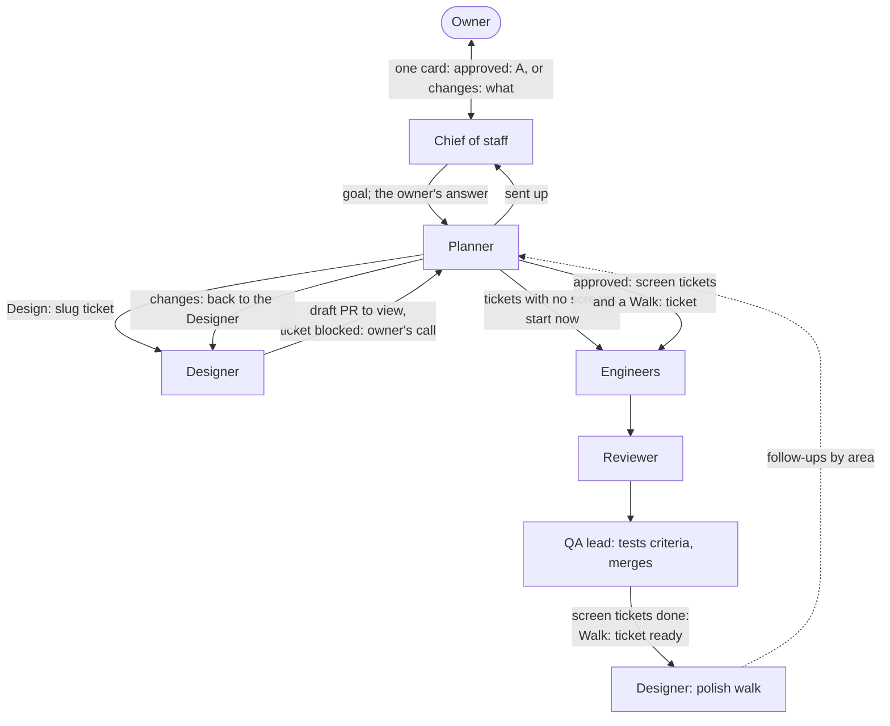

# The Designer bot (v4; slice 1 built)

> **2026-11-14.** The owner settled cards 1 to 6 (below) and slice 1 is built: the role, the persona, the `design` job, the planner's `Design:` ticket and its `approved:` and `changes:` answers, `screens.sh --shoot` and `design-pr.sh`. Decision 18 in `docs/decisions.md` holds the rule. Slices 2 to 6 are still a plan.
>
> **v4:** after two fresh-context audits and two optimization passes. The owner approves in chat and nothing merges; the design rides the planner's existing owner's-call path; slice 1 is the smallest end-to-end proof, and scripts stay only once a measured run shows they save. What changed and why is at the end.

## In plain words

Today nobody on the team decides how a screen should look or feel. The planner writes criteria, an engineer picks a layout, and QA checks it works. So the app works, but each screen looks like whoever built it.

The Designer fills that gap, once per goal, at two points:

- **Before the build**: it frames the problem, sketches the flow, tries two or three directions in code and picks one. **The owner approves it, or asks for changes.** Then the planner writes the screen tickets, with criteria from the spec.
- **After the merge**: it walks the shipped screens in a browser, as a user would, and logs what falls below the bar as follow-ups.

It never writes product code and never merges anything. It owns the design system's rules; the owner owns taste.

## What the best designers do, and what we take

| Who | What they do | What the Designer does |
|---|---|---|
| Karri Saarinen (Linear) | Writes the problem down first; compares a few directions; "the spec is the floor"; Quality Wednesdays: one small polish fix a week | Frame before drawing; 2–3 directions, one pick; a polish walk per goal |
| Ryan Singer (Shape Up) | Breadboards in text (places, what you can do there, arrows); a fat-marker sketch only when layout is the question | Every spec starts as a text breadboard; draw only when layout is open |
| Brad Frost (Atomic Design) | Interface inventory: one shot of each pattern, then keep, merge or drop | `system` job; reuse a component before adding one, and say why when it adds one |
| Refactoring UI | One feature, real content, grayscale first so spacing and weight carry the hierarchy | Prototype with real content; hierarchy before colour |
| Rauno Freiberg, Vercel | No handoff; live with a prototype; a written web interface checklist | Prototype in code; check against a written list, most of it run by a script |
| Emil Kowalski | Writes his motion taste down as rules agents follow | Taste lives in the team's rules file, not in each session's head |
| Stripe (Katie Dill) | Friction logs; "walk the store" end to end; reviews open the real prototype | The polish walk; the owner sees shots of the real prototype |
| Jakob Nielsen | Evaluators work alone, then merge and rank by severity | The walk runs in a fresh session; each finding names a rule and a severity |
| Shopify, Notion (2025–26) | Sketch on a canvas, build the rest in code with Claude Code or Codex | Code first; Figma or Penpot later, as add-ons |

Sources are at the end. The Designer reads none of them at run time: Maestro's rules are written in our own words.

## Where it sits



Nothing new runs on its own: the planner hands out both jobs, as tickets, like every other.

## The owner's approval

Design is taste, and taste is the owner's call. No screen ticket exists until the owner has said yes. The planner can't automate this step and doesn't try: it makes the step one message, and keeps the rest of the goal moving.

The `Design: <slug>` ticket is made the way `plan.md` makes a `Live run:` ticket today: `--type scout --role designer --owner planner`, and no areas, so its claim never holds up other work. It reuses the path an outside step takes, so the planner's board needs no new rows.

| Step | Who | What happens | Ticket |
|---|---|---|---|
| 1. Ready | Designer | Opens a draft PR on `maestro/<id>` holding the spec and a contact sheet of the directions. Posts the spec, then `Escalation: design ready: PR <url>: owner's call` with the card's text in it and a last line `Return-role: designer`. Blocks the ticket and releases its claim | `in_progress` → `blocked` |
| 2. Ask | Planner, chief of staff | Unblock sends an owner's call up and posts `Sent up:`, as today. The chief of staff sends the card from the note: *Build direction A? Answer `approved: A`, `approved: B`, or `changes: <what>`.* The PR link carries the shots | `blocked` |
| 3. Look | Owner | Opens the PR on GitHub, where the shots show, and answers the card in chat. A comment on GitHub reaches no bot | `blocked` |
| 4a. Approved | Planner | `/maestro-planner rule <id>: approved: <the pick>`. The skill claims the ticket, posts `Answer:`, writes the screen tickets from the spec as `plan.md` does, adds them to the goal's `Live run:` ticket, closes the PR, and moves the `Design:` ticket to `done` last. Slice 2 adds a `Walk: <slug>` scout ticket (role and owner `designer`, as QA owns its `Live run:`) that deps on them. Approving another direction goes back to the Designer as a change, since only the pick has criteria | `blocked` → `done`, one move |
| 4b. Changes | Planner, then Designer | `/maestro-planner rule <id>: changes: <the owner's words>`. The ticket goes back to `in_progress` with role `designer`; the next look hands it to the Designer, which reworks the same PR in a fresh run | `blocked` → `in_progress` |

The store lets a designer's scout ticket go from `blocked` straight to `done`, by its owner only, so no stop part way leaves it where review or a build would take it. If the `rule` session dies after writing the screen tickets, the ticket is still `blocked` under an `Answer:`, and the planner's existing row sends `rule <id>: again`, which finds the tickets it made.

The PR never merges. The record is the `Answer:` note and the screen tickets' criteria; the shots are for looking, and also stay in the run's evidence folder.

### Keeping the owner from being the bottleneck

| Risk | Guard |
|---|---|
| The whole goal waits on one look | Tickets with no screens are planned and built at once; only the screen tickets wait, and they don't exist yet |
| The owner looks too often | One look per goal, not per ticket |
| The look takes long | One question, answered in a word or two; the shots behind one link |
| The owner never answers | The ticket shows on the planner's `sent up:` line each report, as any owner's call does |

Small designs that skip the owner come in slice 4, once a script can test what "small" means.

## The jobs

One skill, `/maestro-designer <ask>`, shaped like `/maestro-qa-lead`: a short table of jobs, one reply block whose first line the bot can sort on. It sets `disable-model-invocation: true`, with `allow_implicit_invocation: false` in `agents/openai.yaml`, so its description never loads into other sessions.

| Ask | Job | Hands back | Slice |
|---|---|---|---|
| `design <id>` | **design** | The spec on the ticket, a draft PR to view, the ticket blocked as an owner's call. On a `changes:` answer, the same PR reworked | 1 |
| `walk <id>` (a `Walk:` ticket) | **walk** | A friction log of the shipped path; findings by rule, severity and area, for the planner to fold into each area's follow-ups; the ticket `done` | 2 |
| `system` | **system** | One shot per pattern with keep, merge or drop, a draft rules file, and the ticket drafts that would close the gaps. The rules file reaches main as an engineer's ticket, through review and QA | 4 |

### What a spec holds

```text
Problem:     <who, what they're trying to do, what happens if we don't build it>
Breadboard:  <each place, the route or file it lives at, what you can do there, where each action goes>
Directions:  <2–3, one line each> | Pick: <one, why>
States:      <for each place: empty, loading, error, long text, many items, phone>
Reuses:      <components and tokens> | New: <each, and why the old one won't do> | none
Criteria:    <numbered, each one QA can see in a browser at a named width>
Taste calls: <each, with the Designer's default> | none
```

The criteria are the point. A rule in a criterion gets tested by QA on every ticket at no extra run; a rule in prose gets skipped. Each place names its route or file so a script can later tell a new place from an old one.

### When things change

- **An approved spec doesn't change.** A rethink is a new `Design:` ticket, on its own `maestro/<id>` branch. The planner rewrites only the screen tickets still in `todo`; ones already building finish, and the gaps become follow-ups.
- **A run dies.** The ticket is `in_progress` with no live claim, and the planner's existing row hands it to the same bot again.

## Where things live

| What | Where |
|---|---|
| The design rules: tokens, type, spacing, motion, the checks no script can run | The team's repo. `## Design` in `project-setup.md` is one line: the rules file's path and whether the app has a dark theme. Kept short, since many sessions read that file |
| Tokens | The team's code, in their format. A change is an engineer's ticket |
| One goal's approved design | The `Answer:` note on its `Design:` ticket and the screen tickets' criteria |
| Shots and prototypes | `maestro/evidence/<id>/<run>/` in the repo's shared git folder, as QA's are, so `maestro-prune` already clears them; the draft PR carries copies for the owner to look at |

## Scripts do the fixed steps

A model doing fixed steps pays for every call, every page snapshot and every image it opens. So the Designer flow ships scripts for the steps that are the same every run, as `review-prep.sh` does for review: plain Bash plus one page-side JS file, no agent APIs, `key=value` output, tests and `shellcheck`, as **maestro-create-edit-skill** says.

**Measure first.** Slice 1 starts with one design run and no scripts, its cost read from `maestro-ticket costs`. Then the two scripts below, and the same design again. A script stays only if the trace shows the step it replaces repeating, and the second run costs less.

| Script | Lives in | Does, in one call | Slice |
|---|---|---|---|
| `screens.sh <url or file>... --out <dir> --widths <list> [--shoot] [--check [--base <url>]] [--design]` | `maestro-qa-lead/scripts/`, beside the browser reference | One headless browser of its own, one pass over every page and width. `--shoot`: a contact sheet per width, every page side by side, as one image. `--check`: the machine checks QA's browser reference asks for (sideways scroll, inputs with no label, images with no alt, `undefined` or `NaN` on screen), printing only failures; with `--base`, only failures the base page doesn't have. `--design` adds the Designer's checks: hit targets, a removed focus outline, `transition: all`, motion with no reduced-motion version, with limits from the rules file. Under `browser: none` it prints `stop=no browser` | 1 (`--shoot`), 2 (`--check`) |
| `design-pr.sh <id> <run>` | `maestro-designer/scripts/` | Checks the spec has every field and numbered criteria that each name a width, and refuses one that doesn't. Commits the shots to `maestro/<id>` with `[skip ci]`, opens or updates the draft PR, posts the spec and the `Escalation:` note with the card in it, and blocks the ticket with `--release` | 1 |

What they buy:

- **Fewer images.** Looking at an image costs about 1,500 tokens (an estimate; slice 1 measures it). Three directions at two widths is six shots; two contact sheets, one per width, show the same in two images, and the model opens a full shot only of what it must judge.
- **Fewer snapshots.** A page snapshot is often 5–20k tokens. `--check` answers the same questions in a few lines, and with `--base`, never repeats an old failure as a new one.
- **One browser pass.** Shooting and checking share one browser and one walk over the pages, for the Designer and for QA.
- **Grok Bot credits.** The card's text sits in the `Escalation:` note, where Unblock already reads, so the planner and chief of staff forward it instead of composing it.
- **No new dependency.** `playwright-cli` (when `browser:` installs it), `gh`, `git`, `jq` and `maestro-ticket`. The contact sheet is an HTML page shot as one image, so there's no image tool to add.

QA's use of `screens.sh --check` is its own ticket, under the owner's ruling (card 6): QA's browser reference switches to it once a run beside QA's hand checks shows they agree.

Waiting for a trace to ask for them, not built: a prep script (worktree, run folder, `## Design`), and anything that reads tokens, which every stack keeps differently; slice 4 asks the team for a command that prints theirs.

Other token rules:

- **Load per job.** `SKILL.md` under 60 lines; each job reads only its own reference.
- **Rework starts fresh.** An owner's answer takes hours, long after the prompt cache expired, so resuming pays for the whole old context again. A fresh run reads the spec and the `Answer:` note, and nothing else.
- **Model by job.** `design` on the top model at high effort: that's where taste is spent. `walk` reads script output and the friction it finds, so a cheaper model at medium effort does. `design` starts no app and runs no checks, so it takes `CLAUDE_CODE_PROMPT_CACHE_TTL=5m`, as the team rules allow; `walk` starts the app, on port 0 with a watcher as **maestro-working-principles** says, so it keeps the default.
- **Bytes paid for.** The planner's persona and the team rules are at 19,698 of 19,700. The team rules' escalate line saves 21 bytes; the planner's "same engineer" line spends about 14 of them. Every other planner step goes in the `maestro-planner` skill.

## Design tools

**Pick: code first.** The Designer prototypes in HTML and CSS with the app's own tokens and shoots it in its own Playwright CLI browser, as QA does. No account, no seat, works headless.

| Tool | Read | Write | Headless | Cost |
|---|---|---|---|---|
| None (code) | the repo | the design branch | yes | none |
| Figma, remote MCP (`mcp.figma.com/mcp`) | frames, variables, shots, Code Connect | yes, through `use_figma` (beta) | OAuth only, no token; whether `claude -p` keeps one person's sign-in is untested | a Full seat to write; a Dev or Full seat for 200 reads a day |
| Penpot MCP (MPL-2.0, self-host) | pages, components, tokens | yes, on the page in focus | only while a Penpot tab has its plugin connected; untested in a headless browser | free |
| Penpot RPC API | yes | `update-file`, poorly documented | yes | free |

Each canvas tool waits for a spike that proves a headless designer run can use it; no install key until then. When one passes: its MCP server goes only into the Designer's runs, through `--mcp-config <file> --strict-mcp-config` on its persona's `claude -p` line, never into shared settings (decision 16's reason). Engineers never open it: the Designer copies what they need into the spec, so one bot needs a seat, not the swarm. Read comes first (a person designs in Figma or Penpot; the Designer turns the frame into a spec); writing to the canvas, and owner review there, come after.

## At swarm scale

- One design run, one owner look and one walk per goal, not per ticket.
- Tickets with no screens never wait on the owner.
- The skill's description and any MCP tools load only in designer runs.
- Each run names its own browser, folder and `maestro/<id>` branch; servers start on port 0.
- `--base` keeps an old failure from coming back as a new follow-up on every run.
- The owner sees one card per goal.

## What changes in Maestro

| File | Change | Slice |
|---|---|---|
| `tools/maestro-ticket/ticket/ticket.go` | `RoleDesigner`, with a test | 1 |
| `bot-profiles/designer/persona.md` | New: runs `/maestro-designer`, model by job | 1 |
| `bot-profiles/team-rules.md` | Escalate up: "senior engineer, QA lead or reviewer to the planner" becomes "every other bot to the planner" (21 bytes saved in every block) | 1 |
| `bot-profiles/planner/persona.md` | "Same engineer" also counts a `designer/` holder (about 14 bytes). No other line: it already hands a new role's tickets to that role's bot, and sends an owner's call up | 1 |
| `bot-profiles/chief-of-staff/persona.md` | "Approving a design" joins the owner's calls, the one place that rule lives; its answers are `approved: <direction>` or `changes: <what>`, never a bare yes | 1 |
| `skills/maestro-planner/references/plan.md` | A goal with screens gets a `Design:` ticket and plans its other tickets now | 1 |
| `skills/maestro-planner/references/rule.md` | `designer` as a `Return-role`; `approved:` writes the screen tickets, then closes the `Design:` ticket; `changes:`, or approving another direction, sends it back; `again` finishes an approval that stopped short. Slice 2 adds the `Walk:` ticket | 1 |
| `skills/maestro-designer/` | New: `SKILL.md`, `agents/openai.yaml`, `references/design.md`, `scripts/design-pr.sh` with tests; `walk.md` in slice 2, `system.md` in slice 4 | 1 |
| `skills/maestro-qa-lead/scripts/screens.sh` | New, with tests; `--shoot` in slice 1, `--check` in slice 2 | 1, 2 |
| `skills/maestro-create-ticket/SKILL.md` | `designer` in the role table | 1 |
| `templates/project-setup.md`, `INSTALL.md` | `## Design`, one line | 1 |
| `skills/README.md`, `bot-profiles/README.md`, `docs/team.mermaid`, `docs/bot-anatomy.mermaid`, README.md, AGENTS.md | Seven profiles, 19 skills | 1 |
| `docs/decisions.md` | One line per card the owner settles | 1 |

## In what order

1. **Slice 1: design and approval, end to end.** The role, the persona, the `design` job, the planner's `Design:` ticket and its `rule` branches, `screens.sh --shoot` and `design-pr.sh`. Prove it on one goal in a scratch repo: a baseline run with no scripts, then with them. Measure tokens per design run and the owner's minutes per look.
2. **Slice 2: the walk.** The `Walk:` ticket, the `walk` job, `screens.sh --check` with `--base` and `--design`. Measure what the walk finds that QA missed.
3. **QA's screen check**, its own ticket, beside slice 2: QA's browser reference moves to `screens.sh --check` once it agrees with the hand checks.
4. **Slice 4: the system.** The `system` job, the rules file, a team-supplied tokens command, and the small tier, tested on each place's route.
5. **Slices 5 and 6: Figma, then Penpot**, each after its spike; then canvas writes and canvas review.

## Cards for the owner

1. **Add a seventh bot?** Settled by the owner, 2026-11-14: the default. Options: a new `designer` profile (this draft); a design skill the planner calls (no new bot, but the planner's persona has no room and its sessions would carry taste work). Default: the new bot.
2. **Is design a gate after the build too?** Settled by the owner, 2026-11-14: the default. Options: no, criteria and walks (this draft); a `Design: GO` before QA on every screen ticket (one more run per ticket, and a new place to stall). Default: no; the owner approved the design up front.
3. **Where does the owner look?** Settled by the owner, 2026-11-14: the default. Options: a draft PR on GitHub, answered in chat (this draft); shots sent in chat by the chief of staff (untested in Grok Bot); a Figma or Penpot page (waits on the spikes). Default: the PR.
4. **Every design, or only big ones?** Settled by the owner, 2026-11-14: the default. Options: every design until slice 4 and the owner hands the small tier down (this draft); big only from day one. Default: every design; the rules file is new, and "small" has no test yet.
5. **Does the Designer write code?** Settled by the owner, 2026-11-14: the default. Options: prototypes only (this draft); a design engineer who also builds screen tickets. Default: prototypes only, so review and QA stay the one path to main.
6. **Should QA use the screen check?** Settled by the owner, 2026-11-14: yes. QA switches once a run beside its hand checks shows they agree.

## What slice 1 found

Building and running slice 1 settled a few details the plan left open:

- Playwright CLI refuses `file:` pages, so `screens.sh` serves the prototype folder on 127.0.0.1, port 0, with a small Node server that stops when the script does. Node is already there, since Playwright CLI runs on it.
- One `run-code` call shoots every page, width and colour scheme; a second shoots the sheets. Three directions at two widths in both schemes took under four seconds.
- `screens.sh` takes `--shoot --out <dir> --widths <list> [--dark] [--run <name>]` today; `--check`, `--base` and `--design` come with slice 2.
- The design branch holds its files under `.maestro/design/<id>/`, so they never clash with a team's own; the PR body shows them by their blob URLs at the pushed sha.
- Each direction's page is named after its letter (`b.html`, or `b-<place>.html`), so `design-pr.sh` finds the pick's shots by name.

## What changed, and why

v4, after a second fresh-context audit and a second optimization pass:

| v3 said | v4 says | Why |
|---|---|---|
| `rule <id>: approved` sets the ticket done | `rule.md` gets an `approved:` branch that walks the scout ticket to `done` and writes the screen tickets | `rule.md` step 7 only moves a blocked ticket back to `in_progress`, so the next look would hand an approved design to the Designer again |
| `goal <slug>: screens from <id>`, sent by the planner | Part of `rule <id>: approved:` | The planner's Grok bot reads only its persona, which has no room to learn a new prompt |
| Nothing starts the walk | `approved:` makes a `Walk:` ticket that deps on the screen tickets | A ticket the existing rows hand out costs no persona bytes |
| "Same engineer" becomes the bot for the ticket's role | It also counts a `designer/` holder | Both engineers play `engineer`; the role can't tell junior from senior, and the TRIES 2 row needs to |
| Branch `design/<goal>`, files under `maestro/design/` | Branch `maestro/<id>`, files under `maestro/evidence/<id>/<run>/` | Review, QA and the planner find work by `maestro/<name>`; a rethink on the same goal would reuse the old branch; prune already clears evidence |
| The Designer blocks the ticket | It blocks with `--release` | A blocking session keeps its claim, and the planner skips claimed tickets |
| The card has two shots; a script prints it | The card's text sits in the `Escalation:` note; the shots stay behind the PR link | Images in chat are untested in Grok Bot, and Unblock reads the note, not the session's reply |
| Seven scripts, built up front | Two in slice 1, kept only if a measured run shows they save; the rest wait for a trace | Proof over claims; the token figures were estimates |
| `shoot.sh` and `screen-check.sh` | One `screens.sh`: one browser pass, `--shoot` and `--check` | Two browsers over the same pages cost twice |
| The check "asks what QA asks today" | QA's checks by default; the Designer's extra checks behind `--design`; `--base` prints only new failures | QA's browser reference doesn't check contrast, targets or motion, and whole-page failures would come back as new follow-ups on every run |
| `app-up.sh` with `{port}` and `{data}` (card 7) | Dropped; the walk starts the app as `## Run` says, on port 0 | Working principles require port 0 and a watcher; `{data}` assumes a data folder |
| `inventory.sh` reads CSS custom properties or a theme file | A team-supplied tokens command, in slice 4 | Tailwind, CSS-in-JS and native apps keep tokens differently; a shipped parser would assume a stack |
| A tier test on places in prose | Each place names its route or file; the test comes in slice 4 | A script can't tell from prose whether a place exists on main |
| Widths read from `## QA` | Widths as an argument; `stop=no browser` under `browser: none` | `## QA` is free text, and `browser: none` installs no browser |
| `## Design` names the rules file and how to find tokens | One line: the rules file and whether there's a dark theme | Many sessions read `project-setup.md`; dark-mode shots are wasted on an app with no dark theme |

v3, after the first audit: nothing merges, since the planner never touches code and only QA merges (decision 6); the design rides the owner's-call path, since the board sends `in_review` to the reviewer; the owner answers the card in chat, since PR text is data; screen tickets come after the yes, so they carry the design's criteria; one question per card; three jobs, not six; `CheckGate` is a convention, since `--actor` is self-declared.

## Sources

Read on 2026-11-14 through research agents; claims marked untested were not confirmed.

- Linear: [Design is more than code](https://linear.app/blog/design-is-more-than-code), [Quality Wednesdays](https://linear.app/blog/quality-wednesdays), [10 rules](https://www.figma.com/blog/karri-saarinens-10-rules-for-crafting-products-that-stand-out/)
- Shape Up: [chapter 4](https://basecamp.com/shapeup/1.3-chapter-04)
- Atomic Design: [chapter 4](https://atomicdesign.bradfrost.com/chapter-4/)
- Vercel: [Design engineering](https://vercel.com/blog/design-engineering-at-vercel), [Web Interface Guidelines](https://vercel.com/design/guidelines); Rauno Freiberg: [Interaction design](https://rauno.me/craft/interaction-design)
- Emil Kowalski: [skills](https://github.com/emilkowalski/skill)
- Stripe: [Katie Dill interview](https://creatoreconomy.so/p/how-stripe-crafts-quality-products-katie-dill)
- NN/g: [heuristic evaluation](https://www.nngroup.com/articles/how-to-conduct-a-heuristic-evaluation/)
- Figma MCP: [guide](https://help.figma.com/hc/en-us/articles/32132100833559-Guide-to-the-Figma-MCP-server), [write to canvas](https://developers.figma.com/docs/figma-mcp-server/write-to-canvas), [rate limits](https://developers.figma.com/docs/figma-mcp-server/rate-limits-access/), [no token auth](https://forum.figma.com/ask-the-community-7/support-for-pat-personal-access-token-based-auth-in-figma-remote-mcp-47465)
- Penpot: [repo](https://github.com/penpot/penpot), [MCP](https://help.penpot.app/mcp/), [API](https://help.penpot.app/technical-guide/integration/), [tokens](https://help.penpot.app/user-guide/design-tokens/)
- Tokens: [DTCG 2025.10](https://www.designtokens.org/tr/2025.10/)
