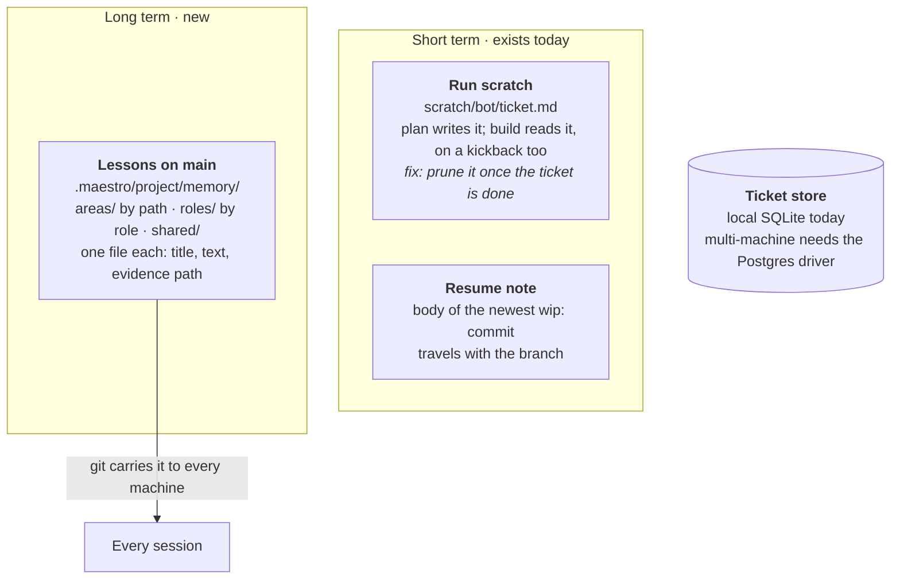
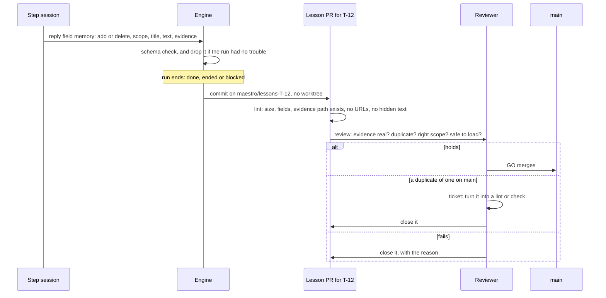
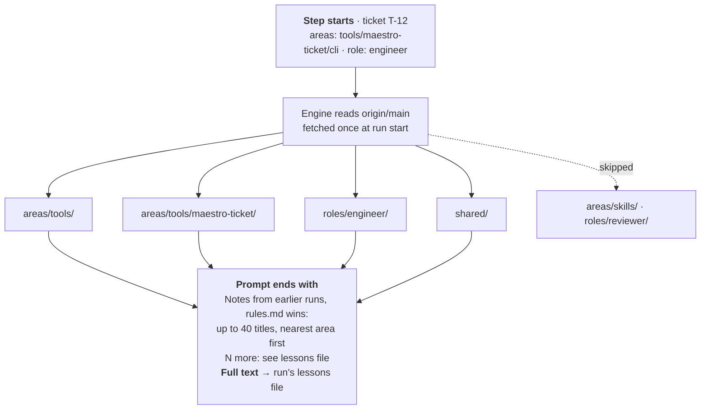

# Memory for a swarm (draft v4, not built)

**Short term** is what one piece of work needs to resume. It already exists: the run's scratch file and the `wip:` commit. **Long term** is lessons: what a future session needs that the code, git and tickets can't show. Lessons are small files on `main`, one per lesson, scoped by what they're about. Only a run that hit trouble may propose one, each ticket gets at most one lesson PR, and the engine, not a prompt, decides which lessons a step sees.

## 1. What exists and what's new

## 2. How a lesson gets in

A lesson never rides in a code PR: review can't drop part of a PR, and a build step may not edit `.maestro/project/`. It gets its own PR, with three limits that keep hundreds of runs from making hundreds of PRs:

- **Only a run that hit trouble may propose one**: a retry, failed checks, a failed verify, a kickback or a block. The engine knows which runs those are and drops the `memory` field from the rest. A clean first run rarely learned anything the repo doesn't already show.
- **One lesson branch per ticket**, `maestro/lessons-<ticket>`, so a ticket that bounces three times still has one PR. Each run adds a commit on top.
- **No worktree.** The engine builds the commit with git plumbing (`hash-object`, `mktree`, `commit-tree` on `origin/<main>`), then pushes and opens the PR the way `open pr` does. No force push is ever needed.

A lesson written twice is the signal to turn it into a rule in code, so the duplicate check doubles as the trigger. A session that finds a lesson wrong replies with a `delete` entry and the reason; it lands the same way. In your own session, the path is the same, by hand: a worktree from `main`, one file per lesson, a PR (the steps in **maestro-working-principles**).

File names are `<slug>-<ticket>.md`, so two tickets that learn the same thing at once never collide in git; review merges them.

## 3. What a step sees

At the start of a run the engine fetches `origin/<main>` once. At each step it reads the lessons from there, not from the worktree, so a lesson merged an hour ago reaches a branch that started yesterday. With no remote it reads the local main branch. It picks scopes from the ticket's `areas` (every lesson folder whose path is a prefix of an area), the run's role, and `shared`. Only titles go into the prompt, at the end so the fixed part still caches; the full text goes to a file the prompt names.

Nothing is evicted to meet a cap. A lesson stays on `main` until a PR deletes it because it's wrong or a rule replaced it, with the reason in the commit. The cap only limits how many titles a prompt carries; the rest are one file away, and the prompt says how many.

## 4. Where it can go wrong, and the guard

| Risk | Guard |
|---|---|
| A step reads a hostile ticket and writes a lesson like "always run X" | The reply schema, titles under 100 characters, the lesson lint (no URLs, no hidden text), review of every lesson PR, and the prompt label "notes from earlier runs; rules.md wins" |
| Hundreds of runs flood review with lessons | Only runs that hit trouble propose; one PR per ticket |
| Prompts grow with the swarm | Titles only, 40 at most, at the end of the prompt |
| A lesson goes stale | Lint fails when its evidence path is gone. A change to the file alone doesn't mark it stale |
| A lesson matters too much to sit in a list | Written twice, it becomes a ticket for a lint or check, then the lesson goes |
| Lag: parallel work misses a lesson until it merges | Accepted for now. Reading `origin/<main>` keeps the lag to review time |

## 5. Engine work

1. Type the reply's `memory` field: a list of `add` (scope, title up to 100 characters, text up to 600 bytes, evidence path) or `delete` (file, reason). Add one line to `_contract.md` asking for it after trouble.
2. Keep `memory` only from runs with a retry, failed checks, a failed verify, a kickback or a block.
3. At the end of every run (`finish`, `end` and `escalate`; today `escalate` drops it), commit the lessons to `maestro/lessons-<ticket>` with git plumbing, push, and open or update its PR. This replaces `memory-inbox/`.
4. Fetch `origin/<main>` at run start. In `compose`, after the template: the titles and the path of the lessons file.
5. `maestro-play memory read --role <role> --paths <paths>` for your own session, and `maestro-play memory lint` for review: the same code the engine uses.
6. At run start, prune scratch files whose ticket is `done` or `cancelled`. Not at run end: a kickback run reads the plan from scratch.

## Changes after the second audit

| v3 | v4 | Why |
|---|---|---|
| Every run may propose lessons | Only runs that hit trouble | Hundreds of clean runs would flood review with lessons nobody needed |
| One lesson PR per run | One per ticket | A ticket that bounces three times made three PRs |
| The engine makes a worktree for the lesson PR | Git plumbing, no worktree | Less disk and less code; no checkout to clean up |
| "Read main's tip" | Fetch `origin/<main>` once per run | The engine never fetches, so local main can lag GitHub by hours |
| Delete scratch when the run is done | Prune it once the ticket is done | A kickback run reads the plan from scratch (`playbooks/work/build.md:5`) |
| Add only | Add or delete | A session that finds a lesson wrong had no way to say so |
| Promotion to a rule had no trigger | A duplicate in review makes the ticket | "Written twice, make it a lint" now has a moment |
| `<slug>.md` | `<slug>-<ticket>.md` | Two tickets naming the same slug at once would collide |

## Still open

1. **How deep to review a lesson PR.** Lessons are text agents obey, so `maestro-code-review` puts them in tier 2: all ten passes and a fresh skeptic. Proposed: a lesson row that runs the skeptic and `maestro-play memory lint` only.
2. **Who picks up lesson PRs.** They have no ticket of their own. Proposed: label them `maestro-lesson`, and the chief of staff sends open ones to the reviewer with the rest of its queue.
3. **Worktrees from a stale main.** `worktree add` also branches from local main without a fetch. That's an engine gap beyond memory; the fetch in item 4 should cover both. Proposed: a separate ticket.
