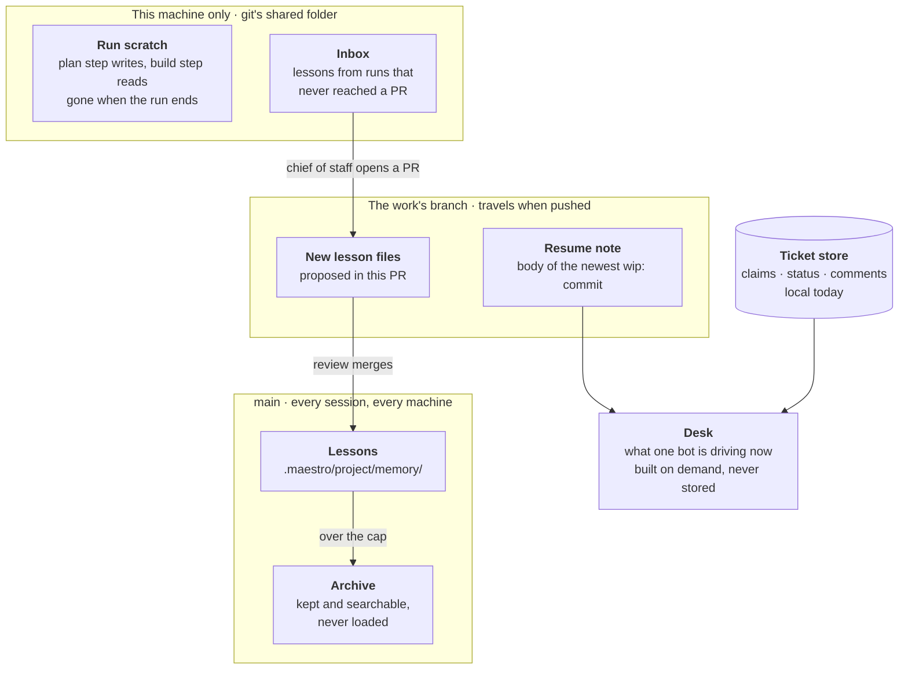
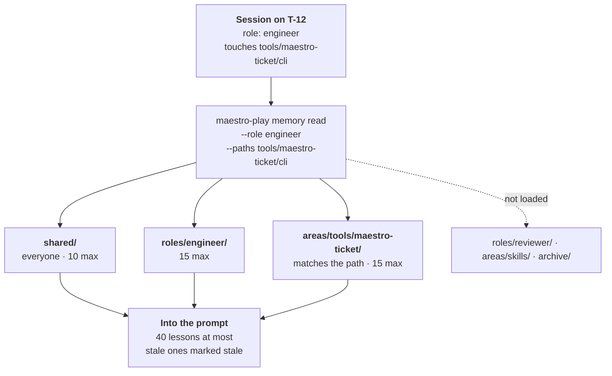
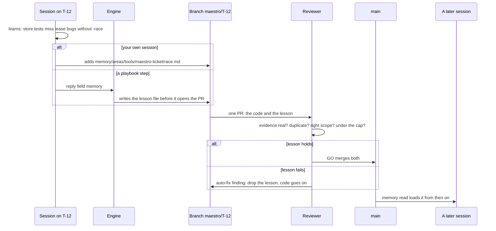
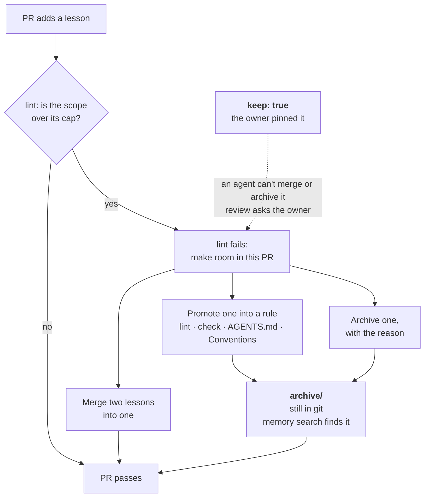
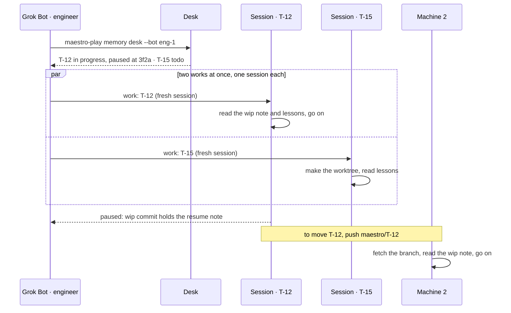

# Memory for a swarm (draft, not built)

Two kinds of memory. **Short term** is what one piece of work needs to resume: it lives with the work and goes when the work merges. **Long term** is lessons: things a future session needs that the code, git and tickets can't show. Lessons are files in the repo, so git carries them to every machine, and they reach `main` only through a reviewed PR.

## 1. Where each kind of memory lives

Nothing new syncs between machines. A run's scratch never leaves the machine it ran on. The resume note rides on the branch. Lessons are committed. The one piece that doesn't travel today is the ticket store, which is a local SQLite file; going multi-machine means a shared ticket store first, through the Postgres driver its README describes.

## 2. Which lessons a session loads

Lessons have a scope: everyone (`shared`), one role (`roles/<role>`), or one part of the code (`areas/<path>`). A session loads only the scopes that match its role and the paths it touches, so hundreds of agents each read a short list instead of one giant file. In a playbook step the engine picks the scopes from the ticket's `areas` and the run's role; in your own session you run the same command.

## 3. How a lesson gets in

No curator. A lesson rides in the same PR as the work that taught it, and the reviewer, from another model family, judges it with the code. A bad lesson gets dropped; it never blocks good code. A run that stops before it reaches a PR (often the one that learned the most) leaves its lesson in the inbox, and the chief of staff turns the inbox into a normal PR while it handles the escalation.

## 4. How the cap works without losing anything

The cap limits what loads, never what's kept. Lint fails the PR that would push a scope over its cap, and that PR makes room: merge two lessons, promote one into a rule, or archive one with a reason. Promotion is the best way out for an important lesson: a rule in a lint, a check or `AGENTS.md` can't be forgotten. Archived lessons stay in git and `memory search` still finds them. A `keep: true` lesson only the owner can move.

## 5. One Grok Bot, many sessions, two machines

Grok Bot holds none of this in its head. Before it starts anything it reads its desk, which is built from claims, runs and worktrees, so it can't drift. It names the work in every prompt, runs at most one live session per work, and starts each one fresh: the session picks up from the resume note and the lessons, not from old chat. Moving work to another machine means pushing the branch.

## Still open

1. Runs that never reach a PR: keep the inbox for them, drained by the chief of staff? (Proposed: yes.)
2. A goal scope, so sibling tickets from one planner goal share findings while they run. Needs a `--goal` ticket field. (Proposed: wait for a real need.)
3. Cap sizes: 15 per area or role, 10 shared, 8 lines per lesson?
4. Only the owner sets `keep: true`?
