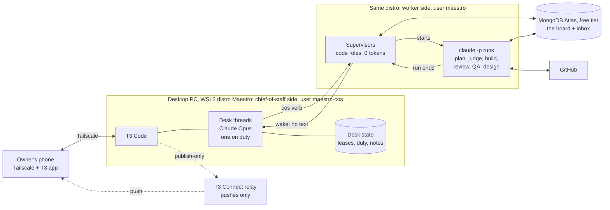
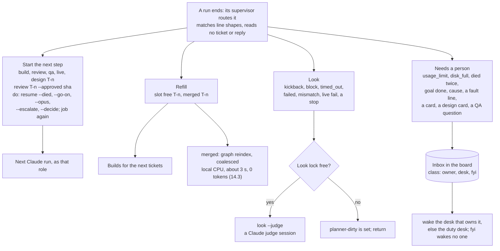
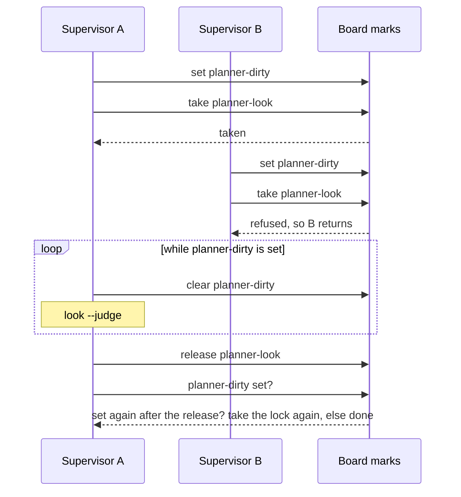
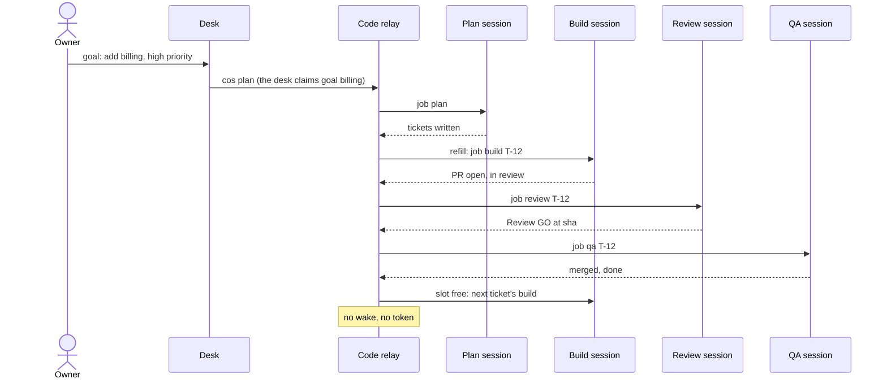
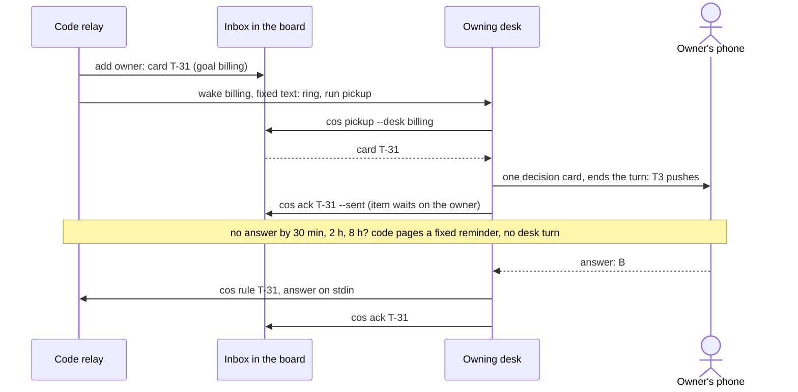
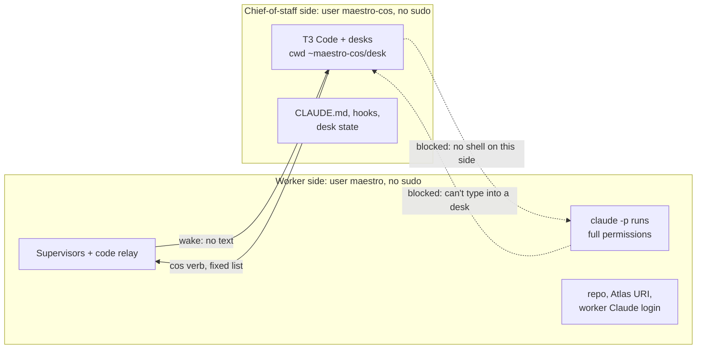
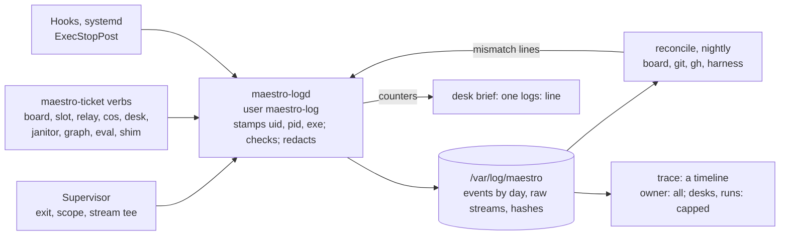
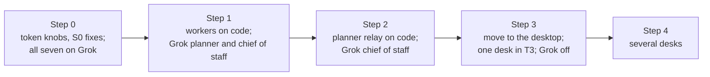
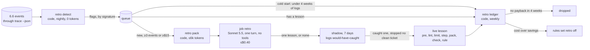

# T3 runtime: a spec for Maestro without Grok Bot

**Status:** draft v13, 2026-11-20. A review proposal on top of v3 (PR #105), for the owner to diff against `docs/design/t3-runtime.md`. v4 added several desks, the phone path, the token plan and the review's fixes; v5 moved the design onto the owner's Windows desktop PC with pushes through T3 Connect. **v6 takes the owner's answers of 2026-11-19, 19:46-19:51 PT** (decisions log, 19.2): the Sonnet moves go ahead behind their evals, effort stays high, the graph re-indexes on merge, the board is Atlas's free tier, the first desk opened has duty, relay-down needs no second channel, and no agents run natively on the owner's Windows account. **v7 adds cleanup** (6.4): a janitor that frees disk before claims are refused, a scratch folder and a memory cap for each run, and a disk that gives space back to Windows, from what fills `grok-bot-vm` today. **v8 adds browsers** (6.5): QA runs test in parallel, each with its own headless Chromium and its own app, under its run's memory scope, with a cap, a reaper and the install for WSL. **v9 puts the code graph to work** (14.3): code queries it before each run and hands build, review and QA a capped pack; every merge re-indexes, and each PR gets an overlay; runs load no MCP server by default. It rests on measurements of real PRs on the VM. **v10 makes the runs harness-neutral** (8.1): one small adapter per harness, Claude's first, and a harness per slot behind the same evals as a model move, with one command back to Claude. It also **scripts QA** (14.6): Opus writes a ticket's test script once, and Sonnet runs it at tiers 0-1, handing any surprise to Opus. **v11 adds logs and traces** (6.6): code writes every line, in one schema, through a writer no run can edit; raw streams are kept with their hashes; the harness's own tokens, cost and plan usage are logged as given; a nightly reconciler checks the logs against the board, git and the harness; and people read a `trace` timeline at no token cost. It starts from what the VM's records lose today. **v12 adds a retro that pays for itself** (14.7): code finds the week's waste in the logs at no token cost; only a repeated signature gets one capped Sonnet run, which names the earliest point it could have been caught and one change; the change lands as a check, a lint, a script step or a pack line before it is ever prose; and a ledger keeps a lesson only while it saves more than it cost, and switches the retro off when the retro doesn't. **v13 designs out last week's waste** (1.1): each class measured on the old system maps to a gate built into the new one (a code check before a build is handed out, a `git merge-tree` and plan-areas check before a review, a reason on every cancel, criterion ids and an edge-case list per area, time limits sized from the logs with one warm resume, a cost ceiling per ticket, rules as code). The old numbers become a baseline (Appendix A), not the retro's target: the retro works only on the new system's own logs, detect-only until it has 4 weeks of them. Nothing here is built.
**Labels:** **[code]** means checked in the source at the `file:line` given; "built" means `GOOS=windows go build` was run on it. **[box]** means checked on `grok-bot-vm`, where Maestro runs today, on 2026-11-19 (1.1, 6.4, 6.5, 6.6, 14.3, 14.7, Appendix A: 2026-11-20). Nothing was checked on the desktop: every desktop claim is **[docs]** or **(guess)** until the probe in 16.3 runs. **[docs]** means a vendor doc or release note says it. **(guess)** means nothing has shown it. **[I]** is an inference from measured data. Sections 11 and 16.3 list the probes.

## 0. The point

1. Grok Bot goes as the runtime. It bills each model call times its whole chat, about 100-200K cached tokens a call ([decisions](../decisions.md), 19). Its seven profiles stay in `bot-profiles/`; setting a bot's webhook again brings it back.
2. Each role gets a **server**: a webhook (a Grok bot), a command (the chief of staff's wake), or code (the planner's routing and the five worker roles). Every "does this bot have a webhook?" becomes "is this role served?".
3. All thinking stays in Claude. Planning, judging and rulings run as Claude sessions, as today. Code takes only the relaying Grok bots did (section 3). Claude is the default, not a hard-wired part: point 13.
4. The chief of staff is one or more **desk** threads in T3 Code. The owner talks only to desks, from the T3 app on the phone over Tailscale (5.5). Desks sit behind a wall: no worker session can type into one, and a desk reaches the board only through `maestro-ticket cos <verb>`.
5. Several desks can run at once. Each owns its goals by a 24-hour lease, and all read one small desk state, so each knows what the others do. **The first desk opened has duty**; when it closes or its lease lapses, the next-oldest live desk takes it, atomically (5.4). The duty desk gets what no desk owns and alone changes board-wide settings.
6. Code tells, Claude decides. Code sorts each inbox item as *owner*, *desk* or *fyi*. Only *owner* and *desk* items wake a desk, and a reminder about a card is a push from code, not a model turn (5.2).
7. The runs get cheaper: Sonnet 5.5 for four jobs, and for scripted QA at tiers 0-1 (14.6), each after its own eval set passes; effort high everywhere; a 5-minute cache for build and QA; a code graph that code queries for the runs (point 12, section 14).
8. One machine: the owner's Windows desktop PC. Everything runs in one WSL2 distro, `Maestro`, with systemd, two Linux users and the wall between them (section 6), and a third user that owns the logs (6.6), unless the 30-minute probe in 16.3 says T3 belongs on native Windows. The board lives on MongoDB Atlas's free tier (7). One Claude Max 20x plan runs it all.
9. One push channel: T3 Connect, linked **publish-only**, so no tunnel and no cloudflared. Access is Tailscale only. If the relay is down, the failure is shown wherever the owner looks next, and a daily heartbeat push makes silence noticeable. There is no second channel (5.5).
10. Cleanup is code. A nightly janitor, also started when free space or inodes fall under 20%, frees what is safe before claims are refused at 10%. Each run gets its own TMPDIR and a 4 GB memory cap, so one heavy build fails alone (6.4).
11. QA tests in parallel: one headless Chromium and one copy of the app per QA run, `qa_slots` of them (4 on a 32 GB PC, guess), in the run's memory scope, which is stopped at the run's end. A shim caps browsers and refuses `close-all` (6.5).
12. Code queries the code graph; runs read a pack. Before build, review and QA, code writes a capped pack: changed symbols, their callers, the blast radius, and the pages a change reaches. It is at most 2,000 tokens, and 400-1,400 on real PRs **[box]**. Each repo's index is rebuilt on every merge in about 3 seconds, with an overlay for each PR. Runs load no MCP server by default, and `rules set graph off` turns it all off (14.3).
13. Any harness can fill a slot. Every Claude assumption in `maestro-ticket` (the `claude -p` flags, session ids, the stop hook, the stream and cost parsing, the usage-limit words) moves behind one adapter per harness. Claude's adapter is built first, with no change in behaviour. Later, `rules set harness <slot> grok|codex|…` moves one role at a time, behind the same eval gate as a model move, and `rules set harness all claude` puts every slot back. Skills, the board, the verbs, the packs, the evidence and the wall stay harness-neutral (8.1).
14. Code writes every log line; models never do. Each hop, from a desk's wake to a run's last tool call, is one line in one schema, sent to `maestro-logd`, a writer under its own user that no run can edit. Lines carry the harness's own tokens, cost and plan usage, marked where the harness reports none, and the raw stream is kept beside them with its hash. A model's word, such as a verdict, is logged as a claim with its hash. A nightly reconciler checks the logs against the board, git and the harness. People read `maestro-ticket trace`; desks see one `logs:` line in `desk brief`; no log enters a context unasked, so logging costs no tokens (6.6).
15. Last week's waste is designed out, not learnt. On the old system, $1,617 of a week's $3,549 went to cancels after a build, kickback loops, killed runs and reviews with no verdict **[box]**. Each class now has a gate built in, mostly code at no token cost: a check before a build is handed out, a `git merge-tree` and plan-areas check before a review, a reason on every cancel, criterion ids and an edge-case list per area, time limits sized from the logs, a cost ceiling per ticket, and rules as code (1.1). Those numbers are the baseline the new system is measured against (Appendix A), not a target.
16. The retro pays for itself, or stops. Each night code reads the new system's logs and flags waste by fixed triggers: two kickbacks, 3× the tier's cost, a diff outside the plan, a cancel after a build, a no-verdict strike, a killed run, a repeated failure. Until 4 weeks of those logs exist it only detects, and no model runs. After that, only a signature that repeats gets a model: one Sonnet run, one turn, a pack code builds, $0.40 at most, and one change back, under a weekly cap set by the waste the logs measured. Changes land as checks, lints, script steps or pack lines, not prose, tried in shadow first. A ledger drops any lesson that doesn't pay back in 4 weeks, and turns the retro off when its cost passes what it saved (14.7).



## 1. The owner's answers

The calls that shaped v3-v5. The answers of 19:46-19:51 are in the decisions log (19.2) and applied throughout.

| Call | Answer (2026-11-19) | Where |
|---|---|---|
| Accounts | One personal Claude Max 20x plan; maybe a Team plan later | Section 8; 12.2 for later |
| Second user for the chief of staff | Yes | The wall, section 6 |
| Main machine (18:01) | The owner's Windows desktop PC, not `grok-bot-vm`; WSL or native, whichever performs better | 6, 16, 17 |
| Pushes (18:01) | Through the T3 Connect relay, not a Slack DM | 5.5 |
| Planner as code | "Isn't the planner the product manager?" | Section 3 answers it |
| Several boxes | One machine | Section 12 keeps the audits' findings for later |
| Where the board lives | MongoDB Atlas; free tier (19:46) | Section 7 |
| Rewrite the rules | Yes, a full rewrite | Section 9 |
| Several chief-of-staff sessions | Yes, each knowing what the others do | 5.4 |
| Remote path | Tailscale into the main machine, T3 on the phone | 5.5 |
| Token use | High quality on fewer tokens; Sonnet where quality holds | Section 14 |

### 1.1 What last week's waste tells the design

The owner, 2026-11-20: "We're factoring in for our new design. The findings now should just be used as insights for how we design the new system." So each class of waste measured on the old system maps here to what stops it in the new one by construction. The old system is Grok Bot and `maestro-ticket` on `grok-bot-vm`, agency-ops, the 7 days to 2026-11-20: $3,549 at list **[box]**. The full table and its method are in Appendix A. Where the design already had the fix, the row points there. **New** marks what v13 adds. The dollars are the old system's, measured unless marked; they size the problem and are not a target.

| Waste class, old system | $ / week | Designed out by | Build |
|---|---|---|---|
| Cancelled after a build: 68 tickets, 52 with no note, 7 rewritten or split, 6 folded into another | 629 (777 with their later runs) | **New: a wanted check before a build** is handed out, in code, at no tokens. The goal is open, no card or ruling waits on the ticket or its goal, and no other open or merged ticket overlaps its areas (by path; by symbol once the graph is in, 14.3's plan overlap) unless the plan named the dependency. A fail parks the ticket for `job plan`, and no build starts. **New, decided by design: a cancel names its reason** from a fixed list (`split`, `folded`, `superseded`, `owner`, `wrong-plan`, `stale`), checked by code. With no reason, `transition … cancelled` is refused (was Q30) | S2 |
| Kickbacks for merge conflicts: 42 | about 156 | **New, built in rather than learnt: a stale-base check before a review** is handed out, `git merge-tree --write-tree origin/<main> HEAD`. A conflict sends the ticket back to its engineer with the files, counts as no strike, and starts no review run. Tickets whose areas overlap get a dependency at plan time, and `create --lint` refuses an overlap without one: rule 39's one lane, as code. 14.3's merge check still covers callers that main changed | S2; S12 for symbols |
| Kickbacks for criteria missed or misread: 42 | part of 527 | Each criterion already has its input and what must show, and steps in a `## QA script` written before the build (14.6). **New:** criteria carry ids (`c1`, `c2`…); the build reads the script as its acceptance list; its handoff names each id with its test or `n/a: <why>`, and the stop check refuses a handoff that misses one. Review reads the criteria by id | S14 |
| Kickbacks for masking edge cases: 51 (rule 55's "18 one-case tickets") | part of 527 | **New: one case list per area,** `docs/cases/<area>.md` in the project repo. The plan cites it, the QA script runs each row as an `edge:` step, and the fix for a case a kickback finds adds its row and its test. A third open one-case ticket on one file is refused by `create --lint` with "rewrite the lane": rule 55 as code, built in rather than a 14.7 lesson | S6, S14 |
| Kickbacks for test gaps: 7 | part of 527 | the same handoff line: each criterion's test, or why there is none | S14 |
| Killed at a time limit: 66 of them reviews at the 45-minute floor of `reviewLimit` **[code]** `cli/job.go:141-144` | 162 | Review subagents in the foreground, and no end before a verdict (14.1), remove the wait many of them died in (guess). **New:** each job's limit is the 95th percentile of a week of its `ms.wall`, by tier, × 1.5, as 6.4 sizes memory. A run that hits it is resumed once, at once, while its cache is warm: "time's up: post your verdict or handoff from what you have", 10 minutes, 3 turns. Its session and worktree are kept (8.1), so the resume finishes rather than restarts. A second hit is a strike | S7; S15a for the sizing |
| Stopped by a launcher | 60 | every stop is logged as `stop {cause, by}` (6.6), and a stop asked for is no strike (3.3). **New:** a stop by a role names a reason from the cancel list. The wanted check should stop most such builds before they start (guess) | S0, S2 |
| Killed by low disk | 6 | the janitor frees space before claims are refused (6.4) | S10 |
| Killed runs missing from `costs` | 274 of the 348 | a killed run's cost is read from its transcript, else `null`, never 0 (6.6) | S15a |
| No verdict: 80 reviews and 18 QA runs, 16 strikes | 113 | review subagents in the foreground and no end before a verdict (14.1, B1); a stop asked for is no strike (3.3); a verdict is a claim code checks against gh (6.6) | S0, S7, S15a |
| Beyond the plan: 26 of 254 merged tickets changed non-test files outside their areas; 35 had their areas widened | about 120-260 **[I]** | **New: the plan's areas on `board.created` are the contract.** The stale-base check also lists non-test files outside them. Any puts `scope=+N` on the review's handout, and the review rules on each: in, or a new ticket. Widening areas needs `--why`, and is logged. A flag, not a block: some widening is right | S2 |
| Cost outliers: 12 tickets over 3× their tier's median | 263 over the median | **New: a ceiling per ticket.** Its spend is on the board. At 3× its tier's 4-week median, code starts no further round and sends the ticket to the judge (`look --judge`) with its `trace --cap 600`, to split, rewrite or let go on | S2 |
| Re-explore turns | 149-293 **[I]** | the graph packs (14.3) | S12 |
| Repeat failures: the third or later event of one signature | 831, of which 588 had a fix in flight | every fix that was in flight is built in: rules 35 and 38 are the stale-base check, rule 55 the one-case lint, B1 is 14.1, #102's stops are 3.3. Rule 39 becomes the overlap lint. What had no fix is left to the new system's retro, on its own logs (14.7) | as above; S16 |
| Rule text in prompts: 25 KB, 3× the budget | about 28 **[I]** | the rewrite (S6) carries no standing rule that a gate above enforces; `rules add` refuses past 8 KB rather than warning (14.5); lessons land as code before prose (14.7) | S0, S6 |

The kickbacks' causes are read from their words **[I]**. The new gates are code: none adds a model turn, and the only new text in a prompt is the handoff's criterion lines and the case rows a ticket's area has.

**What this leaves the retro.** The gates cover the classes the old system showed. The new system will have its own. `retro detect` counts the same triggers on the new logs, and the brief sets each class against this baseline (14.7 item 1). That is also how each gate shows it works.

## 2. Who serves each role

| Role | Today | T3 runtime |
|---|---|---|
| Junior, senior engineer | Grok webhook | code |
| Reviewer, QA lead, designer | Grok webhook | code |
| Planner | Grok webhook | code for the routing; Claude for the thinking (section 3) |
| Chief of staff | Grok webhook | command: wake a desk thread (section 5) |

`maestro-ticket notify set <bot>` takes one of `--url-file` (today), `--exec-file` or `--code`. The chain, `look` and the supervisor read that server through one `served(bot)` check. Today each reads `hasHook`:
- `handOn` **[code]** `tools/maestro-ticket/cli/chain.go:247`;
- `startSends` **[code]** `tools/maestro-ticket/cli/look.go:282`;
- the refill and ack gates **[code]** `tools/maestro-ticket/cli/chain.go:110-120`;
- `runDo` **[code]** `tools/maestro-ticket/cli/chain.go:178`;
- the ring itself **[code]** `tools/maestro-ticket/runs/supervise.go:473`.

The servers mix, so the move off Grok goes one role at a time (section 10).

A served role's runs also have a **harness**, Claude Code for every role today. A **server** says what starts the work: a webhook, a command or code. A **harness** says which agent program does it: `rules set harness <slot>` (8.1). The two are independent. A code-served build can run on any harness with an adapter, and a desk is a T3 thread on whichever engine T3 offers. Moving a slot off Claude needs its eval set (14.2), the same as a model move.

## 3. The planner: Claude thinks, code relays

The planner is still the product manager. What changes is who carries its messages. Decision 19 already bars the Grok planner from reading a ticket, a PR or a reply to judge it, so every planning and judging call already runs in a Claude session. The Grok bot only wakes, runs `look`, passes lines on and acks. That relay is the part code takes.

| Planner's work | Who does it today | T3 runtime |
|---|---|---|
| Turn a goal into ordered, tiered tickets with criteria | Claude: `job plan`, the **maestro-planner** skill | same |
| Split or rewrite a ticket, carry out a ruling, finish a split | Claude: `job plan`, `job rule` | same |
| Judge blocks, disputed findings and parked tickets | Claude: the judge session `look --judge` starts | same |
| Ask the chief of staff before changing scope | Claude: the plan session leaves a card | same; the card goes to the inbox |
| Pick what starts next, fill slots, route by tier | code: `look`, refill, the chain | same |
| Wake on a message, run `look`, pass lines on, ack | Grok bot | **code** (3.1) |
| Report progress, ETAs | Grok bot, from `look --report` | a desk runs `cos look`; the plan session records each ETA it gives |

A standing planner thread in T3, with its own memory between goals, could come later. It would wake on every planner line, so it costs more than code. Not part of this build.

### 3.1 What the code relay does

A run's supervisor routes the run once it ends **[code]** `tools/maestro-ticket/cli/chain.go:51`. When the role the result is for is served by code, the supervisor acts on each line in its own process:



| Line | Code does |
|---|---|
| `build`, `review`, `qa`, `live`, `design <id>` | Starts it as that role. Today `chainLine` takes only the first three **[code]** `tools/maestro-ticket/cli/chain.go:29`. QA starts only into a free QA slot (3.3). A build starts with its graph pack; review and QA build theirs in their prep scripts (14.3). |
| `review <id> --approved <sha> --drop …` from a judge | Starts that review |
| `do: resume <run> --died`, `--go-on`, `job again <run>` | Runs it, as now **[code]** `tools/maestro-ticket/cli/chain.go:169` |
| `do: resume <run> --opus`, `--escalate`, `--decide`, `job again <run> --full` | Runs it. Fixed shapes too; the grammar still allows no rules write. |
| `slot free`, `merged` | Refill **[code]** `tools/maestro-ticket/cli/look.go:304`. `merged` also runs `graph reindex <repo>` under `graph.lock`, dirty first, so a burst of merges makes one or two indexes, not one each (14.3). |
| `kickback`, `block`, `timed_out`, `failed`, `mismatch`, `live fail`, a stop | One `look --judge`, under the look lock (3.2). A stop someone asked for is not a no-verdict strike (3.3). |
| `usage_limit`, `goal <slug> done` | Into the inbox as **fyi**: no wake; the next desk turn and `desk brief` show it (5.2) |
| `disk_full` | **fyi** if the latest janitor pass left free space above the margin, else **desk** (6.4) |
| `died twice`, `cause …`, a fault line | Into the inbox as **desk** |
| a card, a design card, a QA question, `store-down` | Into the inbox as **owner** |

Then it acks the run. A run a usage limit stopped stays unacked, as today, so its ring at the reset fires **[code]** `tools/maestro-ticket/cli/launch.go:409`. With code as the server, that ring runs the run's `do: resume --go-on` line. The same holds for a handoff a pause held, and for the STOP lift.

Each line the relay acts on writes one `route` event naming the row above that matched, and each try for the look lock writes a `look.lock` event: taken, refused or a stale takeover (6.6). So when the relay stalls, `trace` shows which line shape it saw and what it did, with no model turn.

It never forwards a full `--report`. The planner's persona sends a report only when a goal finishes, the line stops, a block needs it or a desk asks, and the relay keeps to that.

### 3.2 The look lock

300 runs can end in one minute. They must not each start a look. A run's end **sets `planner-dirty` first, then tries the lock**, so no end is ever missed.



- The mark expires after 10 minutes. A stale one is taken over, as handouts are (`moveStale`, **[code]** `tools/maestro-ticket/cli/look.go:107`), so a supervisor that dies mid-look can't stop the relay for good.
- After the release, the holder checks `planner-dirty` once more and tries the lock again if it is set. A loser that set dirty after the last clear has either found the lock free and taken it, or will be seen by that check.
- `look` already marks each row it hands a judge **[code]** `tools/maestro-ticket/cli/look.go:410`, so a second look never judges the same row again.

### 3.3 Two fixes the relay needs first

The relay acts at machine speed, so two bugs a person or a Grok bot used to absorb now bite (both were in closed PR #102; they come back as step S0):
- **A stop someone asked for counts as a no-verdict strike.** `noVerdicts` leaves out only launcher-stopped runs **[code]** `tools/maestro-ticket/cli/route.go:824`; `stoppedOnPurpose` **[code]** `route.go:1003-1011` is checked only on the first-rerun branch. The fix leaves out `runs.StopAsked` runs too. Then standing rule 32 goes.
- **QA is handed out past the free QA slots,** and the extra runs wait in `slot`. The fix: `look` and refill hand out QA only up to the free `qa_slots`. Then standing rule 33 goes.

## 4. A ticket's life in the T3 runtime



A send-back from review or QA goes straight back to the engineer. A block goes to the judge. Only what needs a person reaches a desk, and the desk that owns the goal gets it.

## 5. The chief of staff

### 5.1 The desk threads

- A desk is one Claude thread in T3 Code, on Opus, in full access, so tool asks never reach the phone ([decisions](../decisions.md), 12). The owner opens as many as they like; each has a short name (`billing`, `ops`), and its T3 title starts `[CoS] <name>`.
- Desks run as user `maestro-cos`. Their persona, the team rules and the `cos` and `desk` verbs sit in `~maestro-cos/.claude/CLAUDE.md`, built by `scripts/bot-bundle.sh`. A separate user gives a separate config dir, so T3 needs no config-dir setting (its 0.1.0 Claude provider has only `binaryPath` and `customModels` **[box]**). Claude Code loads this `CLAUDE.md` in every session and again after compaction (guess; P0).
- **A desk thread starts in `~maestro-cos/desk/`, never in the repo.** A session started in the repo loads the repo's `CLAUDE.md`, `.claude/settings.json` (whose hooks run a shell), `.claude/skills` and `.mcp.json` **[box]** `blitzlink-agency-ops/`. The worker user can write all of these, and a merged PR can change them: a door through the wall.
- `CLAUDE.md` stays under 4 KB: the persona's core, the verb list and the card format. Longer procedures (dependency audits, outside steps, design cards) live in the `maestro-chief-of-staff` skill, read when needed.
- **Context cap.** Claude threads in T3 on `grok-bot-vm` run at a median of 127k context per request, every cache write on the 1-hour TTL **[box]** (957 requests, `~/.claude/projects/-home-box-t3work-eggbot`). A desk woken after an hour rewrites its whole context, about $1 of cache write at 127k **[I]**. So desks auto-compact at about 40% of the window (`CLAUDE_AUTOCOMPACT_PCT_OVERRIDE` in the desk service's environment **[docs]**, P0). After compaction the desk runs `desk brief` (5.4).
- Auto-memory is off (`CLAUDE_CODE_DISABLE_AUTO_MEMORY=1`), as in worker runs **[code]** `tools/maestro-ticket/cli/job.go:104`. The desks' shared memories are one file, `desk/memory.md`, written only through `desk remember` and imported by `CLAUDE.md`.
- A desk reads what is short itself. Long reads (a PR, many tickets) go through `cos ask`, a separate lean run, so its own context stays small.

### 5.2 The inbox



- The inbox is a space in the board's coord store, `inbox/chief-of-staff`. Each item is one line of a fixed shape, with a run or ticket id, a goal slug when there is one, and a class: **owner** (only the owner can answer: cards, design cards, QA questions, `store-down`), **desk** (a desk can settle it: died twice, a cause, a fault line), **fyi** (no one need act: usage limit with its reset, a disk full the janitor has since freed, goal done). A disk full the janitor couldn't free is **desk** (6.4).
- Code adds items. `cos pickup --desk <name>` returns the items for goals that desk owns, plus unowned ones if it has duty, and leases each to that desk for 2 hours. A second desk's pickup skips leased items, so two desks never act on one item. Only the holder's `cos ack` removes an item. A lease that runs out puts the item back for its owner or the duty desk.
- **`cos ack <id> --sent`** marks an owner item as sent. It stops the wake rings for that item. From then on, code sends the owner a fixed-text reminder at 30 minutes, 2 hours and 8 hours through the pager thread (5.5), with no desk turn. Without it, the 5, 10 and 40 minute re-rings would wake an Opus thread three more times per card, at about 13 cards a week **[box]** (`tickets.db`, 13 card parks over 11 tickets in 7 days).
- **fyi items wake no desk.** The next desk turn and every `desk brief` lead with them.
- A card's text stays data, as [decisions](../decisions.md), 7 says. It is still text a worker session wrote (6.0).
- The wake goes through the existing gate: at most once each 4 minutes **[code]** `tools/maestro-ticket/runs/gate.go:19`, and again at 5, 10 and 40 minutes while a **desk** or unsent **owner** item waits unleased **[code]** `tools/maestro-ticket/runs/supervise.go:46`.
- If Atlas is down, code can't write the inbox. Then the wake goes to the duty desk and carries one fixed word, `store-down`. The duty desk tells the owner, and runs `cos look` once Atlas is back.

### 5.3 The `cos` and `desk` verbs

`cos` verbs cross the wall and run on the worker side, as user `maestro`:

| Verb | Runs, signed as |
|---|---|
| `pickup --desk <name>`, `ack <ids> [--sent]` | the inbox, as `chief-of-staff` |
| `plan` (goal on stdin), `rule <id>`, `resume <run-id>` | `job plan`, `job rule`, `resume`, as `planner` |
| `look` | `look --judge --report`, as `planner`. It also restarts a quiet board after a reboot or an outage. |
| `rules show` | as `chief-of-staff` |
| `rules set limit <n>`, `rules set qa_slots <n>`, `rules set model <job> <model>`, `rules set graph off\|pack\|live` (14.3), `rules add`, `rules drop <n>`, `stop`, `start` | **the duty desk only**, checked under the duty lock (5.4), as `chief-of-staff`, which `rulesWriters` already allows **[code]** `tools/maestro-ticket/cli/rules.go:48`. Another desk gets `refused: duty desk is <name>`, and sends it a note. |
| `retro` (one `job retro` per queued signature, under the week's cap), `lesson add <id>`, `lesson drop <id>`, `rules set retro on\|off` | **the duty desk only**, as for `rules add` (14.7) |
| `ask` (question on stdin) | a `/maestro-chief-of-staff` run on the worker side; its answer comes back through the inbox, to the desk that asked |
| `list`, `get`, `events`, `goals`, `flow`, `eta`, `costs` | as today's commands, as `chief-of-staff` |
| `trace <id>` | a rendered timeline, capped at 1,500 tokens, with claims as hashes; never a raw stream (6.6) |

`cos` refuses any verb off this list. `desk` verbs stay on the chief-of-staff side, as user `maestro-cos`, and never cross the wall (5.4).

### 5.4 Several desks

The owner opens a desk, works on billing, and later opens another for an outage. The second desk must know that billing is taken, what the first has promised and is waiting on, and which desk has duty.

**Where.** The desk state lives on the chief-of-staff side, in `~maestro-cos/desk/state/`, in the coord store's file mark format: create-or-fail and stale takeover **[code]** `tools/maestro-ticket/cli/coord.go` (`create`, `takeOver`). Only `maestro-cos` can write it; a copy in Atlas would let any worker session plant a note every desk reads. It sits on the same disk as the desks' T3 threads, and the nightly backup (17.4) copies both, so a restore takes them back together; leases run out and `desk brief` then shows the real board.

**On the desktop.** The state sits on the distro's ext4 disk, so the file marks work as on Linux today: `O_EXCL` create, write-then-rename, and `flock` **[code]** `cli/coord.go:199-288`, `runs/sys_unix.go:19-43`. Two rules:
- **Never under `/mnt/c` or `\\wsl.localhost`.** Those go through WSL's file bridge, which is far slower **[docs]**, and whose locks a process across the bridge may not see (guess). The same goes for the repo, worktrees, the store folder and T3's data. With automount off (6.2), `/mnt/c` isn't there.
- **One clock.** Leases and `beat_at` compare wall-clock times. A WSL2 clock can drift after a sleep (guess, 16.3 step 5). The PC doesn't sleep (16.2), and the distro runs `systemd-timesyncd`.

If the probe moves T3 to native Windows (option B, 6.1), the `desk` command needs `LockFileEx` and a retry on rename, and the hooks a Git Bash or PowerShell form (`flock` stubs refuse there **[code]** `runs/sys_other.go`).

**The state**, one small JSON file each:

| File | Fields | Rules |
|---|---|---|
| `desks/<name>` | `name`, `thread` (T3 thread id), `session` (Claude session id), `focus` (one line), `opened_at`, `beat_at` | `desk open <name>` creates it, or fails if a live desk has the name. A desk is **live** while `beat_at` is under 24 hours old, and **here** while under 15 minutes old. `desk close` moves it to `closed/`. |
| `goals/<slug>` | `desk`, `claimed_at`, `lease_until` | `desk claim <slug>` creates it. **The lease is 24 hours**, renewed by each of the owning desk's turns. A stale claim is taken over by the next claimer, or by the duty desk. `desk release <slug>` hands it back. `cos plan` claims the goal it plans. |
| `duty` | `desk`, `epoch`, `since`, `lease_until`, `why` | Written only under `duty.lock` (below). The lease is 24 hours, renewed by the duty desk's turns. |
| `duty.log` | one line per epoch: time, epoch, from, to, why | append-only; `brief` shows the last change |
| `notes/<name>/<time>` | a handoff note (format below) | `desk note` appends; `brief` shows each desk's latest note. Pruned after 14 days. |
| `memory.md` | the desks' shared memories | `desk remember` appends one line under a lock; the retro ledger (14.7) proposes cuts. Under 4 KB. |

**Duty: the first desk opened, then the next-oldest.**
- **Who.** `desk open` makes the new desk the duty desk when no live desk holds duty. Duty stays put while its holder is open and its lease is current. When the duty desk **closes** or **its lease lapses**, duty goes to the live desk with the oldest `opened_at` (ties by name). If no desk is live, `duty` is empty and the next `desk open` takes it.
- **Atomic.** Every write to `duty` happens inside one exclusive `flock` on `state/duty.lock`, the lock helper `desk remember` uses **[code]** `runs/sys_unix.go:19`. Inside it: read `duty`; if the holder is open and its lease current, stop; else pick the successor, write the new `duty` with `epoch + 1` by write-then-rename, and append to `duty.log`. One lock serializes every writer, and the file is replaced whole, so a reader sees the old holder or the new one, never two.
- **When it runs.** `desk open`, `desk close`, `desk beat`, `desk brief` and `desk ring` each run this check first. So duty moves at the first desk event after a lapse, and `desk ring` always checks before it routes unowned items. If `t3 thread send` to the duty desk fails (its thread gone; P0 checks the exit code), `desk ring` treats the lease as lapsed and moves duty at once.
- **Board-wide verbs hold the lock.** A desk's `cos rules …`, `stop` and `start` run through the cos-side `maestro-ticket cos --desk <name>`, which takes `duty.lock`, checks that `duty.desk` is `<name>`, crosses with sudo, and releases. A takeover waits for a write in progress, so no write lands from a desk that has lost duty. This keeps desks in step; it is not the wall (section 6 is).
- **Closing.** `desk close <name>` runs when the owner tells a desk it's done; the `SessionEnd` hook runs it too, if T3 ends the Claude session when a thread is archived (guess, P0). It writes the desk's last note, moves duty first if the desk held it, then releases its goals to the duty desk.
- **The new holder** gets the fixed ring `ring: you have duty, run pickup`, and every desk's next brief shows the change.
- There is no manual takeover verb: the order is the rule.

**Heartbeat, with no model tokens.** The desks' `~maestro-cos/.claude/settings.json` sets three hooks. `Stop` runs `maestro-ticket desk beat`, which reads the session id from the hook's input and renews `beat_at` and the desk's leases (goals, and duty if it holds it). `SessionStart` (startup, resume, compaction) runs `maestro-ticket desk brief` and adds its output to the context. `SessionEnd` runs `desk close`. Hooks are code: the heartbeat costs nothing, and a desk can't forget it.

**Logged, with no model turn.** Each `desk` event (`open`, `close`, `claim`, `release`, `beat`, `ring` with the `t3 thread send` exit code, a duty move with its epoch) and each `cos` verb also writes one line to `maestro-logd` (6.6). `duty.log` stays the desks' own record, and the reconciler checks the two agree. The `Stop` hook reads the turn's tokens from the transcript's tail (its input carries `transcript_path` **[code]** `cli/stopcheck.go:88-96`), so a desk's spend is logged as a `desk.turn` line.

**The handoff note.** A desk writes one before it goes idle on a goal, when the owner says they're switching, and after each card it sends. At most 10 lines, ids not titles:

```
desk: billing  at: 2026-11-19T22:04Z  goals: billing-v2
doing: plan R-ab12cd34 split T-40 into T-41..T-44
promised: owner: ETA Fri for billing-v2 (eta recorded)
waiting: owner: card T-31 (B or C), sent 21:50Z
waiting: planner: rule T-38
decided: T-29 dropped (owner, card 21:10Z)
next: on T-31 answer, cos rule T-31
hands off: api/ rules set by owner; don't change limit, ops desk is on duty
```

**Catching up.** A new desk, or one back after compaction, gets `desk brief` from its `SessionStart` hook. In 40 lines at most: who has duty, the desks with their focus, goals and presence, each desk's latest note, the fyi items since this desk's last turn, the owner and desk items waiting by goal, one `counts:` line from the board, and the `disk:`, `graph:` and `logs:` lines (6.4, 14.3, 6.6). Under 2k tokens (guess), against tens of thousands for reading another thread. The top of `billing`'s brief, the turn after `infra` closed:

```
you: billing · goals: billing-v2 (lease to 11-20 22:04Z) · not on duty
duty: ops · epoch 4 · since 11-19 15:10Z · lease to 11-20 21:58Z · next in line: billing
duty moved 15:10Z: infra -> ops (infra closed)
desks: ops (duty, here, opened 09:12Z) · billing (here, opened 11:40Z)
board-wide verbs (rules, stop, start): ask ops
```

The duty desk's own first line reads `you: ops · ON DUTY · epoch 4 · lease to 11-20 21:58Z`, with `retro due` (14.7) when a signature is queued and the week's cap has room.

**Waking the right desk.** `maestro-ticket wake` still carries no text. On the chief-of-staff side it runs `desk ring`, which:
1. runs the duty check;
2. reads the inbox counts by goal and class through `cos pickup --peek` (ids, goals and classes only);
3. maps each goal to its owning desk, and the rest to the duty desk;
4. sends each of those desks the fixed text `ring: run pickup`. A desk the owner is typing in (its thread busy) gets it queued.

If no desk is live, `desk ring` pages the owner the fixed text `Maestro: N items, no desk open` (5.5).

### 5.5 The phone path

**Access: Tailscale only.** Tailscale runs once, on Windows, as its Windows service: one tailnet node for the PC, set to run unattended, so it stays up with no one logged in **[docs]**. Inside WSL, T3 serves on `127.0.0.1:3773`. WSL hands a localhost listener to Windows' localhost: through localhost forwarding in NAT mode, or directly in mirrored mode **[docs]**. On Windows, `tailscale serve --bg 3773` publishes it as tailnet-only HTTPS. Three don'ts:
- Don't use T3's `--tailscale-serve` inside WSL. It drives the `tailscale` CLI, which lives on Windows.
- Don't run a second `tailscaled` inside WSL: a second node with its own login, which may fight the Windows client over routes (guess).
- Don't bind `0.0.0.0`. T3 0.1.3 and later can serve to the LAN **[docs]**. Bound to `127.0.0.1`, only Tailscale Serve reaches it.

The phone runs the Tailscale app and the T3 app, and pairs once with `t3 pair`, which prints a QR code **[box]**. Nothing listens on a public address.

**T3 Connect is for pushes only.** T3 0.1.0 has `t3 connect link --publish-only`: "Link to publish agent activity only — no managed tunnel. Reach this environment out of band (e.g. Tailscale)" **[box]**. `grok-bot-vm` has the full link today, with a managed cloudflared 2026.10.0 **[box]** (`t3 connect status`). The desktop gets the publish-only link and nothing else. P0 (16.3 step 7) confirms: a push reaches the locked phone; no cloudflared runs; with Tailscale off on the phone, pushes arrive but the app can't open a thread.

**Pushes: one channel, T3 Connect.**
- **Desk turns.** T3 pushes when a desk's turn ends (`t3 connect publish`, off on the VM today **[box]**). That covers every card and every answer.
- **Code's own pushes**: the reminders (5.2), `no desk open` (5.4), the heartbeat, and `store-down` when no desk is live. T3 0.1.0 has no command that pushes without a turn **[box]** (`t3 --help`). So code pages through a **pager thread**, `[CoS] pager`, in project `~maestro-cos/pager/`:
  - It runs on Haiku 5.5 with every tool denied in its `settings.json`. Its `CLAUDE.md` is three lines: each message starts `page:`; reply with the rest of the line, word for word, and nothing else.
  - `maestro-ticket desk page <template> <args>` fills a fixed template. It takes only numbers and goal slugs matching `^[a-z0-9-]{1,32}$`, so no ticket text can reach it. It sends with `t3 thread send` (added in T3 0.1.2 **[docs]**). The turn ends and T3 pushes.
  - The pager thread is replaced each day, so its context stays a few thousand tokens. At about 50 pages a week, well under $1 a week (guess).
  - If the pinned T3 version can push without a turn, use that and drop the pager (P0).
- P0 also checks what a push shows on the lock screen: the thread title, the reply's first line, or both.

**The October OOM risk, on the desktop.** The causes then were **[box]** (`OPS-RUNBOOK.md` §9, `t3-architecture-review.md` §2): (1) the VM was suspended and forked, breaking the tunnel; (2) port 7844 was blocked, so cloudflared ran through a hand-written forwarder and the box's egress proxy; (3) watchdog v1 restarted all of T3 on every relay failure; (4) cloudflared retried with no backoff, and T3 logged every retry: 2.3 GB in 4.5 minutes, then a V8 heap OOM. With a publish-only link no tunnel runs, so 2 and 4 can't happen (P0 confirms). The PC doesn't sleep (1). systemd restarts T3 only when it exits (3). What's left is T3's own publish traffic, which might retry hard while the network is down (guess). Guards: `MemoryMax=3G` on T3's unit, a journald size cap, and `ts-ensure --t3-check` as a systemd timer (RSS and log size, with a warning mark `desk brief` shows). If publish-only still starts cloudflared, a home network has no blocked 7844 (guess), T3 0.1.8 restarts the tunnel client when Cloudflare drops it **[docs]**, and the same guards apply. **Verdict: low.**

**When the relay is down: fail visible, plus a daily heartbeat. No second channel** (decided 2026-11-19).
- **Detect.** A 5-minute timer checks the relay. P0 picks the signal: T3's log of a failed publish, or a relay health URL (guess). On failure it writes `desk/state/push-down` with the time, and clears it on recovery. Pages that fail are held in `desk/state/pages-held` and sent as one page when the relay is back.
- **Show.** Every `desk brief`, and the first line of every desk reply, lead with `PUSH DOWN since 14:05`. The pager thread is renamed `[CoS] pager: PUSH DOWN`, if T3 lets code rename a thread (guess), so the thread list shows it as soon as the owner opens T3.
- **Heartbeat.** One page a day at 09:00 local: `Maestro ok: 2 desks, 1 waiting`. If it doesn't come, the relay, Tailscale or the PC is down. 7 Haiku turns a week.

**What a push means.** A desk turn ends with something for the owner only when it brings an owner item, or the owner started the turn. So a push almost always means "you're needed".

**Phone-sized replies.** At most 12 lines. A card fits one screen: what it's for, options as letters, what each costs and risks, the default, and what happens while they wait; answerable with one letter. Anything longer goes to `desk/out/<id>.md` with a one-line summary.

**No approvals on the phone.** Desks run in full access, so no tool prompt reaches the owner. The owner's say-so comes only through card answers, which the desk repeats back in one line before acting.

**When the PC is down.** Tailscale, T3 and the supervisors all start on boot with no one logged in (16.2): Tailscale's service runs unattended, a startup task starts the distro and keeps it running, and systemd starts everything inside it. A Windows Update reboot takes the same path. To recover from the phone:
- Tailscale SSH doesn't run as a server on Windows **[docs]**. Use Windows' OpenSSH Server, key-only, its firewall rule limited to `100.64.0.0/10`, or Remote Desktop over Tailscale. Then, for example, `wsl -d Maestro -u root systemctl restart maestro-t3-cos`.
- After a power cut, the BIOS setting "restore on AC power loss" brings the PC back, if the board has it (guess).
- The heartbeat is how the owner learns the PC is gone at all.

## 6. The wall

Every worker run has full permissions and reads ticket text. If one could type into a desk's thread, text planted in a ticket could steer the team, since the thread has a shell and signs as the planner. So the two sides run apart, with two doors:

| Door | From → to | What crosses |
|---|---|---|
| `maestro-ticket wake` | worker side → chief of staff | nothing but "wake", or the one word `store-down`. `desk ring` sends each chosen desk a fixed text. |
| `maestro-ticket cos <verb>` | chief of staff → worker side | one verb from the list, text on stdin |

A worker session can wake a desk, at worst too often, but can't put words in it unasked. A desk can't run a shell on the worker side.



### 6.0 What the wall does not stop

Text a worker session wrote still reaches a desk when the desk asks for it: a card's body, a `cos ask` answer, a `get` of a ticket. The wall stops text the desk didn't ask for and keeps the worker side's shell out of reach; it doesn't make pulled text safe. So:
- Code renders each card into the fixed card shape, each free-text field capped at 300 characters and fenced as quoted data.
- The verbs with the widest reach (`rules add`, `rules drop`, `rules set model`, `stop`) run only on the duty desk, and each prints a line the next `desk brief` shows every desk.
- A desk changes a rule the owner set only on the owner's card, as the persona already says.

### 6.1 Building it on the desktop

**The worker side is Linux, so it runs in WSL2 whichever way T3 goes.** Built for `windows/amd64`, `maestro-ticket` compiles, but `job`, `launch` and `stop` refuse with "needs a unix system" **[code, built]** `cli/job.go:264`, `cli/launch.go:212`, `cli/launch.go:941`. The Windows stubs have no lock and no process group **[code]** `runs/sys_other.go`, `cli/slot_other.go`, `cli/proc_other.go`, and the skills' and install scripts are bash (11 files under `scripts/` and `skills/` **[code]**). So "native" can only mean T3 and the desks on Windows, with workers in WSL. A is the plan; B is the fallback if the probe (16.3) fails WSL.

| | A: two Linux users in one WSL2 distro (the plan) | B: T3 and desks native on Windows (fallback) |
|---|---|---|
| Worker side | user `maestro` in a dedicated distro, `Maestro` | the same |
| Chief-of-staff side | user `maestro-cos` in the same distro; `t3 serve` as a systemd unit; Windows' `tailscale serve` publishes it (5.5) | a standard Windows account, `maestro-cos`, never the owner's. T3 0.1.10 as a Windows service **[docs]**; Claude Code native, using Git Bash if installed, else PowerShell **[docs]** |
| `wake` door | a sudoers rule: `maestro` may run only `/usr/local/bin/maestro-ticket wake` as `maestro-cos` | interop off; a small listener on a Windows localhost port, as `maestro-cos`, ignores what is sent and runs `desk ring` |
| `cos` door | a sudoers rule: `maestro-cos` may run only `/usr/local/bin/maestro-ticket cos *` as `maestro` | not `wsl.exe -u maestro`: an account that can start a distro can also `wsl -u root` in it **[docs]**. Instead `sshd` in the distro on localhost, one key with `command="maestro-ticket cos",restrict`; the verb arrives in `SSH_ORIGINAL_COMMAND` |
| Files | Linux modes: homes 0700; `store.uri` 0600 **[code]** | NTFS ACLs: a new account's profile private to it, SYSTEM and Administrators (guess, P0) |
| Supervision | systemd in the distro (`[boot] systemd=true` **[docs]**) | a Windows service for T3, a task for the listener, systemd for workers |
| Secrets | env files, mode 0600, one per user, via `EnvironmentFile=` | Credential Manager for the CoS account; workers as in A |
| Desks, leases, hooks | as written (5.4) | `LockFileEx`, rename retries, Windows hooks (5.4) |
| New parts | none beyond v4 | an account, a service, a listener, `sshd`, Windows forms of `desk` and its hooks |

A team on one Linux box with no T3 can skip the wall; the same commands run directly.

### 6.2 Setup for option A on the desktop

**On Windows, as the owner (admin):**
1. `wsl --update`, then a fresh distro just for Maestro: `wsl --install Ubuntu-24.04 --name Maestro` (if `--name` is refused, `wsl --import` a clean Ubuntu). Don't reuse the distro the owner works in.
2. In `%UserProfile%\.wslconfig`, set `[wsl2] memory=` to the PC's RAM minus about 8 GB, and `defaultVhdSize=` to what C: can hold with room to spare. Add `[experimental] sparseVhd=true` only if 16.3 step 5 passed. Write this file before step 1: `defaultVhdSize` and `sparseVhd` apply only to a disk made after them **[docs]** (6.4). Leave networking on NAT; switch to `networkingMode=mirrored` only if 16.3 step 6 needs it.
3. Tailscale for Windows, logged in, set to run unattended **[docs]**. Then `tailscale serve --bg 3773` (tailnet only).
4. A Task Scheduler task, "Maestro keepalive": at startup, whether or not anyone is logged on, run `wsl.exe -d Maestro --exec /bin/sleep infinity`, since WSL may stop an idle distro even with units running (guess, 16.3 step 5).
5. The power plan (16.2).

**In the distro, as root:**
1. `/etc/wsl.conf`:
   ```
   [boot]
   systemd=true
   [automount]
   enabled=false
   mountFsTab=false
   [interop]
   enabled=false
   appendWindowsPath=false
   [user]
   default=paul
   ```
   With interop off and no drives mounted, a worker can't run `t3.exe`, `cmd.exe` or `powershell.exe`, or read `C:`.
2. Users: `paul` (the owner, in `sudo`), `maestro` and `maestro-cos` (neither in `sudo`), homes at mode 0700. Also `maestro-log`, with no login shell, which owns `/var/log/maestro` (6.6), and the group `maestro-logread`, whose only member is `paul`. `scripts/install.sh` prints the two sudoers lines; the owner adds them with `visudo -f /etc/sudoers.d/maestro`.
3. Build `maestro-ticket` as `paul` and install it as `/usr/local/bin/maestro-ticket`, `root:root`, mode 0755. **Neither side may be able to write the binary:** the wake rule runs it as `maestro-cos`, so a worker that could replace it could run anything on the desk side. The same goes for `@playwright/cli` in `/opt/pw` and the `playwright-cli` shim in `/usr/local/bin` (6.5), and for `codebase-memory-mcp` in `/usr/local/bin` (14.3).
4. systemd units, each `Restart=on-failure`:
   - `maestro-t3-cos.service`: `User=maestro-cos`, `t3 serve --host 127.0.0.1 --port 3773 --no-browser`, `MemoryMax=3G` (5.5);
   - `maestro-boot.service` (oneshot, `User=maestro`): a code-only `look` after a boot, with no `--judge`, so dead runs and free slots are seen without a model turn, and `desk brief` shows `rebooted at …`;
   - timers for the relay check, the heartbeat, the T3 resource check (5.5) and the nightly backup (17.4);
   - `maestro-janitor.timer` (`User=maestro`): `janitor` at 03:30, and `janitor --if-low` every 5 minutes; `fstrim.timer` if the disk is sparse; `loginctl enable-linger maestro` for the runs' memory scopes (6.4);
   - `systemd-timesyncd`;
   - `maestro-logd.socket` and `maestro-logd.service` (`User=maestro-log`), `maestro-reconcile.timer` (`User=maestro`, 03:45), and an `ExecStopPost=` on each Maestro unit that logs its result (6.6).
5. Node 24, Chromium's libraries and fonts through Playwright's `install-deps chromium`, and `fonts-noto-cjk` (6.5).

**As `maestro-cos`:**
1. Install T3 Code, pinned to 0.1.10 or later (0.1.2 added `t3 thread`; 0.1.10 is the latest stable on 2026-11-19 **[docs]**), and Claude Code. Log in to the owner's plan.
2. In T3: one Claude provider in full-access mode, the title model on Sonnet or Haiku (Opus 5.5 on the VM today **[box]**).
3. Put the desks' `CLAUDE.md` bundle and `settings.json` (the three hooks, 5.4) in `~/.claude/`.
4. Make `~/desk/` and `~/pager/` and add them as T3 projects. Every desk starts in `~/desk`, never in the repo (5.1).
5. Pair the phone (`t3 pair`). Run `t3 connect link --publish-only --headless`, then `t3 connect publish` (5.5).

**As `maestro`:** clone the repo to `~/src/` on the distro's disk, write the Atlas URI with `maestro-ticket store --uri-file -`, put `GH_TOKEN` and the rest in `~/.config/maestro/env` (mode 0600), log in to Claude Code, and run `playwright-cli install-browser chromium --no-shell` (6.5).

### 6.3 What replaces the VM's holes, and what is new

| VM hole | On the desktop |
|---|---|
| `box` has `NOPASSWD: ALL`, and every run and T3 ran as it **[box]** | Gone. The distro's only sudo user is `paul`, used by the owner alone. No run, desk or T3 server runs as `paul`. S4 checks that `sudo -l` as `maestro` and `maestro-cos` shows one rule each. |
| A Reset wipes `/etc`, taking the users and sudoers lines **[box]** | Gone. A `wsl --unregister` or reinstall still loses everything, so `install.sh` is idempotent, and `maestro-ticket` refuses runs if `maestro-cos` or `/etc/sudoers.d/maestro` is missing: a one-user fallback would drop the wall without a sound. |
| A Reset rolls home back, T3 data and desk state included **[box]** | Gone. A restore from the nightly backup (17.4) acts like a small rollback; leases and `cos look` handle it. |
| PID 1 is `tini`; `restore-box.sh` is run by hand **[box]** | Gone. systemd, a startup task and Tailscale's service bring it all up (16.2). The VM's ts-watchdog, T3 watchdog and `edgefwd-loop` don't come along. |

New on the desktop:
- **The owner's Windows account owns the distro, and is above the wall.** Anything running as that account can run `wsl -d Maestro -u root` **[docs]** or open `\\wsl.localhost\Maestro`. **The distro stays under the owner's account, which relies on one rule: no agent work runs natively under that account** (decided 2026-11-19). What would break the rule:
  - the T3 desktop app, Claude Code, Codex or any other agent CLI run natively on Windows as the owner, on any project;
  - an editor agent (Copilot agent mode, Cursor, Claude Code's IDE extension) in a Windows editor running as the owner, or attached to the `Maestro` distro by Remote-WSL, where it runs as `paul`, who has sudo;
  - a scheduled task, script or tool under the owner's account that acts on text from outside (a ticket, a web page, an email).
  If any of these is wanted later, move the distro first: `wsl --export Maestro`, then `wsl --import` it as a separate standard Windows account that only the startup task uses, and re-point the task. `docs/desktop-setup.md` states the rule. Nothing inside the distro can check it.
- **The binary** (6.2 step 3).
- **Interop stays off.** S4 checks, from a worker session, that `cmd.exe`, `powershell.exe`, `wsl.exe` and `/mnt/c` are all missing.

### 6.4 Cleanup: disk and memory

Today nothing frees disk on its own. On low disk, `claim` and `slot` refuse (`low_disk`) **[code]** `tools/maestro-ticket/cli/cli.go:188-192`, and a run's `disk_full` line goes to the inbox as fyi (3.1). Nothing caps a run's memory. The design: a janitor that frees disk before claims are refused, a scratch folder for each run, a memory cap for each run, and a disk that gives space back to Windows.

**What fills the VM** **[box]**, 2026-11-20. Its files date from Nov 12. It has 128 GB, 2.05M inodes (one per 64 KB) and 15 GiB of RAM with no swap. Today 49 GB and 1.05M inodes are in use.

| Where | Size | Inodes | Freed today by |
|---|---|---|---|
| `/tmp`: 410 `mktemp -d` folders runs left (venvs, uv caches, 200 MB mongo-memory-server copies), 60 of them worktrees git still lists; 4 `maestro-slot-*` from killed slots | 14 GB | 375k | nothing. `slot` removes its own TMPDIR unless it is killed **[code]** `cli/slot.go:165,172`. The `maestro-prune` skill, run by hand, removes `tmp.*` folders untouched for 7 days and asks first **[code]** `skills/maestro-prune/SKILL.md:25,35` |
| `~/.claude/projects`: 2.8 GB of it is agency-ops runs, 2,551 sessions in 8 days | 4.2 GB | 13k | Claude Code, after 30 days (`cleanupPeriodDays`) **[docs]**. Nothing here is that old yet. |
| T3's `statev2.sqlite` | 3.0 GB | — | nothing |
| Build caches: go-build 2.0, npm 0.8, playwright 0.7, pnpm 0.4, pip 0.4, uv 0.2 GB | 4.5 GB | 50k | nothing |
| The store's folder: `evidence/` 796 MB, `backups/` 160 MB, `runs/` 60 MB (14.5k files) | 1.1 GB | 22k | run files 7 days after their ack **[code]** `runs/runs.go:561-563`, `cli/launch.go:37,671`; checks after 14 days **[code]** `cli/check.go:34`; handouts after a day **[code]** `cli/look.go:123`; `## Cache` folders after 14 days **[code]** `cli/cache.go:35,485`. **Evidence: only the skill.** |
| `.maestro/worktrees`: 14 worktrees, 3 of them for done or cancelled tickets (184 MB) | 577 MB | 30k | only the skill |

**Spikes, not just the pile.** Each run's end records the store disk's free space and free inodes **[code]** `cli/statsrun.go:447`. On 2026-11-20, from 05:09 to 05:25 UTC, free space went from 61% to 8% and back to 61%, about 65 GB. Free inodes went from 48% to 15% **[box]** (`stats.db`). On Nov 19, inodes ran out first: from 01:00 to 11:30, 8-16% of inodes were free while 46-55% of the space was. In that window, 22 runs ended `disk_full`. The cause **[box]**: test cases made full `git clone --no-hardlinks` or `cp -r` copies of the 3 GB repo, about 6,300 files a case (run R-lj5twhqh, T-654). Agency-ops is now banning those copies in favour of `git clone --shared`. A nightly janitor fixes the pile. Spikes need each run's scratch in a folder of its own and the low-disk trigger below.

**The desktop's disk is a different shape.** By default the vhdx's virtual size is 1 TB, and `df` inside shows that 1 TB even when C: has less free **[docs]**. So the percent margins measure nothing until the size is fixed. Set `defaultVhdSize` in `.wslconfig` before the distro is made **[docs]**, so the whole vhdx fits on C: with room to spare. How many inodes WSL's ext4 gets per GB is (guess); 16.3 step 5 reads `df -i`.

**1. Each run gets its own TMPDIR.** The launcher sets `TMPDIR=~maestro/tmp/<run-id>` for the run and everything it starts, as `slot` already does for one check **[code]** `cli/slot.go:165-181`. A `slot` inside the run makes its folder under it, so a killed slot's leftovers go with the run. When a run ends, its supervisor records the folder's size and file count as two new stats columns, `tmp_bytes` and `tmp_files`, so the next spike shows its run. The folder stays while a resume might need it, and the janitor removes it.

**2. The janitor.** `maestro-ticket janitor [--dry-run]` is code in the binary, 0 tokens, run as `maestro` by `maestro-janitor.timer` each night at 03:30. It puts the `maestro-prune` skill's **Safe** sort and its proofs into code. It also takes two of the skill's ask-first classes, on a narrower rule: temp folders `maestro` owns, and evidence of closed tickets. The skill asks first because a shared `/tmp` holds other projects' folders; on the desktop, nothing else runs as `maestro`. It reuses `runs.Prune` and `removeTree` **[code]** `cli/cache.go:529`.

| Class | Removed when | Always kept |
|---|---|---|
| Worktrees, in `.maestro/worktrees` and any git lists under `~maestro/tmp` | the ticket is done or cancelled and the head is merged or on the remote (the skill's proof). `git worktree remove`, never `--force`, then `git worktree prune` | dirty, unpushed, a live claim, any process's cwd (`/proc/*/cwd`) |
| A run's TMPDIR | its run was acked over 24 hours ago | unacked runs; any run a `resume` or `--go-on` ring still waits on; a live run's |
| Other entries `maestro` owns in `/tmp` and `~maestro/tmp` | untouched for 3 days and open in no process | the rest |
| Run files | as now: 7 days after the ack | unacked |
| Evidence `<common>/evidence/<id>` | the ticket has been done or cancelled for 14 days | the rest |
| Transcripts | Claude Code's own cleanup, with `cleanupPeriodDays: 14` in `~maestro/.claude/settings.json` **[docs]**. The janitor doesn't touch them. A 14-day-old run resumes as `job again` anyway (14.4), and 14 days covers the weekly token report. | — |
| Build caches | each tool's own prune, once its cache passes a cap (5 GB for Go, 2 GB for the rest, guess): `go clean -cache`, `pnpm store prune`, `uv cache prune`, `pip cache purge`, `npm cache clean --force` | — |
| `/var/backups/maestro` (17.4) | over 14 nights old | the newest 14 |
| Browsers (6.5) | a playwright daemon or Chromium in no live run scope, over 20 minutes old; a session's `.err` or `.session` file with no live daemon, a day old | anything in a live run's scope |
| Graph overlays (14.3) | `<repo>~T-<n>` once its ticket is done or cancelled, or untouched for 3 days: `delete_project`, about 20 MB each **[box]** | each repo's main index; an overlay a live run's prep made |
| Logs (6.6) | never by the janitor: `maestro-logd` prunes its own files at 03:20 (raw streams after 30 days, events after 400). In stage 2 the janitor asks it to drop streams over 7 days old | events, `rejects`, `mismatch` lines |

- **Idempotent.** One janitor at a time, under `flock` on `janitor.lock`. It checks each item again just before removing it. An item already gone counts as removed by someone else. It never deletes a `*.lock`. A second run frees nothing new.
- **Logs.** It writes one journal line per class, such as `janitor: tmp 4.1 GB 180k files (212 dirs); worktrees 0.2 GB (3); kept T-572 dirty`, and one file, `<store>/janitor.json`, with `at`, `freed_bytes`, `freed_inodes`, the free space and inodes after, and `failed`.
- **`--dry-run`** prints each item, its class, its proof and its size, and removes nothing.
- **The wall.** It runs as `maestro`, so it can't touch `maestro-cos`'s files. On that side, desk notes are already pruned (5.4). T3's database is only watched: `ts-ensure --t3-check` (5.5) adds its size to the warning mark. Whether T3 prunes archived threads is (guess); see 11.
- A project's own shared folders, such as agency-ops' `.git/dep-share` (1.1 GB **[box]**), are the project's. The janitor leaves them.

**3. Low disk: free first, refuse second.** The claim margin stays as it is: refuse under 10% free and under 10 GiB, or under 10% of inodes free and under 1Mi inodes **[code]** `envcheck/disk.go:17`, `cli/cli.go:188-191`. The janitor works on a higher line, **20% of space or inodes** (guess, twice the margin). That line means the vhdx's fixed size, not C:.
- **Trigger.** `maestro-janitor.timer` also runs `janitor --if-low` every 5 minutes: one `statfs`, and it exits when free space and inodes are above the line. `headroom`, which every `claim` and `slot` calls **[code]** `cli/cli.go:570`, also starts `janitor --if-low` in the background when it sees free space under the line, so a spike is caught within seconds. The lock keeps one janitor running.
- **Stage 1**, under 20%: the nightly pass, now.
- **Stage 2**, still under 15%: it also removes acked runs' TMPDIRs without the 24-hour wait, the evidence of every done or cancelled ticket, and each tool cache whole (`go clean -cache`, `uv cache clean`, and so on).
- **Failed**, still under the 10% margin: one `disk_full` item goes to the inbox as **desk**, not fyi. It carries the janitor's report: free space and inodes, what it freed, the five largest folders by `du`, and what it kept and why (a dirty worktree, an unacked run). A desk can stop runs, release a stuck ticket or send the owner a card.
- **A run's own `disk_full` line** (3.1) becomes fyi only when the latest `janitor.json` shows space above the margin. Otherwise it is desk.
- Inodes count everywhere space does: `headroom` already checks both **[code]** `envcheck/disk_unix.go:20-22`, and each line above applies to whichever is lower.

**4. A memory cap on each run.** In the Nov 19 22:59 UTC OOM on the VM **[box]** (`dmesg`), 417 tasks held 14.1 GB of anonymous memory:

| Process | Memory |
|---|---|
| Two `next build` | 1.6 GB and 1.8 GB |
| Nine next-servers | 1.4 GB |
| 42 node | 3.5 GB |
| 12 claude | 2.1 GB, about 175 MB each |
| Four mongod | 430 MB |

The kernel killed small chrome processes three times (oom_score_adj 300), and the builds kept running. Nothing records a run's peak today.
- The launcher starts each run in a transient scope: `systemd-run --user --scope --slice=maestro-runs.slice --unit=run-<id> -p MemoryHigh=3G -p MemoryMax=4G -p MemorySwapMax=0`. It needs `loginctl enable-linger maestro` and cgroup v2, which is WSL's default **[docs]**. Whether a `--user` scope may set memory limits in WSL is (guess, 16.3 step 5).
- **The caps** **[I]**. The largest single process seen was a 1.8 GB `next build`. A QA run with `next build`, a next-server, mongod, chrome and claude comes to about 3 GB. So `MemoryHigh=3G` throttles first and `MemoryMax=4G` kills. When each run ends, the supervisor records the scope's `memory.peak` in stats as `mem_peak`. After a week, the cap becomes the 99th-percentile peak × 1.5.
- **The slice total.** `maestro-runs.slice` gets `MemoryMax` = the distro's memory − 3G for T3 (5.5) − 2G for supervisors and the system. For example, 19G under `.wslconfig memory=24GB`. Then 10 runs (the limit today **[box]** `board.json`) can't take down the distro: an OOM kill lands inside the slice, and T3 and the desks stay up.
- **A run its cap kills** shows `oom_kill` in its scope's `memory.events`. The supervisor routes it as `failed` with `why: oom 4G`, which goes to the judge like any `failed`. Two on one ticket make a `died twice` desk item.
- `.wslconfig`'s `autoMemoryReclaim` defaults to `dropCache`, which hands cached memory back to Windows **[docs]**. Keep it.

**5. Give space back to Windows.** A vhdx only grows. Freed space goes back to Windows only if the disk is sparse. Set `[experimental] sparseVhd=true` in `.wslconfig` before the distro is made, which makes new VHDs sparse **[docs]**. For an existing disk, `wsl --manage Maestro --set-sparse true` (the WSL September 2023 update **[docs]**). After that, util-linux's `fstrim.timer` trims weekly. There are caveats. Users report that a sparse disk didn't shrink (Microsoft Q&A, 2024 **[docs]**, weak). Reports say newer builds refuse `--set-sparse` without `--allow-unsafe` because of a corruption risk (guess). `Optimize-VHD` refuses a sparse disk **[docs]**. So 16.3 step 5 tests it. If the disk shrinks with no unsafe flag, keep sparse and `fstrim`. Otherwise, use neither: since the vhdx size is fixed, its growth is bounded, and the owner compacts it on a quiet evening (`wsl --shutdown`, then `Optimize-VHD -Mode Full`, or `diskpart` `compact vdisk` on Windows Home).

**What `desk brief` shows.** One line:
```
disk: 212 GB free (41%) · inodes 88% free · janitor 03:30 freed 6.1 GB, 180k files · runs OOM-capped this week: 1
```
When a stage-2 pass fails: `DISK LOW: 9% free · janitor freed 0.4 GB · disk_full in inbox`.

### 6.5 Browsers

QA checks every screen in a browser of its own, and several QA runs go at once. What exists **[code]**:
- **The rules.** `skills/maestro-qa-lead/references/browser.md:9-14`: use `playwright-cli`; name the session `<run>` on every command; headless, in Playwright's Chromium, with an in-memory profile and a 15-minute idle timeout; run every command from the evidence folder; close only your own session. With no browser, the test is `blocked`.
- **How many.** `qa`, `live` and `qa-ask` each run inside `slot --name qa --max <qa_slots, else 6>`, so the slot holds the whole run `cli/job.go:112-114,480`. Agency-ops sets `qa_slots` to 4 **[box]** (`board.json`).
- **The checks.** `install.sh` opens one headless page and closes only that session `scripts/install.sh:458-484`. `screens.sh` opens a session of its own and serves local files on 127.0.0.1, port 0 `skills/maestro-qa-lead/scripts/screens.sh:8-9,35-36`.
- **The app.** Each QA run keeps its state private: its own data dir or database, a free port, its own browser profile and test accounts it makes; shared accounts are read-only `references/test-a-pr.md:31`. The install asks every project to start the app twice at once from fresh worktrees `INSTALL.md:64`.

**Measured on the VM** **[box]**, 2026-11-20: playwright-cli 0.1.24, its Chromium 1254, a 2,000-row page with CJK, Arabic and emoji text, `DISPLAY` unset, and the VM busy (load 12 on 8 CPUs):

| Sessions at once | Open, wall | Screenshot each, wall | PSS, all | PSS per session |
|---|---|---|---|---|
| 1 | 1.5 s | 0.4 s | 0.50 GB | 0.50 GB |
| 2 | 1.6 s | 0.5 s | 0.80 GB | 0.40 GB |
| 4 | 2.2 s | 0.7 s | 1.34 GB | 0.34 GB |
| 6 | 2.2 s | 0.8 s | 1.89 GB | 0.31 GB |

- **Ten processes a session.** playwright-cli's daemon (node, 110 MB, one per session), then Chromium's browser (109 MB), renderer (159 MB), utility (46 MB), zygote (34 MB) and GPU (31 MB) processes.
- **CPU.** Four sessions' opens and screenshots took 4.4 CPU-seconds in all. Idle sessions use next to none.
- **A real app's page weighs more:** 0.5-0.8 GB a session (guess). That is still small next to the app under test (a `next build` at 1.8 GB, 6.4).
- **No GUI.** Each Chromium ran with `--headless --ozone-platform=headless` and opened with no `DISPLAY` **[box]**, so WSLg isn't needed.
- **No `/dev/shm`.** Playwright passes `--disable-dev-shm-usage`, and `/dev/shm` stayed at 0 MB with six sessions open **[box]**. Its size in WSL doesn't matter.
- **No TCP port.** The browser talks over `--remote-debugging-pipe`. Each daemon listens on a socket of its own, `$XDG_RUNTIME_DIR/playwright/cli/<hash>-<session>.sock`, and the profile is a temp folder, `$TMPDIR/playwright_chromiumdev_profile-*` **[box]**. Browsers never clash on ports; only the app under test needs one.

**What runs leave on the VM** **[box]**:
- **63 zero-byte `<session>.err` files** in `~/.cache/ms-playwright/daemon/*/`, from Nov 11-20. playwright-cli never removes them, and `install.sh` deletes only its own **[code]** `scripts/install.sh:477-481`. Their names show browsers aren't only QA's: 27 design, 11 QA, 7 engineer and 5 review-subagent sessions.
- **Six `/tmp/playwright_chromiumdev_profile-*` folders** (5 MB) from sessions killed mid-run.
- **Five `python3 -m http.server 0` processes** QA runs started and never stopped. They are 23-32 hours old and have been reparented to init. The daemon detaches the same way **[box]**, so a run that dies keeps its browser for up to 15 minutes.

**1. How many at once.** QA browsers at once are QA runs at once, `qa_slots`, with up to two sessions a run: its own and `screens.sh`'s (guess). Design, build and review runs open browsers outside `qa_slots`, under the run limit.
- **Memory.** Set `qa_slots` so that `qa_slots` × 3G, a QA run's estimate in 6.4 **[I]**, is at most half of `maestro-runs.slice`, leaving the other half for builds:
  - `memory=24GB`: a 19G slice and **3** QA slots;
  - `memory=32GB`: 27G and **4**, agency-ops' value today;
  - `memory=56GB` on a 64 GB PC: 51G and **8**.
  The PC's RAM is unknown until 16.3 step 0. After a week, QA runs' `mem_peak` resets it, as 6.4 does for the cap.
- **CPU.** `qa_slots` at most half the logical CPUs (guess). Browsers barely use CPU; the app's build does.
- **A cap on Chromiums.** The cap is `2 × qa_slots` sessions on the worker side, held by the shim below, so design and build runs can't pile on top.

**2. Each run's browser is its own.**

| What | Today | v8 |
|---|---|---|
| Session | `<run>` on every command, by the skill's word `browser.md:10` | also `PLAYWRIGHT_CLI_SESSION=<run id>` from the environment builder (8). playwright-cli reads it when `-s` is missing **[box]** (`cli-client/registry.js`), so a slip lands in the run's own session, not `default` |
| Profile | in-memory: a temp folder per session **[box]** | under the run's TMPDIR (6.4 #1), so a killed run's goes with it |
| Ports | the browser uses none **[box]**; the app takes a free one `test-a-pr.md:31` | same |
| Files | commands run from the evidence folder `browser.md:12`; `.playwright-cli/` lands there | same; downloads and artifacts land in the TMPDIR |
| Other runs' browsers | every run is `maestro` and shares one session list, so `list`, `close-all` and `kill-all` reach every run's browser; only the skill forbids it `browser.md:13` | the shim refuses `close-all`, `kill-all` and `-s=default` |
| Desks | — | `maestro-cos` has its own cache and runtime folder, so no worker can list or close a desk's browser |

**The shim.** `/usr/local/bin/playwright-cli` is a short bash script in `scripts/`, `root:root` and mode 0755 like the binary (6.2 step 3). It runs the real tool from `/opt/pw`, which is also root-owned.
- It refuses `close-all`, `kill-all` and the `default` session.
- On `open`, under `flock`, it counts the worker side's live `cliDaemon.js` processes. At the cap, it waits up to 10 minutes, printing `browser cap <n>: waiting`. Then it fails with `browser cap`, which `browser.md:14` treats as no browser.
- It reads the cap from `rules show --json`'s `qa_slots` **[code]** `cli/rules.go:526`.

**3. The app under test.** Parallel browsers help only if each run has its own app.
- **Agency-ops does.** Each QA run copies the demo clients to its own `mktemp -d` and starts the dashboard on a free port **[box]** (agency-ops' `.maestro/project/project-setup.md:59-60`). It serves `website/` on port 0 (`:67`). Its test data is fixtures and per-run mongo-memory-server copies (6.4). N runs means N instances, so nothing changes.
- **Every project needs the same.** It must start twice at once with no fixed port, `.env` or container name `INSTALL.md:64`. It needs its own data and accounts, with shared accounts read-only `test-a-pr.md:31`. The install asks for two at once; on the desktop `qa_slots` copies run, so S11 starts that many.
- **Which pages to open.** QA's pack (14.3) lists the pages a change reaches, found by walking imports up to `app/**/page.tsx`, or says `no page reached`. QA opens those pages first, then any others its criteria name. It doesn't skip a page because the pack leaves it out: the graph misses framework wiring **[box]**.
- **A project with one shared instance gains nothing.** BDS's `bds-dev` has one checkout; one coordinator leases it and loads one conflict-free wave of branches at a time **[box]** `~/t3work/breakdown/repo-harness/skills/dev-host/SKILL.md:9,21`. BDS stays on `grok-bot-vm` (17.3, question 6). If a project like that comes to Maestro, its `## QA` wraps load-and-test in `maestro-ticket slot --name <host> --max 1` **[code]** `cli/cli.go:146`, so its QA runs queue on the host while other projects' runs go on.

**4. Resources.**
- **The run's scope holds its browser.** The daemon detaches, but a child stays in its parent's cgroup whatever its parent becomes **[docs]** (cgroup v2). So 6.4's `MemoryMax=4G` counts the browser. Whether a `--user` scope in WSL holds it is (guess); 16.3 step 5c checks.
- **The run's end stops its scope.** After it records `mem_peak`, the supervisor runs `systemctl --user stop run-<id>.scope`. That ends every process the run left: its browser, and its servers and mongod, which today outlive it by a day **[box]**. A `resume` runs in a new scope and opens its browser again, as `browser.md:11` already says.
- **A tab dies first.** Chromium gives renderers `oom_score_adj` 300 (6.4), so at the 4G cap the kernel kills a tab, not the build. The supervisor counts `oom_kill` from `memory.events` on every run's end, not only a killed run's, and stores it as `oom_kills` beside `mem_peak`. If a reopened tab crashes again, the QA run treats it as no browser (`browser.md:14`: `test: blocked`). A blocked run whose scope saw an `oom_kill` routes as `why: oom` (6.4).
- **The janitor's browser class** (6.4 table):
  - a `cliDaemon.js` or Chromium of `maestro` that is in no live `run-*.scope` (`/proc/<pid>/cgroup`) and is over 20 minutes old (past the idle timeout) gets `TERM`, then `KILL` after 10 seconds;
  - `ms-playwright/daemon/*/*.err` and `*.session` files whose session has no live daemon, a day after they last changed;
  - stray profiles: the TMPDIR rule removes them, or the 3-day `/tmp` rule.
- **The environment builder (8) drops `DISPLAY` and `WAYLAND_DISPLAY`,** so a run never opens a window on the owner's screen through WSLg. Whether a run could still reach WSLg's socket is (guess); S11 checks that `--headed` fails.

**5. Installing it in WSL** (6.2):
- **Node 24.** `playwright-cli` needs Node 20 or later **[code]** `INSTALL.md:87`, and Ubuntu 24.04's apt has 18 (guess).
- **Chromium's libraries and fonts,** as root, through the bundled Playwright: `node /opt/pw/lib/node_modules/@playwright/cli/node_modules/playwright-core/cli.js install-deps chromium`. For Ubuntu 24.04 its list holds the libraries and `fonts-noto-color-emoji`, `fonts-ipafont-gothic`, `fonts-wqy-zenhei`, `fonts-tlwg-loma-otf`, `fonts-liberation`, `fonts-freefont-ttf` and `fonts-unifont` **[code]** (playwright-core 1.66, read on the VM). Add `fonts-noto-cjk` for Korean and full CJK (guess).
- **The VM is Debian 13,** where that list fails: `fonts-unifont`, `xfonts-scalable` and `fonts-ipafont-gothic` aren't found **[box]**. Ubuntu 24.04 is on Playwright's list, one more reason for 6.2's distro.
- **The browser,** as `maestro`: `playwright-cli install-browser chromium --no-shell`. Sessions ran the full Chromium, not the 283 MB headless shell **[box]**.
- **The check.** `install.sh`'s check (`:458-484`) is unchanged; it opens a page through the shim.

**6. Signed-in browsing: out of scope, recommended.** Worker runs stay logged out: an in-memory profile with no saved logins (`browser.md:11`), because they read ticket text.
- **What Maestro uses today.** No Maestro role uses a signed-in browser: no bot profile or skill names one **[code]** (`bot-profiles/`, `skills/`).
- **What the VM has.** A persistent Chrome profile, `~/chrome-profile`, with saved sign-ins, and a running `chrome-devtools-mcp` **[box]**. They sit outside Maestro's code, and which sites the profile holds wasn't read. Neither moves (17.3).
- **If a desk later needs a site with no API:** one persistent Playwright MCP profile in `~maestro-cos/browser`, headless, on the chief-of-staff side only. The owner signs it in once, and the desk treats every page as pulled text (6.0).
- **Owner's call.** Whether any Grok-browser task loses coverage is open question 14.

### 6.6 Logs and traces

The owner's ask (2026-11-20): "Log as much data as possible in this flow so we can debug things. Logging should consume no tokens, or so few it doesn't affect spend. The information in those logs needs to be extremely accurate." The design:
- code writes every line, in one schema, to files no run can edit;
- a run's raw stream is kept beside the lines parsed from it, with its hash;
- a nightly check compares the logs with the board, git and the harness's own numbers;
- people and desks read a rendered timeline, never the raw files.



**1. What Maestro records today.** Paths are under `tools/maestro-ticket/` unless named. Every row is **[code]**, plus what was read in agency-ops' store on the VM **[box]**, 2026-11-20.

| Record | Where | Written by | Time | Atomic, fsync |
|---|---|---|---|---|
| Run record `runs/<id>.json`: command, job, launcher, session, state, exit, `routed`, `chained`, `reply` (the last 64 KB of the model's result) | `runs/runs.go:265-272`, `:615-618` | the launcher and the supervisor | UTC, ms | temp file and rename; fsync |
| `<id>.in`, `.out`, `.err`: prompt, the child's stdout and stderr | `runs/runs.go:232-239`, `runs/supervise.go:167,172` | the child | — | plain write |
| `<id>.stream`, the stream-json | `runs/supervise.go:182` | the child. **Deleted once the run's end is recorded** `runs/runs.go:440`. `.out` is rewritten as the command's own text plus the last `result` line `runs/supervise.go:381-396`. A killed run keeps no result (`:387-391`) | — | — |
| `streamfilter`'s summary: step codes, tool counts and times, context peak, usage per model | `streamfilter/streamfilter.go:76-102` | parsed from the stream; kept only in stats | the stream's `timestamp` | — |
| `stats.db`: `run_facts` (about 60 columns), `run_models`, `run_steps`, `findings`; rows roll into `daily` after 90 days | `stats/schema.go:28-103`, `stats/prune.go:21-22` | the supervisor at a run's end, in one transaction | epoch ms | WAL, `synchronous=NORMAL`. A write over 300 ms is dropped silently `stats/stats.go:43` |
| Board `events` (claimed, transitioned, commented…) and `comments`; `runs` (cost per session); `launches` | `sqlitestore/sqlitestore.go:72-84,509-516`; `cli/runs.go:149-214` | the store, in the change's own transaction; append-only by trigger | the database's clock, epoch ms | WAL |
| `rules.log` | `cli/rules.go:199-209` | each rules write | UTC, seconds | `O_APPEND`, no fsync |
| `.acked`, `.stop`, `.stopcheck`, gates, `paused.json`, coord marks, slot files | `runs/runs.go:425-475`, `cli/stopcheck.go:246-263`, `runs/gate.go:111`, `cli/coord.go:200-289` | code | mixed; `.stopcheck` has none | mostly rename. `.acked` is `O_EXCL`, then a write, so a reader can see it empty (`runs/runs.go:451-452`) |
| The supervisor's own stderr | `cli/launch.go:317-323` | — | — | goes to **/dev/null**, so its warnings are lost |
| Claude's transcripts, `~/.claude/projects` | Claude Code | per message: UTC ms, `requestId`, usage. A `cost-state` line holds `totalCostUSD` and `totalDuration` **[box]** | UTC, ms | Claude Code's |
| T3's `statev2.sqlite` | T3 | the desks' threads and turns: 450k `orchestration_events` and 10k command receipts on the VM **[box]** | — | T3's |
| `pickup`'s `events.log` and `receipt.txt` (the fleet's job tool, outside Maestro) | `t3work/bin/pickup:627-632` | the receipt is the tail of the job's `out.log`, so it is the model's last words | local time, `-0700`, seconds | write and rename |

Not built yet: `duty.log` (5.4), `janitor.json` (6.4) and `graph.json` (14.3). Worker runs have one hook, the stop check; `~/.claude/settings.json` sets none **[box]**.

**2. What is lost, guessed or wrong today.** All **[box]** unless marked otherwise.

| Found | Example | Cause |
|---|---|---|
| The raw stream is gone | R-k2l7br7g, a 34-minute senior build, keeps a 6 KB `.out` with one `result` line in it. 14½ minutes of the run were one Bash call. Only `run_steps` (`ms_max` 871 s) and Claude's transcript show that | `.stream` is deleted at the end **[code]** |
| 121 runs have tokens but no cost | Most of them timed out or failed. Their transcripts' `cost-state` lines hold $227 at list. That is 10% on top of the $2,248 `costs` shows for the same window (1,500 runs since 2026-11-18 16:55 UTC) | A killed run's result is dropped. A run with no result gets `cost_src=stream` and no dollars **[code]** `cli/statsrun.go:365-369` |
| The cost is list price, not a bill | Claude Code labels its own figure `costBasis: "list"` in `modelUsage` | The Max plan bills no run |
| The plan's own usage is thrown away | Streams carry `rate_limit_event` lines (75 in the 9 live streams) giving the 5-hour and 7-day `utilization` and `resetsAt` as numbers. No code reads them. The pause's reset is parsed from the reply's words, and when that fails it is set to "ended + 1 h" **[code]** `cli/route.go:73,797-805` | — |
| `claude_ms` is not the run's time | R-k2l7br7g: `claude_ms` is 1,214 s, wall time 2,054 s, slot wait 0. The transcript's `totalDuration` says 2,054 s. 155 of 1,500 runs differ by more than 10 minutes beyond their slot wait | It stores the result's `duration_ms` |
| Seven time shapes in one field | `.acked`'s `at` comes as `…05.123Z`, `…05.12Z`, `…05.1Z`, `…05Z`, and 137 times in local time with nanoseconds and `-07:00`. Run records' `started_at` comes in four shapes. `rules.log` is to the second, `.stopcheck` has no time, and `pickup` writes local time | Go drops trailing zeros. Five `Ack(…, time.Now())` calls skip `.UTC()` **[code]** `cli/launch.go:309,328,341`, `cli/job.go:1029,1244`. Variable widths also sort wrongly as text |
| A model's word is stored as fact | `verdict`, `head`, `findings` and `v_tier` are parsed from the reply. `outcome=question` means "the last line ends in `?`". An escalation with no other reason is recorded as `approval` **[code]** `cli/statsreview.go:97-288,244`, `cli/route.go:127`. On the board, 155 of the last 1,500 comments are `Review: GO` and 131 are `QA: pass`. Both are model text, checked only for shape by a regex (`cli/verdict.go:132-228`) | — |
| The model is the flag, not what ran | `model` comes from `--model opus` in argv **[code]** `cli/statsrun.go:104-108`, while the result names `claude-opus-5-5` | — |
| Board events can't be joined to runs | None of the 10,360 events carries a run or session id. `actor` is whatever `--actor` says **[code]** `cli/cli.go:343` | — |
| Lost silently | stats writes that pass 300 ms; the supervisor's stderr. `log-run` merges models into one row per session `cli/runs.go:201-206` **[code]** | — |
| No fsync | `.acked`, `.stop`, `.in`, `rules.log`, `.stopcheck`, coord marks, `paused.json`, check passes **[code]** | — |
| Nothing is redacted | `.in`, `.out`, `.err`, the stream, `reply`, comments and event notes. Only the Mongo URI and webhook URLs are cut **[code]** `mongostore/mongostore.go:788-822`, `runs/notify.go:143-150` | — |
| No clock sync | PID 1 is `tini`, and no `timesyncd`, `chrony` or `ntpd` runs | — |
| Backups miss the logs | `backup` dumps the ticket store only **[code]** `cli/cli.go:1305-1342`. `runs/` and `stats.db` are not in it | — |

What is right: stats and the board agree to the cent on all 1,319 sessions they both hold, and stats' `wall_ms` matches the run records on all 1,500 runs **[box]**. The base is sound. The gaps are what gets thrown away, what gets guessed, and what never gets written.

**3. Code writes every line; models never do.**
- **The writers are code.**
  - the supervisor: process start and exit, the run's scope, and the stream parser through the harness adapter (8.1);
  - the `maestro-ticket` verbs: the board store, `slot`, the relay, `cos`, `desk`, `janitor`, `graph` and `eval`;
  - the hooks, which run `maestro-ticket`;
  - the browser shim (6.5), through `maestro-ticket log browser …`;
  - each systemd unit's `ExecStopPost=`, which passes on `$SERVICE_RESULT` and `$EXIT_STATUS` **[docs]**.
- **git and gh are asked, not told.** At a run's end the supervisor gets the facts from git and gh itself, never from what the model says it did:
  - `git rev-parse HEAD` in the run's worktree;
  - `git ls-remote` for the branch;
  - `gh pr view --json number,state,headRefOid,mergeCommit` for the ticket's PR.

  These calls cost no tokens. Their result is the logged `git`.
- **A model's word is a claim.** Some facts come only from a model: a verdict, a handoff, a question or the reply. Each is logged as `claim`: the text up to 4 KB, redacted, the sha256 of the whole text, and `src: model`. Every field parsed from it carries `src: model` too. Code then checks what it can. A `Review: GO at <sha>` claim gets a `check` line that compares the sha with the PR head gh reports.

**4. The writer: `maestro-logd`.** Every run is `maestro`, with full permissions, so `maestro` can't own the log: a log that user can write is one any run can edit.
- **A unit of its own.** It is socket-activated (`maestro-logd.socket` and `.service`) and runs as its own user, `maestro-log`, with no sudo and no login shell. The socket is `/run/maestro-log/sock`, and `maestro` and `maestro-cos` can write to it through its group.
- **The kernel names the sender.** logd stamps each line with the sender's uid and pid from `SO_PEERCRED`, and its `/proc/<pid>/exe` **[docs]**.
  - A line that didn't come from `/usr/local/bin/maestro-ticket`, which is root-owned (6.2 step 3), is kept, marked `writer: other`. So a run that writes to the socket by hand can't pass as code.
  - The side, `worker` or `cos`, comes from the uid, never from the line.
- **Files no run can touch.** The files are under `/var/log/maestro/`, owned by `maestro-log`, mode 0640. Their group is `maestro-logread`, and its only member is `paul`. No run, desk or T3 server can read or change them directly.
- **The wall holds.** logd answers a sender only `ok` or an error. It caps each sender at 2,000 lines a second (guess), so a flood can't fill the disk. Reads go through `trace` (8 below), which logd serves only to the binary.
- **If logd is down,** `maestro-ticket` spools to `~/.cache/maestro/spool/<pid>.jsonl` with `O_APPEND`. logd takes the spool in when it starts and marks those lines `spooled: true`. A run could have edited them, and the mark says so.

**5. One schema.** One JSON object per line, at most 4 KB:

| Field | Holds |
|---|---|
| `v` | the schema version |
| `ts` | UTC, always with three fraction digits: `2026-11-20T13:06:23.793Z` |
| `mono_ns`, `boot` | the writer's `CLOCK_MONOTONIC` and `/proc/sys/kernel/random/boot_id`. Within one boot the order is exact even if the wall clock steps |
| `host`, `distro`, `side`, `uid`, `pid`, `exe`, `writer` | where the line came from. logd fills in the last five, not the sender |
| `kind` | from the fixed list below |
| `trace`, `span`, `parent` | `trace` is the goal (`G-<slug>`), or the ticket if it has no goal; `span` is this hop; `parent` is the span that caused it |
| `goal`, `ticket`, `run`, `session`, `subagent`, `tool_use` | ids, each from code: the board; `MAESTRO_RUN_ID` **[code]** `runs/supervise.go:21,190`; the stream's own `session_id`, `parent_tool_use_id` and `tool_use_id` **[box]** |
| `job`, `role`, `harness`, `model_asked`, `model`, `effort`, `tier`, `route` | `model_asked` is the flag; `model` is what the harness's result or stream names |
| `git` | `{base, head, remote_head, pr, merge}`, from git and gh |
| `exit`, `signal`, `stop` | `stop` is `{cause, by}`. The cause is `time_limit`, `asked`, `launcher`, `oom`, `usage_limit`, `api_down`, `died` or `none`. Today it survives only as error text **[code]** `runs/supervise.go:344-347` |
| `tok` | `{in, out, cache_read, cache_write_5m, cache_write_1h, thinking}` per model, as the harness reports them |
| `cost` | `{usd, basis, src}`. `usd` appears only as the harness printed it. `basis` is the harness's own word (`list` for Claude Code). `src` is `result`, `transcript` or `none`. Maestro never computes it |
| `plan` | `{five_hour, seven_day, resets_at}` from the stream's `rate_limit_event`, when the harness sends one |
| `ms` | `{wall, harness, api, tool, wait}`, each named for what it measures |
| `res` | `{mem_peak, oom_kills, tmp_bytes, tmp_files, disk_free_pct, inode_free_pct}` (6.4, 6.5) |
| `graph` | `{mode, pack_tokens, rows, cut, index_sha, calls}` (14.3) |
| `src` | `code`, `harness` or `model`, for the facts on the line |
| `raw` | `{file, off, len}`: the bytes in the raw stream this line was parsed from |
| `data` | the fields of the line's kind |

One kind per hop:

| Hop | Kinds | Written by |
|---|---|---|
| A run | `run.start`, `run.end`, `turn` (one per model request: request id, tokens, ms), `tool` (code, ms, ok, bytes), `subagent.start`, `subagent.end`, `compact`, `retry`, `claim`, `check` | the supervisor; the stream parser, through the adapter |
| Slots, claims, the board | `slot.wait`, `slot.got`, `slot.free`; `board.claim`, `board.release`, `board.transition`, `board.comment` (its id and hash only; the text stays on the board), `lease.expired` | `slot`; the store, in the change's transaction, with `run` from `MAESTRO_RUN_ID` |
| The relay | `route` (the row of 3.1's table that matched, the line, the action); `look.lock` (taken, refused, stale takeover); `look.dirty`; `inbox.add` with its class | the supervisor |
| Wakes and desks | `wake` (the gate: sent or held; the exit); `desk.ring` (the desks chosen, the `t3 thread send` exit); `desk.turn` (session, start, end, and tokens from the transcript's tail); `desk.pickup`, `desk.ack`; `duty` (epoch, from, to, why); `desk.open`, `desk.close`, `desk.claim`, `desk.release` | `wake`, `desk` and the three hooks (5.4) |
| `cos` verbs | `cos` (the verb, the desk, the args' sha256, the exit, ms, and `refused` with the reason) | `cos`, on both sides of the door |
| Pushes | `page` (template, args, the send's exit), `push.down`, `push.up`, `heartbeat` | `desk page`; the relay check |
| git, gh | `git.push`, `pr.open`, `pr.merge`, read after the fact | the supervisor at a run's end; the reconciler |
| Cleanup, graph, browsers | `janitor.pass` (per class: freed, kept and why); `graph.reindex`, `graph.pack`; `browser.open`, `.close`, `.wait`, `.cap`, `.reap` | `janitor`, `graph`, the shim |
| Evals | `eval.item` (set, harness, model, expected, got, pass), `eval.done` | `eval` |
| The machine | `unit` (the unit, its result, its exit); `clock` (hourly: synced or not, the offset); `disk` (each `--if-low` pass that acts) | `ExecStopPost=`; a timer |
| The logs | `reject` (a line that failed the schema, kept whole); `mismatch` (from the reconciler); `prune` | logd; the reconciler |
| The retro | `retro.flag` (trigger, signature, $), `retro.run`, `lesson.shadow`, `lesson.hit`, `lesson.drop`, `retro.pause` | `retro detect`, `retro ledger`, the checks that carry lessons (14.7) |

**6. Accuracy rules.**
- **Append-only, whole lines.** logd owns each UTC day's file, `events-YYYY-MM-DD.jsonl`. It opens the file with `O_APPEND` and writes one line per `write`. It is the only writer, so lines can't interleave. Claims and payloads over 4 KB go to side files named by their hash.
- **fsync.** On every `run.end`, `duty`, `cos` and `mismatch`, and at least once a second while lines arrive. A power cut loses at most a second of lines, and the reconciler then finds a `run.start` with no end.
- **Schema-checked on write.** There is one Go struct per kind, shared by the senders and logd. A line that fails is kept whole in `rejects.jsonl` with its error, never dropped. `desk brief` counts these lines.
- **Raw streams, verbatim.**
  - The supervisor reads the child's stdout through a pipe. Today the child writes the file itself (`runs/supervise.go:182`). The supervisor sends every byte to logd and parses the same bytes, so a run can't rewrite its stream later.
  - logd stores `streams/<run>.jsonl.gz`. `run.end` records two hashes: `sha_raw`, of the bytes as sent, and `sha_kept`, after redaction (10 below).
  - Every parsed line carries `raw.off`, so any number can be traced back to its source line.
  - `.out` and `stats.db` work as today. The stream is no longer deleted.
- **The harness's own numbers.** Tokens, cost and the plan's usage come from the harness.
  - Where the harness prints no cost (a killed run, Codex, Antigravity), `cost.usd` is `null` with `src: none`. It is never 0, and never priced by Maestro.
  - For Claude, a killed run's cost is read from its transcript's `cost-state` line, with `src: transcript`. That alone recovers the $227 above.
  - 8.1's list-price view (`cost_src=list`) is worked out when `costs` reads the logs. It is never logged as a fact.
- **Clocks.** `systemd-timesyncd` runs in the distro (6.2). Each hour a `clock` line records `NTPSynchronized` and the offset. Order comes from `mono_ns` within a boot and from `ts` across boots. The reconciler flags any `ts` that runs more than 1 s backwards against `mono_ns`.
- **One time format.** One `stamp()` helper is used everywhere: UTC with three fraction digits. S15a also puts the five local `Ack` calls on it.
- **A hash chain.** The first line of each day's file holds the sha256 of the day before's file. `trace --verify` checks the chain.

**7. The nightly reconciler.** `maestro-ticket reconcile` is code, uses 0 tokens, and runs at 03:45, after the janitor, as `maestro`. It reads the logs through logd. Each mismatch it finds becomes one `mismatch` line. A mismatch never changes the board: it is there for people to read.

| Check | Against |
|---|---|
| Every `run.start` has a `run.end`, or a live pid | the process table |
| A run's tokens and cost in `run.end` equal the sum of its `turn` lines, the result's totals and, for Claude, the transcript's `cost-state` | the harness's three records |
| stats.db's row, and the board's `runs` row for the session, match the events | the events |
| Each ticket's status matches its last `board.transition`. Each transition has a run. Each claim's holder is live or has released | the board |
| A `Review: GO at <sha>` names a commit on the PR's branch. `QA: pass` comes before `merged`. Each `merged` has a merge sha on `origin/<main>` | git and gh |
| The 5-hour `utilization` moves with the runs' token use. Flags: a run that ended in a window whose utilization fell, and a limit hit with utilization under 0.9 | the plan's own numbers. The Max plan has no per-run bill to match. An API-billed harness's usage report would go here (19.1) |
| Each stream's `sha_kept`, and the chain of day files | the files |
| Yesterday's files hold no secret value (10 below) | the redaction list |
| The clock | the `clock` lines |

**8. Reading it, with no tokens.**
- **`maestro-ticket trace <G-slug|T-n|R-id> [--since] [--raw] [--json]`** renders a timeline from the events, one line per hop. An illustration, with R-k2l7br7g's real numbers; the shas, the offset and the times after the run's end are made up:
  ```
  R-k2l7br7g · T-398 · 34m · $4.49 list
  13:06:23.793 run.start  R-k2l7br7g build senior · claude opus-5-5 high · slot 0s · base 4be1c2a
  13:19:29.578 tool       Bash 871.3s ok · raw +1185440
  13:40:38.069 run.end    done · exit 0 · wall 2,054s (harness 1,214s, api 807s) · 88 turns · $4.49 list (result)
  13:40:38.120 claim      model: "…T-398 is now in review as PR #430" · sha256 3f2a91c0
  13:40:38.402 check      PR #430 head 9c1e77d = worktree head: ok
  13:40:38.511 route      row "build done" → job review T-398
  ```
- **Desks** see one line in `desk brief`, built from logd's counters with no file read:
  ```
  logs: 0 rejects · 2 mismatches (R-ab12cd34 cost, T-41 GO sha) · reconcile 03:45 ok · logd up · clock synced
  ```
- **A desk asks** with `cos trace <id>`. It gets the same render, capped at 1,500 tokens (4 bytes a token, counted as 14.3 counts them). Claims appear as their hash and first 80 characters, fenced as data (6.0). A desk never gets a raw stream.
- **A run asks** with `maestro-ticket trace <id> --cap 1500`, which covers its own ticket's runs by default. Nothing is streamed into any context, and no hook adds logs to one.
- **The owner** reads everything as `paul`, raw streams included:
  - `trace --raw`;
  - `trace --db`, which builds `/var/log/maestro/events.db`, a SQLite index of the day files, for ad hoc SQL. The binary already links SQLite: today's board is a SQLite store **[code]**;
  - DuckDB, which reads the `.jsonl.gz` files directly, if the owner installs it.

  All three cost 0 tokens.

**9. Volume and retention.** Rates from agency-ops on the VM, over the 1.9 days `stats.db` holds **[box]**: about 800 runs, 26,000 tool calls, 19,500 model turns and 200 subagents a day, plus 1,100 board events.

| What | Size | Kept | Disk |
|---|---|---|---|
| Events: about 56k lines a day at about 380 bytes **[I]** | about 21 MB a day. gzip shrinks it 8-12× on lines built from real `run_steps` rows **[I]**, but those lines repeat more than real ones will | today and yesterday plain, then gzip; 400 days | about 1 GB |
| Raw streams | the 9 live streams were 78 KB to 5 MB, 0.6-0.85× the size of their transcripts; gzip 1.5-5×, xz 4-6× **[box]**. Agency-ops' transcripts come to 2.04 GB a week **[box]**. So about 200 MB a day raw and about 50 MB gzipped **[I]** | 30 days | about 1.5 GB |
| Claims over 4 KB, `rejects`, `mismatch`, `reconcile-*.json` | small | 400 days | — |
| `stats.db` | as today: 90 days of rows, then `daily` | — | — |

- **Compression** uses Go's own `compress/gzip`, so nothing is installed. A stream is compressed when its run ends.
- **logd prunes its own files** at 03:20, as its own user; the janitor (6.4) can't touch them. In stage 2 of low disk (6.4), the janitor asks logd over the socket to drop streams older than 7 days. Events are never dropped early.
- **Claude's transcripts** stay Claude Code's, kept 14 days (6.4). The raw stream is Maestro's own copy, so the 30 days don't depend on them.

**10. Secrets: redacted on write, and tested.**
- **logd redacts every line and every stream byte** before writing. It works from two lists:
  - the exact values the environment builder (8) puts into runs: `GH_TOKEN`, the Atlas URI, webhook keys and T3's token. They sit in `/etc/maestro/redact`, owned by `maestro-log`, mode 0400, which `install.sh` writes from the env files;
  - patterns: `ghp_`, `github_pat_`, `sk-ant-`, `mongodb+srv://…:…@`, `Bearer …`, `AKIA…` and PEM blocks.

  A match, even one split across two chunks, becomes `«GH_TOKEN»` or `«secret:pattern»`.
- **The kept stream** is verbatim apart from marked spans. `sha_raw` is the hash taken before redaction. logd keeps no copy of the unredacted bytes.
- **The supervisor** puts the same values through the same filter for `reply` and `error` before `runs.Save`. It already holds the values, because it built the run's environment. Events log environment names only, never values, just as `Command` holds none (8).
- **The test** (S15): a run prints `GH_TOKEN`, a fake `sk-ant-` key and the Atlas URI three ways: in a tool result, in its reply, and split across two stream lines. Then `grep -rF` for each value finds nothing in `/var/log/maestro`, `stats.db`, the board, the run records or the nightly tarball, and finds the markers where the values were. The reconciler runs the same grep each night over yesterday's files.

**11. Every harness, one schema.** 8.1's `Events(line)` and `Reply(out)` map each harness's output to these kinds.
- **What a harness doesn't report stays `null`,** with `src: none`:
  - Codex and Antigravity print no USD **[docs]**, so their `cost.usd` is null;
  - a harness that sends no plan event leaves `plan` empty;
  - one with no request ids leaves `turn.request` empty.
- **The fixtures check it.** The adapter's fixtures (8.1, item 4) gain one check: each recorded output maps to the same events, byte for byte.
- **Desks too.** Whatever the engine, a desk's turns are logged the same way, from its hooks and its transcript (8.1, item 6).

**12. Build.**
- **S15a, in step 0 on the VM.** It needs no T3 and no new user.
  - `stamp()` everywhere;
  - the event structs and `maestro-ticket log`;
  - `run.end` with `model`, `stop`, the git and gh facts, `plan`, and a killed run's cost from its transcript;
  - raw streams through the pipe, kept and gzipped with their hashes;
  - redaction in the binary;
  - `trace` and `reconcile`.

  The VM has no systemd (PID 1 is `tini`), so lines go straight to `<store>/events/` with `O_APPEND` and one `write` each.
- **S15b, on the desktop with S9:**
  - `maestro-logd`, with its user and socket, and `SO_PEERCRED`;
  - the files moved under `/var/log/maestro`;
  - the redaction file;
  - the `clock` lines;
  - the units' `ExecStopPost=`;
  - the brief's `logs:` line;
  - `cos trace`.
- **What it costs in tokens.** Nothing in either step adds a model turn. The only tokens are the ones an agent spends when it asks `trace` itself, at most 1,500 an ask.

## 7. The board on Atlas

The board lives on **MongoDB Atlas's free tier** (decided 2026-11-19). `maestro-ticket` already runs on MongoDB, `mongodb+srv://` URIs included **[code]** `tools/maestro-ticket/README.md:24`. The board then survives the PC's disk and is ready for a second box later.

1. Make a free cluster in a region near the desktop. Let only the desktop's public IP reach it, and give Maestro a user with rights on one database only.
2. As `maestro`, write the URI with `maestro-ticket store --uri-file -`. It lands in `store.uri`, mode 0600; only the host ever prints.
3. Move today's board with `maestro-ticket migrate`.
4. The chief-of-staff side never holds the URI; it reaches the board through `cos` verbs.

On MongoDB, the store's folder still holds this machine's own state: `runs/`, `slots/`, `notify/` **[code]** `README.md:24`, and `board.json`, `rules.md` and `rules.log` (limit, QA slots, standing rules) **[code]** `cli/rules.go:28-31`. If the PC dies mid-run, the records of runs going then may be cut short, and `cos look` finds their tickets by their leases. The move (17.2) copies the rules files by hand.

**Free-tier limits P0 must check** [docs] ([Atlas free cluster limits](https://www.mongodb.com/docs/atlas/reference/free-shared-limitations/)):

| Limit | Free tier | P0 measures | If it fails |
|---|---|---|---|
| Connections | 500 at most | connections held by one run, its supervisor and a `look`, during 20 runs; scaled to the run limit | cap the run limit (`rules set limit`) to fit |
| Operations | 100 reads and writes a second; past it, Atlas throttles and adds a 1-second cooldown on the connection | ops a second when 20 runs end within a minute (claims, heartbeats, the look lock, the inbox) | lower heartbeat rates; else open question 12 |
| Storage | 0.5 GB, hard, documents plus indexes | the migrated board's size, and its growth over the rehearsal week | prune events; else question 12 |
| Data transfer | 10 GB in and 10 GB out per rolling 7 days | bytes a `look` moves on a 140-ticket board, times looks a week, plus the nightly `backup` | fewer full reads in `look`; else question 12 |
| Clusters | one free cluster per project | — | the rehearsal's test database shares the cluster (17.1), so it counts against every limit above |
| Backups | none from Atlas on the free tier (guess; P0 reads the plan page) | — | `maestro-ticket backup` nightly (17.4) **[code]** `cli/cli.go:1305` |
| Idle | Atlas may deactivate an idle free cluster **[docs]** | — | Maestro's heartbeats keep it in use; the 09:00 heartbeat shows `store-down` |

Other risks:
- **Latency.** Each command, claim and heartbeat makes a round trip. P0 times a `look` on a real board; the bar is under 5 seconds (guess).
- **An outage stops every run.** The `store-down` wake (5.2) tells the owner, and `cos look` restarts the board after.
- **The home IP can change** (guess; ask the ISP, or record it daily for a week). Then Atlas refuses the PC, and every run stops with `store-down`. Mitigation: a small script the owner runs on Windows that updates the allowlist through the Atlas admin API, with its key held on Windows, never in the distro; `store-down` tells the owner when to run it. If the IP turns out to change often, the script runs from a Windows task each hour.

## 8. One Claude plan

One Max 20x plan runs every desk and every worker run, on one login.

- **The desks share the limit.** At the 5-hour or weekly limit every run pauses, and so do the desks: the owner's front door goes quiet too. The T3 app shows the limit and its reset **[docs]**. Keep the run limit low enough to leave the desks room. P0 measures what a wake costs.
- **One environment builder for runs.** A run's environment drops `ANTHROPIC_API_KEY` and `ANTHROPIC_AUTH_TOKEN`: with `-p`, an API key in the environment wins over the plan login and bills the API **[docs]**. The same builder adds the project's `## Env` lines, such as `GH_TOKEN` from `GITHUB_BLITZLINK_TOKEN` (closed PR #103). Values go only into the environment, never into the run's `Command`, which `job` and `runs` print **[code]** `tools/maestro-ticket/runs/runs.go:75`. Then standing rule 26 goes. Neither key is set on `grok-bot-vm` today **[box]**; S5 checks the desktop's env files.
- **Ready for a Team plan.** Each run records an account name, `default` for now (12.2).
- **The plan's terms.** Plan limits assume "ordinary, individual usage" **[docs]**. Maestro already runs `claude -p` on the plan, so this design adds no new risk and removes none. Whether a Team seat gives as much as Max 20x, and may run scripted `claude -p`, needs Anthropic's answer before any switch.

### 8.1 Harnesses: Claude first, others slot in

The owner's ask (2026-11-20): "I know we're going to be using Claude, but this should be built so we can easily switch, modular in design, so we can slot different harnesses (maybe Muse or Antigravity) into different parts of this system." A **harness** is the agent program a run or a desk talks through: Claude Code today. Maestro already half-supports more: `install.sh` takes `harnesses: claude codex grok` and copies the same skill bytes into `.claude/skills` or `.agents/skills` **[code]** `scripts/install.sh:12-14,179-184`, and four skills carry Codex's `agents/openai.yaml` **[code]**. But every run is still a `claude -p` command, read by Claude-shaped parsers.

**1. Where Claude is assumed today** **[code]**, under `tools/maestro-ticket/` unless named:

| What | Where | What it assumes |
|---|---|---|
| The command | `cli/job.go:101-110` | `claude -p --session-id <uuid> --model --effort --permission-mode bypassPermissions --output-format json`, with `CLAUDE_CODE_DISABLE_AUTO_MEMORY=1` and, on lean jobs, `CLAUDE_CODE_PROMPT_CACHE_TTL=5m` |
| Model names | `cli/job.go:26-32`, the job table `:57-81`, the tier and route switch `:357-414` | `opus`, `sonnet` and effort `high` are Claude Code's aliases |
| The prompt | `cli/job.go:360` | a skill is invoked as a slash command, `/maestro-software-engineer T-12` |
| The session id | `cli/job.go:130-138`; `again` `:970-981`; `resume` `:1132-1140` | the caller picks the id (`--session-id`) before the run starts, so a run that dies with no reply can still be resumed |
| Resume | `cli/job.go:1277-1308`; `sessionOf` `cli/route.go:1176-1178` | `--resume <id>` goes right after `-p`; `--opus` swaps `--model` and `--effort` in the argv |
| The stop hook | `cli/stopcheck.go:44-69`, its input `:88-96` | a `--settings` JSON with `hooks.Stop`, the shape Claude Code reads; stdin holds `session_id`, `transcript_path`, `last_assistant_message` |
| Streaming | `runs/supervise.go:363-375` | swaps the exact pair `--output-format json` for `stream-json --verbose` |
| Stream parsing | `streamfilter/streamfilter.go:1-3,100-146`; tool codes `streamfilter/codes.go:14-21,123` | Claude's line types (`init`, `assistant`, `user`, `result`), `claude_code_version`, `cache_creation_input_tokens`, Claude Code's tool names, `mcp__` tool prefixes |
| The reply | `runs/runs.go:608-640`; `log-run` `cli/runs.go:21-45,108-145` | `result`, `session_id`, `is_error`, `total_cost_usd` and `modelUsage` from Claude's JSON |
| Usage limit and outage | `cli/route.go:68-80,111`; the stop check `cli/stopcheck.go:171` | Claude Code's own words ("Claude AI usage limit reached", "5-hour limit reached", `limit reached\|<epoch>`, `API Error: 5xx`) |
| The pause | `cli/coord.go:33` | one `paused.json`: one plan's limit is the whole team's |
| Stats | `cli/statsrun.go:50-60,104-109`; `stats/schema.go:54,64` | model ids `claude-(opus\|sonnet\|haiku)-…` (Bedrock and Vertex forms too), the lean flag read from `CLAUDE_CODE_PROMPT_CACHE_TTL`, columns `claude_ms` and `v_claude` |
| Slots and scans | `cli/slot.go:117,134`; `cli/job.go:116-127`; `runs/scan.go:15-30` | `argv[0]` is `claude`: only then a slot wait earns credit, a held line holds, and `runs` flags a session started outside `launch` |
| MCP | `--strict-mcp-config --mcp-config` in `job` (14.3) | Claude Code's flags |
| Auth | the environment builder (8) | drops `ANTHROPIC_API_KEY` and `ANTHROPIC_AUTH_TOKEN` |
| Paths | `cli/job.go:165`; `scripts/install.sh:238-240,445-447,492-497` | review-prep lives under `.claude/skills`; install requires `claude` in `harnesses:` and on `PATH`; it checks `.claude/settings.json` for graph hooks |
| Skills | `skills/maestro-prune/SKILL.md:46`, `skills/maestro-figure-it-out/SKILL.md:29` | say "`claude -p`" for a run with no one to answer |

Already neutral: the supervisor's time limit, kill and process group (`runs/supervise.go`, `cli/proc_unix.go:22`, whose comment already names Codex and Grok Build), `MAESTRO_RUN_ID` (`runs/supervise.go:21,190`), the board and every `maestro-ticket` verb, the evidence folders, the packs (14.3), and the skills' text bar the two lines above. `review-prep.sh` already reads `AGENTS.md`, `CLAUDE.md`, `GEMINI.md` and the other harnesses' folders as rules files **[code]** `skills/maestro-code-review/scripts/review-prep.sh:87,122`. `maestro-recall` already lists each harness's transcripts **[code]** `skills/maestro-recall/SKILL.md:25`.

**2. The harnesses.** Only what an adapter needs. Grok Build is on the VM; the others were read from their docs, briefly.

| Harness | Headless | Resume | Output | Hooks | Skills, rules | Cost, limits |
|---|---|---|---|---|---|---|
| **Claude Code** | `claude -p` | `--resume <id>`; the caller picks the id | `json`, `stream-json` | `Stop` and the rest, through `--settings` | `.claude/skills`, `CLAUDE.md` | `total_cost_usd`, `modelUsage`; limit words in the reply **[code]** |
| **Grok Build** 1.0.77 **[box]** | `grok -p`, `--output-format plain\|json\|streaming-json\|streaming-messages-json` | `-r <id>`; `-s <uuid>` lets the caller pick the id | `json` holds `text`, `stopReason`, `sessionId`, `usage`, `modelUsage.*.costUSD` and `total_cost_usd` **[docs]** (`~/.grok/docs/user-guide/14-headless-mode.md`): Claude's cost fields, but `text` and `sessionId` in place of `result` and `session_id` | `Stop` can block; it also reads hooks from `.claude/settings.json` **[docs]** (`10-hooks.md:69-72,102`). Project hooks need folder trust, even headless | `.grok/`, `.claude/` and `.agents/skills`; `AGENTS.md` and `CLAUDE.md` both **[docs]** | `grok usage` prints the plan's limit **[box]**; the limit's words (guess) |
| **Codex CLI** | `codex exec`, `--json` gives JSONL events (`thread.started`, `turn.completed`, `turn.failed`, `item.*`) **[docs]** | `codex exec resume <id>` **[docs]**; the id comes from the stream, not the caller (guess) | JSONL | `hooks.json` or `[hooks]` in `.codex/`; project hooks load only when trusted **[docs]**; a blocking stop event (guess) | `.agents/skills` **[code]** (install); `AGENTS.md` | tokens per turn **[docs]**; USD (guess: not on a ChatGPT plan) |
| **Gemini CLI** | `gemini -p`, `--output-format json\|stream-json` (`init`, `message`, `tool_use`, `tool_result`, `error`, `result`) **[docs]** | `--resume` in `-p` mode varies by version (third-party) | NDJSON | hooks exist (third-party); headless behaviour unknown | `GEMINI.md` (guess) | (guess) |
| **Antigravity CLI** (`agy`) | `agy -p`, `--output-format text\|json\|stream-json`; `--print-timeout` defaults to **5 minutes** **[docs]** | `--conversation <id>`, `-c` **[docs]** | result: `conversation_id`, `status`, `response`, `usage` with tokens; **no cost** **[docs]** | none documented **[docs]** | settings in `~/.gemini/antigravity-cli/settings.json` **[docs]**; rules and skills (guess) | tokens only; quota errors not documented. Reported to **hang in non-TTY `-p`**, as a subprocess is (GitHub issue #318) |
| **Muse Code** (Meta, beta since 2026-08-05) | `muse exec --json`, JSONL (third-party, tried only on a stub model) | none documented; crash-resume exists (third-party) | JSONL | lifecycle hooks (third-party) | `.agents/skills`, `.claude/skills`, `AGENTS.md`; MCP since 1.1.1 (third-party) | unknown; one model, Muse Spark |
| **Cursor CLI** | `cursor-agent -p --output-format json\|stream-json` **[docs]** | `--resume <chat id>` (docs and third-party disagree) | NDJSON | `.cursor/hooks.json`; some events don't fire headless (forum) | `.cursor/rules`, `AGENTS.md` (guess) | (guess) |
| **T3 Code** 0.1.0 threads | — | — | — | — | — | engines `claudeAgent`, `codex`, `cursor`, `grok`, `opencode`, `pi` **[box]** (its settings bundle); `t3 --help` shows no thread verbs |

Every one has a headless mode, but two aren't ready for unattended runs: **Antigravity** (no cost field, no documented hooks, a reported non-TTY hang, and a 5-minute default timeout that a 2-hour run must raise), and **Muse** (no documented resume, its headless mode untested on a live model by the one review found). **Grok Build** is closest to Claude: same cost fields, same hook shape, a caller-chosen session id. **Codex** is next: a clean event stream and resume, but its own session ids and no USD.

**3. The adapter.** One small Go interface per harness, in a new `tools/maestro-ticket/harness/` package. Each method moves code that exists today; nothing new is invented:

| Method | Does | Claude's, moved from |
|---|---|---|
| `Start(run)` | argv and env words for a new run: prompt (skill, ids, text), model, effort, cwd, session, lean, hooked | `claudeCommand`, `job.go:101-110,360` |
| `Resume(cmd, session, model, effort)` | the same run resumed, maybe on another model | `resumeCommand`, `job.go:1277-1308` |
| `Session()` | a caller-chosen id, or none (then read from the stream) | `newSessionID`, `job.go:130` |
| `Stream(cmd)` | the streaming form of the command | `StreamArgv`, `supervise.go:363-375` |
| `Events(line)` | one output line → Maestro's steps, tool codes, usage by model, context peak, and the log kinds of 6.6 (`turn`, `tool`, `subagent`, `plan`), with what the harness lacks left `null` | `streamfilter` |
| `Reply(out)` | text, session id, is-error, tokens by model, cost and where it came from (`result`, `stream`, or `list` = tokens × that vendor's list price) | `ParseOutput`, `lastResult` |
| `Ended(reply)` | `usage_limit` and its reset, `api_down`, or nothing | the regexes in `route.go:68-80` |
| `Family(model id)` | the stats family | `statsrun.go:50-60` |
| `Hooks(exe, store)` | the words that wire stop-check in, or none | `stopSettings`, `withStopHook` |
| `Paths()` | its skills folder, rules file, settings and hooks file, MCP config, transcripts | `install.sh:179-184`, `maestro-recall` |
| `Env()` | the keys the environment builder drops (Claude: `ANTHROPIC_API_KEY`, `ANTHROPIC_AUTH_TOKEN`; Codex: `OPENAI_API_KEY`, guess) | 8 |

Stop, the time limit, cwd and the run's memory scope stay in the supervisor: they are process facts, the same for every harness. A run record gets a `harness` field; empty reads as `claude`, so every record today still resumes. A harness with no blocking stop hook gets the same stop-check **after** the run exits: the supervisor reads the reply, and a job that ended with no note is resumed once with the block text. That costs a resume where Claude's in-session block costs a turn.

**4. A harness per slot.** `rules set harness <slot> claude|grok|codex|…`, beside `rules set model <slot>` (14.1), built the same way: a standing value the duty desk sets and `job` reads before its tier and route switch. The slots are the job kinds, split where 14.1 already splits them:

| Slot | Today | Needs before a move |
|---|---|---|
| `plan`, `rule` that splits, rewrites or plans | Claude Opus | a plan eval set (none yet) |
| `build.junior`, `build.senior` | Claude Sonnet, Opus | B; senior: a set (none yet) |
| `review.light`, `review.full` | Claude Sonnet, Opus | L; full: a set (none yet) |
| `qa.scripted`, `qa.explore`, `live`, `qa-ask` | Claude (14.6) | QS; the rest: a set (none yet) |
| `design` | Claude Opus | a set (none yet) |
| `judge` | Claude, Sonnet after J | J |
| status-only `rule`, `finish` | Claude, Sonnet after S; Sonnet | S; finish: a set (none yet) |
| desks, the pager | T3 Claude threads | item 6 below |

- **The same gate as a model move** (14.2). `maestro-ticket eval <set> --harness <h> --model <m>` reruns the slot's set. A slot with no set stays on Claude until one is built. A harness move also needs its adapter's fixtures to pass: ten recorded outputs (a done run, a question, a usage limit, an API error, a death) parsed to the right outcome, session and cost.
- **Subagents stay in their run's harness.** The red team and skeptic are subagents of a review session, so they can't move alone. Moving one means making it its own job first. Not proposed.
- **Models belong to a harness.** `rules set harness review.light codex` is refused unless `rules set model review.light` names one of Codex's models, so a slot never runs `--model sonnet` on Codex.
- **Each harness's limit pauses only its own slots.** `paused.json` becomes `paused-<harness>.json` **[code]** `cli/coord.go:33`, as 12.2 does for accounts. A Claude limit then stops no Codex slot, and the reverse.
- **The kill switch.** `rules set harness all claude` puts every slot back on Claude and its default model, in one command, logged in `rules.log`. Code also flips one slot back by itself, with a desk item, when two of its runs in a row end with a reply its adapter can't parse.
- **Costs stay comparable.** A harness that prints no USD is priced as tokens × its vendor's list price, with `cost_src=list`, so `costs --by actor` still adds up. A subscription's real cost is its fee, which 14 doesn't count for Claude either. That list figure is worked out when `costs` reads; the logs hold only what the harness printed, or `null` (6.6).

**5. What stays neutral, what is per-harness.**
- **Neutral, always:** skills as plain markdown, the same bytes in every harness's folder (`install.sh`'s copy); the board and every `maestro-ticket` verb, which any harness with a shell can run; the packs (14.3) and the QA script (14.6), which are files; evidence formats and replies; the wall (6), which is Linux users and sudoers, not hooks. Two skill lines change, from "`claude -p`" to "a headless run" (9). Rules files are already shared in Maestro's own repo: `CLAUDE.md` is the single line `@AGENTS.md` **[code]** `CLAUDE.md:1`, which Claude Code imports **[docs]**. Grok reads both files, and Codex and Muse read `AGENTS.md`. In a team's repo, install leaves both files alone **[code]** `INSTALL.md:9`, so a team with only a `CLAUDE.md` needs an `AGENTS.md` before a harness that reads only that one gets a slot; `check` warns.
- **Per harness, in its adapter:** the command and its flags; settings; hooks (stop-check; a desk's `SessionStart`, `beat` and `SessionEnd`); MCP wiring (`--strict-mcp-config` for Claude, `config.toml` for Codex, `grok mcp`, Muse's `settings.json`); auth, its login and the keys to drop; the parsing of output, costs and limits; the skill's prompt form (`/name` for Claude and Grok; else "Follow `<path>/SKILL.md`", which any harness reads).

**6. Desks on another engine.** T3 0.1.0 already offers six engines for a thread **[box]**, so a desk could be a Codex or Grok thread with no Maestro change to the thread itself. What breaks:
- **The desk's hooks.** `SessionStart` runs `desk brief`, others run `beat` and `desk close` (5.4), from `~maestro-cos/.claude/settings.json`. Grok reads that file **[docs]**; Codex needs its own `hooks.json` **[docs]**; Cursor's headless hooks miss events (forum). Whether T3 runs an engine's hooks at all inside a thread is (guess), so each engine needs the S8 checks again.
- **The persona.** `~maestro-cos/.claude/CLAUDE.md` becomes an `AGENTS.md` beside it. Reload after compaction, the context cap (`CLAUDE_AUTOCOMPACT_PCT_OVERRIDE`, Claude only) and the session-to-thread id map are Claude probes (11); each engine needs its own.
- **What it would buy.** A desk on another plan keeps the front door open when Claude's limit pauses everything (8). The pager thread is the cheapest first try: three lines, no judgment.
- **Not proposed now.** Desks are owner-facing and stay on Opus (14.1).

**7. Build now, later.** Laziness, as the owner asked: build the seam and one adapter, and nothing a second harness would only maybe need.
- **Now (S13):** the `harness` package and the Claude adapter, made by moving the code in item 1 behind the interface, and the record's `harness` field. No behaviour change: a golden test shows every job's argv, and every recorded reply's parse, byte for byte as before. The two skill lines and the `AGENTS.md` import.
- **With the second adapter, not before:** `rules set harness`, the per-harness pause, `cost_src=list`, the post-exit stop check, `eval --harness`, the fixtures, and `install.sh` dropping "must include `claude`". Grok Build first: it is on the VM, and its output and hooks are nearest Claude's. Codex next.
- **Not planned:** Antigravity and Muse until the gaps in item 2 close; per-subagent harnesses; desks on another engine.

## 9. The rewrite

The owner asked for a full rewrite of how Maestro runs. Every file below changes in step S6.

| File | Change |
|---|---|
| `docs/decisions.md` | 1: a ring may run a command; a run's end may run the judge's look under the lock. 7: the inbox and `cos` verbs hold the ticket-text guard in code. 12: desks run in full access. 15: desks are the Claude sessions `launch` didn't start. 19 and 21: served roles, not Grok bots. New: the wall; desks (first opened has duty, next-oldest succeeds, one duty desk changes board-wide settings); model per job, effort high (14.1); the graph re-indexes on merge, **reversing T-136's "no hooks/refresh"**, code builds the packs, and runs load no MCP server unless `rules set graph live` (14.3). A harness per slot, Claude by default, each move behind the slot's eval set, with `rules set harness all claude` as the way back (8.1). A Sonnet QA pass at tiers 0-1 merges only with every script step passed and evidenced; a surprise goes to Opus (14.6). Code writes every log line, a model's word is logged as a claim with its hash, and costs are only the harness's own (6.6). |
| `AGENTS.md` | "What we're building": the outer layer is the desks plus code; Grok is one supported runtime |
| `README.md`, `docs/team.mermaid`, `docs/bot-anatomy.mermaid` | redraw for served roles, desks and the wall |
| `bot-profiles/chief-of-staff/persona.md` | rewrite for desks: the `cos` and `desk` verbs, duty, the handoff note, the card shape, the 12-line reply. Procedures move to the skill. |
| `bot-profiles/planner/persona.md` | becomes the spec the code relay follows, and the Grok persona if a team keeps one |
| `bot-profiles/team-rules.md`, `routine.md` | Grok bots only; desks get their own short rules |
| `skills/maestro-chief-of-staff`, `skills/maestro-planner` | stop calling their caller "the bot"; the CoS skill holds the long procedures |
| `skills/maestro-code-review`, `skills/maestro-software-engineer`, `skills/maestro-code-review/passes.md` | the graph lines (14.3): Phase B step 3 and the engineer's step 2 read `graph.md` before any `git grep`; Phase C step 4 takes callers' code from it; passes 8 and 9 read it beside `code.md`; `risk=` feeds the tier rule. Subagents in the foreground with a model named (14.1); the light route's bar to tier ≤ 1 |
| `skills/maestro-code-review/scripts/review-prep.sh`, `skills/maestro-qa-lead/scripts/qa-prep.sh`, `skills/maestro-qa-lead/SKILL.md`, `skills/maestro-planner/references/plan.md` | the prep scripts index the overlay and write `graph.md`, with `risk=` and, for QA, `graph_conflict=` and `pages=`; QA opens the pack's pages first; the planner runs `graph size` for each drafted ticket (14.3) |
| `skills/maestro-qa-lead/references/test-a-pr.md`, `skills/maestro-qa-lead/SKILL.md`, `skills/maestro-qa-lead/scripts/qa-prep.sh` | scripted QA (14.6). Phase B: on the `script` route, run `$C/script.md` step by step, write `results.md`, and never add, drop or rewrite a step; the surprise rule and its `test: blocked` reply; a Sonnet fail only at 3 out of 3; at tier 2, the script first, then the tier's angles; with no fresh script, plan as today. `qa-prep.sh` builds `script.md` from the body, the amend at `H` and the pack's pages, and prints `script=fresh\|stale\|none` and `script_gap=` |
| `skills/maestro-planner/references/plan.md`, `skills/maestro-create-ticket/SKILL.md`, `skills/maestro-code-review/SKILL.md` | a `## QA script` section on every ship ticket, in the shape and caps of 14.6, checked by `create --lint`; a ruling that rewrites a criterion rewrites its steps. A full review's GO posts `QA script amend: at <H>` when the diff reaches what the script misses; a light review adds `script_gap=yes` instead |
| `skills/maestro-prune/SKILL.md:46`, `skills/maestro-figure-it-out/SKILL.md:29` | "`claude -p`" becomes "a headless run" (8.1) |
| `INSTALL.md` step 7, `scripts/install.sh` | the pinned v0.12.1 binary and its sha256; never its `install` or `update`; watchers and UI off in its config; `check` warns on a different version or a watcher left on (14.3) |
| `INSTALL.md`, `scripts/install.sh`, `scripts/bot-bundle.sh` | ask for a runtime (Grok or T3); print the sudoers lines; build the desks' `CLAUDE.md`, hooks and the pager's three lines; idempotent |
| `docs/desktop-setup.md` (new) | 6.2 and 16.2: the distro, `wsl.conf`, `.wslconfig`, Tailscale, the startup task, the power plan, the units; the no-native-agents rule (6.3) |
| `templates/project-setup.md` | a `## Runtime` section and a `## Env` section |
| `docs/evals/` | the pinned eval sets (14.2) |
| `skills/maestro-qa-lead/references/browser.md`, `INSTALL.md` step 7 | the shim's refusals and its `browser cap` wait; a tab that crashes again after a reopen counts as no browser; Node 24 and `install-deps` on Linux (6.5) |
| `skills/maestro-working-principles/SKILL.md`, `skills/maestro-chief-of-staff`, `bot-profiles/chief-of-staff/persona.md` | to see what happened, `maestro-ticket trace <id> --cap 1500` (desks: `cos trace`); never read `/var/log/maestro`, a run's stream or another run's transcript (6.6) |
| `skills/maestro-planner/references/plan.md`, `skills/maestro-create-ticket/SKILL.md`, `skills/maestro-software-engineer`, `templates/project-setup.md` | 1.1: criterion ids; cite the area's `docs/cases/<area>.md`, and add a case's row and test with its fix; a handoff line per criterion id; a cancel's reason from the list; a dependency for every overlap |
| `docs/logging.md` (new) | the schema of 6.6: kinds, fields, `src` and `cost.basis`, the redaction lists, and how to read a trace |

Outside this repo: the fleet model rule ("Claude is always Opus 5.5 at effort high", `t3work/OPS-RUNBOOK.md` line 84) gets an exception for the jobs 14.1 moves, once each passes its set. That is a live rule, so the owner makes the edit. So are the standing rules: once the 1.1 gates are live, rules 35, 38, 39 and 55 can go, and the rest fit 8 KB, each with a lift clause code can check where one exists. The duty desk proposes the cut; the owner says yes.

## 10. The move off Grok, one role at a time

The servers mix, so each step moves one group of roles and can go back by setting the old webhook again. Step 0 needs no runtime change and can ship first.

**Where each step runs.** Steps 0-2 need no T3 and no wall, and the Grok bots run their commands on `grok-bot-vm`, so those steps run there. Step 3 is the move: the desktop takes the board, the runs and the first desk at once, and Grok goes off. While steps 0-2 run, the desktop is built and rehearsed against a test database (17.1).



| Step | Needs | Rollback |
|---|---|---|
| 0. Token knobs and fixes | S0, S7, S12, S13, S14, S15a | `rules set model <job> opus` (for scripted QA, `rules set model qa opus`); `rules set graph off`; revert the skill lines. S13 changes no behaviour, so it needs none; nor does S15a, which changes only what is written |
| 1. Workers on code | S1, S2 | `notify set <worker> --url-file` |
| 2. Planner relay on code | S2, S3 (the inbox, so its lines reach the Grok chief of staff through a webhook ring) | `notify set planner --url-file` |
| 3. Move to the desktop; one desk in T3 | S4, S5, S9, S10, S11, S15b, and the move (17) | for 14 days: drain the desktop, copy `rules.md` and `board.json` back, start the VM's runs, `notify set chief-of-staff --url-file` |
| 4. Several desks | S8 | close all but one desk |

A harness move (8.1) is not a step. Each one comes after step 3, one slot at a time, once a second adapter exists and the slot's set passes on it. The way back is `rules set harness all claude`.

## 11. Build order and probes

| Step | Change | Check |
|---|---|---|
| P0 | Probes, below | each answers with a captured run |
| S0 | From closed PRs #102 and #103: a stop someone asked for is no strike; QA only into free slots; `## Env`; rules need a lift clause, with a budget that refuses past 8 KB (1.1, 14.5); a stop by a role names a reason; `job retro` (its Opus session is replaced in S16, 14.7) | a test for each; a `rules add` past 8 KB is refused; then drop standing rules 26, 32, 33 |
| S1 | `served(bot)` in place of `hasHook`; `notify set --code`, `--exec-file` | each gate starts work for a code role and none for an unserved one |
| S2 | Code relay: line table, wider grammar, reset ring, look lock (dirty before take), inbox classes. The handout gates of 1.1, in code: the wanted check before a build, the stale-base `merge-tree` check and the `scope=` line before a review, the cost ceiling before a round; a reason from the fixed list on every cancel; the overlap lint by path | a unit test for each row of 3.1; two supervisors racing for the lock, the loser's dirty set between the holder's release and its check; a dead holder's lock taken over; a ticket whose goal has a card waiting gets no build; a PR that conflicts with main gets no review run and is sent back with its files, as no strike; a diff with a file outside the plan's areas hands out with `scope=+1`; a ticket past 3× its tier's median goes to the judge, not another round; `transition … cancelled` with no reason, or one off the list, is refused; each gate run over a copy of the VM's Nov 13-20 store in shadow first, logging what it would have stopped |
| S3 | Inbox (classes, desk leases, `--sent`), `wake`, `cos` verbs, code reminders | an item survives a failed wake and is rung again; an owner item acked `--sent` rings no desk again; two desks' pickups never get one item; `cos` refuses a verb off the list |
| S4 | The wall, option A in `Maestro`: `wsl.conf`, users, sudoers lines, a root-owned binary, desks' `CLAUDE.md` and hooks, cwd outside the repo (6.2) | a worker session can't send to a desk thread; finds no `cmd.exe`, `powershell.exe`, `wsl.exe` or `/mnt/c`; can't write `/usr/local/bin/maestro-ticket`; `sudo -l` shows one rule per user; a desk in `~maestro-cos/desk` loads no repo `CLAUDE.md`, settings or `.mcp.json`; with `maestro-cos` missing, `maestro-ticket` refuses runs; a goal from the phone starts a plan run |
| S5 | Atlas free tier, the environment builder, account field | `doctor` shows `mongodb at <host>`; a run's environment holds no API key and holds `GH_TOKEN`; the free-tier rows of 7 measured |
| S9 | Desktop services: units and timers (relay check, heartbeat, T3 resources, backup), the pager thread, `push-down`, the startup task (5.5, 6.2, 17.4) | a reboot with no one logged in brings the phone's T3 back within 5 minutes; a blocked relay sets `push-down`, every desk reply leads with it, held pages go out as one after; the heartbeat arrives at 09:00; a page with a slug off the pattern is refused |
| S10 | Cleanup (6.4): per-run TMPDIR, `janitor` with `--dry-run` and `--if-low`, the timer, `headroom`'s kick, the desk-class `disk_full`, per-run memory scopes, the `tmp_bytes`, `tmp_files` and `mem_peak` stats, and the brief's `disk:` line | `--dry-run` lists and removes nothing; a second pass frees nothing; a dirty worktree, an unacked run's TMPDIR and a live run's cwd survive; filling the disk past the 20% line (`fallocate`) starts the janitor within 5 minutes, and it frees space before any claim is refused; with nothing left to free, one **desk** `disk_full` item; a run that allocates 5 GB is killed alone at 4G, its scope shows `oom_kill`, and the other runs and T3 keep going |
| S11 | Browsers (6.5): Node, Playwright's libraries and fonts, `@playwright/cli` in `/opt/pw` and the shim; `PLAYWRIGHT_CLI_SESSION` set, and `DISPLAY` and `WAYLAND_DISPLAY` dropped, by the environment builder; each run's scope stopped at its end; `oom_kills`; the janitor's browser class; `qa_slots` from the PC's RAM | `qa_slots` QA runs on one board at once each open their own session and their own app on their own port, and all finish; `close-all`, `kill-all` and `-s=default` are refused; a command with no `-s` lands in the run's session; the open past the cap waits, then gets `browser cap`; after a run killed mid-test ends, none of its Chromium, daemon or servers is left; `--headed` from a run fails; a stale `.err` and a daemon outside any scope for 20 minutes are reaped, and a live run's are kept; a CJK and emoji page's screenshot shows no empty boxes |
| S6 | The rewrite (section 9), with the planner's case lists and criterion ids, and the proposed cut of the standing rules: none that a 1.1 gate enforces | review; the proposed rules fit in 8 KB |
| S7 | `rules set model <job>`; review subagents in the foreground with a model named; 5-minute cache for build and QA; `again` for a cold resume (section 14; the graph is S12); the warm resume at a time limit (1.1) | each eval set in 14.2 passes before its job moves to Sonnet; a review killed at its limit is resumed once at once, posts a verdict within 10 minutes, and a second hit is a strike |
| S12 | The graph (14.3): `maestro-ticket graph pack, size, impact, callers, reindex, status`, a stdio client of `codebase-memory-mcp`; the main checkout per repo and `graph.json`; `reindex` on `merged` under `graph.lock`; overlays from the prep scripts; `risk=`, `graph_conflict=`, `pages=`; `--strict-mcp-config` in `job`; `rules set graph`; the stats columns; the janitor's overlay class and the stale check; the brief's `graph:` line | a pack never passes its job's cap, and a 61-file PR's pack ends with `… more`; a function only an array registers shows `0 graph callers` with its `git grep` hit; ten `merged` lines in a minute make at most two indexes; after a merge, `graph status` shows the new sha within 15 minutes; an overlay goes once its ticket is done; with `graph off`, no pack is written and no run starts the server; with `pack`, a run's process list holds no `codebase-memory-mcp`; G passes before `pack` is the default |
| S8 | `desk` command: open, close, claim, release, beat, note, remember, brief, ring, page; the duty check; the three hooks | two desks claim one goal and one wins; a desk silent for 24 h loses its goals to the duty desk; the first desk opened has duty; closing it gives duty to the next-oldest live desk, and a lapsed lease does too at the next desk event; 5 desks racing 1,000 duty checks leave one holder per epoch in `duty.log`; a `rules set` that holds the lock finishes before a takeover, and the old holder's next one is refused; a failed ring send moves duty at once; `brief` shows `duty:` and stays under 40 lines with 5 desks; `ring` wakes only the owning desk |
| S13 | The harness seam (8.1): the `harness` package and the Claude adapter, by moving `claudeCommand`, `resumeCommand`, `newSessionID`, `StreamArgv`, `streamfilter`, `ParseOutput`, `lastResult`, the limit and outage regexes, the model-id regexes, `stopSettings` and the `claude` argv checks behind it; the record's `harness` field; the two skill lines | no behaviour change: a golden test shows each job's argv, `resume`, `resume --opus` and `again` byte for byte as before, and each recorded reply (done, question, usage limit with its reset, API error, death) parsed to the same outcome, session, cost and tokens; a record with no `harness` resumes as `claude`; nothing outside `harness/` names `claude` but the record's default |
| S14 | Scripted QA (14.6): the `## QA script` section and its lint; criterion ids and the handoff's line per id; the area case lists as `edge:` steps and the one-case lint (1.1); `QA script amend:`; `script_gap=`; `qa-prep.sh`'s `script.md` and `script=`; the `script` route in `job qa`; the surprise reply and its `resume --opus` with a QA text; the stop check's step rule; the 1-in-10 second look; eval QS | a Sonnet run on a script with one step it can't follow replies `surprise`, posts no verdict, and is resumed on Opus once; a `QA: pass` with a step missing from `results.md` is blocked; a stale script, a `script_gap=yes` or tier 2 routes to Opus; the pack's pages appear as steps; QS passes before the route is on; a build handoff missing a criterion id is blocked by the stop check; a third open one-case ticket on one file is refused with "rewrite the lane"; a ticket in an area with a case list gets its rows as steps |
| S15a | Logs, on the VM (6.6): `stamp()`; the event structs, kinds and `maestro-ticket log`; `run.end` with `model`, `stop`, git and gh facts, `plan` and a killed run's cost from its transcript; the stdout pipe and tee, raw streams kept gzipped with `sha_raw` and `sha_kept`; `run` on board events from `MAESTRO_RUN_ID`; redaction in the binary; `trace`, `trace --verify`, `trace --db`; `reconcile`; each job's time limit from a week of `ms.wall` (1.1) | a killed run's `run.end` carries the transcript's cost with `src: transcript`, and a run with no number carries `null`, never 0; every `ts` matches `^\d{4}-\d\d-\d\dT\d\d:\d\d:\d\d\.\d{3}Z$`, the five old `Ack` calls included; a tool's `raw.off` points at the stream line it came from; a stream changed after the run's end fails `sha_kept`; a line that fails the schema lands in `rejects.jsonl`; `trace R-…` renders a 2-hour build in under 1 s; the reconciler, run on a copy of the VM's store, lists the 121 cost-less runs and nothing it can't explain; the redaction test of 6.6 item 10 finds no value anywhere |
| S15b | `maestro-logd` on the desktop (6.6): user `maestro-log`, the socket and service, `SO_PEERCRED` and the exe check, `/var/log/maestro` and `maestro-logread`, `/etc/maestro/redact`, the spool, `clock` lines, `ExecStopPost=` on each unit, `maestro-reconcile.timer`, the brief's `logs:` line, `cos trace` | as `maestro`, a run can't open, rename or truncate a file under `/var/log/maestro`; a line written to the socket by `bash` or `claude` is kept as `writer: other`; with logd stopped, lines spool and come back `spooled: true`; a flood of 100k lines from one run is capped and the disk line holds; a power cut (`wsl --shutdown` mid-run) loses at most a second of lines, and the reconciler flags the run's missing `run.end`; `cos trace` stays under 1,500 tokens on a 40-run ticket; `desk brief` shows `logs:` |
| S16 | Retro (14.7), after S15a: the cold start (detect-only until 4 weeks of new-system logs); `retro detect`, `retro pack`, `retro ledger` over `trace --json`; `retro.json` triggers; `lessons.json` with the `pre`, `lint`, `limit`, `check`, `step`, `pack` and `rule` kinds and shadow mode; `job retro` on Sonnet, one turn, no tools, killed at its cap; `cos retro`, `cos lesson add\|drop`; `rules set retro on\|off` and the automatic pause; the brief's `retro:` line; eval RT | as a fixture, `detect` over a copy of the VM's Nov 13-20 store flags the 38 tickets sent back twice and puts the 42 conflicts in one `stale-base` signature; with under 4 weeks of logs, `cos retro` starts no run and the brief says `detect only`; the cap follows 5% of the trailing flagged waste; a pack never passes 6,000 tokens; a judge run past 4k output is killed and logged `none` with its cost; a reply off the format is a `none`; a shadow `pre` stops nothing and logs what it would have caught; a lesson with no payback after 4 weeks is dropped; with the trailing cost over the trailing savings, `retro` turns off and the brief says so; a signature with a live lesson starts no run; RT passes before the judge runs live, and the cold start is over |

| Claim | Label | Probe |
|---|---|---|
| The pinned T3 version has a `thread send` that needs no token and queues on a busy thread | [docs]: 0.1.2 added `t3 thread`, 0.1.9 queues sends while a turn is stopping; 0.1.0 has no `thread` **[box]** | install the pinned version; send twice to a busy thread; read it |
| A send exits non-zero when delivery fails (the ring's duty move uses this) | (guess) | stop T3, send, read the exit code; archive a thread, send to it |
| A queued send survives a T3 restart | (guess) | queue one, restart, read the thread |
| A desk's hooks can map its Claude session id to its T3 thread id | (guess) | `desk open` in a new thread; match the hook's session id against T3's thread list |
| Archiving a T3 thread fires the desk's `SessionEnd` hook | (guess) | archive a desk; check `desk close` ran; else `desk close` is by the owner's word and the lease only |
| A publish-only link pushes to a locked phone, runs no cloudflared, and isn't needed for access | the flag **[box]**; behaviour (guess) | 16.3 step 7 |
| T3 can push without a turn, so the pager isn't needed | (guess): 0.1.0 can't **[box]** | `t3 --help` and the T3 API on the pinned version |
| What a turn-end push shows on the lock screen | (guess) | 16.3 step 7 |
| A relay-down signal code can read | (guess) | block relay.t3.codes in the Windows firewall for 10 minutes; see what T3 logs |
| `CLAUDE.md` in `~maestro-cos/.claude` reloads after compaction, and `SessionStart` fires on compaction | (guess) | compact a desk; ask it a rule from `CLAUDE.md`; check the brief came back |
| `CLAUDE_AUTOCOMPACT_PCT_OVERRIDE` sets the compaction point in a T3 Claude thread | [docs] | set 40; watch a desk compact |
| A cold desk wake costs about $1, a warm one under $0.30 | **[I]** from the 127k median | ten wakes on a real board; `/usage` and the session log |
| The owner can restart the distro from the phone | (guess) | OpenSSH Server or Remote Desktop over Tailscale; `wsl -d Maestro -u root systemctl restart maestro-t3-cos` |
| A `look` on Atlas runs under 5 s | (guess) | time `look` on a 140-ticket board |
| Maestro fits the free tier's connections, ops, storage and transfer | [docs] limits; fit (guess) | the table in 7, during 20 runs and the rehearsal week |
| A repo on the distro's ext4 is much faster than under `/mnt/c` or on NTFS | [docs] | 16.3 step 3 |
| The distro and its units come back after a reboot with no one logged in, and an idle distro isn't stopped | (guess) | 16.3 step 8 |
| The desktop's home IP stays put long enough for an allowlist | (guess) | record the public IP daily for a week |
| A sparse vhdx shrinks after `fstrim` with no `--allow-unsafe` | [docs], weak: reports it doesn't shrink | 16.3 step 5 |
| A `--user` scope as `maestro` can set `MemoryMax` in WSL, and kills only that scope | (guess) | 16.3 step 5; then S10 |
| 4G per run fits a build or QA run | **[I]** from the Nov 19 OOM table (6.4) | a week of `mem_peak`; the 99th percentile × 1.5 |
| WSL's ext4 has more inodes per GB than the VM's one per 64 KB | (guess) | 16.3 step 5, `df -i` |
| T3 prunes or vacuums archived threads (3.0 GB `statev2.sqlite` on the VM **[box]**) | (guess) | the T3 docs; watch its size over the rehearsal week |
| Headless Chromium needs no WSLg, display or `/dev/shm` | **[box]** on the VM: opened with `DISPLAY` unset; `--disable-dev-shm-usage`; desktop (guess) | 16.3 step 5c |
| A session takes 0.3-0.5 GB with 4-8 open | **[box]** on the VM (6.5 table); desktop (guess) | 16.3 step 5c; real pages in S11 |
| The playwright daemon stays in its run's `--user` scope after it detaches, and stopping the scope ends it | [docs] cgroup v2; in WSL (guess) | 16.3 step 5c |
| Playwright's Ubuntu 24.04 libraries install in WSL, and its fonts draw CJK and emoji | the list **[code]**; the result (guess) | 16.3 step 5c |
| `qa_slots` × 3G fits half the slice | **[I]** from 6.4's estimate | a week of QA runs' `mem_peak` and `oom_kills` |
| An index takes about 3 s, and again after a merge under 4 s, on the desktop | **[box]** on the VM (14.3 table); desktop (guess) | 16.3 step 5d |
| Packs stay at 400-1,400 tokens for most PRs, and the cap cuts the rest | **[box]**: a prototype on 4 merged PRs | a week of `pack_tokens` by job |
| Packs remove 40% of build and review explore turns, 25% of QA's, 15% of plan's | (guess); the explore spend is **[box]** | eval G, then the two-week even/odd guard (14.3) |
| `compare_graphs` between the main index and an overlay gives a usable `new calls:` line | (guess): the tool is there **[box]**; its output on a PR wasn't read | one merged PR's overlay against main; keep the line only if it is under 200 tokens |
| A run with `--strict-mcp-config` and the repo's other servers keeps them and drops only the graph | the flags **[box]**; the behaviour (guess) | S12: one run's tool list and process list |
| The page walk finds every page QA tests | **[box]** on one file (4 pages); recall (guess) | eval G's 10 screen PRs |
| Grok Build's `-p --output-format json` gives `text`, `sessionId` and `total_cost_usd`, and its `Stop` hook from `--settings` or `.claude/settings.json` blocks a headless run | the docs on the VM **[docs]**; behaviour (guess) | one `grok -p` run with the stop-check hook and no note; read the JSON and the block |
| Grok Build's usage-limit reply can be told from other errors | (guess) | `grok usage` near the limit; one run past it on a test account |
| `codex exec --json` gives a session id early enough that a run that dies can be resumed | (guess) | kill a `codex exec` run after its first event; `codex exec resume <id>` |
| `agy -p` runs as a subprocess with no TTY, and `--print-timeout` can be set to 2 hours | [docs] for the flag; the hang is reported (issue #318) | one `agy -p` from `maestro-ticket launch`; only if Antigravity is wanted |
| T3 runs an engine's own hooks inside a thread (for a desk on Codex or Grok) | (guess) | a Grok thread in T3 with a `SessionStart` hook that writes a file |
| A Sonnet QA flags what no step covers | (guess) | eval QS: the known catches the script didn't cover |
| Surprises stay near 1 in 6 Sonnet QA runs | (guess) | QS's clean heads, then a week of `surprise` replies |
| A killed Claude run's transcript holds its own cost in a `cost-state` line | **[box]**: all 121 cost-less runs on the VM had one, $227 in all | S15a's reconciler on the VM's store |
| Claude Code's stream sends `rate_limit_event` with 5-hour and 7-day `utilization` and `resetsAt` on every run on the Max plan | **[box]**: 75 in 9 live streams on the VM; other plans (guess) | a week of `plan` fields; one run on an API key, which should send none |
| `SO_PEERCRED` and `/proc/<pid>/exe` tell `maestro-ticket` from a shell writing to the socket | [docs] | S15b: write a line with `socat` from a run |
| `systemd-timesyncd` keeps the distro's clock in sync, including after the PC's clock changes | (guess): WSL also sets the clock from Windows **[docs]** | 16.3 step 5; a week of `clock` lines |
| Events come to about 21 MB a day and gzip about 8× | **[I]** from the VM's rates and lines built from `run_steps` | a week of day files on the VM after S15a |
| Raw streams come to about 200 MB a day, 50 MB gzipped | **[I]** from 9 live streams and a week of transcripts **[box]** | a week of `streams/` after S15a |
| A one-turn Sonnet retro with no tools, on a 6k-token pack, costs $0.10-0.20 | (guess); a lean Opus judge run averages $0.55 **[box]** | five RT items; each run's `cost` |
| The supervisor can stop a run as its stream's tokens pass a cap | (guess): Claude's stream carries usage per message **[box]** | S16: a pack built to overflow the cap |
| A `merge-tree` check before review stops most `stale-base` kickbacks | 42 conflict kickbacks in a week, 5 after rule 38 **[box]**; the catch rate (guess) | S2: the check in shadow over the copied store, then a live week |
| The wanted check catches the cancels the old system's notes explain (7 rewritten or split, 6 folded) without parking tickets that later merged | the counts **[box]**; the catch (guess) | S2: the check in shadow over the copied store |
| A review resumed at its time limit posts a verdict in 10 minutes | (guess); 66 reviews died at 45 minutes **[box]** | S7: ten reviews with a 5-minute limit |
| Signatures from finding words are stable enough to batch | 23 signatures with 3+ events in the old system's week **[box]**; stability (guess) | RT, and the cold start's `retro.flag` lines |

## 12. Later: what the audits found for scale

Out of scope for this build, kept so the work isn't redone.

### 12.1 Several machines

Each box keeps this on its own disk today, so a second box can't join until it moves into the board:

| State | Today | Needed |
|---|---|---|
| Run records, acks, `.resumed` marks | `besideStore("runs")`, per box **[code]** `tools/maestro-ticket/cli/launch.go:53` | a run index in the board: id, host, launcher, state, acked |
| Ring gate | `<bot>.gate` per box **[code]** `tools/maestro-ticket/runs/gate.go` | one per bot per board |
| Limit, QA slots, standing rules | `board.json`, `rules.md` per box **[code]** `tools/maestro-ticket/cli/rules.go:28-31` | the board |
| Desk state | `~maestro-cos/desk/state` | stays on the box that runs T3 |

Then: `resume` and `job again` hop to the run's own box, since transcripts and worktrees stay there. Planning jobs run only on the home box. A run's end refills its own box, then hops `refill` to the box with the most free slots, under one refill mark per box, which keeps SSH under sshd's default of 10 starts at once. Each hop is an SSH key with a forced command.

### 12.2 Several accounts

For a Team plan with several seats:
- Each account gets its own config dir; `token_file` takes `claude setup-token` output, which lasts a year **[docs]**.
- A new start takes the unpaused account with the fewest runs going, counted under a lock.
- A resume uses the run's own account, since its transcript and unpushed work live there. A stopped run waits for its own account's reset.
- The pause becomes one per account: `paused-<name>.json` in place of `paused.json` **[code]** `tools/maestro-ticket/cli/coord.go:33`. Every reader takes the account: `readPause` **[code]** `tools/maestro-ticket/cli/job.go:816`, the QA slot hold **[code]** `tools/maestro-ticket/cli/slot.go:140`, the waiting lines.
- An API outage stays a team-wide pause **[code]** `tools/maestro-ticket/cli/route.go:140`.
- The token goes only into the process's environment, never the run's `Command` **[code]** `tools/maestro-ticket/runs/runs.go:75`.
- Stats store the account as its place in the list, never its name ([decisions](../decisions.md), 24).

The Usage Policy bars making several accounts to get around limits, and the Consumer Terms bar sharing a login **[docs]**. So more capacity comes from a Team plan, extra usage or API keys, never from several personal plans.

## 13. What the audits changed

| v1 said | Found | Now |
|---|---|---|
| Workers become code with no webhook | Every automatic start checks for a webhook first, so none would run | `served(bot)` (section 2) |
| The code planner handles the planner's rings | Worker results, `design`, `live`, `--opus`, `--escalate` and design cards had no taker; nothing woke at a limit's reset | Full line table, reset ring (3.1) |
| Forward lines, then ack | A failed send lost the alert for good | Lasting inbox, acked only by a desk (5.2) |
| The ring sends its body to the thread | Any session can type into the thread, which has a shell | The wall: `wake` with no text, `cos` verbs (6) |
| One look at a time | The lock never expired, and the dirty check could miss a mark | Expiry; dirty before take; re-check after release (3.2) |
| Forward `look --report` | A wake on every look: Grok's cost shape again | Report only when the persona says (3.1) |
| Persona as the first message | Compaction wears it down | `CLAUDE.md` in the desks' config dir (5.1) |
| A stopped run restarts on another account | Unpushed work lost | Stopped runs wait for their own account (12.2) |
| Token in the run's command words | They print in the run record | Only in the process environment (12.2) |
| Boxes share limits, rules and runs through the board | Those live on each box's disk | Listed for later (12.1) |

## 14. The token plan for the runs

The runs spent $2,392 at list price over the 7 days to 2026-11-19, 98% of it on Opus: cache writes $956, output $774, cache reads $682 **[box]** (`t3work/eggbot/token-plan-report.md` §1). The bill comes from turns (48k requests at about 90k context), not huge contexts. Sonnet 5.5 halves output and cache-write prices, but its cache reads cost the same as Opus's ($0.20/M), so a move saves about half a job's output and write spend and nothing on reads.

### 14.1 Model and effort per job

**Decided 2026-11-19:** the Sonnet 5.5 moves below go ahead, **each only after it passes its own eval set** (14.2). For those jobs this replaces the fleet rule "always Opus 5.5 high". Plans, tier-2 review, QA, design and desks stay on Opus. QA at tier 0–1 moves too, but scripted (14.6): the owner approved that in principle on 2026-11-20, behind its own set, QS. **Effort stays high on every job**, as the owner ruled on Nov 14 **[code]** `job.go:26-31`.

A new standing value, `rules set model <job> opus|sonnet`, built like `qa_slots`, lets the duty desk move one job at a time, and back with one command. `job.go` reads it before its tier and route switch, for fixed-model jobs only **[code]** `tools/maestro-ticket/cli/job.go:57-81`. Its twin, `rules set harness <slot>` (8.1), picks the harness; every slot stays on Claude until a set says otherwise.

| Job | Model | Saved / week | Eval set, then the live guard |
|---|---|---|---|
| Judge | **Sonnet**, after J | ~$30 | Live: the rate of desk overturns, and of a second "asked again" **[code]** `route.go:413`. A judge row Sonnet sends `up` reruns on Opus. |
| Status-only rule | **Sonnet**, after S | ~$12 | Live: cancelled tickets per goal stay flat |
| Junior build, on more tickets: the planner tags clear one-area work junior | **Sonnet** (junior builds already are), after B | ~$50 | Live: escalation already in code, sent back twice → senior on Opus **[code]** `job.go:364-379`; `resume --opus`. Junior sent-back rate ≤ 25% a week. |
| Review, tier 0-1 (the light route's bar moves from docs-only to tier ≤ 1) | **Sonnet**, after L | ~$15 | Live: `--light` stops if the tier rises; QA kickbacks on light-reviewed tickets ≤ those on full reviews |
| QA, tier 0-1, running an Opus-written script (14.6) | **Sonnet**, after QS | ~$0-20 net | Live: an Opus second look at 1 in 10 Sonnet passes for four weeks; reverts and live-run failures after Sonnet-QA merges no higher than after Opus's. A surprise goes to Opus (`resume --opus`) |
| Finish | Sonnet (today) | 0 | — |
| Plan, and a rule that splits, rewrites or plans | Opus | 0 | Cancelled tickets ($468/wk) start in plans |
| Senior build | Opus | 0 | — |
| Review, tier 2, its red-team and skeptic subagents included | Opus | 0 | The security gate. Both subagents run only at tier 2 **[code]** `skills/maestro-code-review/SKILL.md:41,59` |
| QA tier 2, live, `qa-ask` | Opus; at tier 2 it runs the script first, then explores | 0 | QA merges, so a false pass ships |
| Design | Opus | 0 | Taste |
| Desks, `cos ask` | Opus | 0 | Owner-facing |

About **$107/week** once all four pass **[I]** (the measured output and write spend per job, halved; `token-plan-report.md` §3), and about $0-20 more for scripted QA (14.6). Review subagents also move to the **foreground**, and a review may not end before its verdict: 227 of 399 review subagent calls ran in the background, and reviews ended with no verdict while they waited, worth about $100/week **[I]** (§2, B1). Standing rule 13 (no review subagents) never reached a review session, since standing rules go only into plan and rule prompts **[code]** `job.go:430-433`. It goes, and the skill text holds the policy.

**Future work, not built:** an effort A/B, one job at a time on its eval set, effort the only variable. It needs the owner's go first.

### 14.2 Pinned evals

Each Sonnet move waits on its own set, and so does each harness move (8.1): the same set, rerun with `--harness`. The sets live in `docs/evals/` as fixed inputs with the Opus answer recorded. `maestro-ticket eval <set> --model sonnet` reruns a set on demand, and the duty desk reruns every set when a skill or model changes.

| Set | For | Inputs | Pass | Cost to run once |
|---|---|---|---|---|
| J | judge | 30 recent judge rows with their Opus calls | ≥ 90% the same call; no sent-back ticket let through | ~$4 (guess) |
| S | status-only rule | 20 status-only rulings with their Opus calls | ≥ 90% the same call; no ticket closed that Opus kept open | ~$2 (guess) |
| B | wider junior builds | 10 recent senior tickets the new junior tag would cover, rebuilt by a junior Sonnet run in a scratch worktree and reviewed as usual | ≤ 2 of 10 sent back, and no blocker the Opus build didn't have | ~$20 (guess) |
| L | tier 0-1 review | 20 tier-1 diffs with their full-review findings | every blocker found | ~$5 (guess) |
| QS | scripted QA at tier 0-1 (14.6) | 15 past tier 0-1 tickets that QA kicked back, each a known catch at a known head, and 10 that passed and stayed clean (no revert, no live-run failure). For each, Opus writes the script from the ticket as planned, never seeing the catch; Sonnet runs it at the head QA tested | no known-bad head passes: each is a fail or a surprise; at least 8 of 10 clean heads pass with no surprise; no false fail. The share of catches the script itself covered is recorded, as the measure of what scripting misses | ~$25 (guess) |
| RT | the retro judge (14.7), Sonnet and Haiku side by side | fixed inputs from the old system, which test the judge's reading, not a target: 12 signatures from Nov 13-20 whose fix the chief of staff later made by hand (rules 35, 38, 39 and 55; B1's foreground subagents; #102's stop rule), and 6 with no fix | the same earliest point on at least 9 of 12, each with a lesson kind that would have caught it, and no `rule` where a `pre` or `lint` fits; `none` on at least 4 of the 6; every reply parses; no run passes its cap | ~$3 (guess) |
| G | graph packs on (`rules set graph pack`, 14.3) | 20 recent reviews of tiers 1-2 with their blockers, re-run with the pack; 10 merged PRs that changed screens, with the pages QA tested (from their evidence) | every blocker still found, no new wrong blocker, turns a review down 15% or more (guess); the pack's pages hold every page QA tested on at least 9 of 10 | ~$10 (guess) |

G gates no model move: it gates whether packs go on. A job that fails its set stays on Opus. A job already moved whose live guard slips for a week goes back with `rules set model <job> opus`, and the duty desk's brief says so.

### 14.3 The code graph: code queries it, runs read a pack

Today `codebase-memory-mcp` starts in every agency-ops session and is never called: 0 organic calls in 2,136 sessions, and an empty index **[box]** (`token-plan-report.md` §4). v9 turns that around. **Code queries the graph before a run starts, and the run reads a small, capped pack.** By default no run loads the MCP server at all.

**What the tool is** **[box]**, v0.12.1, the version agency-ops' `.mcp.json` pins. Maestro installs none: `install.sh` checks only that `.mcp.json` registers one and that it is on `PATH` **[code]** `scripts/install.sh:448-456`.
- **It runs from code, with no model.** Each of its 17 tools is also a command: `codebase-memory-mcp cli <tool> --flag value`, or JSON on stdin, with `--json` for the raw MCP result. Its stdio server also answers a plain JSON-RPC client: a 40-line script ran 21 queries in one 1.2 s session.
- **Two tool profiles.** `--tool-profile=scout` exposes 8 read-only tools, and `analysis` exposes 13. Neither can index or delete.
- **Leave out `install` and `update`.** `install` writes configs for 45 clients, with the hooks INSTALL.md step 7 leaves out (`--help`).

| Tool | Returns | Maestro uses it for |
|---|---|---|
| `index_repository` | indexes a path under a name, `full`, `moderate` or `fast`; unchanged files are skipped | the main index and the overlays (3 below) |
| `detect_changes` | a git diff against a base: changed files, the symbols in its hunks, inbound impact to a depth, modules. `scope=tests` is marked experimental | a pack's changed symbols and blast radius |
| `trace_path` | callers and callees to a depth; `include_tests` marks test callers; also `data_flow`, `cross_service`, `topology` modes | callers; untested functions where tests are indexed |
| `get_code_snippet` | one symbol's source, bounded; large containers come back as outlines | caller code in a pack |
| `query_graph` | read-only Cypher | QA's page walk; `graph size` |
| `compare_graphs` | the nodes and edges one snapshot adds or drops against another | a pack's `new calls:` line (probe, 11) |
| `search_graph`, `search_code`, `get_file_outline`, `get_architecture`, `get_graph_schema` | symbols by BM25, regex or degree; graph-ranked text search; a file's declarations; languages, packages, entry points, cycles; label and edge counts | queries in `live` mode (5 below); not in packs |
| `list_projects`, `index_status`, `check_index_coverage`, `delete_project` | projects and sizes; counts and `indexed_at`; per-path freshness; delete | `graph status`, the janitor |
| `manage_adr`, `ingest_traces` | an ADR kept with the index; runtime call traces | unused: decisions live in `docs/decisions.md`, and no traces are collected |

**Measured** **[box]**, `grok-bot-vm`, 2026-11-20: scratch clones in `/tmp` with their own cache dir, deleted after; load 3-7 on 8 CPUs.

| Repo | Files, lines | Full index | Again, no change | After one merge | Nodes, edges | Index size | Peak RSS |
|---|---|---|---|---|---|---|---|
| agency-ops | 579, 63k | 2.6 s | 1.3 s | 2.3-3.3 s | 7,054, 17,280 | 22 MB | 127 MB |
| blitzlink | 1,765, 314k | 5.3 s | 1.3 s | — | 17,788, 55,533 | 52 MB | 198 MB |
| maestro | 303, 64k | 2.6 s | — | — | 4,874, 26,231 | 19 MB | — |

- **Overlays.** A PR's head, indexed under a name of its own, took 2.4-3.6 s. The same name, moved to a new worktree at the same commit, took 1.5 s. `fast` and `moderate` keep only 1,254 of agency-ops' 7,054 nodes; `full` costs a second more, so packs use it.
- **Latency.** A one-shot `cli` call takes about 1 s, since it starts a daemon. A stdio session takes 0.9 s to start, then tens of milliseconds a query.
- **Output sizes.**
  - PR #398, 4 files: its blast radius is 0.8 KB, and 3.0 KB with its 16 changed symbols.
  - One function's callers and callees: 0.3-0.4 KB. A 21-line function's source: 1.1 KB. `get_architecture`: 4.3 KB.
  - Every tool cuts at `max_output_tokens`, 3,200 by default, counted at 4 bytes a token.
- **A prototype pack.** It held changed symbols with their callers, the blast radius and the callers' code. For 4 merged PRs of 1-24 files it came to **about 400-1,400 tokens**, built in 1.1-2.8 s. Maestro's 61-file PR #95 has 757 changed symbols and a blast radius of 472, so a pack must rank and cut.
- **What the graph misses.**
  - **Framework wiring.** Two of PR #398's functions have no inbound edges, even counting `USAGE`: a Payload hook registered in an array (`beforeOperation: [giveNewUploadAFreeName]`) and a plugin in `plugins`. `git grep -w` finds both.
  - **Dead code.** 28 functions outside entry points have no inbound edges. 27 of them are named elsewhere in the code (JSX components, hooks), so 96% are false.
  - **Short names.** `trace_path fail` found Go functions named `fail`, not the shell one meant. A qualified name is exact.
  - **Pages.** Its `Route` nodes are only URLs that code calls (14 in agency-ops), not Next.js pages. Walking `IMPORTS` up from a changed file to `app/**/page.tsx` does work, once a folder import (`@/components/home/hero`) is mapped to its `index.tsx`: `media/loader.ts` reaches 4 pages in 21 queries and 1.2 s.
  - **Tests.** `detect_changes scope=tests` answered `run_all`. In Go, `trace_path include_tests` marks test callers: 4 of `moveStale`'s 5 callers are in test files. Agency-ops has almost no test files.
  - **Allowed root.** `CBM_ALLOWED_ROOT` limits indexing only; queries and snippets work outside it.
- **What a session pays for the server today.**
  - Claude Code defers its tool schemas. Each session holds the 17 tool names and the server's 309-character instructions: about 1 KB, or 250-300 tokens (50 of 50 recent agency-ops sessions).
  - Loaded whole, the schemas are 22 KB, about 5.6k tokens; `scout`'s 8 are 10 KB.
  - Each session starts its own server process, at 2-13 MB.

**1. The pack: code does the querying, 0 tokens.** `maestro-ticket graph pack <id> --job <job>` writes `graph.md` and prints one line, such as `graph: pack 610 tok · 11 changed · blast 9 · 2 pages · index current`. It runs where Maestro already does fixed steps in code: `review-prep.sh` and `qa-prep.sh` call it once they have made the worktree, and `job build` calls it before the session starts. No session spends a turn on it.

| Job | The pack holds | Cap | What it replaces |
|---|---|---|---|
| Plan; a rule that splits or plans | No pack, since there is no diff. Per drafted ticket, one line from `graph size --areas <paths> [--symbols <names>]`: files and symbols, callers outside the areas, high-risk paths reached, and open tickets that reach the same symbols | 100 tokens a ticket | splits, deps and tiers sized by eye; an overlap means a dep or one ticket |
| Junior, senior build | From the main index, for the ticket's `areas` and the symbols it names: each symbol's direct callers (`file:line`), the high-fan-in ones as hazards, and the tests that call them. On a kickback, from the overlay | 1,500 | step 2 of `maestro-software-engineer`, "every caller, reader and writer", found by grep |
| Review | From the overlay: each changed function's callers (hop 1 listed, hop 2 counted); the blast radius, ranked by fan-in; the callers' code outside the diff, for `code.md`; changed functions that no test calls; high-risk paths reached | 2,000 | Phase B step 3, blast radius; the callers half of Phase C step 4's code pack |
| Red team, skeptic | the same `$C/graph.md`, read beside `code.md` | 0 more | re-exploring; pass 8 already lists each file it read beyond the pack |
| QA | the pages a change reaches and the API routes it serves, or `no page reached` | 300 | guessing which screens to open (6.5) |
| Judge, design, finish, `cos ask`, desks | nothing | 0 | the judge rules on findings that already cite their code; design is screens; desks never load the repo (5.1) |

- **The cap is hard.** Code ranks rows by fan-in, cuts at the cap and ends with `… 41 more: maestro-ticket graph impact T-n`. A pack over its cap means a large PR.
- **It never says "no callers".** For the wiring the graph misses, a row reads `0 graph callers · git grep: Media.ts:54`.
- **It holds no changed code.** `diff.patch` has that.
- **It is data.** Code on the worker side wrote it, from the PR's own code. It is read the way `code.md` is.
- **Agents may still ask.** They ask through the same verb, `maestro-ticket graph callers <qualified name>` or `graph impact <id>`, each capped at 1,000 tokens, not through MCP (5 below).

**2. Checks code runs, 0 tokens.**
- **A tier floor.** `review-prep.sh` prints `risk=<path>` when the blast radius reaches a path `## Review` names as high-risk, and the tier rule reads it. The graph can only raise a tier: "nothing a file says lowers it" (`maestro-code-review/SKILL.md:37`).
- **A merge check.** After `qa-prep.sh` merges today's main into the worktree, it lists two things: callers of the PR's changed symbols that main changed since the review's base, and callers in the PR of symbols that main changed. If either is non-empty, it prints `graph_conflict=<n>` with the names. QA runs the checks on the merged tree, as now, and tests those callers too. Text can merge cleanly while the code no longer fits.
- **Plan overlap.** `graph size` names the other open tickets whose areas reach the same symbols.

**3. Fresh on every branch.**
- **The main index** is one per repo, built from a checkout no one works in: `~maestro/graph/<repo>`, a locked, detached `git worktree` at `origin/<main>`. The dev checkout's dirty state never reaches it.
- **On `merged`** (3.1), code runs `graph reindex <repo>`: fetch, check out the new main, `index_repository` (1.3-3.3 s), then write `graph.json` with the sha, the time, the seconds taken and the node count. It runs under `graph.lock`, dirty first as the look lock does (3.2), so ten merges in a minute make two indexes.
- **An overlay per ticket.** `review-prep.sh` and `qa-prep.sh` index their worktree as `<repo>~T-<n>`: 2.4-3.6 s the first time, 1.5 s when a new worktree reuses the name. Review sees the PR's code, and the main index stays main.
- **Cleanup** is a janitor class (6.4). An overlay goes when its ticket is done or cancelled, or after 3 days untouched, through `delete_project`. Each is about 20 MB.
- **A stale check.** The janitor's 5-minute timer also runs `graph status`, which compares the main index's sha with `origin/<main>`. 15 minutes behind: reindex. Two failures: one fyi item. A pack built from a stale index says so in its first line.
- **No watchers.** The tool's defaults are on **[box]**: `auto_watch` and `watcher_enabled` true, and the UI on. Maestro sets `auto_watch`, `watcher_enabled`, `auto_index` and `ui_enabled` false. Code owns every index, and still runs no session hook, as T-136 wanted.
- **`desk brief`** gets one line, read the way the `disk:` line is: `graph: agency-ops @22fc904 current · 3 overlays 61 MB · 41 packs today, median 610 tok`.

**4. Several repos.**
- **Names.** Each repo Maestro builds has one main index, named for the repo's folder, with overlays `<repo>~T-<n>`.
- **Which index a ticket uses.** A ticket's board lives in one repo's store, so `graph` takes the repo from the store, never from ticket text.
- **The cache dir** comes from `CBM_CACHE_DIR` in the repo's `.mcp.json`, else `~maestro/.cache/cbm`, so code and any live session read the same index.
- **`CBM_ALLOWED_ROOT=/home/maestro`** is set only for the process that indexes.
- **A repo with `code-graph: none`** gets no packs: `graph: off`.
- **Sizes.** agency-ops: 2.6 s and 22 MB. Maestro's own repo: 2.6 s and 19 MB; it has no `.mcp.json`, and packs need none. blitzlink: 5.3 s and 52 MB, if it comes to Maestro. BDS stays on the VM (17.3).
- **Cross-repo links** (`mode=cross-repo-intelligence`) aren't used, since no ticket spans two repos (guess).

**5. Token discipline.**
- **Hard caps** per job, in code, as the table above sets.
- **No MCP server in runs by default.** `job` adds `--strict-mcp-config --mcp-config <file>` to the `claude -p` command **[code]** `cli/job.go:108`. Both flags are in Claude Code 2.1.319 **[box]**. The file is the repo's `.mcp.json` without the graph server, so other servers stay. That saves the 250-300 tokens and the server process in every session.
- **`rules set graph off|pack|live`**, a standing value like `qa_slots`, set by the duty desk only:
  - `off` is the kill switch: no packs and no server;
  - `pack` is packs with no server, the default once eval set G passes;
  - `live` is packs, plus the server with `--tool-profile=scout` for senior builds and tier-2 reviews only.
- **Conditional skill lines.** "If `graph.md` is there, read it before you search; else `git grep`." A repo with no graph is unaffected.
- **What gets measured.** Each run's stats get `graph` (`off`, `pack` or `live`), `pack_tokens` and `graph_calls`. An explore turn is a turn whose every tool call is a search or a read; 6 below counts them that way.
- **Eval set G** (14.2) gates `pack`.
- **The live guard.** For two weeks, even ticket numbers get packs and odd ones don't. Per job, compare turns, explore turns, tokens, cost, and QA kickbacks after a review GO. Packs stay on if turns and cost fall and kickbacks don't rise. Otherwise, `rules set graph off`.

**6. What it saves.** **[I]** from measured spend; the share of turns a pack replaces is (guess).
- **Measured** **[box]**: agency-ops' session logs for the 7 days to 2026-11-20 (2,650 files), priced at Opus list ($3,218 in all, so read the shares, not the dollars):
  - Turns whose every tool call was a search or a read: build $46, review $31, review subagents $38, QA $27, plan $28. That is $170, 5.4% of those jobs.
  - Counting every turn that starts with a search or a read: $332, 10.6%.
  - Review sessions also wrote `code.md` by hand 525 times, at a median of 3.1k characters.
- **Saved.** Suppose packs remove 40% of build and review explore turns, 25% of QA's and 15% of plan's (guess). That is $42-86 a week in section 14's terms. Code writing `code.md`'s callers saves about $5 of output, and leaving the server out of runs saves about $10 (about 275 tokens a session, written once and read on about 35 turns).
- **Spent.** A pack is read again on every turn: about $0.012 for an 800-token pack in a review, so about $21 a week across review, its subagents, build and QA.
- **Net: about $35-80 a week** **[I]**, and about 1,500 fewer turns a week (2-4 run-hours, guess).
- **The larger gain is quality, all done by code:** callers a review would have missed, conflicts caught at merge, and the pages QA should open. G and the live guard decide whether it stays.

### 14.4 Cache and resume

- **5-minute cache for build and QA only** (decided 2026-11-19), not review or resume. Replaying every logged request with its real gaps shows about $58/week saved **[I]** (`token-plan-report.md` §5); review would lose $4 and resume $197. In code, a `ttl5m` field beside `lean` **[code]** `job.go:103-109`.
- **A cold resume becomes `job again`.** When a run's last turn is over 60 minutes old and its context over 100k, `pickup` and the relay offer `job again` (a fresh session from the Handoff/WIP note) in place of `resume`. About $40/week **[I]**.
- **Desks** stay on the 1-hour cache: owner gaps are long. The context cap (5.1) keeps a cold wake cheap.

### 14.5 Rules stay few

The desks inherit the rule budget from closed PR #103: a rule needs a `Lifts when` clause, a warning past 20 rules, a refusal past 8 KB (v13: the old system's 25 KB cost about $28 a week to carry, 1.1), and the reason in `rules.log`. #103's weekly Opus `job retro` folds into 14.7: its rule pruning becomes code in the retro's ledger, which drops a rule once a `Lifts when` code can check holds, and `job retro` becomes the capped Sonnet judge. It never runs after every 10 changes (at 40 changes a day that would fire four times a day **[I]**). Nothing is scheduled: the duty desk's `desk brief` shows `retro due` when a signature is queued after the cold start, and the desk runs it.

### 14.6 Scripted QA on Sonnet

The owner's idea, approved in principle on 2026-11-20. **Today** each QA run, on Opus, writes its own `plan.md` from the criteria, the tier and the critical flows, then runs it **[code]** `skills/maestro-qa-lead/references/test-a-pr.md:16-27`. Deciding what to check and checking it happen in one Opus session. **The change:** Opus decides once, as a script; at tiers 0-1, Sonnet does the checking.

**1. Who writes the script, and when.**
- **The planner, at plan time, by default.** It already writes each criterion with "its input and what must show" **[code]** `skills/maestro-create-ticket/SKILL.md:16,20`, and its session is already warm, so a script costs only its output tokens. It goes in a `## QA script` section of the ticket body, under the criteria. Every ship ticket gets one: QA's tier comes from the changed files, which the planner can't see yet.
- **The reviewer at GO, on a full (Opus) review only.** It knows the diff. When the diff reaches something the script misses, it posts `QA script amend: at <H>` with the extra steps. A light review is Sonnet at tiers 0-1 once L passes (14.1), so it writes no steps. Instead its GO carries `script_gap=yes` and names the gap, and QA then runs on Opus, unscripted, as today.
- **Code adds the pages.** `qa-prep.sh` writes `$C/script.md`: the body's script, any amend at `H`, then one step for each page in the pack's `pages=` (14.3) the script doesn't open: "open it; it renders; no console error". No model writes that part.
- **A ruling that rewrites a criterion rewrites its steps** (`job rule` is Opus). A script older than the latest edit to the criteria is stale, and a stale script means Opus QA.
- **Why no `job script` at GO.** A fresh Opus session pays for its system prompt and skills as cache writes, about $0.20-0.30 a ticket (guess). That is more than tier 0-1 saves per ticket.

**2. The script's shape.** Markdown, so any harness can read it (8.1). At most 40 steps and 6 KB, which `create --lint` checks:

```text
## QA script
S1 (c1) where: /clients, as a fresh admin | do: add a client named "Ünïcode 李" | expect: it shows first in the list, its name unchanged
S2 (c1, empty) where: /clients/new | do: submit with no name | expect: "Name is required" under the field; nothing saved
S3 (flow: sign-in) where: / | do: sign in, then sign out | expect: as on main
```

Each step names its criterion (or `flow:` for a critical flow, `edge:` for an edge case), where to go, what to do, and the expected result a person can see. The tier's angles in Phase B's table become steps: at tier 1, one empty and one wrong input per criterion, every changed screen, and one feature next to the change. No step covers a case under `Not handled:`.

**3. Sonnet runs it.** A tier 0-1 ticket with a fresh script and no `script_gap` goes to Sonnet: `job qa` gets a `script` route, beside `tier` and `route` **[code]** `cli/job.go:57-81`. The session does Phases A and C as today. Then it runs each step in order, in its own browser (6.5), with evidence, and writes `$C/results.md`: one line per step, `pass` or `fail`, with the evidence path. It never adds, drops or rewrites a step.

**4. On a surprise, escalate; never guess.** A Sonnet QA stops before any verdict, and replies `test: blocked: <id> at <H>` with `Answer: surprise: <step>: <what>`, when:
- a step can't be followed as written: the page, the control or the setup isn't there;
- something looks wrong that no step covers: a crash, a broken screen, data shown to the wrong user, an error main doesn't have;
- it isn't sure a result matches the expected one;
- a step fails, but not 3 times out of 3 from a fresh start (Phase D step 4).

The route then resumes it once with `resume --opus`, as it already does for a junior build's question **[code]** `cli/route.go:628-631`, with a QA text in place of `opusText` (`cli/job.go:1060-1062`). Opus judges, explores as far as it needs to, and posts the verdict. The resumed run gets a new scope, so it starts the app and the browser again (6.5). And on a new model the whole context is written to the cache again: about $0.50 at 90k (guess).
- **What Sonnet may post itself.** A fail, only when a step's expected result failed 3 times out of 3 from a fresh start, with evidence. A pass, only when every step passed with evidence, the checks are green and nothing surprised it.
- **Code checks the pass.** The stop check gets one more rule **[code]** `cli/stopcheck.go:100-106`: on a Sonnet `qa` run, `QA: pass` needs a `pass` line in `results.md` for every step id in `script.md`, or the stop is blocked.

**5. By tier.**

| Tier | QA |
|---|---|
| 0-1, with a fresh script, no gap, after QS | Sonnet runs the script; a surprise goes to Opus |
| 0-1, any other case | Opus, as today, with the script as its plan |
| 2 | Opus runs the script first, as the floor, then explores the tier's angles on top. Costs the same as today |
| `live`, `qa-ask` | Opus, unscripted |

**6. The risk: a script catches only what was scripted.** An Opus QA that explores finds what no one thought to check. A Sonnet run that follows steps finds what the author thought of, plus whatever it trips over. Three guards:
- The surprise rule makes "something is wrong and no step asked" an escalation, never a pass. QS measures whether Sonnet notices.
- Tier 2 keeps Opus exploring. That is where data, auth, money and migrations are.
- For the first four weeks, 1 in 10 Sonnet passes gets an Opus `qa-ask` second look after the merge, about $1.50 each (guess). A real miss puts the slot back: `rules set model qa opus`.

Retests are where scripts do best: a `mode=retest` run reruns the failed steps and the ones the delta touches (Phase B step 3), with the same words each time.

**7. Savings.** QA spent $383 a week: $103 on output and $150 on cache writes **[box]** (`token-plan-report.md` §3). Tiers 0-1 are a small part of it: 7% of tiered review spend **[box]**, and about 10-20% of QA's (guess), so $40-75.
- Sonnet halves that share's output and cache writes: about $13-25.
- Not writing `plan.md`, and fewer turns spent deciding what to check: a few dollars (guess).
- Costs: the planner's scripts, 1-3k Opus output tokens on every ship ticket: about $3-10. Surprises resumed on Opus, at 1 in 6 (guess): about $3-5. The second looks: about $3-7 a week, for four weeks only.
- **Net: about $0-20 a week** **[I]**, once the four weeks are over. That is small, and could be nothing.

The larger gains aren't dollars. The script can be read before QA spends anything, retests rerun the same words, and each step's pass rate shows flakes. The money is at tier 2, most of the $383: Sonnet could run tier 2's script before Opus explores. That is later, not proposed here, and needs its own eval on top of QS.

### 14.7 Retro: code finds the waste, a capped run names the fix

The owner's ask (2026-11-20): "Does our plan factor in some sort of retro, where it self-reflects on the output and thinks how it can improve things? … The whole point of the retro is to save tokens, so there's no point in it burning tokens if it doesn't save more than it uses." Then: "The findings now should just be used as insights for how we design the new system." Today nothing reflects on outcomes. `job retro` (S0, from closed PR #103) runs on Opus, reads `rules.log`, `costs`, `flow` and the kickback notes of five tickets, and proposes rules to turn into code. It never asks why a ticket cost what it did. That reflecting is done by hand, in prose: rules 38, 39 and 55 are retros, with their own dollar figures **[box]**, and every plan, rule and judge session pays to read them. They don't always hold: 5 merge-conflict kickbacks came after rule 38 was set. What those rules and the old system's waste taught is built in (1.1). The retro is for what the new system gets wrong.

**1. What it works on.** Only the new system's own logs (6.6), from S15a on.
- **The baseline.** Appendix A's week on the old system is what each class is compared against: the brief's `retro:` line shows each trigger's $/week beside it. It is not the retro's pool, and it sets neither its budget nor its break-even.
- **Cold start.** Until 4 weeks of new-system logs exist, the retro is **detect-only**. `detect` flags and `ledger` reports, at no token cost, and no `job retro` runs. The gates of 1.1 change which signatures there are, so old signatures say nothing about new ones. Four weeks gives two of `detect`'s 14-day windows, and the 4-week medians the triggers and the ledger use.
- **After it.** The budget is a share of the waste the logs measured (6 below), and the retro must save more than it costs or stop.



**2. Code finds: `maestro-ticket retro detect`.** It is code and reads only `trace --json` (6.6), never a stream or a transcript. It runs at 03:50, from `maestro-reconcile.timer` after the reconciler. The triggers are fixed, kept in `retro.json`:
- a ticket sent back twice, by review or QA;
- a ticket over 3× its tier's median cost over the trailing 4 weeks;
- a merged diff that changes non-test files outside the plan's areas. "The plan's areas" means those on `board.created`, not the engineer's later edits (1.1);
- a ticket cancelled after a build;
- a no-verdict strike;
- a killed run whose `stop.cause` is `time_limit`, `oom` or `died` (a stop someone `asked` for doesn't count);
- the third event of one signature in 14 days.

Three of them, the cancel after a build, the diff outside the plan and the cost outlier, now meet a gate first (1.1): the wanted check, the stale-base check's `scope=` line and the ceiling. `detect` keeps them as the measure of whether those gates work, at no cost.

Each flag is one `retro.flag` line holding the trigger, the ticket, the run, the dollars and a signature, `<class>:<job>:<area folder>`. The class comes from fixed patterns: `CONFLICT` or `merge-tree` in a finding means `stale-base`, a killed run takes its stop cause, and a cancel takes its reason (1.1). On the old system's week the same triggers flagged 129 of 390 tickets (Appendix A). A model run on every flag would cost more than it finds, so flags only queue.

**3. Batch and dedupe.** After the cold start, a signature gets a model retro only when all four hold:
- it has 3 or more events, or $15 or more, in 14 days;
- no live or shadow lesson names it;
- it had no retro in the last 14 days;
- the week's cap has room.

Its pack carries up to three of its events, the costliest first. How many runs a week that makes is for the first 4 weeks of logs to show; the cap bounds it either way. A signature that has a lesson gets no model run at all: the ledger says whether the lesson works.

**4. The judge: `job retro`, one turn, capped.**
- **Sonnet 5.5, effort high** (14.1).
  - Code has already done the finding. What's left is reading a small pack and saying where the event could first have been caught: judgment over text, which Sonnet holds.
  - Opus would double the output and write price for a job the pack keeps small.
  - Haiku 5.5 lists at $0.10 in and $0.50 out per million **[docs]**, 20× under Sonnet. At a few runs a week the gap is a dollar or two, and one wrong lesson costs more: a bad planner lint stalls good tickets. So Haiku runs eval RT (14.2) beside Sonnet, and takes the job only if it matches.
- **The pack is built by code**, `maestro-ticket retro pack <signature>`. It is at most 6,000 tokens, counted as 14.3 counts, and is cut from the bottom with `… more`. It holds:
  - the signature, with its counts, dollars and 4-week trend;
  - for each of up to three events:
    - the ticket's criteria and the plan's areas;
    - each kickback's finding lines (severity, `file:line` and the first 300 characters), fenced as data (6.0);
    - `git diff --stat` between rounds, and the hunks at the findings' lines, ±15 lines;
    - the `trace --cap 600` timeline;
    - a killed run's stop cause;
  - the lessons and standing rules near it, by area, one line each;
  - the menu of lesson kinds (5 below).

  The pack holds no transcript, no raw stream, no whole diff and no skill. The run has no tools and `--max-turns 1`, and goes through the adapter (8.1), so any harness can take it.
- **A hard cap.** The supervisor kills the run when its stream passes 20k tokens in, 4k out (thinking included) or $0.40. A killed retro counts as `none`, and its cost still counts. A run should cost about $0.10-0.20 (guess). For comparison, a lean Opus judge run averages $0.55 today **[box]**.
- **One output, parsed by code:**
  ```text
  retro: <signature>
  cause: plan|criterion|stale-base|test-gap|scope-split|env|limit|review-miss|flake
  earliest: plan|build-start|pre-review|review|qa|merge
  change: <kind> <where> | <text, at most 400 bytes>
  lifts: <a condition code can check>
  expect: <which trigger falls, and by how much>
  ```
  The other allowed reply is `retro: <signature> none: <one line>`. Anything else counts as `none`. The run proposes and changes nothing.

**5. Lessons land in structure, not prose.** A lesson is a row in `lessons.json`, beside the store, and code reads it. The kinds, cheapest first:

| Kind | Runs where | Tokens per run | Example |
|---|---|---|---|
| `pre` | a code check before a job is handed out. A non-zero exit sends the ticket back with the output, and no run starts | 0 | 1.1's stale-base check is one, built in from the start. A lesson adds another, for a signature the new system shows |
| `lint` | `create --lint` and the plan's stop check: when areas match a glob, the ticket must hold a pattern, an area, a dependency or a split | 0 | 1.1's overlap and one-case lints are two, built in. A lesson adds a glob and its pattern |
| `limit` | a `rules set` value: a job's time limit, `qa_slots`, a tier floor | 0 | — |
| `check` | a line under `## Checks` in the project's setup, run by the gates | 0 (the check's own run time) | — |
| `step` | `qa-prep.sh` adds a script step when the diff touches a glob (14.6) | the step's few lines, on the QA runs it reaches | mostly a row in the area's case list (1.1), which needs no lesson; `step` is for a glob no case list covers |
| `pack` | `graph pack` adds a line when a file under a glob changes (14.3) | at most 200, on the runs it reaches | — |
| `rule` | a standing rule, through `rules add` (14.5) | about $1.1 a KB a week in plan, rule and judge prompts **[I]** | the last resort, when no kind above can say it |

- **Each row** holds `id`, `signature`, `kind`, `match`, `body`, `lifts` and `from` (the retro run that proposed it).
  - `lifts` is a condition code checks: `T-664 merges`, `0 events in 28 days`, or a date. "When the owner says" is allowed only on a `rule`.
  - A lesson that needs Maestro code, not just a row, becomes a ticket, and the ticket's cost is charged to the lesson.
- **Shadow first.** For 7 days, a new `pre`, `lint` or `check` stops nothing and logs `lesson.shadow`: "would have stopped this". It goes live only if it would have caught at least one event of its signature, and would have stopped no ticket that later merged clean on that round. Otherwise it is dropped.
- **The budget.** Lessons count toward 14.5's 20 rules and 8 KB only by the bytes they put into a prompt. `pre`, `lint`, `limit` and `check` put in none.
- **The duty desk applies them** with `cos lesson add <id>` and `cos lesson drop <id>`, under the duty lock, like `rules add`. A `rule` still goes through the rules flow.

**6. The ledger proves it saves.** `maestro-ticket retro ledger` is code. It runs weekly, from the logs.
- **A lesson's cost** has three parts:
  - its retro run's cost, shared across the batch;
  - its ticket's cost, if it needed code;
  - its carry: the tokens it adds × the turns of the runs it reaches × their cache-read price, all from the logs.
- **A lesson's saving** is counted two ways, and the ledger takes the smaller and shows both:
  - **Direct.** Each `lesson.hit`, a `pre` that sent a ticket back or a `lint` that refused one, is worth the signature's median event cost over the 4 weeks before the lesson. Each false stop is subtracted: a stopped ticket that then merged unchanged, at its wait-and-retry cost.
  - **Rate.** The signature's events per 100 runs of its job and area, the 4 weeks after against the 4 before, × that week's runs × the median event cost. A signature with fewer than 5 events before gets only the direct count.
- **Payback.** After 4 weeks live, a lesson whose saving is under its cost is dropped, with its numbers in the `lesson.drop` line. So is one with no hit and no change in rate for 28 days. A lesson whose `lifts` holds is dropped at once.
- **The retro as a whole.**
  - **The budget is relative.** After the cold start, `job retro` runs are capped each week at 5% of the week's mean flagged waste over the trailing 4 weeks, and never more than $5 (12 runs at the $0.40 cap). Little measured waste means few runs; none means none. At most 2 lesson tickets a week.
  - **Break-even is the new system's own.** The ledger sets the retro's cost (judge runs, lesson tickets, carry) against its lessons' savings (the smaller count above), both from the new logs. The old system's figures (Appendix A) set neither side.
  - **The automatic pause.** After the cold start and a 4-week grace, if the last 4 weeks' retro cost is more than the last 4 weeks' savings, code runs `rules set retro off`. It pages no one, and `desk brief` shows it.
  - `detect` and `ledger` keep running at no token cost, so the brief still shows what the retro would have saved, and the duty desk can turn it back on.
- **What prose missed.** Rule 38 was a lesson with nothing behind it, and 5 conflicts got past it. Its fix is now built in (1.1). A lesson like it is a `pre`: its hits are counted, and it goes if it doesn't pay.

**7. Subtract before adding.**
- **The Opus `job retro` of S0 goes**, and `job retro` becomes the judge above.
  - Its rule pruning moves into the ledger. A rule whose `Lifts when` code can check is dropped when the condition holds: today that is 5 of the 51 clauses ("T-n merges", "T-n shows cancelled") **[box]**.
  - The rest go in the brief by size and age, for the duty desk.
- **What 1.1 makes redundant.** v12's two worked lessons, the `stale-base` `pre` and rule 55's `lint`, are built in, so the retro starts with no queue of known fixes. The `step` kind mostly gives way to the area case lists. Detect's three gated triggers stay, as the measure of their gates.
- **`memory.md`** cuts (5.4) go to the same weekly ledger line.
- **No new unit.** `detect` runs from `maestro-reconcile.timer` (6.6).
- **No retro of a retro.** The ledger is the only check on lessons, and it is code.

**8. How it fits.**
- **The duty desk runs it.** `desk brief` gets one line: `retro: 3 queued · 2 lessons live, 1 shadow · 4 wk: $6.10 spent, $41 saved · on`. During the cold start it reads `retro: detect only, week 2 of 4 · 7 days: 14 flags, $38 (old system: $1,736)`. `retro due` means a signature is queued, the cold start is over and the cap has room. The desk runs `cos retro`, one `job retro` per queued signature with the cap enforced in code, then `cos lesson add` for what it accepts.
- **Harness-neutral** (8.1): the judge is a one-turn run with no tools, through the adapter, and the pack and the reply are plain text.
- **It reads only through `trace`** (6.6). `detect`, `pack` and `ledger` call `trace --json`. The new kinds are `retro.flag`, `retro.run`, `lesson.shadow`, `lesson.hit`, `lesson.drop` and `retro.pause`.
- **Model and harness moves** (14.1, 8.1): the ledger watches each moved job's kickbacks per 100 runs, as it would a lesson's signature, at no extra cost.
- **Build:** S16, after S15a, so it can run on the VM. Its cold start counts from S15a's first full week of logs.

## 15. What the v4 review changed

| v3 said | Found | Now |
|---|---|---|
| One chief-of-staff thread; `wake` reads one saved thread id | The owner wants several that know about each other; two threads would both pick up an item and both write rules | Desks, leases, a duty desk, notes, `desk brief` (5.4) |
| T3 Connect for the phone (`t3 up --connect`) | The owner wants Tailscale; T3 0.1.0 has `--tailscale-serve`, `t3 pair` and `t3 connect publish`, but no `t3 up` or `t3 thread` **[box]** | Tailscale for access; pinned T3 version (5.5, 6.2) |
| Start the thread in the repo | The repo's `CLAUDE.md`, hooks, skills and `.mcp.json` load into it, and workers can write them | Desks start in `~maestro-cos/desk` (5.1) |
| The wall: a worker can't put words in the thread | Cards and `cos ask` answers are worker-written text the thread pulls in | Capped, fenced cards; wide-reach verbs on the duty desk only (6.0) |
| The loser sets dirty after a refused take | The holder can release and check in between, and no one looks | Dirty first, then take (3.2) |
| An item stays unacked till the owner answers | Three more Opus turns and pushes per card | `ack --sent`; code reminders (5.2) |
| Every needs-a-person line wakes the thread | Usage limits, disk full and goal done need no one | fyi class (5.2) |
| A stop goes to the judge | A stop someone asked for counts as a strike **[code]** `route.go:824` | S0 carries #102's fix (3.3) |
| Nothing on Claude spend | $2,392/week, 98% Opus | Section 14 |
| — | A long Opus thread at 127k context rewrites about $1 of cache on each cold wake **[box]** | Context cap (5.1) |

## 16. The main machine: WSL2 or native Windows

Open until the probe below runs; the plan is A. The worker side runs in WSL2 either way, because `maestro-ticket` won't launch, stop or hold a slot on Windows **[code, built]** (6.1). The question is only where T3 and the desks run: in the same distro (A) or natively under their own Windows account (B).

### 16.1 What decides it

| Factor | A: all in WSL2 | B: T3 and desks native | Decides? |
|---|---|---|---|
| T3 Code | `t3 serve` under systemd; 0.1.10 fixed `t3 service install` on Linux with no login session **[docs]** | Windows app and CLI; 0.1.10 runs as a Windows service **[docs]**. T3's WSL issue (#192) closed with a user report that a WSL backend plus the Windows app works **[docs]** (weak) | Only if step 7 fails in WSL |
| Claude Code | first-class on Linux | supported on Windows 10 1809+; the Bash tool uses Git Bash, else PowerShell **[docs]**; desk hooks need a Windows form | No |
| Git and file-watch speed | repo on ext4: fast **[docs]** | desks barely touch git; workers on ext4 either way. `/mnt/c` and `\\wsl.localhost` are much slower **[docs]** | Settles *where files live*, not A or B |
| `maestro-ticket` | as today | `job`, `launch`, `stop`, `slot` refuse **[code, built]**; `desk` needs Windows forms | Against B |
| Shell scripts | bash and `shellcheck` from apt | Git Bash: MSYS path rewriting and no `flock(1)` likely snags (guess). `blitzlink-agency-ops` has no `.gitattributes` **[box]**, so a Windows checkout with `core.autocrlf` gives CRLF scripts | Against B |
| Networking | T3 on WSL's `127.0.0.1`, reached by NAT localhost forwarding or mirrored mode **[docs]**; mirrored has open localhost bugs (microsoft/WSL#40343) **[docs]** | T3 on Windows' localhost, no WSL hop for access; the doors cross by network | Only if step 6 fails in both modes |
| Always on, reboot | startup task → distro → systemd | the same task, since workers need the distro | No |
| The wall | sudoers and Linux modes, unchanged | a second account, ACLs, forced-command `sshd`, wake listener | **For A** |

### 16.2 Always on

Both options need the PC awake. In an admin PowerShell:
```
powercfg /change standby-timeout-ac 0      # never sleep on AC
powercfg /change hibernate-timeout-ac 0
powercfg /hibernate off                    # also turns off Fast Startup
powercfg /change monitor-timeout-ac 15     # the screen may still turn off
```
Windows Update still reboots the PC. Set active hours, and let the startup path (Tailscale's unattended service, the keepalive task, systemd) bring everything back. The 09:00 heartbeat confirms it each day.

### 16.3 The probe: about 55 minutes, on the desktop

It uses a throwaway distro, `MaestroProbe`, and leaves nothing behind. Run step 8 last, because it reboots. Text after `#` is a note. `<you>` is the Linux user the probe distro asks you to make; `<pc>.<tailnet>` is the PC's tailnet name. Claude Code runs only inside the probe distro, never natively (6.3).

**0. Facts (2 min).** PowerShell:
```
[Environment]::OSVersion.Version; wsl --version; wsl -l -v
Get-CimInstance Win32_ComputerSystem | Select TotalPhysicalMemory
Get-CimInstance Win32_Processor | Select Name,NumberOfLogicalProcessors
Get-PhysicalDisk | Select FriendlyName,MediaType,Size
manage-bde -status C:              # BitLocker on? The distro's disk will hold tokens
tailscale version; tailscale status --self
```

**1. A scratch distro with systemd (4 min).** PowerShell:
```
wsl --install Ubuntu-24.04 --name MaestroProbe   # if --name is refused: wsl --import MaestroProbe C:\WSL\MaestroProbe <Ubuntu 24.04 WSL rootfs>
```
In the new distro:
```
printf '[boot]\nsystemd=true\n' | sudo tee /etc/wsl.conf; exit
```
PowerShell:
```
wsl --terminate MaestroProbe; wsl -d MaestroProbe -- systemctl is-system-running   # want: running (degraded is fine)
```

**2. Tools (4 min).** In `MaestroProbe`:
```
sudo apt-get update -qq && sudo apt-get install -y -qq git shellcheck inotify-tools python3
curl -fsSL https://go.dev/dl/go1.27.3.linux-amd64.tar.gz | sudo tar -C /usr/local -xz; export PATH=$PATH:/usr/local/go/bin
bash --version | head -1; shellcheck --version | sed -n 2p; go version
```
On Windows, if Git and Go aren't installed: `winget install Git.Git GoLang.Go`, then open a new PowerShell.

**3. Git and build speed: ext4, `/mnt/c` and NTFS (6 min).** The maestro repo is public. In `MaestroProbe`:
```
git clone -q https://github.com/ProlesDei/maestro ~/m-ext4
mkdir -p /mnt/c/probe && git clone -q https://github.com/ProlesDei/maestro /mnt/c/probe/m-ntfs
for d in ~/m-ext4 /mnt/c/probe/m-ntfs; do echo "== $d"; cd $d
  time (for i in 1 2 3 4 5; do git status -s >/dev/null; done)
  cd tools/maestro-ticket; time go vet ./... >/dev/null 2>&1; time go test ./... >/dev/null 2>&1; cd ~; done
for f in ~/m-ext4/scripts/*.sh ~/m-ext4/skills/*/scripts/*.sh; do shellcheck -S error "$f" >/dev/null || echo "shellcheck: $f"; done
bash ~/m-ext4/scripts/install_test.sh >/dev/null 2>&1 && echo "install_test ok"
```
PowerShell (native):
```
git clone -q https://github.com/ProlesDei/maestro C:\probe\m-win; cd C:\probe\m-win
Measure-Command { 1..5 | % { git status -s | Out-Null } } | Select TotalSeconds
cd tools\maestro-ticket; go build -o $env:TEMP\mt.exe ./cmd/maestro-ticket
& $env:TEMP\mt.exe launch -- cmd /c echo hi       # expect: launch needs a unix system
& "C:\Program Files\Git\bin\bash.exe" -c "cd /c/probe/m-win && bash scripts/install_test.sh >/dev/null 2>&1 && echo install_test ok || echo install_test FAILED"
```

**4. File watch (2 min).** In `MaestroProbe`: `inotifywait -m -q -e create ~/m-ext4 /mnt/c/probe/m-ntfs &`. Then in PowerShell:
```
"x" | Out-File C:\probe\m-ntfs\w.txt
"x" | Out-File \\wsl.localhost\MaestroProbe\home\<you>\m-ext4\w.txt
```
Back in the distro, check which writes printed a line, then `kill %1`.

**5. Idle stop and clock (3 min).** Close every WSL window. PowerShell: `wsl -l -v`; wait 2 minutes; `wsl -l -v` again. Does `MaestroProbe` show Stopped? Then:
```
wsl -d MaestroProbe -- date -u +%T; (Get-Date).ToUniversalTime().ToString("T")    # within 1 s?
wsl -d MaestroProbe -- timedatectl show -p NTPSynchronized -p NTP    # want: yes, yes (6.6)
```

**5b. Disk give-back and memory caps (8 min).** These feed 6.4. In `MaestroProbe`: `df -h /; df -i /` (inodes per GB). Then `systemd-run --user --scope -p MemoryMax=200M python3 -c 'b=bytearray(400<<20)'`, which should be killed while the shell stays. PowerShell:
```
$v = (Get-ChildItem HKCU:\Software\Microsoft\Windows\CurrentVersion\Lxss | ? { $_.GetValue("DistributionName") -eq 'MaestroProbe' }).GetValue("BasePath") + "\ext4.vhdx"
wsl --terminate MaestroProbe; wsl --manage MaestroProbe --set-sparse true     # refused without --allow-unsafe? then stop: no sparse
wsl -d MaestroProbe -- sh -c 'head -c 20G /dev/zero > ~/big; sync'; wsl --terminate MaestroProbe; (Get-Item $v).Length/1GB
wsl -d MaestroProbe -- rm ~/big; wsl -d MaestroProbe -u root -- fstrim -v /; wsl --terminate MaestroProbe; Start-Sleep 10; (Get-Item $v).Length/1GB   # about 20 GB smaller?
```

**5c. Parallel browsers (8 min).** These feed 6.5. In `MaestroProbe` (Node from NodeSource, a third-party script: read it first):
```
curl -fsSL https://deb.nodesource.com/setup_24.x | sudo bash - && sudo apt-get install -y -qq nodejs fonts-noto-cjk
sudo npm i -g --prefix /opt/pw @playwright/cli; export PATH=/opt/pw/bin:$PATH
sudo node /opt/pw/lib/node_modules/@playwright/cli/node_modules/playwright-core/cli.js install-deps chromium
playwright-cli install-browser chromium --no-shell
echo "DISPLAY=${DISPLAY:-unset}"; unset DISPLAY WAYLAND_DISPLAY; df -h /dev/shm
mkdir -p /tmp/pw && cd /tmp/pw && printf '<meta charset=utf-8><h1>Probe 日本語 中文 한국어 العربية 😀🎉</h1>' > p.html
python3 -m http.server 8765 --bind 127.0.0.1 >/dev/null 2>&1 &
for n in 1 4 8; do t=$(date +%s%N)
  for i in $(seq $n); do playwright-cli -s=p$n-$i open --browser=chromium --idle-timeout=120000 http://127.0.0.1:8765/p.html >/dev/null & done; wait
  echo "n=$n: open $(( ($(date +%s%N)-t)/1000000 )) ms, $(ps -C chrome,node -o rss= | awk '{s+=$1} END {print int(s/1024)}') MB RSS, $(free -m | awk 'NR==2{print $7}') MB available, shm $(df -m /dev/shm | awk 'NR==2{print $3}') MB"
  for i in $(seq $n); do playwright-cli -s=p$n-$i close >/dev/null; done; done
playwright-cli -s=f open --browser=chromium http://127.0.0.1:8765/p.html >/dev/null; playwright-cli -s=f screenshot --filename=fonts.png >/dev/null; playwright-cli -s=f close
systemd-run --user --scope --unit=pwprobe -p MemoryMax=2G playwright-cli -s=sc open --browser=chromium http://127.0.0.1:8765/p.html >/dev/null
systemctl --user status pwprobe.scope | grep -c chrome            # want: above 0, the browser is still in the scope
systemctl --user stop pwprobe.scope; sleep 2; pgrep -c chrome || echo "browser ended with its scope"
kill %1; cd ~
```
Open `\\wsl.localhost\MaestroProbe\tmp\pw\fonts.png` on Windows: every script drawn, no empty boxes?

**5d. The code graph (3 min).** This feeds 14.3. Get `codebase-memory-mcp` v0.12.1 for Linux from its GitHub release, and check that `sha256sum` gives `77745491f0a9c346d6da23eed4d92b5feaa31a27a883c9faa4fa9f47c8183705`, the VM's binary **[box]**. Don't run its `install`. In `MaestroProbe`, against the maestro clone from step 3:
```
export CBM_CACHE_DIR=/tmp/cbm CBM_RUNTIME_DIR=/tmp/cbm CBM_ALLOWED_ROOT=$HOME; C=./codebase-memory-mcp
$C config set auto_watch false; $C config set watcher_enabled false; $C config set ui_enabled false
time $C cli --quiet index_repository --repo-path ~/m-ext4 --name m >/dev/null       # VM: 2.6 s
time $C cli --quiet index_repository --repo-path ~/m-ext4 --name m >/dev/null       # VM: 1.3 s
$C cli detect_changes --project m --base-branch HEAD~5 | head -20; rm -rf /tmp/cbm
```

**6. Networking: WSL → Windows → tailnet (3 min).** In `MaestroProbe`: `python3 -m http.server 3773 --bind 127.0.0.1 --directory /tmp &`. PowerShell:
```
curl.exe -sI http://127.0.0.1:3773 | Select -First 1      # want: HTTP/1.0 200 (NAT localhost forwarding)
tailscale serve --bg 3773
```
On the phone, on cellular with Tailscale on, open `https://<pc>.<tailnet>.ts.net`: a file list means it works. If `curl.exe` failed, add `networkingMode=mirrored` under `[wsl2]` in `%UserProfile%\.wslconfig`, run `wsl --shutdown`, and try again. Also try `wsl -d MaestroProbe -- curl -sI https://<pc>.<tailnet>.ts.net`: can WSL reach the tailnet? That matters only for BDS work.

**7. T3 in WSL, publish-only, a push (6 min).** In `MaestroProbe`, get T3 0.1.10 (`t3-0.1.10-linux-x64.tar.gz` from the T3 Code GitHub release; unpack it and put its `t3` on the `PATH`), and Claude Code (`curl -fsSL https://claude.ai/install.sh | bash`; run `claude` once and log in). Then:
```
t3 --version; t3 thread --help | head -5; t3 connect link --help | grep -i publish-only
B=~/.t3probe
t3 connect link --publish-only --headless --base-dir $B    # approve the device code in a browser
t3 connect publish --base-dir $B
kill %1; t3 serve --host 127.0.0.1 --port 3773 --no-browser --base-dir $B ~ &   # reuses the serve from step 6
sleep 20; pgrep -a cloudflared || echo "no cloudflared"
t3 connect status --base-dir $B
t3 pair --base-dir $B                                        # scan with the T3 app
```
On the phone, start a Claude thread ("say hi") and lock the phone. Did a push arrive, and what did it show (title, first line)? Turn Tailscale off on the phone and start a turn from the PC's browser at `http://127.0.0.1:3773`. Does the push still arrive, and does opening the thread fail? Then `t3 connect logout --base-dir $B`.

**8. Power and reboot with no one logged in (5 min plus the reboot).** PowerShell (admin):
```
powercfg /a; powercfg /requests
Get-WinEvent -FilterHashtable @{LogName='System';ProviderName='Microsoft-Windows-Kernel-Power';Id=42} -MaxEvents 5 -EA 0 | Select TimeCreated   # recent sleeps?
$a = New-ScheduledTaskAction -Execute "wsl.exe" -Argument "-d MaestroProbe --exec /bin/sleep infinity"
Register-ScheduledTask -TaskName "MaestroProbe keepalive" -Action $a -Trigger (New-ScheduledTaskTrigger -AtStartup) -User $env:USERNAME -Password (Read-Host "Windows password") -RunLevel Limited
```
A Microsoft-account login with a PIN still needs the account password here. In `MaestroProbe`:
```
printf '[Service]\nExecStart=/usr/bin/python3 -m http.server 3773 --bind 127.0.0.1 --directory /tmp\nRestart=always\n[Install]\nWantedBy=multi-user.target\n' | sudo tee /etc/systemd/system/probe-http.service
sudo systemctl enable probe-http
```
Reboot and **don't log in**. After 3 minutes, open `https://<pc>.<tailnet>.ts.net` on the phone. A file list means Tailscale, the task, the distro and systemd all came up with no one logged in. Then log in, and repeat the clock check from step 5.

**Cleanup (2 min).** PowerShell:
```
Unregister-ScheduledTask "MaestroProbe keepalive" -Confirm:$false
tailscale serve --https=443 off
wsl --unregister MaestroProbe
Remove-Item -Recurse -Force C:\probe
```

| Step | Result to note | A stays the plan unless |
|---|---|---|
| 3 | `git status` ×5 and `go test` times: ext4, `/mnt/c`, NTFS; `launch` refused natively; `install_test` in WSL and Git Bash | — (decides only that files live on ext4) |
| 4 | which writes inotify saw | — |
| 5 | idle distro stopped? clock skew; `NTPSynchronized` | — (the keepalive task covers a stop; with no sync, logs order by `mono_ns` and a `clock` line marks the skew, 6.6) |
| 5b | inodes per GB; the scope killed alone; `--set-sparse` refused without the unsafe flag?; vhdx size before and after `fstrim` | — (no shrink, or the unsafe flag: no sparse, the owner compacts by hand, 6.4) |
| 5c | `install-deps` passed; open time and RSS at 1, 4 and 8; shm used; the browser in the scope and gone with it; the fonts | — (sets `qa_slots` with step 0's RAM, 6.5; a browser that outlives its scope means the janitor's browser class does the reaping) |
| 5d | the sha256 matched; index and re-index seconds; `detect_changes` printed changed files | — (over 10 s for the re-index: reindex from the janitor's timer, not inline on `merged`) |
| 6 | localhost forwarding in NAT, else mirrored; phone reaches it | **both modes fail**: then B |
| 7 | `t3 thread` there; no cloudflared; push on a locked phone; what it shows; push without Tailscale | **T3 misbehaves in WSL** while the Windows app works: then B. If the push fails in both, the pager plan (5.5) is wrong: stop and rethink |
| 8 | sleeps seen; phone reached the PC after a reboot with no login; clock | **the distro won't start without a login**: B doesn't fix that either. Use auto-login with a locked screen, and say so |

### 16.4 Recommendation: WSL2, option A

1. **The workers need WSL anyway** **[code, built]**. Desks in the same distro mean one OS, one supervisor, one backup, one set of scripts.
2. **The wall is the v4 design, unchanged.** Under B, the desk side either owns the workers' distro (and so has root on it) or needs a forced-command `sshd` and a wake listener: new code, and a new place to leak.
3. **Desks, leases, duty and hooks run as written** on ext4 with `flock`. Under B they need `LockFileEx`, rename retries and Windows hooks.
4. **Speed is the same where it counts.** The repo, worktrees, store and T3 data stay on ext4 under both. B only takes WSL's localhost hop out of the phone's path.
5. **B doesn't remove the startup task or the always-on settings.**

Revisit only if 16.3 step 6 or 7 fails in WSL while native Windows works. Porting the worker side to Windows (Job Objects, `LockFileEx`, the bash skills) would be weeks of work for no gain asked for (guess); it stays out of scope.

## 17. Moving off `grok-bot-vm`

### 17.1 Rehearse on the desktop first

While steps 0-2 (section 10) run on the VM, build the desktop per 6.2. Point it at a separate test database on the same free cluster (one free cluster per project, 7), and drop that database after. Run the S4, S8 and S9 checks, the free-tier measurements of 7, and one small goal end to end from the phone, with a push. Nothing live changes. **After the rehearsal, the owner decides open question 6** (Grok Ultra, BDS, the BDS PO), which sets what 17.3 keeps.

### 17.2 The cutover (one quiet evening, about 2 hours, guess)

| What | How |
|---|---|
| **Runs and supervisors** | On the VM, `maestro-ticket stop`: no new starts. Let the running runs end and ack them. A resume can't cross boxes, since transcripts and worktrees stay on the VM, so a run that can't finish is stopped and restarted on the desktop as `job again` from its Handoff/WIP note. Per-run supervisors end with their runs. On the desktop, the code relay starts with S1-S2 in place. |
| **The board** | If S5 already ran on the VM, the board is on the free cluster and nothing moves. Else `maestro-ticket migrate` to it first, on the VM. Then add the desktop's IP to the allowlist and remove the VM's after the rollback window. |
| **The store folder** | Copy `board.json`, `rules.md`, `rules.log` and `backups/` from the VM's store folder **[code]** `cli/rules.go:28-31`. Don't copy `runs/`, `slots/`, `notify/`, `handouts/`, `checks/`, `bundles/` or `dep-cache/` **[code]** (`besideStore`): per box, and their runs are over. Archive the VM's `runs/`, `stats.db` and `events/` (S15a) for history; `trace --store <archive>` reads them. |
| **`codebase-memory-mcp`** | As root, the pinned v0.12.1 binary in `/usr/local/bin`, `root:root`, mode 0755, with its sha256 checked against the VM's (16.3 step 5d). Never its `install` or `update`. As `maestro`, its config has watchers and the UI off. Then `graph reindex` for each repo: seconds each (14.3). The VM's index is empty **[box]**, so nothing is copied. |
| **Secrets and env** | Made new, not copied. **GitHub:** a new fine-grained token in `~maestro/.config/maestro/env`; revoke the VM's after 14 days. **Atlas:** the same database user; `maestro-ticket store --uri-file -` reads stdin, so nothing echoes. **Claude:** log in as `maestro` and `maestro-cos`; no API key in either environment (8). **T3 Connect:** a new publish-only link. **Tailscale:** the Windows client's own login; no `TS_AUTHKEY`. **Windows Credential Manager:** unused by the distro (interop off); it holds only the Atlas admin key for the IP script (7). Env files are written in an editor, never with `echo` in a shell that logs. |
| **Switch on** | `notify set <role> --code` for each code role, `systemctl enable --now` for the units, a code-only `look`, open the first desk, which takes duty. Grok's webhooks stay unset. |
| **Check** | the S4 and S9 checks; a goal from the phone; a push; `desk brief` shows `duty:` |

### 17.3 What stays on `grok-bot-vm`

- **BDS:** its Grok bots, the box helpers and the `grokbot-t3` tailnet node that reaches the Mac's T3, until open question 6 is decided after the rehearsal.
- **For 14 days, Maestro's rollback:** its store folder and a stopped Maestro. After that, nothing of Maestro.
- **The VM's T3 0.1.0 server**, with its full T3 Connect link and the cloudflared chain **[box]**. Maestro no longer needs it. The default (open question 11): once the 14-day window closes, `t3 connect unlink` and `T3_RELAY=off` on the VM, which also removes the October OOM chain there. It changes a live setting, so it waits on the owner's OK.

### 17.4 Backups on the desktop

Each night a timer in the distro writes a tarball to `/var/backups/maestro/` (owner `root`, group `paul`, mode 0750) holding:
- `~maestro-cos/desk/state`;
- a `sqlite3 .backup` copy of T3's state database (not a live file copy);
- `board.json`, `rules.md` and `rules.log`;
- the latest `maestro-ticket backup` JSON dump of the board **[code]** `cli/cli.go:1305`, since the free tier has no Atlas backups (7);
- yesterday's events from `/var/log/maestro`, gzipped (about 3 MB, **[I]**), with the day files' chain hashes, and the reconciler's report (6.6);
- a `sqlite3 .backup` copy of `stats.db`, which `backup` leaves out today **[code]** `cli/cli.go:1305-1342`.

Raw streams are not copied (about 50 MB a day, **[I]**); their hashes are in the events. Everything in the tarball has been through redaction (6.6), and the reconciler's nightly grep covers it.

A Windows task, as the owner, copies that folder from `\\wsl.localhost\Maestro\var\backups\maestro` to a backed-up Windows folder. Restoring after a reinstall means re-running `install.sh` and unpacking the tarball; leases and `cos look` handle the gap.

## 18. What v6 to v13 changed

| v5 said | The owner's answer (19.2) | v6 |
|---|---|---|
| Sonnet moves proposed; skeptic, red team and junior QA among them; J covers judge and status rulings | Moves go ahead, each after its own set; plans, tier-2 review, QA, design, desks stay on Opus | Four moves, four sets (J, S, B, L); red team, skeptic and QA stay on Opus; eval R and Q dropped; ~$107/week (14.1, 14.2) |
| Effort A/B asked | High everywhere; A/B later | Future work line (14.1) |
| Graph refresh asked | Yes | Re-index on merge; T-136 reversal recorded (9, 14.3) |
| 5-minute cache asked | Yes, build and QA only | Decided (14.4) |
| First live desk takes duty; `desk duty` takeover from a desk not here; A/B/C state table | First opened has duty; 24-hour goal leases; next-oldest succeeds atomically | Duty under one `flock`, epochs and `duty.log`; `desk close` and a `SessionEnd` hook; `duty:` line in the brief; no manual takeover; table cut (5.4) |
| Atlas or SQLite re-asked; tier open | Atlas free tier | SQLite gone; the free-tier limits P0 checks; nightly board dump (7, 17.4) |
| A second channel kept as an option | Fail visible plus heartbeat is enough | Option removed (5.5) |
| Native agents on the owner's account asked | None | Distro stays under the owner's account; the rule, what breaks it, and the fix (6.3) |
| Option C, a container | — | Removed: not in play (6.1) |

v7, 2026-11-20, approved by the owner for PR #105:

| v6 said | Found on the VM **[box]** | v7 |
|---|---|---|
| Low disk: claims refuse, `disk_full` is fyi | Nothing frees disk: 14 GB of run leftovers in `/tmp`, 0.8 GB of evidence. Free space swung 61% → 8% → 61% in 15 minutes; inodes ran out first on Nov 19 | Per-run TMPDIR; nightly and `--if-low` janitor; `disk_full` is desk when freeing fails (6.4, 3.1, 5.2) |
| `MemoryMax` on T3 only | Nov 19 OOM: two `next build` at 1.6-1.8 GB; the kernel killed chrome instead | Each run in a scope, 4G cap **[I]**, a slice total; `mem_peak` sets the cap after a week (6.4) |
| `.wslconfig` sets memory | A vhdx shows 1 TB and only grows **[docs]** | `defaultVhdSize`; sparse plus `fstrim` only if 16.3 step 5b passes (6.2, 6.4) |

v8, 2026-11-20, asked for by the owner: QA tests in the browser, several runs at once, on the desktop.

| v7 said | Found on the VM **[box]** | v8 |
|---|---|---|
| Nothing on browsers; `browser.md` as it is | One headless session 0.5 GB PSS, six at once 1.9 GB; no display, no `/dev/shm`, no TCP port | `qa_slots` set from the PC's RAM, half the slice for QA; a cap of `2 × qa_slots` sessions (6.5) |
| Each run in a memory scope | The browser daemon and QA's servers detach; five servers had outlived their runs by a day | The scope holds the browser and is stopped at the run's end; `oom_kills` stored (6.5) |
| The janitor's classes | 63 stale session `.err` files, six orphan profiles | A browser class (6.4, 6.5) |
| `close-all` and the `default` session barred in prose | Every run shares one session list as `maestro` | `PLAYWRIGHT_CLI_SESSION=<run>`; a root-owned shim refuses them (6.5) |
| Install as on the VM | Playwright's dependency list fails on the VM's Debian 13 | Ubuntu 24.04: Node 24, `install-deps chromium`, `fonts-noto-cjk`, full Chromium only; probe step 5c (6.2, 16.3) |

v9, 2026-11-20, asked for by the owner: put the code graph to work, with token efficiency in mind.

| v8 said | Found on the VM **[box]** | v9 |
|---|---|---|
| Review, build and subagents query the graph through MCP | Every tool also runs as a CLI command or through a scripted stdio client, with no model. A full index takes 2.6 s (agency-ops) to 5.3 s (blitzlink). | Code builds a pack before each run; caps 2,000 tokens for review, 1,500 for build, 300 for QA, nothing for judge, design and desks (14.3) |
| Re-index the main checkout on merge | Re-indexing after a merge takes 2.3-3.3 s; a PR's own index takes 2.4-3.6 s, about 20 MB | A clean checkout per repo indexed on `merged` under a lock; an overlay per ticket from the prep scripts; a janitor class for overlays; a stale check; the brief's `graph:` line (14.3, 6.4) |
| The server loads in every session | Its 17 deferred tool names and instructions cost about 250-300 tokens a session; loaded whole, the schemas are 5.6k | `--strict-mcp-config` with no graph server by default; `rules set graph off\|pack\|live`; `scout` profile for `live` (14.3) |
| — | The graph misses framework-registered hooks; 96% of its "no callers" functions are named elsewhere; short names collide; its routes aren't pages | Packs say `0 graph callers` and add `git grep` hits; qualified names only; no dead-code check; pages found by an import walk (14.3) |
| About $50-90/week (guess) | Explore-only turns cost 5.4-10.6% of build, review, QA and plan spend | About $35-80/week net **[I]**, gated by eval G and a two-week even/odd guard (14.2, 14.3) |
| — | — | Code checks: a tier floor from risk paths, a merge check of callers that main changed, plan overlap from `graph size` (14.3) |

v10, 2026-11-20, asked for by the owner: build it so harnesses can be swapped per part, and script QA so Sonnet can run it.

| v9 said | Found | v10 |
|---|---|---|
| Every run is `claude -p`; `install.sh` lists `claude codex grok` | Claude is assumed in about 15 places in `maestro-ticket`: the flags, caller-chosen session ids, `--resume` surgery, the `--settings` stop hook, `stream-json` parsing, `total_cost_usd`, Claude's limit words, one pause, model-id regexes, `argv[0] == "claude"` **[code]** | One adapter interface per harness; the Claude adapter first, by moving that code, with a golden test for no change (8.1, S13) |
| — | Grok Build 1.0.77 on the VM has `-p`, a caller-chosen `-s <uuid>`, `-r`, Claude's cost fields and Claude's hook shape, but `text` and `sessionId` in place of `result` and `session_id` **[box]**. Codex has `exec --json` and `exec resume` **[docs]**. Antigravity has `-p` but no cost, no documented hooks, a 5-minute default timeout and a reported non-TTY hang **[docs]**. Muse has `exec --json`, untested live, and no documented resume (third-party). T3 0.1.0 offers six thread engines **[box]** | Grok Build is the second adapter, then Codex; Antigravity and Muse wait (8.1) |
| `rules set model <job>` | Roles need a harness too, and a limit on one vendor's plan shouldn't stop another's slots | `rules set harness <slot>`, the same eval gate, a pause per harness, `cost_src=list`, `rules set harness all claude`, an automatic flip back after two unparsed replies; all built with the second adapter, not now (8.1) |
| Desks are Claude threads with Claude hooks | Their hooks and persona are Claude Code's files; Grok reads them, Codex doesn't **[docs]** | A desk on another engine is possible but not proposed; the pager is the first try (8.1) |
| QA, every tier: Opus writes `plan.md` and runs it | Tiers 0-1 are a small share of QA spend; a script costs 1-3k output tokens in a session that is already warm | The planner writes a `## QA script` for every ship ticket; a full review may amend it at GO; code adds the pack's pages; Sonnet runs it at tiers 0-1 after QS; a surprise goes to Opus; tier 2 runs the script, then explores; about $0-20/week net **[I]** (14.6) |

v11, 2026-11-20, asked for by the owner: log as much as possible, at no token cost, and accurately.

| v10 said | Found on the VM **[box]** | v11 |
|---|---|---|
| Records as today: run files, stats, the board, `rules.log` | The raw stream is deleted at each run's end **[code]**; a 34-minute build keeps one `result` line. 121 killed or failed runs have tokens but no cost, while their transcripts hold $227 of it, 10% on top of what `costs` shows | A raw stream per run, kept 30 days with its hashes; every parsed line points at its bytes; a killed run's cost read from its transcript, else `null` (6.6) |
| — | Times in seven shapes, 137 acks in local time **[code]**; no clock sync; stats writes dropped silently; the supervisor's stderr to /dev/null; no fsync on acks, stops or `rules.log` | One UTC ms format; `mono_ns` and `boot`; `timesyncd` and `clock` lines; schema checks with `rejects.jsonl`; fsync on every run end (6.6) |
| — | Verdicts, heads, findings and questions parsed from model prose and stored as facts; the model is the `--model` flag; board events have no run id; `actor` is self-declared | Code writes every line; a model's word is a `claim` with its hash and `src: model`, checked against gh where it can be; `model` from the harness; `run` on board events from `MAESTRO_RUN_ID` (6.6) |
| Cost is `total_cost_usd` | Claude Code labels its figure `costBasis: list`; streams carry the plan's 5-hour and 7-day utilization, which no code reads | `cost.basis` and `cost.src` on every figure; a `plan` field; the reconciler checks token use against utilization, since the Max plan bills no run (6.6) |
| — | Any run can edit any file `maestro` owns | `maestro-logd` under its own user, the sender named by the kernel, files only `paul` can read (6.6) |
| — | Nothing is redacted but the Mongo URI and webhook URLs **[code]** | Redaction on write, by exact value and pattern, with a test and a nightly grep (6.6) |
| — | — | `trace` for the owner; `cos trace` and `trace --cap` at 1,500 tokens for desks and runs; one `logs:` line in `desk brief`; about 21 MB of events and 50 MB of gzipped streams a day **[I]** (6.6, 17.4) |

v12, 2026-11-20, asked for by the owner: a retro that reflects on outcomes, and saves more tokens than it spends.

| v11 said | Found on the VM **[box]** | v12 |
|---|---|---|
| `job retro` (S0, #103): Opus, weekly, proposes rules to turn into code | Nothing asks why a ticket cost what it did. The chief of staff does it by hand, in prose (rules 38, 39, 55, with dollar figures); 5 conflict kickbacks came after rule 38 | `retro detect`, code over the logs, with fixed triggers; one capped Sonnet run per repeated signature; the Opus session goes (14.7, 14.5) |
| — | Of $3,549 in 7 days: cancelled after a build $629, kickback loops $527 (155 kickbacks, a median $5.63 a round), killed runs $348 ($274 of it missing from `costs`), no verdict $113; $242 of repeat waste with no fix in flight | Waste by class with a $/week each, measured or marked (14.7 item 1) |
| Standing rules within a budget | The rules are 25 KB, 3× the budget, about $28 a week to carry **[I]**; 5 of 51 lift clauses are checkable by code | Lessons as `pre`, `lint`, `limit`, `check`, `step` or `pack` rows before prose; shadow first; code drops a rule whose lift holds (14.7) |
| — | — | A ledger per lesson (retro, ticket and carry cost against direct hits and rate change); a $5 weekly cap; `rules set retro off` when the trailing cost passes the savings; eval RT; S16 (14.2, 11) |

v13, 2026-11-20, asked for by the owner: use the measured waste as insights for the design, not as the retro's targets.

| v12 said | Found | v13 |
|---|---|---|
| The retro's pool is the old system's $242 a week of repeats with no fix; it breaks even at 4-5% of it | Those figures describe the old system. The new system's gates change which signatures it has | Each class maps to a gate (1.1); the figures are a baseline (Appendix A); the retro works on the new logs only (14.7) |
| The `stale-base` `pre` and rule 55's `lint` as the retro's first lessons | Both were known fixes, in flight as prose (rules 38 and 55) **[box]** | Built in: the stale-base check before review, the one-case lint, and rule 39 as the overlap lint (1.1, S2, S14) |
| Cancels after a build flagged nightly; a reason on cancel asked (Q30) | 52 of the 68 had no note **[box]** | A wanted check before a build; a reason from a fixed list on every cancel, by design (1.1, S2) |
| A diff outside the plan flagged nightly | 26 of 254 merged tickets; areas widened on 35 **[box]** | The areas on `board.created` are the contract: `scope=+N` at the review's handout, `--why` to widen (1.1, S2) |
| Criteria and edge cases left to the script and the reviewer | 42 kickbacks on criteria, 51 on masking cases **[I]** | Criterion ids and a handoff line per id; a case list per area (1.1, S14) |
| `reviewLimit`, 45 minutes plus 15 per 200 lines **[code]** | 66 reviews killed at 45 minutes; $162 at time limits **[box]** | Limits from a week of `ms.wall`; one warm resume at the limit (1.1, S7, S15a) |
| Cost outliers flagged nightly | 12 tickets, $263 over the median **[box]** | A ceiling at 3× the tier's median sends a ticket to the judge (1.1, S2) |
| A warning past 8 KB of rules | 25 KB, about $28 a week **[I]** | A refusal past 8 KB; a proposed cut (14.5, 9) |
| A $5 weekly cap; the pause after a 4-week grace | — | Detect-only until 4 weeks of new logs; a cap of 5% of the trailing flagged waste, at most $5; the pause after the cold start and a grace (14.7) |

## 19. Open questions

### 19.1 Still open

6. **Grok Ultra, BDS and the BDS PO.** After step 3, cancel Grok Ultra? Does BDS move too, and does the BDS Product Owner (a second front door) go? Decide after the rehearsal (17.1); it sets what stays on `grok-bot-vm` (17.3).
8. **WSL or native.** Open until the probe in 16.3 runs. The plan is A (all in WSL2); B only if step 6 or 7 fails in WSL.
11. **The VM's T3 Connect link.** Unlink it and drop the cloudflared chain on the VM? Default: yes, after the 14-day rollback window (17.3).
12. **If the free tier doesn't fit** (7): a paid Atlas tier, which costs money, or fewer runs at once? Asked only if P0 or the rehearsal fails a row of 7's table.
13. **Tier-2 review subagents.** v6 reads "tier-2 review stays on Opus" as including its red-team and skeptic subagents, which run only at tier 2. If you meant only the main review session, those two moves (~$20/week, and ~$110 if a red-team eval passes) come back from v5 with their own sets.
14. **Signed-in browsing.** Recommended: out of scope. Worker runs stay logged out. No Maestro role uses a signed-in browser today **[code]**, and the VM's own Chrome profile stays on the VM (6.5). If a desk needs a site with no API, then one persistent Playwright MCP profile on the chief-of-staff side only. Does any task you hand Grok today need a signed-in browser, and which sites?
15. **`qa_slots` on the desktop.** 3 at `memory=24GB`, 4 at 32GB, 8 at 56GB (6.5, **[I]**). Set it once 16.3 step 0 gives the RAM; it changes a live rule, so you set it.
16. **The graph's live guard.** For two weeks, packs go on even ticket numbers and off on odd ones, on live runs, to measure with and without (14.3). It changes how live runs start, so it needs your yes. If not, eval G alone decides, with less certainty.
17. **`live` mode.** Recommended: start at `pack`, with no server in any run. `live` adds the server, read-only, for senior builds and tier-2 reviews. Turn it on only if G shows those runs still grep for callers the pack lacks.
18. **The second harness.** Recommended: Grok Build, then Codex, and only when a slot has a reason to move: cost, a limit, or a model that does that job better. Until then S13 builds the seam and the Claude adapter only. Which slot would you try first? The cheapest test is `judge` or a status-only `rule`: each has a set (J, S), and a desk overturns a bad call.
19. **Antigravity and Muse.** You named both. Neither is ready for unattended runs today (8.1, item 2). Keep them on the list, or drop them until they publish resume, hooks and costs?
20. **Who writes the QA script.** Recommended: the planner at plan time, with an Opus full review amending it at GO and code adding the pages. Tier 0-1 reviews are moving to Sonnet, so the reviewer can't be the usual author at those tiers. A separate Opus `job script` at GO would cost more than the tier 0-1 saving (14.6).
21. **Scripted QA's worth.** The saving is about $0-20/week **[I]**. Tiers 0-1 are a small share of QA spend. The stronger case is a QA plan that can be read before QA runs, the same steps on every retest, and the way it opens to Sonnet at tier 2 later. Build it for those reasons, or wait for the tier-2 version?
22. **QS needs past catches.** It wants 15 tier 0-1 QA kickbacks with known heads. QA kicked back 14 tickets on content in the report's window **[box]** (`token-plan-report.md` §1), at every tier. If the board holds too few at tiers 0-1, QS takes longer to build, or takes tier-2 catches whose failing step is a plain criterion.
23. **What "billed" means on the Max plan.** No run is billed on it. Claude Code's own figure is a list price (`costBasis: list`) **[box]**, so the logs mark every cost `basis: list`. The reconciler can check token use only against the plan's own utilization, not a bill. If a harness or a slot moves to an API key, its vendor's usage report becomes the bill to match. Is list price, labelled, enough?
24. **`maestro-logd` as a third user.** Recommended: yes. Every run is `maestro` with full permissions, so logs that `maestro` writes are logs any run can edit. The cost is one small unit, one user and a socket. The simpler choice is `O_APPEND` files under `maestro`, as S15a does on the VM, with the hash chain to show tampering after the fact.
25. **Retention.** Proposed: raw streams for 30 days (about 1.5 GB **[I]**) and events for 400 days (about 1 GB). Longer for streams?
26. **Model text in the logs.** Proposed: each claim keeps up to 4 KB of redacted text, plus the hash of the whole. Hash only would leak less but say less.
27. **Backfill on the VM.** The 121 cost-less runs' figures could be read from their transcripts into `stats.db` and the board's `runs` table, adding $227 to `costs`. That writes to a live store, so it needs your yes.
28. **Shadow to live, by code?** Recommended: a `pre`, `lint` or `check` that caught one of its signature's events in shadow, and would have stopped no clean ticket, goes live without a desk turn, and the brief says so. The alternative is `cos lesson add` by the duty desk each time, which costs a desk turn per lesson.
29. **The automatic pause.** After the cold start and a 4-week grace, when the retro's trailing 4-week cost passes its savings, code runs `rules set retro off`. That is code changing a live setting with no desk. Is that yes, or should it only page the duty desk?
30. **A reason on every cancel: settled by design in v13** (1.1). `transition … cancelled` needs a reason from a fixed list (`split`, `folded`, `superseded`, `owner`, `wrong-plan`, `stale`), checked by code at no token cost. On the old system 52 of 68 cancels after a build had no note **[box]**, so neither a person nor the detector could say why. It changes the planner's verb, so it stays listed until you say yes or object.
31. **Lesson tickets.** Recommended: none during the cold start, then at most 2 a week, tier 0-1 where they can be, each charged to its lesson in the ledger. More would speed lessons up and put the break-even at risk.
32. **Haiku for the judge.** Haiku 5.5 is 20× cheaper than Sonnet, but at a few runs a week the gap is a dollar or two. Recommended: let RT decide, and keep Sonnet if they tie.
33. **The cold start and the budget.** Recommended: detect-only until 4 weeks of new-system logs, then a judge cap of 5% of the trailing flagged waste a week, at most $5. Shorter starts the judge on thin medians; a larger share buys more runs than the queue is likely to need.

### 19.2 Decisions log

All by the owner on 2026-11-19, 19:46-19:51 PT, numbered as in v5's §19:

| # | Decision | Applied in |
|---|---|---|
| 1 | Model policy: the Sonnet 5.5 moves in §14.1 go ahead, each after its own eval set passes; this replaces "always Opus 5.5 high" for those jobs. Plans, tier-2 review, QA, design and desks stay on Opus. | 0, 9, 14.1, 14.2 |
| 2 | Effort: high on every job. A later effort A/B is allowed, as future work. | 14.1 |
| 3 | Graph re-index on merge: yes. Reverses T-136's "no hooks/refresh". | 3.1, 6.4, 9, 14.3, 17.2 |
| 4 | 5-minute cache for build and QA only: yes. | 14.4 |
| 5 | Duty desk: the first desk opened has duty; goal claims are 24-hour leases; on close or lapse, the next-oldest live desk takes duty, atomically. | 0, 5.2-5.4, 11, 17.2 |
| 6 | Grok Ultra, BDS, BDS PO: not answered; decide after the rehearsal. | 17.1, 17.3, 19.1 |
| 7 | Board store: Atlas free tier; SQLite removed; home-IP risk kept with its mitigation. | 7, 11, 17 |
| 8 | WSL or native: open until the probe; keep A. | 6.1, 16, 19.1 |
| 9 | Relay down: fail visible plus the daily heartbeat; no second channel. | 0, 5.5 |
| 10 | No native agents on the owner's Windows account; the distro stays under it. | 6.3, 9, 16.3 |
| 11 | VM T3 Connect unlink: not answered; default after the 14-day window. | 17.3, 19.1 |

Earlier on 2026-11-19 (18:01 PT): the main machine is the desktop PC, and pushes go through T3 Connect (section 1).

On 2026-11-20 the owner asked for harnesses that can be swapped per part (8.1), and approved scripted QA on Sonnet in principle (14.1, 14.2, 14.6). Later that day the owner asked for logging that costs no tokens and is extremely accurate (6.6), and then for a retro that reflects on outcomes and saves more tokens than it spends (14.7). Last, the owner asked that the measured waste be used as insights for the new design, not as the retro's targets (1.1, 14.7, Appendix A).

## Appendix A. Baseline: last week's waste on the old system

Moved here from v12's 14.7. Agency-ops on the VM, Grok Bot and `maestro-ticket` as they run today, the 7 days to 2026-11-20 15:03 UTC **[box]**. Run records were joined to the board's `runs` costs by session. 143 killed runs that have no session were priced from their transcripts' `cost-state`, matched by start time within 2 minutes **[I]**, and 40 stayed unpriced. Spend: **$3,549** at list over 2,199 runs. Each run is counted once, in the first row it fits.

**What it is for.** These figures shaped the gates of 1.1, and `retro detect` sets the new system's classes against them (14.7 item 1). They are not the retro's pool, budget or break-even: v12 used the last row's $242 that way, and v13 doesn't.

| Class | What | $ / week | Label | Designed out in |
|---|---|---|---|---|
| Cancelled after a build | 68 tickets cancelled after at least one build: 52 with no note, 7 rewritten or split, 6 folded into another | 629 (777 with their kickback and killed runs) | measured; the avoidable share is (guess) | 1.1: the wanted check, a reason on every cancel |
| Kickback loops | 155 kickbacks (118 review, 37 QA) on 114 tickets, 38 of them sent back two or three times. Counted: the run that kicked back, plus every build, review and QA run after a ticket's first kickback. An extra round costs a median $5.63 (the first round: $5.11) | 527 | measured. Causes, read from the kickback's words **[I]**: 51 masking edge cases, 42 criteria missed or misread, 42 merge conflicts with main ($156: $46 in the runs that kicked back, $110 in the rounds after), 7 test gaps, 13 other | 1.1: the stale-base check, criterion ids, case lists |
| Killed or failed | 217 runs: time limits $162 (66 of them reviews at 45 minutes), stops by a launcher $60, other $45, low disk $6 | 348. Of that, $274 isn't in `costs` today (6.6) | measured for 33 runs, matched by transcript **[I]** for 143 | 1.1: sized limits and one warm resume; 6.4; 6.6 |
| No verdict | 80 reviews ($99) and 18 QA runs ($14) ended `done` with no verdict comment; 16 no-verdict strikes | 113 | measured | 14.1, 3.3, 6.6 |
| Beyond the plan | 26 of 254 merged tickets changed non-test files outside the areas their plan gave them. Their median cost was $14.60-18.05, against $7.21 for tickets that stayed within. Engineers widened the areas of 35 tickets | about 120-260 over the tier median | counts measured; the excess **[I]**; overlaps the rows above | 1.1: areas as the contract |
| Cost outliers | 12 merged tickets cost over 3× their tier's median | 263 over the median | measured; overlaps | 1.1: the ceiling |
| Re-explore turns | explore-only turns, 5.4-10.6% of build, review, QA and plan spend (14.3) | 149-293 | **[I]** from v9's **[box]** share | 14.3 |
| Re-hits | the third or later event with the same signature in the week (class, job, the folder of the plan's first area) | 831: $588 with a fix already in flight (rules 35, 38 and 55; B1's foreground subagents; #102's stops), $242 with none | measured; overlaps every row | 1.1 for the fixes in flight; the rest is not carried over |

Without overlap, $1,617 of the $3,549 (46%) sits in the first four rows. Not all of it is waste: a kickback's fix had to be built somewhere, and some cancellations were the owner's own calls.

**The cost of prose.** The standing rules are 25 KB, three times #103's 8 KB budget, and carrying them costs about $28 a week **[I]**. A KB of prompt text costs about $1.1 a week in plan, rule and judge prompts (559 sessions at about 14 turns) and about $5.2 a week in build, review and QA prompts (1,403 sessions at about 33 turns, with 1-hour cache writes) **[I]**, from **[box]** session counts and turns. Only 5 of the rules' 51 `Lifts when` clauses can be checked by code **[box]**.

**The detector, run over the week.** 14.7's triggers flag 129 of the 390 tickets that had spend ($1,736), in 23 signatures with three or more events; 11 of those had a fix in flight **[box]**. S16 uses this store as a test fixture for `detect` (11), not as a target.
