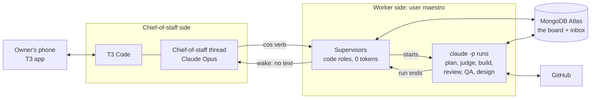
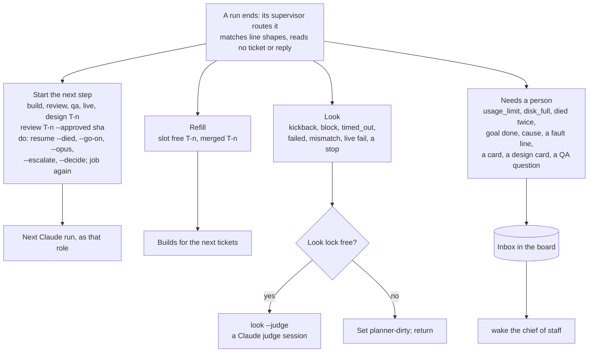
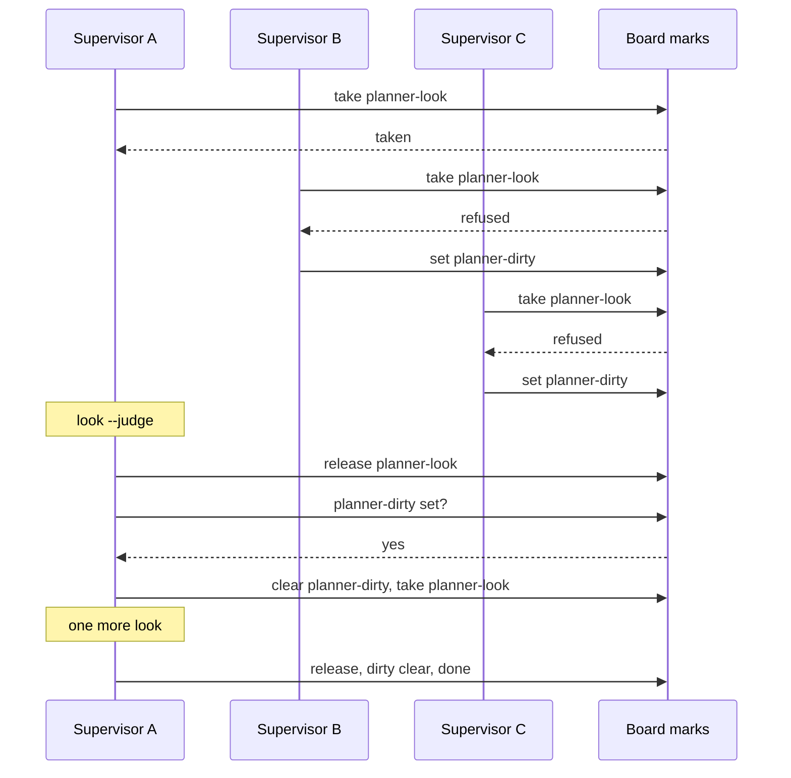
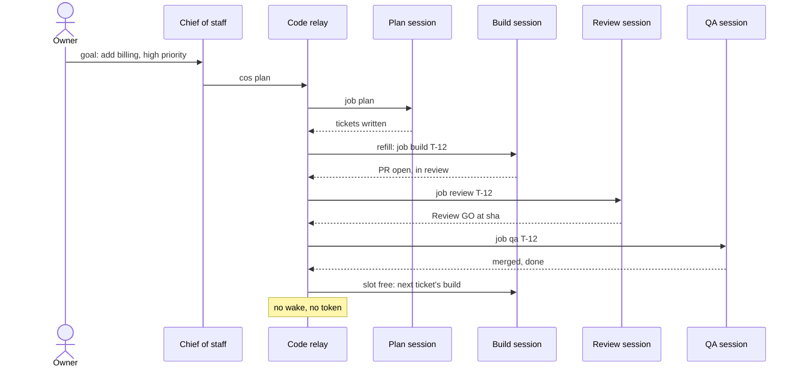
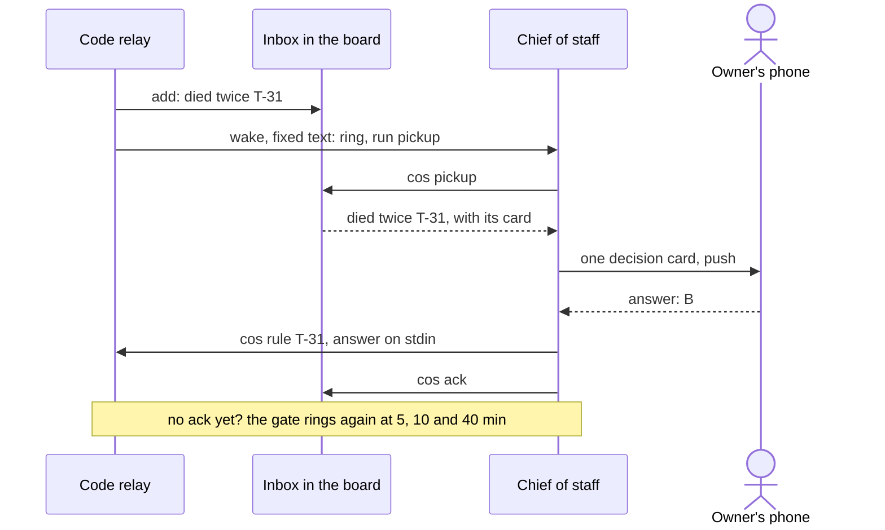
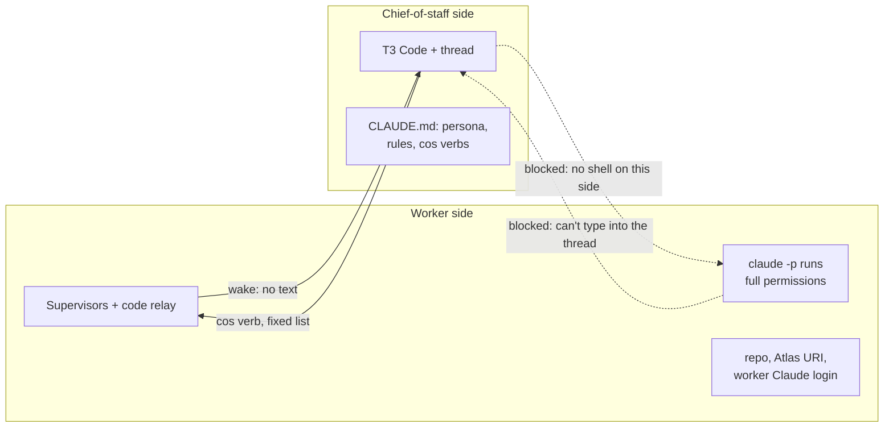
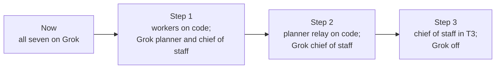

# T3 runtime: a spec for Maestro without Grok Bot

**Status:** draft v3, 2026-11-19. v1 went through two fresh-context audits on 2026-11-18; v2 fixed what they found (section 13). v3 takes the owner's answers (section 1). Nothing here is built. The team works on this spec from here.
**Labels:** **[code]** means the claim was checked in the source at the `file:line` given. **[docs]** means a vendor doc says it; no run here has shown it. **(guess)** means neither has. Section 11 lists the probes that settle each **[docs]** and **(guess)** claim the build depends on.

## 0. The point

1. Grok Bot goes as the runtime. It bills each model call times its whole chat, about 100-200K cached tokens a call ([decisions](../decisions.md), 19). Its seven profiles stay in `bot-profiles/`. Setting a bot's webhook again brings it back, so a team can still run Maestro on Grok.
2. Each role gets a **server**: a webhook (a Grok bot, as today), a command (the chief of staff's wake), or code (the planner's routing and the five worker roles). Every place that now asks "does this bot have a webhook?" asks "is this role served?" instead.
3. All thinking stays in Claude. Planning, judging and rulings run as Claude sessions, as they do today. Code takes only the relaying that Grok bots did: start the next step, refill a slot, take a look, pass on what needs a person (section 3).
4. One Claude thread in T3 Code plays the chief of staff. The owner talks to it from the T3 phone app. It runs behind a wall: no worker session can type into it, and it reaches the board through one command, `maestro-ticket cos <verb>`.
5. One machine. The board lives on MongoDB Atlas. One Claude Max 20x plan runs it all.

## 1. The owner's answers

| Call | Answer (2026-11-19) | What it changes here |
|---|---|---|
| Accounts | One personal Claude Max 20x plan; maybe a Team plan later, if a seat gives as much as Max 20x | No account picking now. Section 8 keeps one small step so a Team plan can slot in later. |
| Second user for the chief of staff | Yes. Today T3 runs in WSL on a Windows desktop; that may move to the native Windows app, or a container | Section 6 gives the wall three ways to build it. |
| Planner as code | Asked what it means: isn't the planner the product manager? | Section 3 answers it. |
| Several boxes | One machine | Phase 2 leaves the build. Section 12 keeps what the audits found, for later. |
| Where the board lives | MongoDB Atlas | Section 7. |
| Rewrite the rules | Yes: a full rewrite of how Maestro runs | Section 9 lists every file. |

## 2. Who serves each role

| Role | Today | T3 runtime |
|---|---|---|
| Junior, senior engineer | Grok webhook | code |
| Reviewer, QA lead, designer | Grok webhook | code |
| Planner | Grok webhook | code for the routing; Claude for the thinking (section 3) |
| Chief of staff | Grok webhook | command: wake its T3 thread (section 5) |

`maestro-ticket notify set <bot>` takes one of `--url-file` (today), `--exec-file` or `--code`. The chain, `look` and the supervisor read that server through one `served(bot)` check. Today each reads `hasHook`:
- `handOn` **[code]** `tools/maestro-ticket/cli/chain.go:247`;
- `startSends` **[code]** `tools/maestro-ticket/cli/look.go:282`;
- the refill and ack gates **[code]** `tools/maestro-ticket/cli/chain.go:110-120`;
- the ring itself **[code]** `tools/maestro-ticket/runs/supervise.go:473`.

The servers mix, so the move off Grok goes one role at a time (section 10).

## 3. The planner: Claude thinks, code relays

The planner is still the product manager. What changes is who carries its messages. Decision 19 already bars the Grok planner from reading a ticket, a PR or a reply to judge it, so today every planning and judging call already runs in a Claude session. The Grok bot only wakes, runs `look`, passes lines on and acks. That relay is the part code takes.

| Planner's work | Who does it today | T3 runtime |
|---|---|---|
| Turn a goal into ordered, tiered tickets with criteria | Claude: `job plan`, the **maestro-planner** skill | same |
| Split or rewrite a ticket, carry out a ruling, finish a split | Claude: `job plan`, `job rule` | same |
| Judge blocks, disputed findings and parked tickets | Claude: the judge session `look --judge` starts | same |
| Ask the chief of staff before changing scope | Claude: the plan session leaves a card | same; the card goes to the inbox |
| Pick what starts next, fill slots, route by tier | code: `look`, refill, the chain | same |
| Wake on a message, run `look`, pass lines on, ack | Grok bot | **code** (3.1) |
| Report progress, ETAs | Grok bot, from `look --report` | the chief of staff runs `cos look`; the plan session records each ETA it gives |

A standing planner thread in T3 could come later, if the owner wants a product manager that keeps its own memory between goals. It would wake on every planner line, so it costs more than code. That is a later call, not part of this build.

### 3.1 What the code relay does

A run's supervisor routes the run once it ends **[code]** `tools/maestro-ticket/cli/chain.go:51`. When the role the result is for is served by code, the supervisor acts on each line in its own process:

| Line | Code does |
|---|---|
| `build`, `review`, `qa`, `live`, `design <id>` | Starts it as that role. Today `chainLine` takes only the first three **[code]** `tools/maestro-ticket/cli/chain.go:29`. |
| `review <id> --approved <sha> --drop …` from a judge | Starts that review |
| `do: resume <run> --died`, `--go-on`, `job again <run>` | Runs it, as now **[code]** `tools/maestro-ticket/cli/chain.go:169` |
| `do: resume <run> --opus`, `--escalate`, `--decide`, `job again <run> --full` | Runs it. These are fixed shapes too; the grammar still allows no rules write. |
| `slot free`, `merged` | Refill **[code]** `tools/maestro-ticket/cli/look.go:304` |
| `kickback`, `block`, `timed_out`, `failed`, `mismatch`, `live fail`, a stop | One `look --judge`, under the look lock (3.2) |
| `usage_limit`, `disk_full`, `died twice`, `goal <slug> done`, `cause …`, a fault line, a card, a design card, a QA question | Into the chief of staff's inbox (5.2) |

Then it acks the run. A run a usage limit stopped stays unacked, as today, so its ring at the reset fires **[code]** `tools/maestro-ticket/cli/launch.go:409`. With code as the server, that ring runs the run's `do: resume --go-on` line. The same holds for a handoff a pause held, and for the STOP lift.

It never forwards a full `--report`. The planner's persona sends a report only when a goal finishes, the line stops, a block needs it or the chief of staff asks, and the relay keeps to that.

### 3.2 The look lock

300 runs can end in one minute. They must not each start a look.

- The mark expires after 10 minutes. A stale one is taken over, as handouts are (`moveStale`), so a supervisor that dies mid-look can't stop the relay for good.
- Releasing before re-checking `planner-dirty` means a loser's mark is never missed.
- `look` already marks each row it hands a judge **[code]** `tools/maestro-ticket/cli/look.go:410`, so a second look never judges the same row again.

## 4. A ticket's life in the T3 runtime

A send-back from review or QA goes straight back to the engineer. A block goes to the judge. Only what needs a person reaches the chief of staff.

## 5. The chief of staff

### 5.1 The thread

- One Claude thread in T3 Code, on Opus, in full access, so tool asks never reach the phone ([decisions](../decisions.md), 12).
- Its persona, the team rules and the `cos` verbs sit in `CLAUDE.md` in the thread's own Claude config dir, built by `scripts/bot-bundle.sh`. Claude Code loads `CLAUDE.md` in every session and again after compaction, which a first message doesn't get (guess). Its memories go in a file that `CLAUDE.md` imports.
- It reads what is short itself. Long reads (a PR, many tickets) go through `cos ask`, a separate run, so its own context stays small.

### 5.2 The inbox

- The inbox is a space in the board's coord store, `inbox/chief-of-staff`. Each item is one line of a fixed shape, with a run or ticket id.
- Code adds items. Only the chief of staff's `cos ack` removes them, so a failed or lost wake is rung again and an alert can't vanish.
- A card's text stays data, as [decisions](../decisions.md), 7 says.
- The wake goes through the existing gate: at most once each 4 minutes **[code]** `tools/maestro-ticket/runs/gate.go`, and again at 5, 10 and 40 minutes while anything waits unacked **[code]** `tools/maestro-ticket/runs/supervise.go:46`.
- If Atlas is down, code can't write the inbox. Then the wake carries one fixed word, `store-down`. The chief of staff tells the owner, and runs `cos look` once Atlas is back.

### 5.3 The `cos` verbs

| Verb | Runs, signed as |
|---|---|
| `pickup`, `ack <ids>` | the inbox, as `chief-of-staff` |
| `plan` (goal on stdin), `rule <id>`, `resume <run-id>` | `job plan`, `job rule`, `resume`, as `planner` |
| `look` | `look --judge --report`, as `planner`. It also restarts a quiet board after a reboot or an outage. |
| `rules show`, `rules set limit <n>`, `rules add`, `rules drop <n>` | as `chief-of-staff`, which `rulesWriters` already allows **[code]** `tools/maestro-ticket/cli/rules.go:48` |
| `ask` (question on stdin) | a `/maestro-chief-of-staff` run on the worker side; its answer comes back through the inbox |
| `list`, `get`, `events`, `goals`, `flow`, `eta`, `stop`, `start` | as today's commands, as `chief-of-staff` |

`cos` refuses any verb off this list.

## 6. The wall

Every worker run has full permissions and reads ticket text. If one could type into the chief of staff's thread, text planted in a ticket could steer the team, since the thread has a shell and signs as the planner. Under Grok this hole was smaller, because a bot only ever read fixed-shape lines. So the two sides run apart, with two doors:

| Door | From → to | What crosses |
|---|---|---|
| `maestro-ticket wake` | worker side → chief of staff | nothing but "wake", or the one word `store-down`. It sends the thread the fixed text `ring: run pickup`. |
| `maestro-ticket cos <verb>` | chief of staff → worker side | one verb from the list, text on stdin |

So a worker session can wake the thread, at worst too often, but can't put words in it. The thread can't run a shell on the worker side.

### 6.1 Three ways to build it

The worker side must be Linux. The supervisor's process handling is Unix-only, with a stub elsewhere **[code]** `tools/maestro-ticket/cli/proc_unix.go`, `tools/maestro-ticket/cli/proc_other.go`, and the skills' scripts are bash.

| | A: two users in WSL (default) | B: T3 native on Windows, workers in WSL | C: workers in a container |
|---|---|---|---|
| Worker side | user `maestro` in the WSL distro | user `maestro` in the WSL distro | a Linux container |
| Chief-of-staff side | user `maestro-cos` in the same distro, running `t3 serve`; the Windows T3 app and the phone connect to it | the Windows T3 app, as the Windows user | T3 on the host |
| `wake` door | a sudoers rule: `maestro` may run only `maestro-ticket wake` as `maestro-cos` | a T3 webhook task bound to the thread, with a fixed prompt that ignores the body (needs T3 Connect) **[docs]** | the same webhook task |
| `cos` door | a sudoers rule: `maestro-cos` may run only `maestro-ticket cos …` as `maestro` | `wsl.exe -d <distro> -u maestro maestro-ticket cos …` | `docker exec <container> maestro-ticket cos …` |
| What else must hold | nothing | WSL interop off (`[interop] enabled=false`) and no Windows drives mounted (`[automount] enabled=false`) in the worker distro's `/etc/wsl.conf`; else a worker can run `t3.exe` or read the thread's files | the container gets no host socket or host folder beyond the repo |
| Change from today | one more Linux user | moves T3 out of WSL | adds Docker |

A is the default: it changes least from today's setup. B and C wait on a reason to move, such as a speed gain from the native app. In every option, keep the repo on the Linux filesystem, not under `/mnt/c`; WSL reads Windows drives far slower (guess, P0 measures it).

A team on one Linux box with no T3 can skip the wall. Then the same commands run directly, without the guard.

### 6.2 Setup for option A

1. Make user `maestro-cos`. `scripts/install.sh` prints the two sudoers lines; the owner adds them with `visudo`.
2. As `maestro-cos`: install T3 Code, pin a stable version (`t3 update <version>`) and run `t3 up --connect` **[docs]**.
3. In T3, add one Claude provider instance with its own config dir, logged in to the owner's plan, in full-access mode.
4. Put the chief of staff's `CLAUDE.md` bundle in that config dir.
5. Start the thread in the repo. Save its id where `maestro-ticket wake` reads it.
6. Turn on phone pushes. Background pushes need T3 Connect **[docs]**.

## 7. The board on Atlas

`maestro-ticket` already runs on MongoDB, `mongodb+srv://` URIs included **[code]** `tools/maestro-ticket/README.md:24`.

1. Make an Atlas cluster in a region near the machine. Let only the machine's IP reach it, and give Maestro a user with rights on one database only.
2. As `maestro`, write the URI with `maestro-ticket store --uri-file -`. It lands in `store.uri`, mode 0600, and only the host ever prints.
3. Move today's board with `maestro-ticket migrate`.
4. The chief-of-staff side never holds the URI. It reaches the board through `cos` verbs.

On MongoDB, the store's folder still holds this machine's own state: `runs/`, `slots/`, `notify/` **[code]** `tools/maestro-ticket/README.md:24`. On one machine that costs nothing.

Risks:
- **Latency.** Each command, claim and heartbeat makes a round trip to Atlas, where SQLite made none. P0 times a `look` on a real board.
- **Tier limits.** Atlas's free tier caps connections and operations (guess). 300 sessions, each with a keepalive, may need a paid tier. P0 counts the connections one run holds.
- **An outage stops every run.** The `store-down` wake (5.2) tells the owner, and `cos look` restarts the board after.
- **Backups.** Atlas's backups come with paid tiers (guess). `maestro-ticket` keeps its own `backups/` folder too.

## 8. One Claude plan

One Max 20x plan runs the chief of staff and every worker run, on one login.

- **The chief of staff shares the limit.** When the plan hits its 5-hour or weekly limit, every run pauses, as today, and so does the thread. The T3 app shows the limit and its reset **[docs]**. Keep the swarm's run limit (`rules set limit`) low enough to leave the thread room. P0 measures what a wake costs.
- **Strip stray API keys.** With `-p`, an `ANTHROPIC_API_KEY` in the environment wins over the plan login and bills the API **[docs]**. The run's environment drops `ANTHROPIC_API_KEY` and `ANTHROPIC_AUTH_TOKEN`.
- **Ready for a Team plan.** Each run records an account name, `default` for now. A Team plan later adds more names, each with its own config dir, and the pause becomes one per account. The v2 design for that is kept in section 12.2.
- **The plan's terms.** Plan limits assume "ordinary, individual usage" **[docs]**. Maestro already runs `claude -p` on the plan, so this design adds no new risk and removes none. Whether a Team seat gives as much as Max 20x, and whether a seat may run scripted `claude -p`, needs Anthropic's answer before the switch.

## 9. The rewrite

The owner asked for a full rewrite of how Maestro runs. Every file below changes in step S6.

| File | Change |
|---|---|
| `docs/decisions.md` | 1: a ring may run a command; a run's end may run the judge's look under the lock. 7: the inbox and `cos` verbs hold the ticket-text guard in code. 12: the thread runs in full access. 15: the thread is the one Claude session `launch` didn't start. 19 and 21: name served roles, not Grok bots. A new decision for the wall. |
| `AGENTS.md` | "What we're building": the outer layer is the T3 thread plus code; Grok is one supported runtime |
| `README.md`, `docs/team.mermaid`, `docs/bot-anatomy.mermaid` | redraw for served roles and the wall |
| `bot-profiles/chief-of-staff/persona.md` | rewrite for the T3 thread and the `cos` verbs |
| `bot-profiles/planner/persona.md` | becomes the spec the code relay follows, and the Grok persona if a team keeps one |
| `bot-profiles/team-rules.md`, `routine.md` | Grok bots only; the thread gets its own short rules |
| `skills/maestro-chief-of-staff`, `skills/maestro-planner` | stop calling their caller "the bot" |
| `INSTALL.md`, `scripts/install.sh`, `scripts/bot-bundle.sh` | ask for a runtime (Grok or T3); print the sudoers lines; build the thread's `CLAUDE.md` |
| `templates/project-setup.md` | a `## Runtime` section |

## 10. The move off Grok, one role at a time

The servers mix, so each step moves one group of roles and can go back by setting the old webhook again.

| Step | Needs | Rollback |
|---|---|---|
| 1. Workers on code | S1, S2 | `notify set <worker> --url-file` |
| 2. Planner relay on code | S2, S3 (the inbox, so its lines reach the Grok chief of staff through a webhook ring) | `notify set planner --url-file` |
| 3. Chief of staff in T3 | S4, S5 | `notify set chief-of-staff --url-file` |

## 11. Build order and probes

| Step | Change | Check |
|---|---|---|
| P0 | Probes, below | each answers with a captured run |
| S1 | `served(bot)` in place of `hasHook`; `notify set --code`, `--exec-file` | unit tests: each gate starts work for a code role and none for an unserved one |
| S2 | Code relay: line table, wider grammar, reset ring, look lock | a unit test for each row of 3.1; two supervisors racing for the lock; a dead holder's lock taken over |
| S3 | Inbox, `wake`, `cos` verbs | an item survives a failed wake and is rung again; `cos` refuses a verb off the list |
| S4 | The wall, option A: user, sudoers lines, thread's `CLAUDE.md` | a worker session's `t3 thread send` fails; the owner sends a goal from the phone and a plan run starts |
| S5 | Atlas, API-key strip, account field | `doctor` shows `mongodb at <host>`; a run's environment holds no API key |
| S6 | The rewrite (section 9) | review |

| Claim | Label | Probe |
|---|---|---|
| `t3 thread send` from a local script needs no token and queues on a busy thread | [docs] | send twice to a busy thread; read `t3 thread show` |
| `t3 thread send` exits non-zero when delivery fails | (guess) | stop T3, send, read the exit code |
| A queued send survives a T3 restart | (guess) | queue one, restart, read the thread |
| T3 pushes to the phone when the thread ends a turn | [docs] | wake it with the phone locked |
| `CLAUDE.md` in the thread's config dir reloads after compaction | (guess) | compact the thread; ask it a rule from `CLAUDE.md` |
| One wake costs what share of the 5-hour window | (guess) | ten wakes on a real board; read `/usage` |
| A `look` on Atlas runs fast enough | (guess) | time `look` on a 140-ticket board, Atlas against SQLite |
| One run's connection count fits Atlas's tier | (guess) | count connections during 20 runs |
| A repo under `/mnt/c` is much slower in WSL | (guess) | time `git status` and one build in both places |

## 12. Later: what the audits found for scale

Out of scope for this build, but kept so the work isn't redone.

### 12.1 Several machines

Each box keeps this on its own disk today, so a second box can't join until it moves into the board:

| State | Today | Needed |
|---|---|---|
| Run records, acks, `.resumed` marks | `besideStore("runs")`, per box **[code]** `tools/maestro-ticket/cli/launch.go:53` | a run index in the board: id, host, launcher, state, acked |
| Ring gate | `<bot>.gate` per box **[code]** `tools/maestro-ticket/runs/gate.go` | one per bot per board |
| Limit, QA slots, standing rules | `board.json`, `rules.md` per box **[code]** `tools/maestro-ticket/cli/rules.go:28-31` | the board |

Then: `resume` and `job again` hop to the run's own box, since transcripts and worktrees stay there. Planning jobs run only on the home box. A run's end refills its own box, then hops `refill` to the box with the most free slots, under one refill mark per box, which keeps SSH under sshd's default of 10 starts at once. Each hop is an SSH key with a forced command.

### 12.2 Several accounts

For a Team plan with several seats:
- Each account gets its own config dir; `token_file` takes `claude setup-token` output, which lasts a year **[docs]**.
- A new start takes the unpaused account with the fewest runs going, counted under a lock.
- A resume uses the run's own account, since its transcript and unpushed work live there. A stopped run waits for its own account's reset.
- The pause becomes one per account: `paused-<name>.json` in place of `paused.json` **[code]** `tools/maestro-ticket/cli/coord.go:33`. Every reader takes the account: `readPause` **[code]** `tools/maestro-ticket/cli/job.go:816`, the QA slot hold **[code]** `tools/maestro-ticket/cli/slot.go:140`, the waiting lines.
- An API outage stays a team-wide pause **[code]** `tools/maestro-ticket/cli/route.go:140`, since another account hits the same outage.
- The token goes only into the process's environment, never the run's `Command`, which `job` and `runs` print **[code]** `tools/maestro-ticket/runs/runs.go:75`.
- Stats store the account as its place in the list, never its name ([decisions](../decisions.md), 24).

The Usage Policy bars making several accounts to get around limits, and the Consumer Terms bar sharing a login **[docs]**. So more capacity comes from a Team plan, extra usage or API keys, never from several personal plans.

## 13. What the audits changed

| v1 said | Found | Now |
|---|---|---|
| Workers become code with no webhook | Every automatic start checks for a webhook first, so none would run | `served(bot)` (section 2) |
| The code planner handles the planner's rings | Worker runs' results, `design`, `live`, `--opus`, `--escalate` and design cards had no taker; nothing woke at a limit's reset | Full line table, reset ring (3.1) |
| Forward lines, then ack | A failed send lost the alert for good | Lasting inbox, acked only by the chief of staff (5.2) |
| The ring sends its body to the thread | Any session can type into the thread, which has a shell | The wall: `wake` with no text, `cos` verbs (section 6) |
| One look at a time | The lock never expired, and the dirty check could miss a mark | Expiry; release before the re-check (3.2) |
| Forward `look --report` | A wake on every look: Grok's cost shape again | Report only when the persona says (3.1) |
| Persona as the first message | Compaction wears it down | `CLAUDE.md` in the thread's config dir (5.1) |
| A stopped run restarts on another account | Unpushed work lost; the ticket is held till the reset anyway | Stopped runs wait for their own account (12.2) |
| Token in the run's command words | They print in the run record | Only in the process environment (12.2) |
| Boxes share limits, rules and runs through the board | Those live on each box's disk | Listed for later (12.1) |
