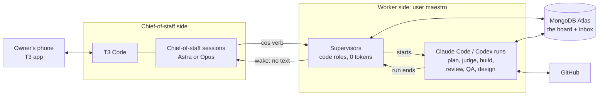
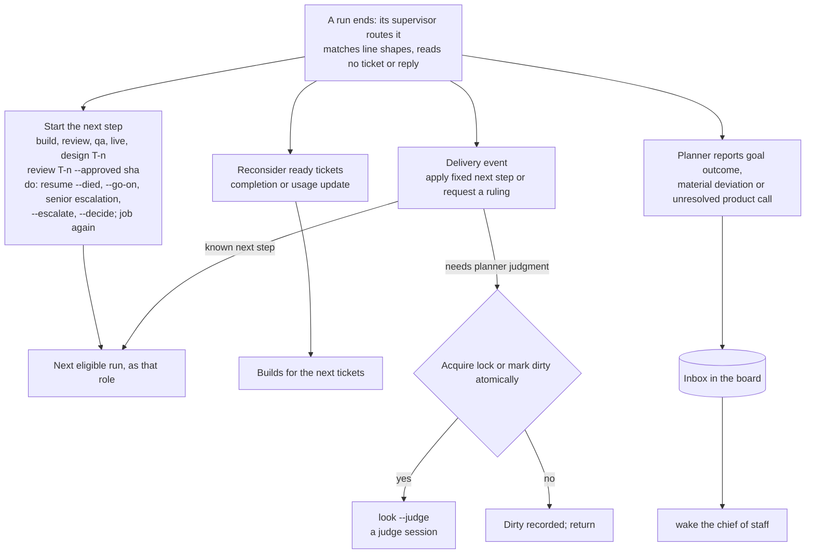
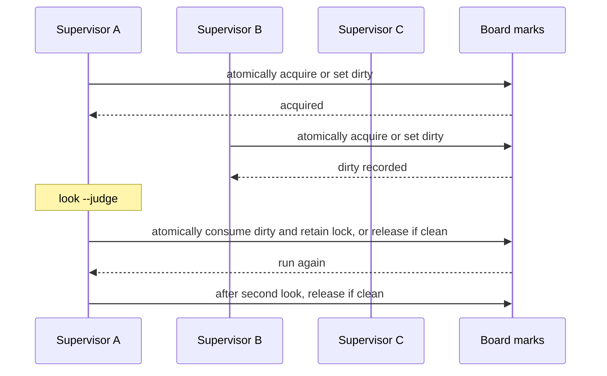
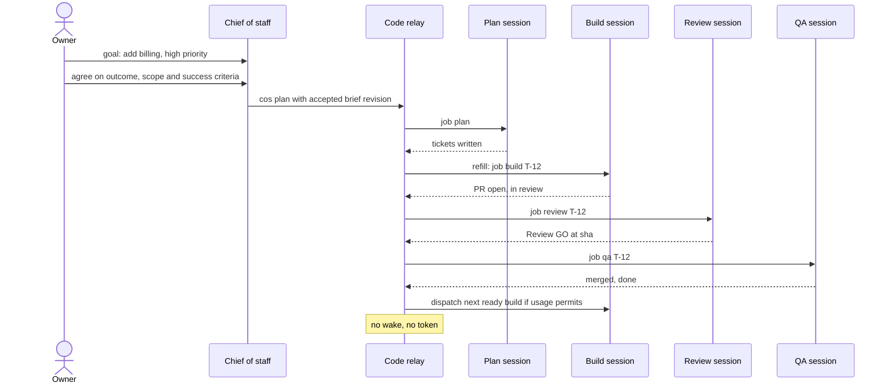
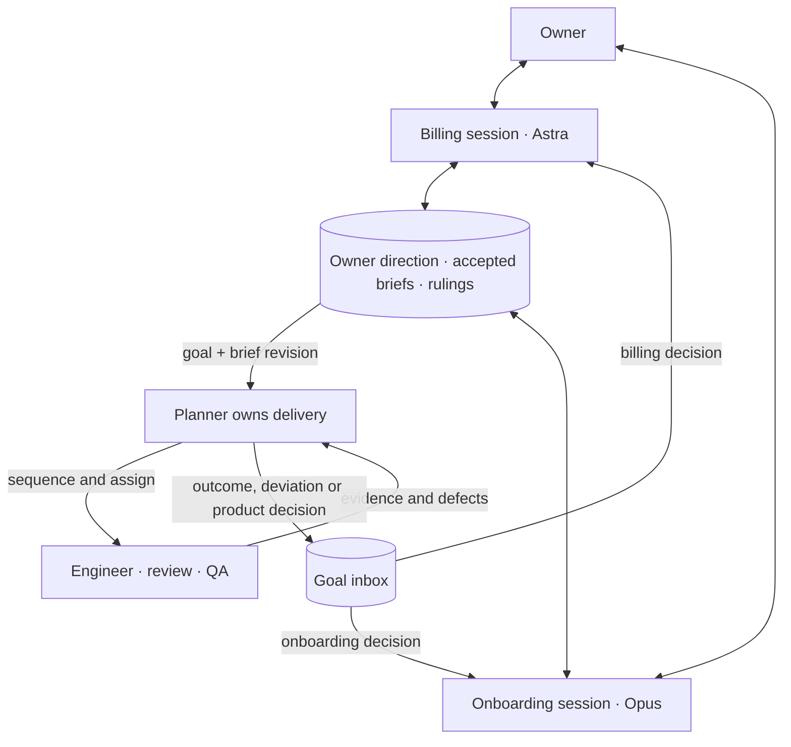
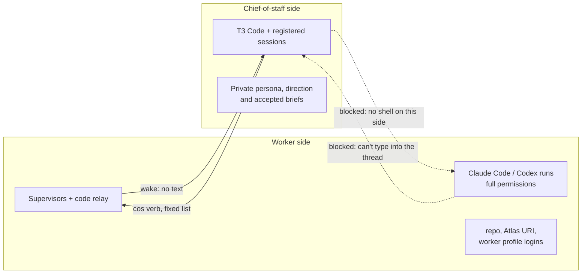
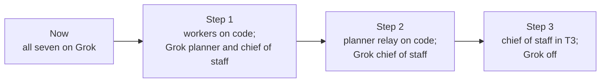

# T3 runtime: a spec for Maestro without Grok Bot

**Status:** draft v10, 2026-11-20. v1 went through two fresh-context audits on 2026-11-18; v2 fixed what they found (section 13). v3 takes the owner's answers (section 1). v4 added subscription routing. v5 supports concurrent Astra and Opus chiefs and gives delivery to the planner. v6 specifies recovery discovery (3.3). v7 defines chief memory on Atlas (5.4). v8 covers changes to active briefs and ticket criteria (4.1–4.2). v9 replaces worker-count limits with subscription pacing (8). v10 specifies repeat kickbacks (4.3). The proposed runtime is still unbuilt. The team works on this spec from here.
**Labels:** **[code]** means the claim was checked in the source at the `file:line` given. **[docs]** means a vendor doc says it; no run here has shown it. **(guess)** means neither has. Section 11 lists the probes that settle each **[docs]** and **(guess)** claim the build depends on.

## 0. The point

1. Grok Bot goes as the runtime. It bills each model call times its whole chat, about 100-200K cached tokens a call ([decisions](../decisions.md), 19). Its seven profiles stay in `bot-profiles/`. Setting a bot's webhook again brings it back, so a team can still run Maestro on Grok.
2. Each role gets a **server**: a webhook (a Grok bot, as today), a command (the chief of staff's wake), or code (the planner's routing and the five worker roles). Every place that now asks "does this bot have a webhook?" asks "is this role served?" instead.
3. Agent sessions plan, judge and rule. Section 8 maps each role to a harness, model and account. Code takes only the relaying that Grok bots did: start the next step, dispatch ready work, take a look, pass on what needs a person (section 3).
4. The owner specs features with one or more T3 chief-of-staff sessions. Each session uses Astra or Opus. Chiefs share accepted direction, work with the planner on outcomes, and settle delegated product calls. Section 5 defines their authority and handoffs.

5. One machine. The board lives on MongoDB Atlas. Two Claude Max 20x accounts and one ChatGPT Pro account serve the roles in section 8.

## 1. The owner's answers

| Call | Current answer | What it changes here |
|---|---|---|
| Accounts | Two Claude Max 20x plans and ChatGPT Pro; choose Astra or Opus and effort per chief session | Section 8 sets the initial assignments and capacity rules. |
| Second user for the chief of staff | Yes. Today T3 runs in WSL on a Windows desktop; that may move to the native Windows app, or a container | Section 6 gives the wall three ways to build it. |
| Planner as code | Asked what it means: isn't the planner the product manager? | Section 3 answers it. |
| Several boxes | One machine | Phase 2 leaves the build. Section 12 keeps what the audits found, for later. |
| Where the board lives | MongoDB Atlas | Section 7. |
| Rewrite the rules | Yes: a full rewrite of how Maestro runs | Section 9 lists every file. |

## 2. Who serves each role

| Role | Today | T3 runtime |
|---|---|---|
| Junior, senior engineer | Grok webhook | code |
| Reviewer, QA lead, designer | Grok webhook | code |
| Planner | Grok webhook | code for the routing; agent sessions for decisions (section 3) |
| Chief of staff | Grok webhook | command: wake the assigned T3 session (section 5) |

`maestro-ticket notify set <bot>` takes one of `--url-file` (today), `--exec-file` or `--code`. The chain, `look` and the supervisor read that server through one `served(bot)` check. Today each reads `hasHook`:
- `handOn` **[code]** `tools/maestro-ticket/cli/chain.go:247`;
- `startSends` **[code]** `tools/maestro-ticket/cli/look.go:282`;
- the refill and ack gates **[code]** `tools/maestro-ticket/cli/chain.go:110-120`;
- the ring itself **[code]** `tools/maestro-ticket/runs/supervise.go:473`.

The servers mix, so the move off Grok goes one role at a time (section 10).

## 3. The planner owns delivery

The planner turns an accepted brief into executable work. Its code relay handles known next steps. A planner session investigates a failure or rules on a dispute when the evidence needs judgment.

| Planner's work | Who does it today | T3 runtime |
|---|---|---|
| Turn a goal into ordered, tiered tickets with criteria | Claude: `job plan`, the **maestro-planner** skill | same |
| Split or rewrite a ticket, carry out a ruling, finish a split | Claude: `job plan`, `job rule` | same |
| Judge blocks, disputed findings and parked tickets | Claude: the judge session `look --judge` starts | same |
| Ask the chief of staff before changing scope | Claude: the plan session leaves a card | same; the card goes to the inbox |
| Pick ready work and route by tier | code: `look`, refill, the chain | dispatch by subscription pace (8) |
| Wake on a message, run `look`, pass lines on, ack | Grok bot | **code** (3.1) |
| Report progress, ETAs | Grok bot, from `look --report` | planner verifies progress, records ETAs and reports material deviations to the goal’s chief |

A standing planner thread in T3 could come later, if the owner wants a product manager that keeps its own memory between goals. It would wake on every planner line, so it costs more than code. That is a later call, not part of this build.

### 3.1 What the code relay does

A run's supervisor routes the run once it ends **[code]** `tools/maestro-ticket/cli/chain.go:51`. When the role the result is for is served by code, the supervisor acts on each line in its own process:

| Line | Code does |
|---|---|
| `build`, `review`, `qa`, `live`, `design <id>` | Starts it as that role. Today `chainLine` takes only the first three **[code]** `tools/maestro-ticket/cli/chain.go:29`. |
| `review <id> --approved <sha> --drop …` from a judge | Starts that review |
| `do: resume <run> --died`, `--go-on`, `job again <run>` | Runs it, as now **[code]** `tools/maestro-ticket/cli/chain.go:169` |
| `do: resume <run> --opus`, `--escalate`, `--decide`, `job again <run> --full` | Map the existing `--opus` line to a senior escalation under section 8. Keep the other fixed shapes; the grammar still allows no rules write. |
| Ticket revision request (4.2) | Hold affected work and send the evidence to the planner once. |
| `slot free`, `merged` | Treat these legacy event names as prompts to reassess usage and ready work. Today they trigger refill **[code]** `tools/maestro-ticket/cli/look.go:304` |
| `kickback`, `block`, `timed_out`, `failed`, `mismatch`, `live fail`, a stop | Route review and QA kickbacks by section 4.3. Apply known retry, hold and recovery rules. Only a disputed or unresolved delivery decision starts a planner ruling under the lock (3.2). |
| `usage_limit`, `disk_full`, `died twice`, `goal <slug> done`, `cause …`, a fault line, a card, a design card, a QA question | Planner owns triage and groups related causes. Send goal outcomes, material deviations and unresolved product or owner decisions to the goal inbox (5.2). |

Persist one handoff ID per action. Replay returns the recorded run or inbox item, including during a switch back to a webhook. Ack after all actions have durable receipts. A run a usage limit stopped stays unacked, as today, so its ring at the reset fires **[code]** `tools/maestro-ticket/cli/launch.go:409`. With code as the server, that ring runs the run's `do: resume --go-on` line. The same holds for a handoff a pause held, and for the STOP lift.

It never forwards a full `--report`. The planner's persona sends a report only when a goal finishes, the line stops, a block needs it or the chief of staff asks, and the relay keeps to that.

### 3.2 The look lock

300 runs can end in one minute. They must not each start a look.

Renew the 10-minute lease during a long look. On takeover, verify the holder token before clearing or releasing the lock.

- `look` already marks each row it hands a judge **[code]** `tools/maestro-ticket/cli/look.go:410`, so a second look never judges the same row again.

### 3.3 Find stranded work

The planner owns recovery. A code command, `maestro-ticket recover`, discovers work without taking ticket IDs or run IDs as input. Run it once when the worker runtime starts, before admitting fresh jobs, and on ordinary planner wakeups. After an Atlas outage, the process that saw the outage retries with backoff and invokes recovery when the board responds. An operator can invoke it directly. A startup hook runs once per worker-runtime start. On an otherwise quiet host, detection waits for the next trigger. A periodic host check would require a separate decision. Owner status reads stay read-only.

Before spawning a worker, persist its Maestro run ID, ticket or goal, profile, host and reservation. Pass the ID to the worker so the host can identify a surviving session independently of the run file. Pair it with process identity and start time to guard against PID reuse. Reuse the supervisor locks and surviving-session checks in `tools/maestro-ticket/runs/runs.go`. Their current scan starts from recorded runs.

Compare active tickets, claims, reservations and pending handoffs with local run records and live Maestro-owned workers **in both directions**. Also compare recorded outcomes with the next action and its receipt. Inspect the matching worktree, PR head, verdict or merge only where those sources disagree.

| Found | Action |
|---|---|
| Active ticket, supervisor and worker both gone | Check for saved edits, a pushed commit, a verdict or a merge. Resume from verified progress under section 8. |
| Live worker, supervisor gone | Preserve the session and reservation. Track its existing run through completion. |
| Live Maestro worker without a matching board entry | Reconcile only when the run identity and ownership agree. Otherwise report the uncertainty and leave the process alone. Exclude personal Claude and Codex sessions. |
| Review passed the current PR head, but QA has neither a run nor a receipt | Replay the missing handoff with its original action ID. A changed head goes back to review. |
| QA merged before it could close the ticket | Verify that the merged PR matches the approved head and QA pass. Record completion once and release its reservation. |

Take one recovery claim per board. Before acting, recheck the current run, head, claim and STOP state. Keep an explicit halt in force. Hold an ambiguous ticket for planner investigation while unrelated work continues. Repeating recovery must preserve live workers, pending owner decisions and completed actions.

**S2 acceptance trial.** Seed a dead worker with saved edits, a surviving worker whose supervisor died, a review GO with no QA handoff, and an unrelated personal session. Supply no IDs to recovery. Require it to name the three discrepancies and the evidence for each, preserve the edits and surviving worker, start QA once, and leave the personal session alone. Repeat recovery concurrently and after restart. Also interrupt QA between merge and closure, reconnect Atlas with a worker still alive, and restart with STOP set. Expect one verified closure, no duplicate worker, and zero starts under STOP.

## 4. A ticket's life in the T3 runtime

Section 4.3 determines who takes a send-back from review or QA. The planner handles delivery blocks. The goal’s chief receives material deviations and unresolved product choices.

### 4.1 When an accepted brief changes

Record the goal, the brief revision the planner last checked, and the ticket’s own acceptance criteria (AC) revision on each ticket. Publishing a brief makes its new revision visible to the merge gate before the planner finishes assessing affected tickets. Use one Atlas transaction for the private acceptance and a board-visible goal revision marker; allow the chief service to write that marker only through the publish operation. The full planner handoff still uses the delivery receipt in 5.4.

The planner compares the accepted revisions and records a disposition per open ticket. Work may continue during assessment. QA waits to merge a ticket until its disposition covers the current brief.

| Disposition | Planner action |
|---|---|
| Still fits | Advance the checked brief revision. Carry applicable evidence and continue. |
| Criteria changed | Publish the revised ticket criteria. Identify affected code paths and evidence that needs fresh review or QA. |
| Deferred or replaced | Pause affected work, preserve its branch and commits, release its unused usage estimate, and update dependencies. |

Other goals keep moving. Within the changed goal, a cleared ticket can merge while the planner assesses the rest. For example, dropping Excel from a Friday release can leave CSV ready for QA, park the Excel branch, and narrow an unstarted export-menu ticket.

### 4.2 Engineer requests a ticket revision

When reading the code reveals a material ambiguity, contradiction, missing dependency or infeasible criterion, the engineer can request a revision before review. A technical choice that preserves agreed behavior stays with the engineer. The normal build path adds no planner turn.

1. Identify the ticket, brief and AC revisions, affected criterion, concrete evidence, proposed wording or split, and decision needed. Save the branch and commit or worktree checkpoint. Give the request a stable ID.
2. Record the request and hold the ticket before releasing its claim and unused usage estimate. Hold dependent work only where it needs the disputed point. Replays reuse the request. Count this as a clarification, separate from failed builds, retries and review or QA kickbacks.
3. The planner returns revised criteria, a split or dependency, a reason the existing criterion settles the issue, or a product escalation with options and impact. Only a change beyond the accepted brief goes to the goal’s chief. The chief uses delegated authority or asks the owner.
4. Apply the response against the current request and revisions. Reconcile a stale response before reopening work. A ticket-only clarification increments the AC revision when the text changes. Resume from the saved work once its dependencies allow.
5. Bind the engineer handoff, review verdict and QA evidence to both the PR head and AC revision. Before merge, verify that the ticket is cleared for the latest brief and that review and QA cover the current criteria. Serialize merge authorization with revision publication; if a merge is already in flight, reconcile its actual result before treating a conflicting change as effective. Record exactly which evidence carries forward and which needs another run.

**S3 acceptance.** Change a brief while CSV is in QA and Excel is in development. Confirm that cleared CSV can merge, Excel retains its saved work, and neither can merge under withdrawn criteria. Then have an engineer find conflicting access rules before review. A brief that settles the rule yields one planner answer and zero chief wakes. An unresolved product choice yields one goal escalation. Replay the request, change the AC at the same commit, and verify that stale proof cannot authorize a merge. Run a ticket with clear criteria through the ordinary path and count zero clarification turns.

### 4.3 Repeated review or QA kickbacks

Use the ticket’s recorded tries and last engineering role. Review and QA kickbacks share the same count. Preserve the existing [routing function](../../tools/maestro-ticket/cli/route.go) when dispatching work through either harness.

| Recorded tries after a kickback | Next step |
|---|---|
| 0 or 1 | Return to the same engineering role with the finding, commit and evidence. |
| 2, last engineer was junior | Send to a senior engineer with the previous findings and attempted fixes. |
| 2, last engineer was senior, or 3 or more for either role | Send to the planner to split the ticket, revise its criteria or resolve the dispute. |

Concrete evidence that the ticket itself is wrong can go to the planner immediately through section 4.2. An AC clarification adds no try. A replay of an already recorded kickback keeps its count and its original handoff. Only QA can clear a QA failure: after a fix, review the new head and have QA rerun the failed case. If the engineer disputes the finding without changing code, the planner can request a QA retest at the same reviewed head.

**S2 acceptance.** Exercise the first kickback, both second-kickback branches and a third after escalation. Replay a QA failure and verify one count and one handoff. Insert an AC clarification between kickbacks and verify the next recipient stays the same. Keep the QA finding open until QA records its retest.

## 5. The chief of staff

### 5.1 Feature conversations and accepted briefs

The owner opens a chief-of-staff session for a goal and selects its harness, model and supported effort. An Astra session can shape billing while an Opus session shapes onboarding. Several sessions may explore the same feature. Each keeps its conversation and draft private. Either model can take over a goal by reading the accepted brief, rulings and open questions.

The chief works with the owner on the user problem, intended outcome, success criteria, scope, constraints and choices still open. Once they agree, the chief publishes a versioned brief. The planner checks feasibility and returns a delivery plan, dependencies and any material deviation. It owns ticket splits, assignments, retries, investigations and verified status. The chief checks progress against the outcome and challenges a plan that drifts.

Keep shared owner direction, explicit delegations and accepted briefs in the chief memory collections (5.4). Publish only the goal's accepted revision and applicable rulings to the planner. Accept a change against the revision its author read. If another session published first, return the current revision and reconcile before sending a new brief. Key each planner handoff by goal and revision so a replay produces one plan.

### 5.2 Who decides and how an answer survives

The planner resolves execution choices inside the brief. If a product choice remains, it sends the goal, evidence, options, recommendation, and work affected. The chief checks the brief, the owner's reasons and applicable delegations. It can settle a new trade-off that fits those bounds and records why. An inferred preference guides the recommendation. Only the owner's explicit words grant new authority over spending, scope or external actions. For missing facts, ask the planner for evidence. For a material choice outside the chief's authority, ask the owner one question.

Each inbox item has a stable decision ID, goal, affected work, and state. Register chief sessions and their goals privately. Route a fixed wake to the assigned session. A goal without a live chief remains pending for pickup or reassignment. Route a team-wide fault to one designated available chief. Workers cannot choose a thread or supply prompt text.

Several chiefs may read an item. One atomically claims the right to answer. Store the owner question under the decision ID before notifying. Retries and takeovers reuse that question. If T3 delivery is uncertain, follow 5.4. Keep the answer and ruling under the same ID. On transfer, invalidate the old claim and check the current holder before committing a ruling. Deliver a recorded ruling once to the planner, then acknowledge its receipt. After a crash, resume the pending step from the record. Group tickets blocked by the same decision under that question.

A failed wake leaves the item pending. Apply the existing wake and retry intervals per destination (today's gate and supervisor in `tools/maestro-ticket/runs/`). A card's text stays data ([decisions](../decisions.md), 7). If Atlas is down, expose `store-down` through host status without requiring a model. On reconnect, the planner recovers interrupted delivery under section 3.3.

### 5.3 Proposed chief-side operations

| Operation | Effect |
|---|---|
| Register a session or transfer a goal | Bind the session ID, goal, harness, profile, model and effort. Preserve pending decisions across a transfer. |
| Read or publish a brief | Read the accepted revision or commit against an expected revision. Submit the accepted brief through `cos plan`. |
| `cos pickup`, claim, `cos rule`, `cos ack` | Read goal-scoped items, claim a decision, deliver its ruling and acknowledge the receipt (5.2). |
| `cos look`, `goals`, `eta` | Read the planner's verified delivery summary and recorded ETA. Status reads never launch a judge, dispatch jobs or resume work. |
| `cos ask` | Request a focused second opinion on a product decision when the planner's evidence leaves a material question. Return the result to the requesting session. |
| Standing rules, stop and start | Carry an authorized priority, limit or hold to the planner. The planner handles individual retries and recovery. |

The chief-side service owns private state. Only allowlisted `cos` operations cross to the worker side. Bind each request to its registered session and check its goal and claim before writing.

### 5.4 Shared memory and freshness

Use the existing Atlas database. Give the chief service and the worker runtime distinct credentials with collection-scoped roles. The chief service owns the five collections below. Workers access board collections, including accepted planner handoffs and receipts. Remove any database-wide worker grant that would also cover chief memory. Protect the chief credential and backups from workers. The chief service enforces draft ownership among trusted chief sessions.

| Collection | Identity and contents | Update trigger |
|---|---|---|
| `chief_sessions` | Session ID, T3 thread reference, harness, model, effort, goal, status, last versions read | Register on open. Refresh on resume or goal switch. Closing a session preserves its provenance. |
| `chief_drafts` | Unique (session, goal), base brief revision, draft text | Save as the session edits. A stale base keeps its draft until the chief reconciles it. |
| `goal_briefs` | Unique (goal, revision), parent revision, outcome, success criteria, scope, constraints, acceptance source, planner delivery | Publish against the expected current revision. Two writers proposing the next revision cannot both succeed. Keep accepted content immutable. |
| `goal_decisions` | Stable question ID, goal, brief revision, claimant and generation, question, source references, answer, authority, rationale, delivery | Claim, ask, answer, deliver or reopen explicitly. Index goal and state for open questions, and delivery state for recovery. Derive open questions here. |
| `owner_rules` | Rule ID and revision, preference or delegation, scope, exceptions, owner source, expiry or revocation | Append a revision when direction changes. Preserve earlier wording and the decision that relied on it. Only an explicit grant can authorize action. |

**Read path.** On an owner turn, session resume or decision claim, fetch the latest accepted brief, outstanding decisions and deliveries, matching current rules and the session's draft. Fetch older evidence by reference as needed. A changed record does not wake every model.

**Write path.** A refresh can race with another writer. At commit, require the expected brief revision, a current claim generation and an unanswered decision. When a ruling relies on delegated authority, also require the cited rule revision to remain current and unexpired. Serialize authorization with changes to its rule and brief: revocation and authorization must contend on the same current-version records. A read-only snapshot of the rule is insufficient. On conflict, reload and reconsider. Preserve the original answer or draft as evidence if its premise changed.

**Delivery.** Publish the accepted brief and its pending delivery in one write. Likewise, save an answer, its source and pending ruling in one conditional write or transaction. Embed the delivery ID, state and receipt in the source document. The planner commits its receipt and accepted instruction together, then keys any downstream run to that delivery. Replays of the same ID and payload return the prior receipt; a different payload under the same ID is an error. Distinguish saved, planner-acknowledged and completed work in status. Startup, reconnect and planner wakes retry pending deliveries through the authorized service. While Atlas is down, chats can explore drafts; acknowledge a save only after the database confirms it.

**Uncertain owner message.** Persist a question before notifying. Capture a stable T3 thread and message reference if available. If a send has no confirmed receipt or a crash may have interrupted reply capture, inspect the original thread before resending. When the answer cannot be tied to this question, keep the decision unresolved. Guarantee one accepted ruling and one planner action. Promise one visible notification only if P0 proves T3 can recover or deduplicate an uncertain send.

**S3 acceptance.** Start with `chief_sessions` and `goal_decisions`: answer Astra, interrupt it, transfer the claim to Opus and verify one planner action. Lose the planner receipt and repeat. Add the other collections, race two brief publications, and verify the losing draft survives. Revoke a delegation in Astra while Opus holds its stale context: a subsequent approval under that rule must fail. Verify that a one-off answer changes no other goal and that worker credentials cannot read chief collections or their backups.

## 6. The wall

Every worker run has full permissions and reads ticket text. If one could type into the chief of staff's thread, text planted in a ticket could steer the team, since the thread has a shell and signs as the planner. Under Grok this hole was smaller, because a bot only ever read fixed-shape lines. So the two sides run apart, with two doors:

| Door | From → to | What crosses |
|---|---|---|
| `maestro-ticket wake` | worker side → chief of staff | nothing but "wake", or the one word `store-down`. It sends the thread the fixed text `ring: run pickup`. |
| `maestro-ticket cos <verb>` | chief of staff → worker side | one verb from the list, text on stdin |

So a worker session can wake the thread, at worst too often, but can't put words in it. The thread can't run a shell on the worker side.

### 6.1 Three ways to build it

The worker side must be Linux. The supervisor's process handling is Unix-only, with a stub elsewhere **[code]** `tools/maestro-ticket/cli/proc_unix.go`, `tools/maestro-ticket/cli/proc_other.go`, and the skills' scripts are bash.

| | A: two users in WSL (default) | B: T3 native on Windows, workers in WSL | C: workers in a container |
|---|---|---|---|
| Worker side | user `maestro` in the WSL distro | user `maestro` in the WSL distro | a Linux container |
| Chief-of-staff side | user `maestro-cos` in the same distro, running `t3 serve`; the Windows T3 app and the phone connect to it | the Windows T3 app, as the Windows user | T3 on the host |
| `wake` door | a sudoers rule: `maestro` may run only `maestro-ticket wake` as `maestro-cos` | a fixed wake to a private dispatcher that resolves the registered session (probe before choosing B) | the same webhook task |
| `cos` door | a sudoers rule: `maestro-cos` may run only `maestro-ticket cos …` as `maestro` | `wsl.exe -d <distro> -u maestro maestro-ticket cos …` | `docker exec <container> maestro-ticket cos …` |
| What else must hold | worker cannot reach the host identity, private files or T3 listener | WSL interop off (`[interop] enabled=false`) and no Windows drives mounted (`[automount] enabled=false`) in the worker distro's `/etc/wsl.conf`; else a worker can run `t3.exe` or read the thread's files | the container gets no host socket or host folder beyond the repo |
| Change from today | one more Linux user | moves T3 out of WSL | adds Docker |

P0 checks that workers cannot reach the host identity, private thread files or T3 listener through WSL interop. A is the default: it changes least from today's setup. B and C wait on a reason to move, such as a speed gain from the native app. In every option, keep the repo on the Linux filesystem, not under `/mnt/c`; WSL reads Windows drives far slower (guess, P0 measures it).

A team on one Linux box with no T3 can skip the wall. Then the same commands run directly, without the guard.

### 6.2 Setup for option A

1. Make user `maestro-cos`. `scripts/install.sh` prints the two sudoers lines; the owner adds them with `visudo`.
2. As `maestro-cos`: install T3 Code, pin a stable version (`t3 update <version>`) and run `t3 up --connect` **[docs]**.
3. Configure native Codex and Claude logins for authorized chief profiles. Keep their config outside worker-writable paths.
4. Build private instructions from one chief persona for both harnesses (`AGENTS.md` for Codex and `CLAUDE.md` for Claude).
5. Register each T3 session privately with its goal and chosen profile. Resolve wake destinations through this registry.

6. Turn on phone pushes. Background pushes need T3 Connect **[docs]**.

## 7. The board on Atlas

`maestro-ticket` already runs on MongoDB, `mongodb+srv://` URIs included **[code]** `tools/maestro-ticket/README.md:24`.

1. Make an Atlas cluster in a region near the machine. Let only the machine's IP reach it, and provision the separate collection-scoped roles in 5.4.
2. As `maestro`, write the URI with `maestro-ticket store --uri-file -`. It lands in `store.uri`, mode 0600, and only the host ever prints.
3. Move today's board with `maestro-ticket migrate`.
4. The chief service holds its own memory credential. It reaches worker board operations through `cos` verbs; the worker URI stays on the worker side.

On MongoDB, the store's folder still holds this machine's own state: `runs/`, `slots/`, `notify/` **[code]** `tools/maestro-ticket/README.md:24`. On one machine that costs nothing.

Risks:
- **Latency.** Each command, claim and heartbeat makes a round trip to Atlas, where SQLite made none. P0 times a `look` on a real board.
- **Tier limits.** Atlas's free tier caps connections and operations (guess). 300 sessions, each with a keepalive, may need a paid tier. P0 counts the connections one run holds.
- **An outage stops every run.** The `store-down` wake (5.2) tells the owner, and the planner resumes delivery after recovery.
- **Backups.** Atlas's backups come with paid tiers (guess). `maestro-ticket` keeps its own `backups/` folder too.

## 8. Profiles, model choice and capacity

The installation defines each profile by account alias, harness, approved models and effort levels, and eligible roles. Each profile uses its owner's native login and its own config. Credentials stay out of commands, run records and logs. Use subscription billing by default. Strip inherited API credentials and reject a launch whose billing mode cannot be verified. API billing requires explicit configuration. See [Claude plan usage](https://support.claude.com/en/articles/15036540-use-the-claude-agent-sdk-with-your-claude-plan) and [Codex authentication](https://developers.openai.com/codex/auth).

The owner selects Astra on ChatGPT Pro or Opus on an authorized Claude Max profile for a chief session. Keep that session on its chosen profile. Fresh background jobs can use any authorized profile qualified for the role and tier. Qualify review on both harnesses first, then qualify other shared roles independently. Keep private chief and worker configs separate.

**Subscription pacing.** The only throughput limit for ready work is how quickly the authorized subscriptions are being consumed. The T3 runtime has no global, per-profile or QA worker-count ceiling. Remove the legacy build-limit and QA-slot checks from T3 dispatch, including retries and handoffs. Dependencies, explicit holds and STOP still govern whether work is ready.

For each eligible profile, compare observed usage and projected consumption through each applicable reset window. Include owner turns, outstanding work and child sessions. Prefer the profile with the most projected headroom in its tightest window, comparing fractions of each account's own allowance. Charge each fresh job its estimated usage by role, model and effort. Reconcile estimates with observations without counting spend twice. If readings are stale, label estimates with their age and source. Reassess pending work when usage or reset data changes. Report uncertainty when there is too little evidence to estimate pace.

Claim the handoff and record its estimated spend together so simultaneous launches see each other's commitments. Record the profile, harness, model, effort, native session ID when available, worktree and handoff ID. Reconcile unused estimates at completion or recovery. A reservation represents expected subscription usage. The number of running sessions is diagnostic only. Keep exported stats anonymous.

**Recovery.** Resume with the original profile, session and worktree. If a qualified role changes harness, start a fresh run from a durable handoff with the ticket, commit, worktree and unfinished step. Preserve pending edits. A reset notification checks that the old run still owns the step. Pause one profile for expired login or exhausted allowance, one provider for a provider outage, and all board-dependent work during a store outage. Show active and waiting jobs in `look`, with the profile, wait reason and reset time when known. Provide a model-free owner status path for quota, login and store failures.

## 9. The rewrite

The owner asked for a full rewrite of how Maestro runs. Every file below changes in step S6.

| File | Change |
|---|---|
| `docs/decisions.md` | 1: a ring may run a command; an unresolved delivery dispute can trigger a planner ruling under the lock. 7: the inbox and `cos` verbs hold the ticket-text guard in code. 12: the thread runs in full access. 15: T3 starts registered chief sessions. 19 and 21: name served roles, not Grok bots. A new decision for the wall. |
| `AGENTS.md` | "What we're building": the outer layer is T3 chief sessions plus code; Grok is one supported runtime |
| `README.md`, `docs/team.mermaid`, `docs/bot-anatomy.mermaid` | redraw for served roles and the wall |
| `bot-profiles/chief-of-staff/persona.md` | feature specs, outcome reviews, scoped delegation and goal-aware handoffs |
| `bot-profiles/planner/persona.md` | becomes the spec the code relay follows, and the Grok persona if a team keeps one |
| `bot-profiles/team-rules.md`, `routine.md` | Grok bots only; the thread gets its own short rules |
| Engineer, review and QA skills | record and resolve revision requests; bind evidence and merge authority to current criteria (4.2) |
| `skills/maestro-chief-of-staff`, `skills/maestro-planner` | give the chief feature specs and delegated product decisions; give the planner board triage, delivery reporting, recovery and ticket investigations |
| `INSTALL.md`, `scripts/install.sh`, `scripts/bot-bundle.sh` | configure runtime, profiles, role models, effort and reserves; print the sudoers lines; build both private instruction bundles |
| `templates/project-setup.md` | a `## Runtime` section |

## 10. The move off Grok, one role at a time

The servers mix, so each step moves one group of roles and can go back by setting the old webhook again.

| Step | Needs | Rollback |
|---|---|---|
| 1. Workers on code | S1, S2 | `notify set <worker> --url-file` |
| 2. Planner relay on code | S2, S3 (the inbox, so its lines reach the Grok chief of staff through a webhook ring) | `notify set planner --url-file` |
| 3. Chief of staff in T3 | S4, S5 | `notify set chief-of-staff --url-file` |

## 11. Build order and probes

| Step | Change | Check |
|---|---|---|
| P0 | Probes, below | each answers with a captured run |
| S1 | Profile and role settings, per-harness start, result and resume handling (section 8); `served(bot)` in place of `hasHook`; `notify set --code`, `--exec-file` | unit tests: each gate starts work for a code role and none for an unserved one |
| S2 | Code relay, look lock and recovery discovery (3.3) | recovery discovery (3.3) and kickback routing (4.3); one start after replay; concurrent starts account for projected spend once; a unit test for each row of 3.1; two supervisors racing for the lock; a dead holder's lock taken over |
| S3 | Shared memory and delivery (5.4), goal inbox, fixed wake and `cos` verbs | run the brief-change and AC revision trials (4.1–4.2) and the memory trials (5.4); an item survives a failed wake and is rung again; `cos` refuses a verb off the list |
| S4 | The wall, option A: user, sudoers lines, private bundles for both harnesses | a worker session's `t3 thread send` fails; the owner sends a goal from the phone and a plan run starts |
| S5 | Atlas setup and subscription billing checks | `doctor` shows `mongodb at <host>`; a run's environment holds no API key |
| S6 | The rewrite (section 9) | review |

Use a scratch board and a thin trial driver in P0. Start a billing brief with Astra and an onboarding brief with Opus at the same time. The planner must receive both accepted revisions. Give it a ticket-ordering issue and expect zero chief wakes. Give the billing chief a trade-off covered by owner direction and expect one recorded ruling and zero owner questions. Then exceed that authority: expect exactly one owner question and one ruling delivered to the planner, visible to both chief sessions.

Race two chiefs on the same decision and on edits to the same brief. Expect one claim and a revision conflict. Transfer the claim after the owner answers, restart before ack, and replay. Expect the same question, answer and planner receipt. Read status during the trial and expect zero worker model starts. Repeat against S3–S4 with both chief profiles under worker load. Verify that a worker cannot address either private thread.

Repeat the routing and recovery checks against the production relay in S2. Review is the first shared worker role. Use a scratch board and one fixed PR head. Have Astra take the owner's goal and Claude build the change. Give Claude and Codex independent fresh reviews of that head. Each must load the role instructions, read the diff and record a verdict against the exact SHA. Capture the chosen model, effort, billing mode and session identity. Verify Astra medium and high on the installed Pro profile.

For the routing trial, drive the eligible Claude profiles toward their usage pace limit and submit a fresh review with measured Pro capacity available. Expect one Codex review and a responsive chief of staff. Replay the handoff after launch and confirm the same run ID. Hold worker count constant and vary measured burn; verify routing changes. Launch more jobs than the legacy worker limit while projected burn is sustainable. When every eligible profile would overspend its window, verify the job waits with a usage-based reason and is reconsidered at reset. Exercise profile login loss, provider outage and restart; verify pause scope, resume affinity and owner status without a model. Qualify builds and QA separately before adding Codex to either role.

| Claim | Label | Probe |
|---|---|---|
| `t3 thread send` from a local script needs no token and queues on a busy thread | [docs] | send twice to a busy thread; read `t3 thread show` |
| `t3 thread send` exits non-zero when delivery fails | (guess) | stop T3, send, read the exit code |
| A successor can find a specific owner reply and resolve an uncertain send | (guess) | interrupt before recording the send receipt and again before saving the reply; inspect from the successor session by question ID and thread reference |
| A queued send survives a T3 restart | (guess) | queue one, restart, read the thread |
| T3 pushes to the phone when the thread ends a turn | [docs] | wake it with the phone locked |
| Private harness instructions reload after compaction | (guess) | compact an Astra and an Opus session; check the same rule from their respective instruction bundles |
| Owner turns leave enough headroom for optional reviews | (guess) | measure ten wakes on each active chief profile and record the available usage signals |
| A `look` on Atlas runs fast enough | (guess) | time `look` on a 140-ticket board, Atlas against SQLite |
| One run's connection count fits Atlas's tier | (guess) | count connections during 20 runs |
| A repo under `/mnt/c` is much slower in WSL | (guess) | time `git status` and one build in both places |

## 12. Later: what the audits found for scale

Out of scope for this build, but kept so the work isn't redone.

### 12.1 Several machines

Each box keeps this on its own disk today, so a second box can't join until it moves into the board:

| State | Today | Needed |
|---|---|---|
| Run records, acks, `.resumed` marks | `besideStore("runs")`, per box **[code]** `tools/maestro-ticket/cli/launch.go:53` | a run index in the board: id, host, launcher, state, acked |
| Ring gate | `<bot>.gate` per box **[code]** `tools/maestro-ticket/runs/gate.go` | one per bot per board |
| Limit, QA slots, standing rules | `board.json`, `rules.md` per box **[code]** `tools/maestro-ticket/cli/rules.go:28-31` | the board |

Then: `resume` and `job again` hop to the run's own box, since transcripts and worktrees stay there. Planning jobs run only on the home box. A run's end refills its own box, then hops `refill` to a box eligible to run the job under the shared subscription pace, under one refill mark per box, which keeps SSH under sshd's default of 10 starts at once. Each hop is an SSH key with a forced command.

## 13. What the audits changed

| v1 said | Found | Now |
|---|---|---|
| Workers become code with no webhook | Every automatic start checks for a webhook first, so none would run | `served(bot)` (section 2) |
| The code planner handles the planner's rings | Worker runs' results, `design`, `live`, `--opus`, `--escalate` and design cards had no taker; nothing woke at a limit's reset | Full line table, reset ring (3.1) |
| Forward lines, then ack | A failed send lost the alert for good | Lasting inbox, acked only by the chief of staff (5.2) |
| The ring sends its body to the thread | Any session can type into the thread, which has a shell | The wall: `wake` with no text, `cos` verbs (section 6) |
| One look at a time | The lock never expired, and the dirty check could miss a mark | Renewable lease and atomic dirty check (3.2) |
| Forward `look --report` | A wake on every look: Grok's cost shape again | Report only when the persona says (3.1) |
| Persona as the first message | Compaction wears it down | Private harness instructions (6.2) |
| A stopped run restarts on another account | Unpushed work lost; the ticket is held till the reset anyway | Resume on the original profile (section 8) |
| Token in the run's command words | They print in the run record | Native profile login (section 8) |
| Boxes share limits, rules and runs through the board | Those live on each box's disk | Listed for later (12.1) |
