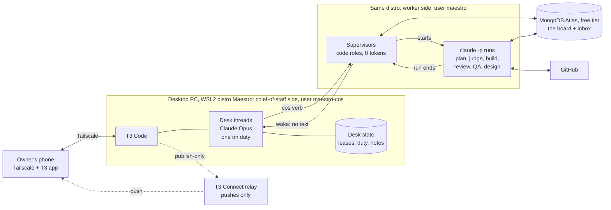
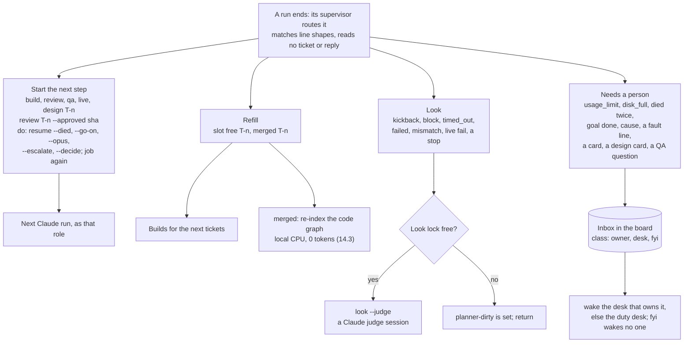
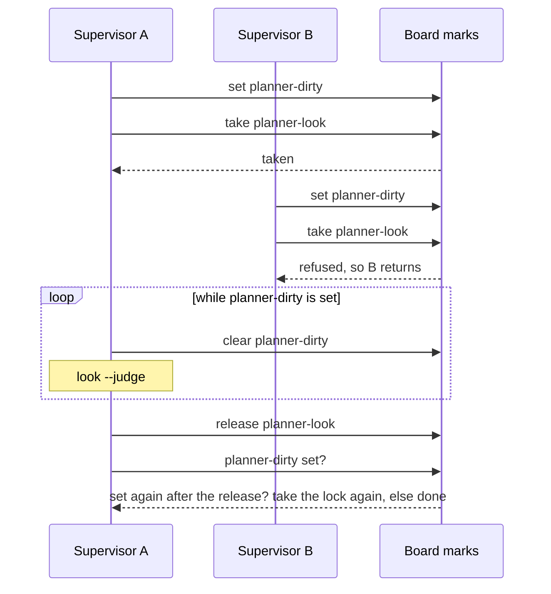
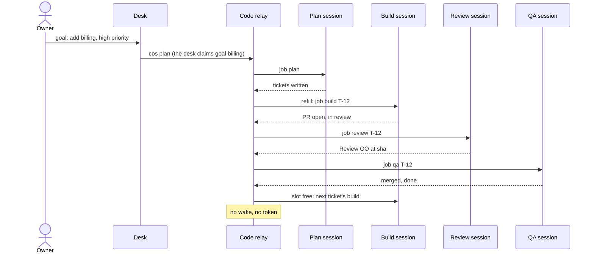
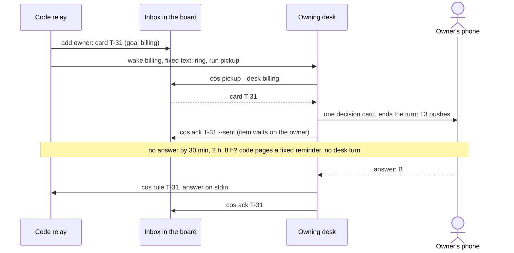
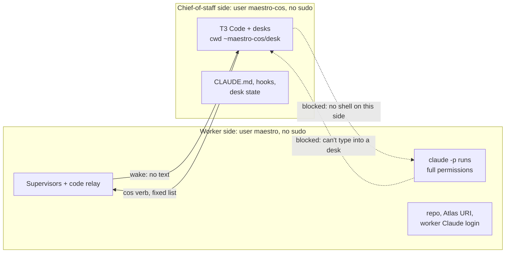
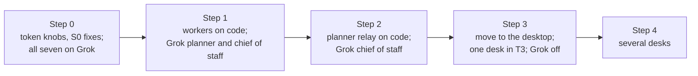

# T3 runtime: a spec for Maestro without Grok Bot

**Status:** draft v8, 2026-11-20. A review proposal on top of v3 (PR #105), for the owner to diff against `docs/design/t3-runtime.md`. v4 added several desks, the phone path, the token plan and the review's fixes; v5 moved the design onto the owner's Windows desktop PC with pushes through T3 Connect. **v6 takes the owner's answers of 2026-11-19, 19:46-19:51 PT** (decisions log, 19.2): the Sonnet moves go ahead behind their evals, effort stays high, the graph re-indexes on merge, the board is Atlas's free tier, the first desk opened has duty, relay-down needs no second channel, and no agents run natively on the owner's Windows account. **v7 adds cleanup** (6.4): a janitor that frees disk before claims are refused, a scratch folder and a memory cap for each run, and a disk that gives space back to Windows, from what fills `grok-bot-vm` today. **v8 adds browsers** (6.5): QA runs test in parallel, each with its own headless Chromium and its own app, under its run's memory scope, with a cap, a reaper and the install for WSL. Nothing here is built.
**Labels:** **[code]** means checked in the source at the `file:line` given; "built" means `GOOS=windows go build` was run on it. **[box]** means checked on `grok-bot-vm`, where Maestro runs today, on 2026-11-19 (6.4, 6.5: 2026-11-20). Nothing was checked on the desktop: every desktop claim is **[docs]** or **(guess)** until the probe in 16.3 runs. **[docs]** means a vendor doc or release note says it. **(guess)** means nothing has shown it. **[I]** is an inference from measured data. Sections 11 and 16.3 list the probes.

## 0. The point

1. Grok Bot goes as the runtime. It bills each model call times its whole chat, about 100-200K cached tokens a call ([decisions](../decisions.md), 19). Its seven profiles stay in `bot-profiles/`; setting a bot's webhook again brings it back.
2. Each role gets a **server**: a webhook (a Grok bot), a command (the chief of staff's wake), or code (the planner's routing and the five worker roles). Every "does this bot have a webhook?" becomes "is this role served?".
3. All thinking stays in Claude. Planning, judging and rulings run as Claude sessions, as today. Code takes only the relaying Grok bots did (section 3).
4. The chief of staff is one or more **desk** threads in T3 Code. The owner talks only to desks, from the T3 app on the phone over Tailscale (5.5). Desks sit behind a wall: no worker session can type into one, and a desk reaches the board only through `maestro-ticket cos <verb>`.
5. Several desks can run at once. Each owns its goals by a 24-hour lease, and all read one small desk state, so each knows what the others do. **The first desk opened has duty**; when it closes or its lease lapses, the next-oldest live desk takes it, atomically (5.4). The duty desk gets what no desk owns and alone changes board-wide settings.
6. Code tells, Claude decides. Code sorts each inbox item as *owner*, *desk* or *fyi*. Only *owner* and *desk* items wake a desk, and a reminder about a card is a push from code, not a model turn (5.2).
7. The runs get cheaper: Sonnet 5.5 for four jobs, each after its own eval set passes; effort high everywhere; a 5-minute cache for build and QA; a code graph that review and build query, re-indexed on every merge (section 14).
8. One machine: the owner's Windows desktop PC. Everything runs in one WSL2 distro, `Maestro`, with systemd, two Linux users and the wall between them (section 6), unless the 30-minute probe in 16.3 says T3 belongs on native Windows. The board lives on MongoDB Atlas's free tier (7). One Claude Max 20x plan runs it all.
9. One push channel: T3 Connect, linked **publish-only**, so no tunnel and no cloudflared. Access is Tailscale only. If the relay is down, the failure is shown wherever the owner looks next, and a daily heartbeat push makes silence noticeable. There is no second channel (5.5).
10. Cleanup is code. A nightly janitor, also started when free space or inodes fall under 20%, frees what is safe before claims are refused at 10%. Each run gets its own TMPDIR and a 4 GB memory cap, so one heavy build fails alone (6.4).
11. QA tests in parallel: one headless Chromium and one copy of the app per QA run, `qa_slots` of them (4 on a 32 GB PC, guess), in the run's memory scope, which is stopped at the run's end. A shim caps browsers and refuses `close-all` (6.5).



## 1. The owner's answers

The calls that shaped v3-v5. The answers of 19:46-19:51 are in the decisions log (19.2) and applied throughout.

| Call | Answer (2026-11-19) | Where |
|---|---|---|
| Accounts | One personal Claude Max 20x plan; maybe a Team plan later | Section 8; 12.2 for later |
| Second user for the chief of staff | Yes | The wall, section 6 |
| Main machine (18:01) | The owner's Windows desktop PC, not `grok-bot-vm`; WSL or native, whichever performs better | 6, 16, 17 |
| Pushes (18:01) | Through the T3 Connect relay, not a Slack DM | 5.5 |
| Planner as code | "Isn't the planner the product manager?" | Section 3 answers it |
| Several boxes | One machine | Section 12 keeps the audits' findings for later |
| Where the board lives | MongoDB Atlas; free tier (19:46) | Section 7 |
| Rewrite the rules | Yes, a full rewrite | Section 9 |
| Several chief-of-staff sessions | Yes, each knowing what the others do | 5.4 |
| Remote path | Tailscale into the main machine, T3 on the phone | 5.5 |
| Token use | High quality on fewer tokens; Sonnet where quality holds | Section 14 |

## 2. Who serves each role

| Role | Today | T3 runtime |
|---|---|---|
| Junior, senior engineer | Grok webhook | code |
| Reviewer, QA lead, designer | Grok webhook | code |
| Planner | Grok webhook | code for the routing; Claude for the thinking (section 3) |
| Chief of staff | Grok webhook | command: wake a desk thread (section 5) |

`maestro-ticket notify set <bot>` takes one of `--url-file` (today), `--exec-file` or `--code`. The chain, `look` and the supervisor read that server through one `served(bot)` check. Today each reads `hasHook`:
- `handOn` **[code]** `tools/maestro-ticket/cli/chain.go:247`;
- `startSends` **[code]** `tools/maestro-ticket/cli/look.go:282`;
- the refill and ack gates **[code]** `tools/maestro-ticket/cli/chain.go:110-120`;
- `runDo` **[code]** `tools/maestro-ticket/cli/chain.go:178`;
- the ring itself **[code]** `tools/maestro-ticket/runs/supervise.go:473`.

The servers mix, so the move off Grok goes one role at a time (section 10).

## 3. The planner: Claude thinks, code relays

The planner is still the product manager. What changes is who carries its messages. Decision 19 already bars the Grok planner from reading a ticket, a PR or a reply to judge it, so every planning and judging call already runs in a Claude session. The Grok bot only wakes, runs `look`, passes lines on and acks. That relay is the part code takes.

| Planner's work | Who does it today | T3 runtime |
|---|---|---|
| Turn a goal into ordered, tiered tickets with criteria | Claude: `job plan`, the **maestro-planner** skill | same |
| Split or rewrite a ticket, carry out a ruling, finish a split | Claude: `job plan`, `job rule` | same |
| Judge blocks, disputed findings and parked tickets | Claude: the judge session `look --judge` starts | same |
| Ask the chief of staff before changing scope | Claude: the plan session leaves a card | same; the card goes to the inbox |
| Pick what starts next, fill slots, route by tier | code: `look`, refill, the chain | same |
| Wake on a message, run `look`, pass lines on, ack | Grok bot | **code** (3.1) |
| Report progress, ETAs | Grok bot, from `look --report` | a desk runs `cos look`; the plan session records each ETA it gives |

A standing planner thread in T3, with its own memory between goals, could come later. It would wake on every planner line, so it costs more than code. Not part of this build.

### 3.1 What the code relay does

A run's supervisor routes the run once it ends **[code]** `tools/maestro-ticket/cli/chain.go:51`. When the role the result is for is served by code, the supervisor acts on each line in its own process:



| Line | Code does |
|---|---|
| `build`, `review`, `qa`, `live`, `design <id>` | Starts it as that role. Today `chainLine` takes only the first three **[code]** `tools/maestro-ticket/cli/chain.go:29`. QA starts only into a free QA slot (3.3). |
| `review <id> --approved <sha> --drop …` from a judge | Starts that review |
| `do: resume <run> --died`, `--go-on`, `job again <run>` | Runs it, as now **[code]** `tools/maestro-ticket/cli/chain.go:169` |
| `do: resume <run> --opus`, `--escalate`, `--decide`, `job again <run> --full` | Runs it. Fixed shapes too; the grammar still allows no rules write. |
| `slot free`, `merged` | Refill **[code]** `tools/maestro-ticket/cli/look.go:304`. `merged` also re-indexes the graph (14.3). |
| `kickback`, `block`, `timed_out`, `failed`, `mismatch`, `live fail`, a stop | One `look --judge`, under the look lock (3.2). A stop someone asked for is not a no-verdict strike (3.3). |
| `usage_limit`, `goal <slug> done` | Into the inbox as **fyi**: no wake; the next desk turn and `desk brief` show it (5.2) |
| `disk_full` | **fyi** if the latest janitor pass left free space above the margin, else **desk** (6.4) |
| `died twice`, `cause …`, a fault line | Into the inbox as **desk** |
| a card, a design card, a QA question, `store-down` | Into the inbox as **owner** |

Then it acks the run. A run a usage limit stopped stays unacked, as today, so its ring at the reset fires **[code]** `tools/maestro-ticket/cli/launch.go:409`. With code as the server, that ring runs the run's `do: resume --go-on` line. The same holds for a handoff a pause held, and for the STOP lift.

It never forwards a full `--report`. The planner's persona sends a report only when a goal finishes, the line stops, a block needs it or a desk asks, and the relay keeps to that.

### 3.2 The look lock

300 runs can end in one minute. They must not each start a look. A run's end **sets `planner-dirty` first, then tries the lock**, so no end is ever missed.



- The mark expires after 10 minutes. A stale one is taken over, as handouts are (`moveStale`, **[code]** `tools/maestro-ticket/cli/look.go:107`), so a supervisor that dies mid-look can't stop the relay for good.
- After the release, the holder checks `planner-dirty` once more and tries the lock again if it is set. A loser that set dirty after the last clear has either found the lock free and taken it, or will be seen by that check.
- `look` already marks each row it hands a judge **[code]** `tools/maestro-ticket/cli/look.go:410`, so a second look never judges the same row again.

### 3.3 Two fixes the relay needs first

The relay acts at machine speed, so two bugs a person or a Grok bot used to absorb now bite (both were in closed PR #102; they come back as step S0):
- **A stop someone asked for counts as a no-verdict strike.** `noVerdicts` leaves out only launcher-stopped runs **[code]** `tools/maestro-ticket/cli/route.go:824`; `stoppedOnPurpose` **[code]** `route.go:1003-1011` is checked only on the first-rerun branch. The fix leaves out `runs.StopAsked` runs too. Then standing rule 32 goes.
- **QA is handed out past the free QA slots,** and the extra runs wait in `slot`. The fix: `look` and refill hand out QA only up to the free `qa_slots`. Then standing rule 33 goes.

## 4. A ticket's life in the T3 runtime



A send-back from review or QA goes straight back to the engineer. A block goes to the judge. Only what needs a person reaches a desk, and the desk that owns the goal gets it.

## 5. The chief of staff

### 5.1 The desk threads

- A desk is one Claude thread in T3 Code, on Opus, in full access, so tool asks never reach the phone ([decisions](../decisions.md), 12). The owner opens as many as they like; each has a short name (`billing`, `ops`), and its T3 title starts `[CoS] <name>`.
- Desks run as user `maestro-cos`. Their persona, the team rules and the `cos` and `desk` verbs sit in `~maestro-cos/.claude/CLAUDE.md`, built by `scripts/bot-bundle.sh`. A separate user gives a separate config dir, so T3 needs no config-dir setting (its 0.1.0 Claude provider has only `binaryPath` and `customModels` **[box]**). Claude Code loads this `CLAUDE.md` in every session and again after compaction (guess; P0).
- **A desk thread starts in `~maestro-cos/desk/`, never in the repo.** A session started in the repo loads the repo's `CLAUDE.md`, `.claude/settings.json` (whose hooks run a shell), `.claude/skills` and `.mcp.json` **[box]** `blitzlink-agency-ops/`. The worker user can write all of these, and a merged PR can change them: a door through the wall.
- `CLAUDE.md` stays under 4 KB: the persona's core, the verb list and the card format. Longer procedures (dependency audits, outside steps, design cards) live in the `maestro-chief-of-staff` skill, read when needed.
- **Context cap.** Claude threads in T3 on `grok-bot-vm` run at a median of 127k context per request, every cache write on the 1-hour TTL **[box]** (957 requests, `~/.claude/projects/-home-box-t3work-eggbot`). A desk woken after an hour rewrites its whole context, about $1 of cache write at 127k **[I]**. So desks auto-compact at about 40% of the window (`CLAUDE_AUTOCOMPACT_PCT_OVERRIDE` in the desk service's environment **[docs]**, P0). After compaction the desk runs `desk brief` (5.4).
- Auto-memory is off (`CLAUDE_CODE_DISABLE_AUTO_MEMORY=1`), as in worker runs **[code]** `tools/maestro-ticket/cli/job.go:104`. The desks' shared memories are one file, `desk/memory.md`, written only through `desk remember` and imported by `CLAUDE.md`.
- A desk reads what is short itself. Long reads (a PR, many tickets) go through `cos ask`, a separate lean run, so its own context stays small.

### 5.2 The inbox



- The inbox is a space in the board's coord store, `inbox/chief-of-staff`. Each item is one line of a fixed shape, with a run or ticket id, a goal slug when there is one, and a class: **owner** (only the owner can answer: cards, design cards, QA questions, `store-down`), **desk** (a desk can settle it: died twice, a cause, a fault line), **fyi** (no one need act: usage limit with its reset, a disk full the janitor has since freed, goal done). A disk full the janitor couldn't free is **desk** (6.4).
- Code adds items. `cos pickup --desk <name>` returns the items for goals that desk owns, plus unowned ones if it has duty, and leases each to that desk for 2 hours. A second desk's pickup skips leased items, so two desks never act on one item. Only the holder's `cos ack` removes an item. A lease that runs out puts the item back for its owner or the duty desk.
- **`cos ack <id> --sent`** marks an owner item as sent. It stops the wake rings for that item. From then on, code sends the owner a fixed-text reminder at 30 minutes, 2 hours and 8 hours through the pager thread (5.5), with no desk turn. Without it, the 5, 10 and 40 minute re-rings would wake an Opus thread three more times per card, at about 13 cards a week **[box]** (`tickets.db`, 13 card parks over 11 tickets in 7 days).
- **fyi items wake no desk.** The next desk turn and every `desk brief` lead with them.
- A card's text stays data, as [decisions](../decisions.md), 7 says. It is still text a worker session wrote (6.0).
- The wake goes through the existing gate: at most once each 4 minutes **[code]** `tools/maestro-ticket/runs/gate.go:19`, and again at 5, 10 and 40 minutes while a **desk** or unsent **owner** item waits unleased **[code]** `tools/maestro-ticket/runs/supervise.go:46`.
- If Atlas is down, code can't write the inbox. Then the wake goes to the duty desk and carries one fixed word, `store-down`. The duty desk tells the owner, and runs `cos look` once Atlas is back.

### 5.3 The `cos` and `desk` verbs

`cos` verbs cross the wall and run on the worker side, as user `maestro`:

| Verb | Runs, signed as |
|---|---|
| `pickup --desk <name>`, `ack <ids> [--sent]` | the inbox, as `chief-of-staff` |
| `plan` (goal on stdin), `rule <id>`, `resume <run-id>` | `job plan`, `job rule`, `resume`, as `planner` |
| `look` | `look --judge --report`, as `planner`. It also restarts a quiet board after a reboot or an outage. |
| `rules show` | as `chief-of-staff` |
| `rules set limit <n>`, `rules set qa_slots <n>`, `rules set model <job> <model>`, `rules add`, `rules drop <n>`, `stop`, `start` | **the duty desk only**, checked under the duty lock (5.4), as `chief-of-staff`, which `rulesWriters` already allows **[code]** `tools/maestro-ticket/cli/rules.go:48`. Another desk gets `refused: duty desk is <name>`, and sends it a note. |
| `ask` (question on stdin) | a `/maestro-chief-of-staff` run on the worker side; its answer comes back through the inbox, to the desk that asked |
| `list`, `get`, `events`, `goals`, `flow`, `eta`, `costs` | as today's commands, as `chief-of-staff` |

`cos` refuses any verb off this list. `desk` verbs stay on the chief-of-staff side, as user `maestro-cos`, and never cross the wall (5.4).

### 5.4 Several desks

The owner opens a desk, works on billing, and later opens another for an outage. The second desk must know that billing is taken, what the first has promised and is waiting on, and which desk has duty.

**Where.** The desk state lives on the chief-of-staff side, in `~maestro-cos/desk/state/`, in the coord store's file mark format: create-or-fail and stale takeover **[code]** `tools/maestro-ticket/cli/coord.go` (`create`, `takeOver`). Only `maestro-cos` can write it; a copy in Atlas would let any worker session plant a note every desk reads. It sits on the same disk as the desks' T3 threads, and the nightly backup (17.4) copies both, so a restore takes them back together; leases run out and `desk brief` then shows the real board.

**On the desktop.** The state sits on the distro's ext4 disk, so the file marks work as on Linux today: `O_EXCL` create, write-then-rename, and `flock` **[code]** `cli/coord.go:199-288`, `runs/sys_unix.go:19-43`. Two rules:
- **Never under `/mnt/c` or `\\wsl.localhost`.** Those go through WSL's file bridge, which is far slower **[docs]**, and whose locks a process across the bridge may not see (guess). The same goes for the repo, worktrees, the store folder and T3's data. With automount off (6.2), `/mnt/c` isn't there.
- **One clock.** Leases and `beat_at` compare wall-clock times. A WSL2 clock can drift after a sleep (guess, 16.3 step 5). The PC doesn't sleep (16.2), and the distro runs `systemd-timesyncd`.

If the probe moves T3 to native Windows (option B, 6.1), the `desk` command needs `LockFileEx` and a retry on rename, and the hooks a Git Bash or PowerShell form (`flock` stubs refuse there **[code]** `runs/sys_other.go`).

**The state**, one small JSON file each:

| File | Fields | Rules |
|---|---|---|
| `desks/<name>` | `name`, `thread` (T3 thread id), `session` (Claude session id), `focus` (one line), `opened_at`, `beat_at` | `desk open <name>` creates it, or fails if a live desk has the name. A desk is **live** while `beat_at` is under 24 hours old, and **here** while under 15 minutes old. `desk close` moves it to `closed/`. |
| `goals/<slug>` | `desk`, `claimed_at`, `lease_until` | `desk claim <slug>` creates it. **The lease is 24 hours**, renewed by each of the owning desk's turns. A stale claim is taken over by the next claimer, or by the duty desk. `desk release <slug>` hands it back. `cos plan` claims the goal it plans. |
| `duty` | `desk`, `epoch`, `since`, `lease_until`, `why` | Written only under `duty.lock` (below). The lease is 24 hours, renewed by the duty desk's turns. |
| `duty.log` | one line per epoch: time, epoch, from, to, why | append-only; `brief` shows the last change |
| `notes/<name>/<time>` | a handoff note (format below) | `desk note` appends; `brief` shows each desk's latest note. Pruned after 14 days. |
| `memory.md` | the desks' shared memories | `desk remember` appends one line under a lock; `job retro` (14.5) proposes cuts. Under 4 KB. |

**Duty: the first desk opened, then the next-oldest.**
- **Who.** `desk open` makes the new desk the duty desk when no live desk holds duty. Duty stays put while its holder is open and its lease is current. When the duty desk **closes** or **its lease lapses**, duty goes to the live desk with the oldest `opened_at` (ties by name). If no desk is live, `duty` is empty and the next `desk open` takes it.
- **Atomic.** Every write to `duty` happens inside one exclusive `flock` on `state/duty.lock`, the lock helper `desk remember` uses **[code]** `runs/sys_unix.go:19`. Inside it: read `duty`; if the holder is open and its lease current, stop; else pick the successor, write the new `duty` with `epoch + 1` by write-then-rename, and append to `duty.log`. One lock serializes every writer, and the file is replaced whole, so a reader sees the old holder or the new one, never two.
- **When it runs.** `desk open`, `desk close`, `desk beat`, `desk brief` and `desk ring` each run this check first. So duty moves at the first desk event after a lapse, and `desk ring` always checks before it routes unowned items. If `t3 thread send` to the duty desk fails (its thread gone; P0 checks the exit code), `desk ring` treats the lease as lapsed and moves duty at once.
- **Board-wide verbs hold the lock.** A desk's `cos rules …`, `stop` and `start` run through the cos-side `maestro-ticket cos --desk <name>`, which takes `duty.lock`, checks that `duty.desk` is `<name>`, crosses with sudo, and releases. A takeover waits for a write in progress, so no write lands from a desk that has lost duty. This keeps desks in step; it is not the wall (section 6 is).
- **Closing.** `desk close <name>` runs when the owner tells a desk it's done; the `SessionEnd` hook runs it too, if T3 ends the Claude session when a thread is archived (guess, P0). It writes the desk's last note, moves duty first if the desk held it, then releases its goals to the duty desk.
- **The new holder** gets the fixed ring `ring: you have duty, run pickup`, and every desk's next brief shows the change.
- There is no manual takeover verb: the order is the rule.

**Heartbeat, with no model tokens.** The desks' `~maestro-cos/.claude/settings.json` sets three hooks. `Stop` runs `maestro-ticket desk beat`, which reads the session id from the hook's input and renews `beat_at` and the desk's leases (goals, and duty if it holds it). `SessionStart` (startup, resume, compaction) runs `maestro-ticket desk brief` and adds its output to the context. `SessionEnd` runs `desk close`. Hooks are code: the heartbeat costs nothing, and a desk can't forget it.

**The handoff note.** A desk writes one before it goes idle on a goal, when the owner says they're switching, and after each card it sends. At most 10 lines, ids not titles:

```
desk: billing  at: 2026-11-19T22:04Z  goals: billing-v2
doing: plan R-ab12cd34 split T-40 into T-41..T-44
promised: owner: ETA Fri for billing-v2 (eta recorded)
waiting: owner: card T-31 (B or C), sent 21:50Z
waiting: planner: rule T-38
decided: T-29 dropped (owner, card 21:10Z)
next: on T-31 answer, cos rule T-31
hands off: api/ rules set by owner; don't change limit, ops desk is on duty
```

**Catching up.** A new desk, or one back after compaction, gets `desk brief` from its `SessionStart` hook. In 40 lines at most: who has duty, the desks with their focus, goals and presence, each desk's latest note, the fyi items since this desk's last turn, the owner and desk items waiting by goal, and one `counts:` line from the board. Under 2k tokens (guess), against tens of thousands for reading another thread. The top of `billing`'s brief, the turn after `infra` closed:

```
you: billing · goals: billing-v2 (lease to 11-20 22:04Z) · not on duty
duty: ops · epoch 4 · since 11-19 15:10Z · lease to 11-20 21:58Z · next in line: billing
duty moved 15:10Z: infra -> ops (infra closed)
desks: ops (duty, here, opened 09:12Z) · billing (here, opened 11:40Z)
board-wide verbs (rules, stop, start): ask ops
```

The duty desk's own first line reads `you: ops · ON DUTY · epoch 4 · lease to 11-20 21:58Z`, with `retro due` (14.5) when it is.

**Waking the right desk.** `maestro-ticket wake` still carries no text. On the chief-of-staff side it runs `desk ring`, which:
1. runs the duty check;
2. reads the inbox counts by goal and class through `cos pickup --peek` (ids, goals and classes only);
3. maps each goal to its owning desk, and the rest to the duty desk;
4. sends each of those desks the fixed text `ring: run pickup`. A desk the owner is typing in (its thread busy) gets it queued.

If no desk is live, `desk ring` pages the owner the fixed text `Maestro: N items, no desk open` (5.5).

### 5.5 The phone path

**Access: Tailscale only.** Tailscale runs once, on Windows, as its Windows service: one tailnet node for the PC, set to run unattended, so it stays up with no one logged in **[docs]**. Inside WSL, T3 serves on `127.0.0.1:3773`. WSL hands a localhost listener to Windows' localhost: through localhost forwarding in NAT mode, or directly in mirrored mode **[docs]**. On Windows, `tailscale serve --bg 3773` publishes it as tailnet-only HTTPS. Three don'ts:
- Don't use T3's `--tailscale-serve` inside WSL. It drives the `tailscale` CLI, which lives on Windows.
- Don't run a second `tailscaled` inside WSL: a second node with its own login, which may fight the Windows client over routes (guess).
- Don't bind `0.0.0.0`. T3 0.1.3 and later can serve to the LAN **[docs]**. Bound to `127.0.0.1`, only Tailscale Serve reaches it.

The phone runs the Tailscale app and the T3 app, and pairs once with `t3 pair`, which prints a QR code **[box]**. Nothing listens on a public address.

**T3 Connect is for pushes only.** T3 0.1.0 has `t3 connect link --publish-only`: "Link to publish agent activity only — no managed tunnel. Reach this environment out of band (e.g. Tailscale)" **[box]**. `grok-bot-vm` has the full link today, with a managed cloudflared 2026.10.0 **[box]** (`t3 connect status`). The desktop gets the publish-only link and nothing else. P0 (16.3 step 7) confirms: a push reaches the locked phone; no cloudflared runs; with Tailscale off on the phone, pushes arrive but the app can't open a thread.

**Pushes: one channel, T3 Connect.**
- **Desk turns.** T3 pushes when a desk's turn ends (`t3 connect publish`, off on the VM today **[box]**). That covers every card and every answer.
- **Code's own pushes**: the reminders (5.2), `no desk open` (5.4), the heartbeat, and `store-down` when no desk is live. T3 0.1.0 has no command that pushes without a turn **[box]** (`t3 --help`). So code pages through a **pager thread**, `[CoS] pager`, in project `~maestro-cos/pager/`:
  - It runs on Haiku 5.5 with every tool denied in its `settings.json`. Its `CLAUDE.md` is three lines: each message starts `page:`; reply with the rest of the line, word for word, and nothing else.
  - `maestro-ticket desk page <template> <args>` fills a fixed template. It takes only numbers and goal slugs matching `^[a-z0-9-]{1,32}$`, so no ticket text can reach it. It sends with `t3 thread send` (added in T3 0.1.2 **[docs]**). The turn ends and T3 pushes.
  - The pager thread is replaced each day, so its context stays a few thousand tokens. At about 50 pages a week, well under $1 a week (guess).
  - If the pinned T3 version can push without a turn, use that and drop the pager (P0).
- P0 also checks what a push shows on the lock screen: the thread title, the reply's first line, or both.

**The October OOM risk, on the desktop.** The causes then were **[box]** (`OPS-RUNBOOK.md` §9, `t3-architecture-review.md` §2): (1) the VM was suspended and forked, breaking the tunnel; (2) port 7844 was blocked, so cloudflared ran through a hand-written forwarder and the box's egress proxy; (3) watchdog v1 restarted all of T3 on every relay failure; (4) cloudflared retried with no backoff, and T3 logged every retry: 2.3 GB in 4.5 minutes, then a V8 heap OOM. With a publish-only link no tunnel runs, so 2 and 4 can't happen (P0 confirms). The PC doesn't sleep (1). systemd restarts T3 only when it exits (3). What's left is T3's own publish traffic, which might retry hard while the network is down (guess). Guards: `MemoryMax=3G` on T3's unit, a journald size cap, and `ts-ensure --t3-check` as a systemd timer (RSS and log size, with a warning mark `desk brief` shows). If publish-only still starts cloudflared, a home network has no blocked 7844 (guess), T3 0.1.8 restarts the tunnel client when Cloudflare drops it **[docs]**, and the same guards apply. **Verdict: low.**

**When the relay is down: fail visible, plus a daily heartbeat. No second channel** (decided 2026-11-19).
- **Detect.** A 5-minute timer checks the relay. P0 picks the signal: T3's log of a failed publish, or a relay health URL (guess). On failure it writes `desk/state/push-down` with the time, and clears it on recovery. Pages that fail are held in `desk/state/pages-held` and sent as one page when the relay is back.
- **Show.** Every `desk brief`, and the first line of every desk reply, lead with `PUSH DOWN since 14:05`. The pager thread is renamed `[CoS] pager: PUSH DOWN`, if T3 lets code rename a thread (guess), so the thread list shows it as soon as the owner opens T3.
- **Heartbeat.** One page a day at 09:00 local: `Maestro ok: 2 desks, 1 waiting`. If it doesn't come, the relay, Tailscale or the PC is down. 7 Haiku turns a week.

**What a push means.** A desk turn ends with something for the owner only when it brings an owner item, or the owner started the turn. So a push almost always means "you're needed".

**Phone-sized replies.** At most 12 lines. A card fits one screen: what it's for, options as letters, what each costs and risks, the default, and what happens while they wait; answerable with one letter. Anything longer goes to `desk/out/<id>.md` with a one-line summary.

**No approvals on the phone.** Desks run in full access, so no tool prompt reaches the owner. The owner's say-so comes only through card answers, which the desk repeats back in one line before acting.

**When the PC is down.** Tailscale, T3 and the supervisors all start on boot with no one logged in (16.2): Tailscale's service runs unattended, a startup task starts the distro and keeps it running, and systemd starts everything inside it. A Windows Update reboot takes the same path. To recover from the phone:
- Tailscale SSH doesn't run as a server on Windows **[docs]**. Use Windows' OpenSSH Server, key-only, its firewall rule limited to `100.64.0.0/10`, or Remote Desktop over Tailscale. Then, for example, `wsl -d Maestro -u root systemctl restart maestro-t3-cos`.
- After a power cut, the BIOS setting "restore on AC power loss" brings the PC back, if the board has it (guess).
- The heartbeat is how the owner learns the PC is gone at all.

## 6. The wall

Every worker run has full permissions and reads ticket text. If one could type into a desk's thread, text planted in a ticket could steer the team, since the thread has a shell and signs as the planner. So the two sides run apart, with two doors:

| Door | From → to | What crosses |
|---|---|---|
| `maestro-ticket wake` | worker side → chief of staff | nothing but "wake", or the one word `store-down`. `desk ring` sends each chosen desk a fixed text. |
| `maestro-ticket cos <verb>` | chief of staff → worker side | one verb from the list, text on stdin |

A worker session can wake a desk, at worst too often, but can't put words in it unasked. A desk can't run a shell on the worker side.



### 6.0 What the wall does not stop

Text a worker session wrote still reaches a desk when the desk asks for it: a card's body, a `cos ask` answer, a `get` of a ticket. The wall stops text the desk didn't ask for and keeps the worker side's shell out of reach; it doesn't make pulled text safe. So:
- Code renders each card into the fixed card shape, each free-text field capped at 300 characters and fenced as quoted data.
- The verbs with the widest reach (`rules add`, `rules drop`, `rules set model`, `stop`) run only on the duty desk, and each prints a line the next `desk brief` shows every desk.
- A desk changes a rule the owner set only on the owner's card, as the persona already says.

### 6.1 Building it on the desktop

**The worker side is Linux, so it runs in WSL2 whichever way T3 goes.** Built for `windows/amd64`, `maestro-ticket` compiles, but `job`, `launch` and `stop` refuse with "needs a unix system" **[code, built]** `cli/job.go:264`, `cli/launch.go:212`, `cli/launch.go:941`. The Windows stubs have no lock and no process group **[code]** `runs/sys_other.go`, `cli/slot_other.go`, `cli/proc_other.go`, and the skills' and install scripts are bash (11 files under `scripts/` and `skills/` **[code]**). So "native" can only mean T3 and the desks on Windows, with workers in WSL. A is the plan; B is the fallback if the probe (16.3) fails WSL.

| | A: two Linux users in one WSL2 distro (the plan) | B: T3 and desks native on Windows (fallback) |
|---|---|---|
| Worker side | user `maestro` in a dedicated distro, `Maestro` | the same |
| Chief-of-staff side | user `maestro-cos` in the same distro; `t3 serve` as a systemd unit; Windows' `tailscale serve` publishes it (5.5) | a standard Windows account, `maestro-cos`, never the owner's. T3 0.1.10 as a Windows service **[docs]**; Claude Code native, using Git Bash if installed, else PowerShell **[docs]** |
| `wake` door | a sudoers rule: `maestro` may run only `/usr/local/bin/maestro-ticket wake` as `maestro-cos` | interop off; a small listener on a Windows localhost port, as `maestro-cos`, ignores what is sent and runs `desk ring` |
| `cos` door | a sudoers rule: `maestro-cos` may run only `/usr/local/bin/maestro-ticket cos *` as `maestro` | not `wsl.exe -u maestro`: an account that can start a distro can also `wsl -u root` in it **[docs]**. Instead `sshd` in the distro on localhost, one key with `command="maestro-ticket cos",restrict`; the verb arrives in `SSH_ORIGINAL_COMMAND` |
| Files | Linux modes: homes 0700; `store.uri` 0600 **[code]** | NTFS ACLs: a new account's profile private to it, SYSTEM and Administrators (guess, P0) |
| Supervision | systemd in the distro (`[boot] systemd=true` **[docs]**) | a Windows service for T3, a task for the listener, systemd for workers |
| Secrets | env files, mode 0600, one per user, via `EnvironmentFile=` | Credential Manager for the CoS account; workers as in A |
| Desks, leases, hooks | as written (5.4) | `LockFileEx`, rename retries, Windows hooks (5.4) |
| New parts | none beyond v4 | an account, a service, a listener, `sshd`, Windows forms of `desk` and its hooks |

A team on one Linux box with no T3 can skip the wall; the same commands run directly.

### 6.2 Setup for option A on the desktop

**On Windows, as the owner (admin):**
1. `wsl --update`, then a fresh distro just for Maestro: `wsl --install Ubuntu-24.04 --name Maestro` (if `--name` is refused, `wsl --import` a clean Ubuntu). Don't reuse the distro the owner works in.
2. In `%UserProfile%\.wslconfig`, set `[wsl2] memory=` to the PC's RAM minus about 8 GB, and `defaultVhdSize=` to what C: can hold with room to spare. Add `[experimental] sparseVhd=true` only if 16.3 step 5 passed. Write this file before step 1: `defaultVhdSize` and `sparseVhd` apply only to a disk made after them **[docs]** (6.4). Leave networking on NAT; switch to `networkingMode=mirrored` only if 16.3 step 6 needs it.
3. Tailscale for Windows, logged in, set to run unattended **[docs]**. Then `tailscale serve --bg 3773` (tailnet only).
4. A Task Scheduler task, "Maestro keepalive": at startup, whether or not anyone is logged on, run `wsl.exe -d Maestro --exec /bin/sleep infinity`, since WSL may stop an idle distro even with units running (guess, 16.3 step 5).
5. The power plan (16.2).

**In the distro, as root:**
1. `/etc/wsl.conf`:
   ```
   [boot]
   systemd=true
   [automount]
   enabled=false
   mountFsTab=false
   [interop]
   enabled=false
   appendWindowsPath=false
   [user]
   default=paul
   ```
   With interop off and no drives mounted, a worker can't run `t3.exe`, `cmd.exe` or `powershell.exe`, or read `C:`.
2. Users: `paul` (the owner, in `sudo`), `maestro` and `maestro-cos` (neither in `sudo`), homes at mode 0700. `scripts/install.sh` prints the two sudoers lines; the owner adds them with `visudo -f /etc/sudoers.d/maestro`.
3. Build `maestro-ticket` as `paul` and install it as `/usr/local/bin/maestro-ticket`, `root:root`, mode 0755. **Neither side may be able to write the binary:** the wake rule runs it as `maestro-cos`, so a worker that could replace it could run anything on the desk side. The same goes for `@playwright/cli` in `/opt/pw` and the `playwright-cli` shim in `/usr/local/bin` (6.5).
4. systemd units, each `Restart=on-failure`:
   - `maestro-t3-cos.service`: `User=maestro-cos`, `t3 serve --host 127.0.0.1 --port 3773 --no-browser`, `MemoryMax=3G` (5.5);
   - `maestro-boot.service` (oneshot, `User=maestro`): a code-only `look` after a boot, with no `--judge`, so dead runs and free slots are seen without a model turn, and `desk brief` shows `rebooted at …`;
   - timers for the relay check, the heartbeat, the T3 resource check (5.5) and the nightly backup (17.4);
   - `maestro-janitor.timer` (`User=maestro`): `janitor` at 03:30, and `janitor --if-low` every 5 minutes; `fstrim.timer` if the disk is sparse; `loginctl enable-linger maestro` for the runs' memory scopes (6.4);
   - `systemd-timesyncd`.
5. Node 24, Chromium's libraries and fonts through Playwright's `install-deps chromium`, and `fonts-noto-cjk` (6.5).

**As `maestro-cos`:**
1. Install T3 Code, pinned to 0.1.10 or later (0.1.2 added `t3 thread`; 0.1.10 is the latest stable on 2026-11-19 **[docs]**), and Claude Code. Log in to the owner's plan.
2. In T3: one Claude provider in full-access mode, the title model on Sonnet or Haiku (Opus 5.5 on the VM today **[box]**).
3. Put the desks' `CLAUDE.md` bundle and `settings.json` (the three hooks, 5.4) in `~/.claude/`.
4. Make `~/desk/` and `~/pager/` and add them as T3 projects. Every desk starts in `~/desk`, never in the repo (5.1).
5. Pair the phone (`t3 pair`). Run `t3 connect link --publish-only --headless`, then `t3 connect publish` (5.5).

**As `maestro`:** clone the repo to `~/src/` on the distro's disk, write the Atlas URI with `maestro-ticket store --uri-file -`, put `GH_TOKEN` and the rest in `~/.config/maestro/env` (mode 0600), log in to Claude Code, and run `playwright-cli install-browser chromium --no-shell` (6.5).

### 6.3 What replaces the VM's holes, and what is new

| VM hole | On the desktop |
|---|---|
| `box` has `NOPASSWD: ALL`, and every run and T3 ran as it **[box]** | Gone. The distro's only sudo user is `paul`, used by the owner alone. No run, desk or T3 server runs as `paul`. S4 checks that `sudo -l` as `maestro` and `maestro-cos` shows one rule each. |
| A Reset wipes `/etc`, taking the users and sudoers lines **[box]** | Gone. A `wsl --unregister` or reinstall still loses everything, so `install.sh` is idempotent, and `maestro-ticket` refuses runs if `maestro-cos` or `/etc/sudoers.d/maestro` is missing: a one-user fallback would drop the wall without a sound. |
| A Reset rolls home back, T3 data and desk state included **[box]** | Gone. A restore from the nightly backup (17.4) acts like a small rollback; leases and `cos look` handle it. |
| PID 1 is `tini`; `restore-box.sh` is run by hand **[box]** | Gone. systemd, a startup task and Tailscale's service bring it all up (16.2). The VM's ts-watchdog, T3 watchdog and `edgefwd-loop` don't come along. |

New on the desktop:
- **The owner's Windows account owns the distro, and is above the wall.** Anything running as that account can run `wsl -d Maestro -u root` **[docs]** or open `\\wsl.localhost\Maestro`. **The distro stays under the owner's account, which relies on one rule: no agent work runs natively under that account** (decided 2026-11-19). What would break the rule:
  - the T3 desktop app, Claude Code, Codex or any other agent CLI run natively on Windows as the owner, on any project;
  - an editor agent (Copilot agent mode, Cursor, Claude Code's IDE extension) in a Windows editor running as the owner, or attached to the `Maestro` distro by Remote-WSL, where it runs as `paul`, who has sudo;
  - a scheduled task, script or tool under the owner's account that acts on text from outside (a ticket, a web page, an email).
  If any of these is wanted later, move the distro first: `wsl --export Maestro`, then `wsl --import` it as a separate standard Windows account that only the startup task uses, and re-point the task. `docs/desktop-setup.md` states the rule. Nothing inside the distro can check it.
- **The binary** (6.2 step 3).
- **Interop stays off.** S4 checks, from a worker session, that `cmd.exe`, `powershell.exe`, `wsl.exe` and `/mnt/c` are all missing.

### 6.4 Cleanup: disk and memory

Today nothing frees disk on its own. On low disk, `claim` and `slot` refuse (`low_disk`) **[code]** `tools/maestro-ticket/cli/cli.go:188-192`, and a run's `disk_full` line goes to the inbox as fyi (3.1). Nothing caps a run's memory. The design: a janitor that frees disk before claims are refused, a scratch folder for each run, a memory cap for each run, and a disk that gives space back to Windows.

**What fills the VM** **[box]**, 2026-11-20. Its files date from Nov 12. It has 128 GB, 2.05M inodes (one per 64 KB) and 15 GiB of RAM with no swap. Today 49 GB and 1.05M inodes are in use.

| Where | Size | Inodes | Freed today by |
|---|---|---|---|
| `/tmp`: 410 `mktemp -d` folders runs left (venvs, uv caches, 200 MB mongo-memory-server copies), 60 of them worktrees git still lists; 4 `maestro-slot-*` from killed slots | 14 GB | 375k | nothing. `slot` removes its own TMPDIR unless it is killed **[code]** `cli/slot.go:165,172`. The `maestro-prune` skill, run by hand, removes `tmp.*` folders untouched for 7 days and asks first **[code]** `skills/maestro-prune/SKILL.md:25,35` |
| `~/.claude/projects`: 2.8 GB of it is agency-ops runs, 2,551 sessions in 8 days | 4.2 GB | 13k | Claude Code, after 30 days (`cleanupPeriodDays`) **[docs]**. Nothing here is that old yet. |
| T3's `statev2.sqlite` | 3.0 GB | — | nothing |
| Build caches: go-build 2.0, npm 0.8, playwright 0.7, pnpm 0.4, pip 0.4, uv 0.2 GB | 4.5 GB | 50k | nothing |
| The store's folder: `evidence/` 796 MB, `backups/` 160 MB, `runs/` 60 MB (14.5k files) | 1.1 GB | 22k | run files 7 days after their ack **[code]** `runs/runs.go:561-563`, `cli/launch.go:37,671`; checks after 14 days **[code]** `cli/check.go:34`; handouts after a day **[code]** `cli/look.go:123`; `## Cache` folders after 14 days **[code]** `cli/cache.go:35,485`. **Evidence: only the skill.** |
| `.maestro/worktrees`: 14 worktrees, 3 of them for done or cancelled tickets (184 MB) | 577 MB | 30k | only the skill |

**Spikes, not just the pile.** Each run's end records the store disk's free space and free inodes **[code]** `cli/statsrun.go:447`. On 2026-11-20, from 05:09 to 05:25 UTC, free space went from 61% to 8% and back to 61%, about 65 GB. Free inodes went from 48% to 15% **[box]** (`stats.db`). On Nov 19, inodes ran out first: from 01:00 to 11:30, 8-16% of inodes were free while 46-55% of the space was. In that window, 22 runs ended `disk_full`. The cause **[box]**: test cases made full `git clone --no-hardlinks` or `cp -r` copies of the 3 GB repo, about 6,300 files a case (run R-lj5twhqh, T-654). Agency-ops is now banning those copies in favour of `git clone --shared`. A nightly janitor fixes the pile. Spikes need each run's scratch in a folder of its own and the low-disk trigger below.

**The desktop's disk is a different shape.** By default the vhdx's virtual size is 1 TB, and `df` inside shows that 1 TB even when C: has less free **[docs]**. So the percent margins measure nothing until the size is fixed. Set `defaultVhdSize` in `.wslconfig` before the distro is made **[docs]**, so the whole vhdx fits on C: with room to spare. How many inodes WSL's ext4 gets per GB is (guess); 16.3 step 5 reads `df -i`.

**1. Each run gets its own TMPDIR.** The launcher sets `TMPDIR=~maestro/tmp/<run-id>` for the run and everything it starts, as `slot` already does for one check **[code]** `cli/slot.go:165-181`. A `slot` inside the run makes its folder under it, so a killed slot's leftovers go with the run. When a run ends, its supervisor records the folder's size and file count as two new stats columns, `tmp_bytes` and `tmp_files`, so the next spike shows its run. The folder stays while a resume might need it, and the janitor removes it.

**2. The janitor.** `maestro-ticket janitor [--dry-run]` is code in the binary, 0 tokens, run as `maestro` by `maestro-janitor.timer` each night at 03:30. It puts the `maestro-prune` skill's **Safe** sort and its proofs into code. It also takes two of the skill's ask-first classes, on a narrower rule: temp folders `maestro` owns, and evidence of closed tickets. The skill asks first because a shared `/tmp` holds other projects' folders; on the desktop, nothing else runs as `maestro`. It reuses `runs.Prune` and `removeTree` **[code]** `cli/cache.go:529`.

| Class | Removed when | Always kept |
|---|---|---|
| Worktrees, in `.maestro/worktrees` and any git lists under `~maestro/tmp` | the ticket is done or cancelled and the head is merged or on the remote (the skill's proof). `git worktree remove`, never `--force`, then `git worktree prune` | dirty, unpushed, a live claim, any process's cwd (`/proc/*/cwd`) |
| A run's TMPDIR | its run was acked over 24 hours ago | unacked runs; any run a `resume` or `--go-on` ring still waits on; a live run's |
| Other entries `maestro` owns in `/tmp` and `~maestro/tmp` | untouched for 3 days and open in no process | the rest |
| Run files | as now: 7 days after the ack | unacked |
| Evidence `<common>/evidence/<id>` | the ticket has been done or cancelled for 14 days | the rest |
| Transcripts | Claude Code's own cleanup, with `cleanupPeriodDays: 14` in `~maestro/.claude/settings.json` **[docs]**. The janitor doesn't touch them. A 14-day-old run resumes as `job again` anyway (14.4), and 14 days covers the weekly token report. | — |
| Build caches | each tool's own prune, once its cache passes a cap (5 GB for Go, 2 GB for the rest, guess): `go clean -cache`, `pnpm store prune`, `uv cache prune`, `pip cache purge`, `npm cache clean --force` | — |
| `/var/backups/maestro` (17.4) | over 14 nights old | the newest 14 |
| Browsers (6.5) | a playwright daemon or Chromium in no live run scope, over 20 minutes old; a session's `.err` or `.session` file with no live daemon, a day old | anything in a live run's scope |

- **Idempotent.** One janitor at a time, under `flock` on `janitor.lock`. It checks each item again just before removing it. An item already gone counts as removed by someone else. It never deletes a `*.lock`. A second run frees nothing new.
- **Logs.** It writes one journal line per class, such as `janitor: tmp 4.1 GB 180k files (212 dirs); worktrees 0.2 GB (3); kept T-572 dirty`, and one file, `<store>/janitor.json`, with `at`, `freed_bytes`, `freed_inodes`, the free space and inodes after, and `failed`.
- **`--dry-run`** prints each item, its class, its proof and its size, and removes nothing.
- **The wall.** It runs as `maestro`, so it can't touch `maestro-cos`'s files. On that side, desk notes are already pruned (5.4). T3's database is only watched: `ts-ensure --t3-check` (5.5) adds its size to the warning mark. Whether T3 prunes archived threads is (guess); see 11.
- A project's own shared folders, such as agency-ops' `.git/dep-share` (1.1 GB **[box]**), are the project's. The janitor leaves them.

**3. Low disk: free first, refuse second.** The claim margin stays as it is: refuse under 10% free and under 10 GiB, or under 10% of inodes free and under 1Mi inodes **[code]** `envcheck/disk.go:17`, `cli/cli.go:188-191`. The janitor works on a higher line, **20% of space or inodes** (guess, twice the margin). That line means the vhdx's fixed size, not C:.
- **Trigger.** `maestro-janitor.timer` also runs `janitor --if-low` every 5 minutes: one `statfs`, and it exits when free space and inodes are above the line. `headroom`, which every `claim` and `slot` calls **[code]** `cli/cli.go:570`, also starts `janitor --if-low` in the background when it sees free space under the line, so a spike is caught within seconds. The lock keeps one janitor running.
- **Stage 1**, under 20%: the nightly pass, now.
- **Stage 2**, still under 15%: it also removes acked runs' TMPDIRs without the 24-hour wait, the evidence of every done or cancelled ticket, and each tool cache whole (`go clean -cache`, `uv cache clean`, and so on).
- **Failed**, still under the 10% margin: one `disk_full` item goes to the inbox as **desk**, not fyi. It carries the janitor's report: free space and inodes, what it freed, the five largest folders by `du`, and what it kept and why (a dirty worktree, an unacked run). A desk can stop runs, release a stuck ticket or send the owner a card.
- **A run's own `disk_full` line** (3.1) becomes fyi only when the latest `janitor.json` shows space above the margin. Otherwise it is desk.
- Inodes count everywhere space does: `headroom` already checks both **[code]** `envcheck/disk_unix.go:20-22`, and each line above applies to whichever is lower.

**4. A memory cap on each run.** In the Nov 19 22:59 UTC OOM on the VM **[box]** (`dmesg`), 417 tasks held 14.1 GB of anonymous memory:

| Process | Memory |
|---|---|
| Two `next build` | 1.6 GB and 1.8 GB |
| Nine next-servers | 1.4 GB |
| 42 node | 3.5 GB |
| 12 claude | 2.1 GB, about 175 MB each |
| Four mongod | 430 MB |

The kernel killed small chrome processes three times (oom_score_adj 300), and the builds kept running. Nothing records a run's peak today.
- The launcher starts each run in a transient scope: `systemd-run --user --scope --slice=maestro-runs.slice --unit=run-<id> -p MemoryHigh=3G -p MemoryMax=4G -p MemorySwapMax=0`. It needs `loginctl enable-linger maestro` and cgroup v2, which is WSL's default **[docs]**. Whether a `--user` scope may set memory limits in WSL is (guess, 16.3 step 5).
- **The caps** **[I]**. The largest single process seen was a 1.8 GB `next build`. A QA run with `next build`, a next-server, mongod, chrome and claude comes to about 3 GB. So `MemoryHigh=3G` throttles first and `MemoryMax=4G` kills. When each run ends, the supervisor records the scope's `memory.peak` in stats as `mem_peak`. After a week, the cap becomes the 99th-percentile peak × 1.5.
- **The slice total.** `maestro-runs.slice` gets `MemoryMax` = the distro's memory − 3G for T3 (5.5) − 2G for supervisors and the system. For example, 19G under `.wslconfig memory=24GB`. Then 10 runs (the limit today **[box]** `board.json`) can't take down the distro: an OOM kill lands inside the slice, and T3 and the desks stay up.
- **A run its cap kills** shows `oom_kill` in its scope's `memory.events`. The supervisor routes it as `failed` with `why: oom 4G`, which goes to the judge like any `failed`. Two on one ticket make a `died twice` desk item.
- `.wslconfig`'s `autoMemoryReclaim` defaults to `dropCache`, which hands cached memory back to Windows **[docs]**. Keep it.

**5. Give space back to Windows.** A vhdx only grows. Freed space goes back to Windows only if the disk is sparse. Set `[experimental] sparseVhd=true` in `.wslconfig` before the distro is made, which makes new VHDs sparse **[docs]**. For an existing disk, `wsl --manage Maestro --set-sparse true` (the WSL September 2023 update **[docs]**). After that, util-linux's `fstrim.timer` trims weekly. There are caveats. Users report that a sparse disk didn't shrink (Microsoft Q&A, 2024 **[docs]**, weak). Reports say newer builds refuse `--set-sparse` without `--allow-unsafe` because of a corruption risk (guess). `Optimize-VHD` refuses a sparse disk **[docs]**. So 16.3 step 5 tests it. If the disk shrinks with no unsafe flag, keep sparse and `fstrim`. Otherwise, use neither: since the vhdx size is fixed, its growth is bounded, and the owner compacts it on a quiet evening (`wsl --shutdown`, then `Optimize-VHD -Mode Full`, or `diskpart` `compact vdisk` on Windows Home).

**What `desk brief` shows.** One line:
```
disk: 212 GB free (41%) · inodes 88% free · janitor 03:30 freed 6.1 GB, 180k files · runs OOM-capped this week: 1
```
When a stage-2 pass fails: `DISK LOW: 9% free · janitor freed 0.4 GB · disk_full in inbox`.

### 6.5 Browsers

QA checks every screen in a browser of its own, and several QA runs go at once. What exists **[code]**:
- **The rules.** `skills/maestro-qa-lead/references/browser.md:9-14`: use `playwright-cli`; name the session `<run>` on every command; headless, in Playwright's Chromium, with an in-memory profile and a 15-minute idle timeout; run every command from the evidence folder; close only your own session. With no browser, the test is `blocked`.
- **How many.** `qa`, `live` and `qa-ask` each run inside `slot --name qa --max <qa_slots, else 6>`, so the slot holds the whole run `cli/job.go:112-114,480`. Agency-ops sets `qa_slots` to 4 **[box]** (`board.json`).
- **The checks.** `install.sh` opens one headless page and closes only that session `scripts/install.sh:458-484`. `screens.sh` opens a session of its own and serves local files on 127.0.0.1, port 0 `skills/maestro-qa-lead/scripts/screens.sh:8-9,35-36`.
- **The app.** Each QA run keeps its state private: its own data dir or database, a free port, its own browser profile and test accounts it makes; shared accounts are read-only `references/test-a-pr.md:31`. The install asks every project to start the app twice at once from fresh worktrees `INSTALL.md:64`.

**Measured on the VM** **[box]**, 2026-11-20: playwright-cli 0.1.24, its Chromium 1254, a 2,000-row page with CJK, Arabic and emoji text, `DISPLAY` unset, and the VM busy (load 12 on 8 CPUs):

| Sessions at once | Open, wall | Screenshot each, wall | PSS, all | PSS per session |
|---|---|---|---|---|
| 1 | 1.5 s | 0.4 s | 0.50 GB | 0.50 GB |
| 2 | 1.6 s | 0.5 s | 0.80 GB | 0.40 GB |
| 4 | 2.2 s | 0.7 s | 1.34 GB | 0.34 GB |
| 6 | 2.2 s | 0.8 s | 1.89 GB | 0.31 GB |

- **Ten processes a session.** playwright-cli's daemon (node, 110 MB, one per session), then Chromium's browser (109 MB), renderer (159 MB), utility (46 MB), zygote (34 MB) and GPU (31 MB) processes.
- **CPU.** Four sessions' opens and screenshots took 4.4 CPU-seconds in all. Idle sessions use next to none.
- **A real app's page weighs more:** 0.5-0.8 GB a session (guess). That is still small next to the app under test (a `next build` at 1.8 GB, 6.4).
- **No GUI.** Each Chromium ran with `--headless --ozone-platform=headless` and opened with no `DISPLAY` **[box]**, so WSLg isn't needed.
- **No `/dev/shm`.** Playwright passes `--disable-dev-shm-usage`, and `/dev/shm` stayed at 0 MB with six sessions open **[box]**. Its size in WSL doesn't matter.
- **No TCP port.** The browser talks over `--remote-debugging-pipe`. Each daemon listens on a socket of its own, `$XDG_RUNTIME_DIR/playwright/cli/<hash>-<session>.sock`, and the profile is a temp folder, `$TMPDIR/playwright_chromiumdev_profile-*` **[box]**. Browsers never clash on ports; only the app under test needs one.

**What runs leave on the VM** **[box]**:
- **63 zero-byte `<session>.err` files** in `~/.cache/ms-playwright/daemon/*/`, from Nov 11-20. playwright-cli never removes them, and `install.sh` deletes only its own **[code]** `scripts/install.sh:477-481`. Their names show browsers aren't only QA's: 27 design, 11 QA, 7 engineer and 5 review-subagent sessions.
- **Six `/tmp/playwright_chromiumdev_profile-*` folders** (5 MB) from sessions killed mid-run.
- **Five `python3 -m http.server 0` processes** QA runs started and never stopped. They are 23-32 hours old and have been reparented to init. The daemon detaches the same way **[box]**, so a run that dies keeps its browser for up to 15 minutes.

**1. How many at once.** QA browsers at once are QA runs at once, `qa_slots`, with up to two sessions a run: its own and `screens.sh`'s (guess). Design, build and review runs open browsers outside `qa_slots`, under the run limit.
- **Memory.** Set `qa_slots` so that `qa_slots` × 3G, a QA run's estimate in 6.4 **[I]**, is at most half of `maestro-runs.slice`, leaving the other half for builds:
  - `memory=24GB`: a 19G slice and **3** QA slots;
  - `memory=32GB`: 27G and **4**, agency-ops' value today;
  - `memory=56GB` on a 64 GB PC: 51G and **8**.
  The PC's RAM is unknown until 16.3 step 0. After a week, QA runs' `mem_peak` resets it, as 6.4 does for the cap.
- **CPU.** `qa_slots` at most half the logical CPUs (guess). Browsers barely use CPU; the app's build does.
- **A cap on Chromiums.** The cap is `2 × qa_slots` sessions on the worker side, held by the shim below, so design and build runs can't pile on top.

**2. Each run's browser is its own.**

| What | Today | v8 |
|---|---|---|
| Session | `<run>` on every command, by the skill's word `browser.md:10` | also `PLAYWRIGHT_CLI_SESSION=<run id>` from the environment builder (8). playwright-cli reads it when `-s` is missing **[box]** (`cli-client/registry.js`), so a slip lands in the run's own session, not `default` |
| Profile | in-memory: a temp folder per session **[box]** | under the run's TMPDIR (6.4 #1), so a killed run's goes with it |
| Ports | the browser uses none **[box]**; the app takes a free one `test-a-pr.md:31` | same |
| Files | commands run from the evidence folder `browser.md:12`; `.playwright-cli/` lands there | same; downloads and artifacts land in the TMPDIR |
| Other runs' browsers | every run is `maestro` and shares one session list, so `list`, `close-all` and `kill-all` reach every run's browser; only the skill forbids it `browser.md:13` | the shim refuses `close-all`, `kill-all` and `-s=default` |
| Desks | — | `maestro-cos` has its own cache and runtime folder, so no worker can list or close a desk's browser |

**The shim.** `/usr/local/bin/playwright-cli` is a short bash script in `scripts/`, `root:root` and mode 0755 like the binary (6.2 step 3). It runs the real tool from `/opt/pw`, which is also root-owned.
- It refuses `close-all`, `kill-all` and the `default` session.
- On `open`, under `flock`, it counts the worker side's live `cliDaemon.js` processes. At the cap, it waits up to 10 minutes, printing `browser cap <n>: waiting`. Then it fails with `browser cap`, which `browser.md:14` treats as no browser.
- It reads the cap from `rules show --json`'s `qa_slots` **[code]** `cli/rules.go:526`.

**3. The app under test.** Parallel browsers help only if each run has its own app.
- **Agency-ops does.** Each QA run copies the demo clients to its own `mktemp -d` and starts the dashboard on a free port **[box]** (agency-ops' `.maestro/project/project-setup.md:59-60`). It serves `website/` on port 0 (`:67`). Its test data is fixtures and per-run mongo-memory-server copies (6.4). N runs means N instances, so nothing changes.
- **Every project needs the same.** It must start twice at once with no fixed port, `.env` or container name `INSTALL.md:64`. It needs its own data and accounts, with shared accounts read-only `test-a-pr.md:31`. The install asks for two at once; on the desktop `qa_slots` copies run, so S11 starts that many.
- **A project with one shared instance gains nothing.** BDS's `bds-dev` has one checkout; one coordinator leases it and loads one conflict-free wave of branches at a time **[box]** `~/t3work/breakdown/repo-harness/skills/dev-host/SKILL.md:9,21`. BDS stays on `grok-bot-vm` (17.3, question 6). If a project like that comes to Maestro, its `## QA` wraps load-and-test in `maestro-ticket slot --name <host> --max 1` **[code]** `cli/cli.go:146`, so its QA runs queue on the host while other projects' runs go on.

**4. Resources.**
- **The run's scope holds its browser.** The daemon detaches, but a child stays in its parent's cgroup whatever its parent becomes **[docs]** (cgroup v2). So 6.4's `MemoryMax=4G` counts the browser. Whether a `--user` scope in WSL holds it is (guess); 16.3 step 5c checks.
- **The run's end stops its scope.** After it records `mem_peak`, the supervisor runs `systemctl --user stop run-<id>.scope`. That ends every process the run left: its browser, and its servers and mongod, which today outlive it by a day **[box]**. A `resume` runs in a new scope and opens its browser again, as `browser.md:11` already says.
- **A tab dies first.** Chromium gives renderers `oom_score_adj` 300 (6.4), so at the 4G cap the kernel kills a tab, not the build. The supervisor counts `oom_kill` from `memory.events` on every run's end, not only a killed run's, and stores it as `oom_kills` beside `mem_peak`. If a reopened tab crashes again, the QA run treats it as no browser (`browser.md:14`: `test: blocked`). A blocked run whose scope saw an `oom_kill` routes as `why: oom` (6.4).
- **The janitor's browser class** (6.4 table):
  - a `cliDaemon.js` or Chromium of `maestro` that is in no live `run-*.scope` (`/proc/<pid>/cgroup`) and is over 20 minutes old (past the idle timeout) gets `TERM`, then `KILL` after 10 seconds;
  - `ms-playwright/daemon/*/*.err` and `*.session` files whose session has no live daemon, a day after they last changed;
  - stray profiles: the TMPDIR rule removes them, or the 3-day `/tmp` rule.
- **The environment builder (8) drops `DISPLAY` and `WAYLAND_DISPLAY`,** so a run never opens a window on the owner's screen through WSLg. Whether a run could still reach WSLg's socket is (guess); S11 checks that `--headed` fails.

**5. Installing it in WSL** (6.2):
- **Node 24.** `playwright-cli` needs Node 20 or later **[code]** `INSTALL.md:87`, and Ubuntu 24.04's apt has 18 (guess).
- **Chromium's libraries and fonts,** as root, through the bundled Playwright: `node /opt/pw/lib/node_modules/@playwright/cli/node_modules/playwright-core/cli.js install-deps chromium`. For Ubuntu 24.04 its list holds the libraries and `fonts-noto-color-emoji`, `fonts-ipafont-gothic`, `fonts-wqy-zenhei`, `fonts-tlwg-loma-otf`, `fonts-liberation`, `fonts-freefont-ttf` and `fonts-unifont` **[code]** (playwright-core 1.66, read on the VM). Add `fonts-noto-cjk` for Korean and full CJK (guess).
- **The VM is Debian 13,** where that list fails: `fonts-unifont`, `xfonts-scalable` and `fonts-ipafont-gothic` aren't found **[box]**. Ubuntu 24.04 is on Playwright's list, one more reason for 6.2's distro.
- **The browser,** as `maestro`: `playwright-cli install-browser chromium --no-shell`. Sessions ran the full Chromium, not the 283 MB headless shell **[box]**.
- **The check.** `install.sh`'s check (`:458-484`) is unchanged; it opens a page through the shim.

**6. Signed-in browsing: out of scope, recommended.** Worker runs stay logged out: an in-memory profile with no saved logins (`browser.md:11`), because they read ticket text.
- **What Maestro uses today.** No Maestro role uses a signed-in browser: no bot profile or skill names one **[code]** (`bot-profiles/`, `skills/`).
- **What the VM has.** A persistent Chrome profile, `~/chrome-profile`, with saved sign-ins, and a running `chrome-devtools-mcp` **[box]**. They sit outside Maestro's code, and which sites the profile holds wasn't read. Neither moves (17.3).
- **If a desk later needs a site with no API:** one persistent Playwright MCP profile in `~maestro-cos/browser`, headless, on the chief-of-staff side only. The owner signs it in once, and the desk treats every page as pulled text (6.0).
- **Owner's call.** Whether any Grok-browser task loses coverage is open question 14.

## 7. The board on Atlas

The board lives on **MongoDB Atlas's free tier** (decided 2026-11-19). `maestro-ticket` already runs on MongoDB, `mongodb+srv://` URIs included **[code]** `tools/maestro-ticket/README.md:24`. The board then survives the PC's disk and is ready for a second box later.

1. Make a free cluster in a region near the desktop. Let only the desktop's public IP reach it, and give Maestro a user with rights on one database only.
2. As `maestro`, write the URI with `maestro-ticket store --uri-file -`. It lands in `store.uri`, mode 0600; only the host ever prints.
3. Move today's board with `maestro-ticket migrate`.
4. The chief-of-staff side never holds the URI; it reaches the board through `cos` verbs.

On MongoDB, the store's folder still holds this machine's own state: `runs/`, `slots/`, `notify/` **[code]** `README.md:24`, and `board.json`, `rules.md` and `rules.log` (limit, QA slots, standing rules) **[code]** `cli/rules.go:28-31`. If the PC dies mid-run, the records of runs going then may be cut short, and `cos look` finds their tickets by their leases. The move (17.2) copies the rules files by hand.

**Free-tier limits P0 must check** [docs] ([Atlas free cluster limits](https://www.mongodb.com/docs/atlas/reference/free-shared-limitations/)):

| Limit | Free tier | P0 measures | If it fails |
|---|---|---|---|
| Connections | 500 at most | connections held by one run, its supervisor and a `look`, during 20 runs; scaled to the run limit | cap the run limit (`rules set limit`) to fit |
| Operations | 100 reads and writes a second; past it, Atlas throttles and adds a 1-second cooldown on the connection | ops a second when 20 runs end within a minute (claims, heartbeats, the look lock, the inbox) | lower heartbeat rates; else open question 12 |
| Storage | 0.5 GB, hard, documents plus indexes | the migrated board's size, and its growth over the rehearsal week | prune events; else question 12 |
| Data transfer | 10 GB in and 10 GB out per rolling 7 days | bytes a `look` moves on a 140-ticket board, times looks a week, plus the nightly `backup` | fewer full reads in `look`; else question 12 |
| Clusters | one free cluster per project | — | the rehearsal's test database shares the cluster (17.1), so it counts against every limit above |
| Backups | none from Atlas on the free tier (guess; P0 reads the plan page) | — | `maestro-ticket backup` nightly (17.4) **[code]** `cli/cli.go:1305` |
| Idle | Atlas may deactivate an idle free cluster **[docs]** | — | Maestro's heartbeats keep it in use; the 09:00 heartbeat shows `store-down` |

Other risks:
- **Latency.** Each command, claim and heartbeat makes a round trip. P0 times a `look` on a real board; the bar is under 5 seconds (guess).
- **An outage stops every run.** The `store-down` wake (5.2) tells the owner, and `cos look` restarts the board after.
- **The home IP can change** (guess; ask the ISP, or record it daily for a week). Then Atlas refuses the PC, and every run stops with `store-down`. Mitigation: a small script the owner runs on Windows that updates the allowlist through the Atlas admin API, with its key held on Windows, never in the distro; `store-down` tells the owner when to run it. If the IP turns out to change often, the script runs from a Windows task each hour.

## 8. One Claude plan

One Max 20x plan runs every desk and every worker run, on one login.

- **The desks share the limit.** At the 5-hour or weekly limit every run pauses, and so do the desks: the owner's front door goes quiet too. The T3 app shows the limit and its reset **[docs]**. Keep the run limit low enough to leave the desks room. P0 measures what a wake costs.
- **One environment builder for runs.** A run's environment drops `ANTHROPIC_API_KEY` and `ANTHROPIC_AUTH_TOKEN`: with `-p`, an API key in the environment wins over the plan login and bills the API **[docs]**. The same builder adds the project's `## Env` lines, such as `GH_TOKEN` from `GITHUB_BLITZLINK_TOKEN` (closed PR #103). Values go only into the environment, never into the run's `Command`, which `job` and `runs` print **[code]** `tools/maestro-ticket/runs/runs.go:75`. Then standing rule 26 goes. Neither key is set on `grok-bot-vm` today **[box]**; S5 checks the desktop's env files.
- **Ready for a Team plan.** Each run records an account name, `default` for now (12.2).
- **The plan's terms.** Plan limits assume "ordinary, individual usage" **[docs]**. Maestro already runs `claude -p` on the plan, so this design adds no new risk and removes none. Whether a Team seat gives as much as Max 20x, and may run scripted `claude -p`, needs Anthropic's answer before any switch.

## 9. The rewrite

The owner asked for a full rewrite of how Maestro runs. Every file below changes in step S6.

| File | Change |
|---|---|
| `docs/decisions.md` | 1: a ring may run a command; a run's end may run the judge's look under the lock. 7: the inbox and `cos` verbs hold the ticket-text guard in code. 12: desks run in full access. 15: desks are the Claude sessions `launch` didn't start. 19 and 21: served roles, not Grok bots. New: the wall; desks (first opened has duty, next-oldest succeeds, one duty desk changes board-wide settings); model per job, effort high (14.1); the graph re-indexes on merge, **reversing T-136's "no hooks/refresh"** (14.3). |
| `AGENTS.md` | "What we're building": the outer layer is the desks plus code; Grok is one supported runtime |
| `README.md`, `docs/team.mermaid`, `docs/bot-anatomy.mermaid` | redraw for served roles, desks and the wall |
| `bot-profiles/chief-of-staff/persona.md` | rewrite for desks: the `cos` and `desk` verbs, duty, the handoff note, the card shape, the 12-line reply. Procedures move to the skill. |
| `bot-profiles/planner/persona.md` | becomes the spec the code relay follows, and the Grok persona if a team keeps one |
| `bot-profiles/team-rules.md`, `routine.md` | Grok bots only; desks get their own short rules |
| `skills/maestro-chief-of-staff`, `skills/maestro-planner` | stop calling their caller "the bot"; the CoS skill holds the long procedures |
| `skills/maestro-code-review`, `skills/maestro-software-engineer`, `skills/maestro-code-review/passes.md` | the graph lines (14.3); subagents in the foreground with a model named (14.1); the light route's bar to tier ≤ 1 |
| `INSTALL.md`, `scripts/install.sh`, `scripts/bot-bundle.sh` | ask for a runtime (Grok or T3); print the sudoers lines; build the desks' `CLAUDE.md`, hooks and the pager's three lines; idempotent |
| `docs/desktop-setup.md` (new) | 6.2 and 16.2: the distro, `wsl.conf`, `.wslconfig`, Tailscale, the startup task, the power plan, the units; the no-native-agents rule (6.3) |
| `templates/project-setup.md` | a `## Runtime` section and a `## Env` section |
| `docs/evals/` | the pinned eval sets (14.2) |
| `skills/maestro-qa-lead/references/browser.md`, `INSTALL.md` step 7 | the shim's refusals and its `browser cap` wait; a tab that crashes again after a reopen counts as no browser; Node 24 and `install-deps` on Linux (6.5) |

Outside this repo: the fleet model rule ("Claude is always Opus 5.5 at effort high", `t3work/OPS-RUNBOOK.md` line 84) gets an exception for the jobs 14.1 moves, once each passes its set. That is a live rule, so the owner makes the edit.

## 10. The move off Grok, one role at a time

The servers mix, so each step moves one group of roles and can go back by setting the old webhook again. Step 0 needs no runtime change and can ship first.

**Where each step runs.** Steps 0-2 need no T3 and no wall, and the Grok bots run their commands on `grok-bot-vm`, so those steps run there. Step 3 is the move: the desktop takes the board, the runs and the first desk at once, and Grok goes off. While steps 0-2 run, the desktop is built and rehearsed against a test database (17.1).



| Step | Needs | Rollback |
|---|---|---|
| 0. Token knobs and fixes | S0, S7 | `rules set model <job> opus`; revert the skill lines |
| 1. Workers on code | S1, S2 | `notify set <worker> --url-file` |
| 2. Planner relay on code | S2, S3 (the inbox, so its lines reach the Grok chief of staff through a webhook ring) | `notify set planner --url-file` |
| 3. Move to the desktop; one desk in T3 | S4, S5, S9, S10, S11, and the move (17) | for 14 days: drain the desktop, copy `rules.md` and `board.json` back, start the VM's runs, `notify set chief-of-staff --url-file` |
| 4. Several desks | S8 | close all but one desk |

## 11. Build order and probes

| Step | Change | Check |
|---|---|---|
| P0 | Probes, below | each answers with a captured run |
| S0 | From closed PRs #102 and #103: a stop someone asked for is no strike; QA only into free slots; `## Env`; rules need a lift clause, with a budget; `job retro` | a test for each; then drop standing rules 26, 32, 33 |
| S1 | `served(bot)` in place of `hasHook`; `notify set --code`, `--exec-file` | each gate starts work for a code role and none for an unserved one |
| S2 | Code relay: line table, wider grammar, reset ring, look lock (dirty before take), inbox classes | a unit test for each row of 3.1; two supervisors racing for the lock, the loser's dirty set between the holder's release and its check; a dead holder's lock taken over |
| S3 | Inbox (classes, desk leases, `--sent`), `wake`, `cos` verbs, code reminders | an item survives a failed wake and is rung again; an owner item acked `--sent` rings no desk again; two desks' pickups never get one item; `cos` refuses a verb off the list |
| S4 | The wall, option A in `Maestro`: `wsl.conf`, users, sudoers lines, a root-owned binary, desks' `CLAUDE.md` and hooks, cwd outside the repo (6.2) | a worker session can't send to a desk thread; finds no `cmd.exe`, `powershell.exe`, `wsl.exe` or `/mnt/c`; can't write `/usr/local/bin/maestro-ticket`; `sudo -l` shows one rule per user; a desk in `~maestro-cos/desk` loads no repo `CLAUDE.md`, settings or `.mcp.json`; with `maestro-cos` missing, `maestro-ticket` refuses runs; a goal from the phone starts a plan run |
| S5 | Atlas free tier, the environment builder, account field | `doctor` shows `mongodb at <host>`; a run's environment holds no API key and holds `GH_TOKEN`; the free-tier rows of 7 measured |
| S9 | Desktop services: units and timers (relay check, heartbeat, T3 resources, backup), the pager thread, `push-down`, the startup task (5.5, 6.2, 17.4) | a reboot with no one logged in brings the phone's T3 back within 5 minutes; a blocked relay sets `push-down`, every desk reply leads with it, held pages go out as one after; the heartbeat arrives at 09:00; a page with a slug off the pattern is refused |
| S10 | Cleanup (6.4): per-run TMPDIR, `janitor` with `--dry-run` and `--if-low`, the timer, `headroom`'s kick, the desk-class `disk_full`, per-run memory scopes, the `tmp_bytes`, `tmp_files` and `mem_peak` stats, and the brief's `disk:` line | `--dry-run` lists and removes nothing; a second pass frees nothing; a dirty worktree, an unacked run's TMPDIR and a live run's cwd survive; filling the disk past the 20% line (`fallocate`) starts the janitor within 5 minutes, and it frees space before any claim is refused; with nothing left to free, one **desk** `disk_full` item; a run that allocates 5 GB is killed alone at 4G, its scope shows `oom_kill`, and the other runs and T3 keep going |
| S11 | Browsers (6.5): Node, Playwright's libraries and fonts, `@playwright/cli` in `/opt/pw` and the shim; `PLAYWRIGHT_CLI_SESSION` set, and `DISPLAY` and `WAYLAND_DISPLAY` dropped, by the environment builder; each run's scope stopped at its end; `oom_kills`; the janitor's browser class; `qa_slots` from the PC's RAM | `qa_slots` QA runs on one board at once each open their own session and their own app on their own port, and all finish; `close-all`, `kill-all` and `-s=default` are refused; a command with no `-s` lands in the run's session; the open past the cap waits, then gets `browser cap`; after a run killed mid-test ends, none of its Chromium, daemon or servers is left; `--headed` from a run fails; a stale `.err` and a daemon outside any scope for 20 minutes are reaped, and a live run's are kept; a CJK and emoji page's screenshot shows no empty boxes |
| S6 | The rewrite (section 9) | review |
| S7 | `rules set model <job>`; review subagents in the foreground with a model named; 5-minute cache for build and QA; graph wiring and re-index on merge; `again` for a cold resume (section 14) | each eval set in 14.2 passes before its job moves to Sonnet |
| S8 | `desk` command: open, close, claim, release, beat, note, remember, brief, ring, page; the duty check; the three hooks | two desks claim one goal and one wins; a desk silent for 24 h loses its goals to the duty desk; the first desk opened has duty; closing it gives duty to the next-oldest live desk, and a lapsed lease does too at the next desk event; 5 desks racing 1,000 duty checks leave one holder per epoch in `duty.log`; a `rules set` that holds the lock finishes before a takeover, and the old holder's next one is refused; a failed ring send moves duty at once; `brief` shows `duty:` and stays under 40 lines with 5 desks; `ring` wakes only the owning desk |

| Claim | Label | Probe |
|---|---|---|
| The pinned T3 version has a `thread send` that needs no token and queues on a busy thread | [docs]: 0.1.2 added `t3 thread`, 0.1.9 queues sends while a turn is stopping; 0.1.0 has no `thread` **[box]** | install the pinned version; send twice to a busy thread; read it |
| A send exits non-zero when delivery fails (the ring's duty move uses this) | (guess) | stop T3, send, read the exit code; archive a thread, send to it |
| A queued send survives a T3 restart | (guess) | queue one, restart, read the thread |
| A desk's hooks can map its Claude session id to its T3 thread id | (guess) | `desk open` in a new thread; match the hook's session id against T3's thread list |
| Archiving a T3 thread fires the desk's `SessionEnd` hook | (guess) | archive a desk; check `desk close` ran; else `desk close` is by the owner's word and the lease only |
| A publish-only link pushes to a locked phone, runs no cloudflared, and isn't needed for access | the flag **[box]**; behaviour (guess) | 16.3 step 7 |
| T3 can push without a turn, so the pager isn't needed | (guess): 0.1.0 can't **[box]** | `t3 --help` and the T3 API on the pinned version |
| What a turn-end push shows on the lock screen | (guess) | 16.3 step 7 |
| A relay-down signal code can read | (guess) | block relay.t3.codes in the Windows firewall for 10 minutes; see what T3 logs |
| `CLAUDE.md` in `~maestro-cos/.claude` reloads after compaction, and `SessionStart` fires on compaction | (guess) | compact a desk; ask it a rule from `CLAUDE.md`; check the brief came back |
| `CLAUDE_AUTOCOMPACT_PCT_OVERRIDE` sets the compaction point in a T3 Claude thread | [docs] | set 40; watch a desk compact |
| A cold desk wake costs about $1, a warm one under $0.30 | **[I]** from the 127k median | ten wakes on a real board; `/usage` and the session log |
| The owner can restart the distro from the phone | (guess) | OpenSSH Server or Remote Desktop over Tailscale; `wsl -d Maestro -u root systemctl restart maestro-t3-cos` |
| A `look` on Atlas runs under 5 s | (guess) | time `look` on a 140-ticket board |
| Maestro fits the free tier's connections, ops, storage and transfer | [docs] limits; fit (guess) | the table in 7, during 20 runs and the rehearsal week |
| A repo on the distro's ext4 is much faster than under `/mnt/c` or on NTFS | [docs] | 16.3 step 3 |
| The distro and its units come back after a reboot with no one logged in, and an idle distro isn't stopped | (guess) | 16.3 step 8 |
| The desktop's home IP stays put long enough for an allowlist | (guess) | record the public IP daily for a week |
| A sparse vhdx shrinks after `fstrim` with no `--allow-unsafe` | [docs], weak: reports it doesn't shrink | 16.3 step 5 |
| A `--user` scope as `maestro` can set `MemoryMax` in WSL, and kills only that scope | (guess) | 16.3 step 5; then S10 |
| 4G per run fits a build or QA run | **[I]** from the Nov 19 OOM table (6.4) | a week of `mem_peak`; the 99th percentile × 1.5 |
| WSL's ext4 has more inodes per GB than the VM's one per 64 KB | (guess) | 16.3 step 5, `df -i` |
| T3 prunes or vacuums archived threads (3.0 GB `statev2.sqlite` on the VM **[box]**) | (guess) | the T3 docs; watch its size over the rehearsal week |
| Headless Chromium needs no WSLg, display or `/dev/shm` | **[box]** on the VM: opened with `DISPLAY` unset; `--disable-dev-shm-usage`; desktop (guess) | 16.3 step 5c |
| A session takes 0.3-0.5 GB with 4-8 open | **[box]** on the VM (6.5 table); desktop (guess) | 16.3 step 5c; real pages in S11 |
| The playwright daemon stays in its run's `--user` scope after it detaches, and stopping the scope ends it | [docs] cgroup v2; in WSL (guess) | 16.3 step 5c |
| Playwright's Ubuntu 24.04 libraries install in WSL, and its fonts draw CJK and emoji | the list **[code]**; the result (guess) | 16.3 step 5c |
| `qa_slots` × 3G fits half the slice | **[I]** from 6.4's estimate | a week of QA runs' `mem_peak` and `oom_kills` |

## 12. Later: what the audits found for scale

Out of scope for this build, kept so the work isn't redone.

### 12.1 Several machines

Each box keeps this on its own disk today, so a second box can't join until it moves into the board:

| State | Today | Needed |
|---|---|---|
| Run records, acks, `.resumed` marks | `besideStore("runs")`, per box **[code]** `tools/maestro-ticket/cli/launch.go:53` | a run index in the board: id, host, launcher, state, acked |
| Ring gate | `<bot>.gate` per box **[code]** `tools/maestro-ticket/runs/gate.go` | one per bot per board |
| Limit, QA slots, standing rules | `board.json`, `rules.md` per box **[code]** `tools/maestro-ticket/cli/rules.go:28-31` | the board |
| Desk state | `~maestro-cos/desk/state` | stays on the box that runs T3 |

Then: `resume` and `job again` hop to the run's own box, since transcripts and worktrees stay there. Planning jobs run only on the home box. A run's end refills its own box, then hops `refill` to the box with the most free slots, under one refill mark per box, which keeps SSH under sshd's default of 10 starts at once. Each hop is an SSH key with a forced command.

### 12.2 Several accounts

For a Team plan with several seats:
- Each account gets its own config dir; `token_file` takes `claude setup-token` output, which lasts a year **[docs]**.
- A new start takes the unpaused account with the fewest runs going, counted under a lock.
- A resume uses the run's own account, since its transcript and unpushed work live there. A stopped run waits for its own account's reset.
- The pause becomes one per account: `paused-<name>.json` in place of `paused.json` **[code]** `tools/maestro-ticket/cli/coord.go:33`. Every reader takes the account: `readPause` **[code]** `tools/maestro-ticket/cli/job.go:816`, the QA slot hold **[code]** `tools/maestro-ticket/cli/slot.go:140`, the waiting lines.
- An API outage stays a team-wide pause **[code]** `tools/maestro-ticket/cli/route.go:140`.
- The token goes only into the process's environment, never the run's `Command` **[code]** `tools/maestro-ticket/runs/runs.go:75`.
- Stats store the account as its place in the list, never its name ([decisions](../decisions.md), 24).

The Usage Policy bars making several accounts to get around limits, and the Consumer Terms bar sharing a login **[docs]**. So more capacity comes from a Team plan, extra usage or API keys, never from several personal plans.

## 13. What the audits changed

| v1 said | Found | Now |
|---|---|---|
| Workers become code with no webhook | Every automatic start checks for a webhook first, so none would run | `served(bot)` (section 2) |
| The code planner handles the planner's rings | Worker results, `design`, `live`, `--opus`, `--escalate` and design cards had no taker; nothing woke at a limit's reset | Full line table, reset ring (3.1) |
| Forward lines, then ack | A failed send lost the alert for good | Lasting inbox, acked only by a desk (5.2) |
| The ring sends its body to the thread | Any session can type into the thread, which has a shell | The wall: `wake` with no text, `cos` verbs (6) |
| One look at a time | The lock never expired, and the dirty check could miss a mark | Expiry; dirty before take; re-check after release (3.2) |
| Forward `look --report` | A wake on every look: Grok's cost shape again | Report only when the persona says (3.1) |
| Persona as the first message | Compaction wears it down | `CLAUDE.md` in the desks' config dir (5.1) |
| A stopped run restarts on another account | Unpushed work lost | Stopped runs wait for their own account (12.2) |
| Token in the run's command words | They print in the run record | Only in the process environment (12.2) |
| Boxes share limits, rules and runs through the board | Those live on each box's disk | Listed for later (12.1) |

## 14. The token plan for the runs

The runs spent $2,392 at list price over the 7 days to 2026-11-19, 98% of it on Opus: cache writes $956, output $774, cache reads $682 **[box]** (`t3work/eggbot/token-plan-report.md` §1). The bill comes from turns (48k requests at about 90k context), not huge contexts. Sonnet 5.5 halves output and cache-write prices, but its cache reads cost the same as Opus's ($0.20/M), so a move saves about half a job's output and write spend and nothing on reads.

### 14.1 Model and effort per job

**Decided 2026-11-19:** the Sonnet 5.5 moves below go ahead, **each only after it passes its own eval set** (14.2). For those jobs this replaces the fleet rule "always Opus 5.5 high". Plans, tier-2 review, QA, design and desks stay on Opus. **Effort stays high on every job**, as the owner ruled on Nov 14 **[code]** `job.go:26-31`.

A new standing value, `rules set model <job> opus|sonnet`, built like `qa_slots`, lets the duty desk move one job at a time, and back with one command. `job.go` reads it before its tier and route switch, for fixed-model jobs only **[code]** `tools/maestro-ticket/cli/job.go:57-81`.

| Job | Model | Saved / week | Eval set, then the live guard |
|---|---|---|---|
| Judge | **Sonnet**, after J | ~$30 | Live: the rate of desk overturns, and of a second "asked again" **[code]** `route.go:413`. A judge row Sonnet sends `up` reruns on Opus. |
| Status-only rule | **Sonnet**, after S | ~$12 | Live: cancelled tickets per goal stay flat |
| Junior build, on more tickets: the planner tags clear one-area work junior | **Sonnet** (junior builds already are), after B | ~$50 | Live: escalation already in code, sent back twice → senior on Opus **[code]** `job.go:364-379`; `resume --opus`. Junior sent-back rate ≤ 25% a week. |
| Review, tier 0-1 (the light route's bar moves from docs-only to tier ≤ 1) | **Sonnet**, after L | ~$15 | Live: `--light` stops if the tier rises; QA kickbacks on light-reviewed tickets ≤ those on full reviews |
| Finish | Sonnet (today) | 0 | — |
| Plan, and a rule that splits, rewrites or plans | Opus | 0 | Cancelled tickets ($468/wk) start in plans |
| Senior build | Opus | 0 | — |
| Review, tier 2, its red-team and skeptic subagents included | Opus | 0 | The security gate. Both subagents run only at tier 2 **[code]** `skills/maestro-code-review/SKILL.md:41,59` |
| QA, live | Opus | 0 | — |
| Design | Opus | 0 | Taste |
| Desks, `cos ask` | Opus | 0 | Owner-facing |

About **$107/week** once all four pass **[I]** (the measured output and write spend per job, halved; `token-plan-report.md` §3). Review subagents also move to the **foreground**, and a review may not end before its verdict: 227 of 399 review subagent calls ran in the background, and reviews ended with no verdict while they waited, worth about $100/week **[I]** (§2, B1). Standing rule 13 (no review subagents) never reached a review session, since standing rules go only into plan and rule prompts **[code]** `job.go:430-433`. It goes, and the skill text holds the policy.

**Future work, not built:** an effort A/B, one job at a time on its eval set, effort the only variable. It needs the owner's go first.

### 14.2 Pinned evals

Each Sonnet move waits on its own set. The sets live in `docs/evals/` as fixed inputs with the Opus answer recorded. `maestro-ticket eval <set> --model sonnet` reruns a set on demand, and the duty desk reruns every set when a skill or model changes.

| Set | For | Inputs | Pass | Cost to run once |
|---|---|---|---|---|
| J | judge | 30 recent judge rows with their Opus calls | ≥ 90% the same call; no sent-back ticket let through | ~$4 (guess) |
| S | status-only rule | 20 status-only rulings with their Opus calls | ≥ 90% the same call; no ticket closed that Opus kept open | ~$2 (guess) |
| B | wider junior builds | 10 recent senior tickets the new junior tag would cover, rebuilt by a junior Sonnet run in a scratch worktree and reviewed as usual | ≤ 2 of 10 sent back, and no blocker the Opus build didn't have | ~$20 (guess) |
| L | tier 0-1 review | 20 tier-1 diffs with their full-review findings | every blocker found | ~$5 (guess) |

A job that fails its set stays on Opus. A job already moved whose live guard slips for a week goes back with `rules set model <job> opus`, and the duty desk's brief says so.

### 14.3 The code graph, used for real

Today `codebase-memory-mcp` starts in every agency-ops session and is never called: 0 organic calls in 2,136 sessions, and an empty index **[box]** (`token-plan-report.md` §4).
- **Index once.** Index the main checkout, not worktrees or `/tmp` copies. Set `CBM_ALLOWED_ROOT` to its absolute path, so a worktree or `/tmp` session can query it (today `'.'` refuses `/tmp`). On the desktop that is `/home/maestro/src/blitzlink-agency-ops`, on ext4, indexed fresh (17.2).
- **Re-index on merge** (decided 2026-11-19). On a `merged` line the relay runs an incremental `index_repository` in the supervisor (3.1): local CPU, no tokens. **This reverses T-136's "no hooks/refresh"**; decisions.md records the reversal (section 9). It is still no session hook: it runs in the supervisor.
- **Who queries it:**
  - Review's code pack (`maestro-code-review` Phase C step 4) gets callers and changed functions from `trace_path` and `get_code_snippet`.
  - `passes.md:3` changes "search for the name" to `search_graph`, then `get_code_snippet`.
  - The red team and skeptic subagents query the graph instead of re-exploring.
  - The senior engineer's Files and Hazards plan step gets callers from `trace_path`.
  - Plan, judge, QA and the desks don't query it.
- **Fallback.** Each skill line is conditional: without the tools it greps, so BDS is unaffected.
- **Measure.** Stats count MCP calls per run. Compare reads per review on 20 reviews with the graph and 20 without. About $50-90/week if it removes a tenth of build and review turns (guess).

### 14.4 Cache and resume

- **5-minute cache for build and QA only** (decided 2026-11-19), not review or resume. Replaying every logged request with its real gaps shows about $58/week saved **[I]** (`token-plan-report.md` §5); review would lose $4 and resume $197. In code, a `ttl5m` field beside `lean` **[code]** `job.go:103-109`.
- **A cold resume becomes `job again`.** When a run's last turn is over 60 minutes old and its context over 100k, `pickup` and the relay offer `job again` (a fresh session from the Handoff/WIP note) in place of `resume`. About $40/week **[I]**.
- **Desks** stay on the 1-hour cache: owner gaps are long. The context cap (5.1) keeps a cold wake cheap.

### 14.5 Rules stay few

The desks inherit the rule budget from closed PR #103: a rule needs a `Lifts when` clause, a warning past 20 rules or 8 KB, and the reason in `rules.log`. `job retro` runs weekly, not after every 10 changes (at 40 changes a day that would fire four times a day **[I]**). Nothing is scheduled: the duty desk's `desk brief` shows `retro due` after 7 days, and the desk runs it.

## 15. What the v4 review changed

| v3 said | Found | Now |
|---|---|---|
| One chief-of-staff thread; `wake` reads one saved thread id | The owner wants several that know about each other; two threads would both pick up an item and both write rules | Desks, leases, a duty desk, notes, `desk brief` (5.4) |
| T3 Connect for the phone (`t3 up --connect`) | The owner wants Tailscale; T3 0.1.0 has `--tailscale-serve`, `t3 pair` and `t3 connect publish`, but no `t3 up` or `t3 thread` **[box]** | Tailscale for access; pinned T3 version (5.5, 6.2) |
| Start the thread in the repo | The repo's `CLAUDE.md`, hooks, skills and `.mcp.json` load into it, and workers can write them | Desks start in `~maestro-cos/desk` (5.1) |
| The wall: a worker can't put words in the thread | Cards and `cos ask` answers are worker-written text the thread pulls in | Capped, fenced cards; wide-reach verbs on the duty desk only (6.0) |
| The loser sets dirty after a refused take | The holder can release and check in between, and no one looks | Dirty first, then take (3.2) |
| An item stays unacked till the owner answers | Three more Opus turns and pushes per card | `ack --sent`; code reminders (5.2) |
| Every needs-a-person line wakes the thread | Usage limits, disk full and goal done need no one | fyi class (5.2) |
| A stop goes to the judge | A stop someone asked for counts as a strike **[code]** `route.go:824` | S0 carries #102's fix (3.3) |
| Nothing on Claude spend | $2,392/week, 98% Opus | Section 14 |
| — | A long Opus thread at 127k context rewrites about $1 of cache on each cold wake **[box]** | Context cap (5.1) |

## 16. The main machine: WSL2 or native Windows

Open until the probe below runs; the plan is A. The worker side runs in WSL2 either way, because `maestro-ticket` won't launch, stop or hold a slot on Windows **[code, built]** (6.1). The question is only where T3 and the desks run: in the same distro (A) or natively under their own Windows account (B).

### 16.1 What decides it

| Factor | A: all in WSL2 | B: T3 and desks native | Decides? |
|---|---|---|---|
| T3 Code | `t3 serve` under systemd; 0.1.10 fixed `t3 service install` on Linux with no login session **[docs]** | Windows app and CLI; 0.1.10 runs as a Windows service **[docs]**. T3's WSL issue (#192) closed with a user report that a WSL backend plus the Windows app works **[docs]** (weak) | Only if step 7 fails in WSL |
| Claude Code | first-class on Linux | supported on Windows 10 1809+; the Bash tool uses Git Bash, else PowerShell **[docs]**; desk hooks need a Windows form | No |
| Git and file-watch speed | repo on ext4: fast **[docs]** | desks barely touch git; workers on ext4 either way. `/mnt/c` and `\\wsl.localhost` are much slower **[docs]** | Settles *where files live*, not A or B |
| `maestro-ticket` | as today | `job`, `launch`, `stop`, `slot` refuse **[code, built]**; `desk` needs Windows forms | Against B |
| Shell scripts | bash and `shellcheck` from apt | Git Bash: MSYS path rewriting and no `flock(1)` likely snags (guess). `blitzlink-agency-ops` has no `.gitattributes` **[box]**, so a Windows checkout with `core.autocrlf` gives CRLF scripts | Against B |
| Networking | T3 on WSL's `127.0.0.1`, reached by NAT localhost forwarding or mirrored mode **[docs]**; mirrored has open localhost bugs (microsoft/WSL#40343) **[docs]** | T3 on Windows' localhost, no WSL hop for access; the doors cross by network | Only if step 6 fails in both modes |
| Always on, reboot | startup task → distro → systemd | the same task, since workers need the distro | No |
| The wall | sudoers and Linux modes, unchanged | a second account, ACLs, forced-command `sshd`, wake listener | **For A** |

### 16.2 Always on

Both options need the PC awake. In an admin PowerShell:
```
powercfg /change standby-timeout-ac 0      # never sleep on AC
powercfg /change hibernate-timeout-ac 0
powercfg /hibernate off                    # also turns off Fast Startup
powercfg /change monitor-timeout-ac 15     # the screen may still turn off
```
Windows Update still reboots the PC. Set active hours, and let the startup path (Tailscale's unattended service, the keepalive task, systemd) bring everything back. The 09:00 heartbeat confirms it each day.

### 16.3 The probe: about 50 minutes, on the desktop

It uses a throwaway distro, `MaestroProbe`, and leaves nothing behind. Run step 8 last, because it reboots. Text after `#` is a note. `<you>` is the Linux user the probe distro asks you to make; `<pc>.<tailnet>` is the PC's tailnet name. Claude Code runs only inside the probe distro, never natively (6.3).

**0. Facts (2 min).** PowerShell:
```
[Environment]::OSVersion.Version; wsl --version; wsl -l -v
Get-CimInstance Win32_ComputerSystem | Select TotalPhysicalMemory
Get-CimInstance Win32_Processor | Select Name,NumberOfLogicalProcessors
Get-PhysicalDisk | Select FriendlyName,MediaType,Size
manage-bde -status C:              # BitLocker on? The distro's disk will hold tokens
tailscale version; tailscale status --self
```

**1. A scratch distro with systemd (4 min).** PowerShell:
```
wsl --install Ubuntu-24.04 --name MaestroProbe   # if --name is refused: wsl --import MaestroProbe C:\WSL\MaestroProbe <Ubuntu 24.04 WSL rootfs>
```
In the new distro:
```
printf '[boot]\nsystemd=true\n' | sudo tee /etc/wsl.conf; exit
```
PowerShell:
```
wsl --terminate MaestroProbe; wsl -d MaestroProbe -- systemctl is-system-running   # want: running (degraded is fine)
```

**2. Tools (4 min).** In `MaestroProbe`:
```
sudo apt-get update -qq && sudo apt-get install -y -qq git shellcheck inotify-tools python3
curl -fsSL https://go.dev/dl/go1.27.3.linux-amd64.tar.gz | sudo tar -C /usr/local -xz; export PATH=$PATH:/usr/local/go/bin
bash --version | head -1; shellcheck --version | sed -n 2p; go version
```
On Windows, if Git and Go aren't installed: `winget install Git.Git GoLang.Go`, then open a new PowerShell.

**3. Git and build speed: ext4, `/mnt/c` and NTFS (6 min).** The maestro repo is public. In `MaestroProbe`:
```
git clone -q https://github.com/ProlesDei/maestro ~/m-ext4
mkdir -p /mnt/c/probe && git clone -q https://github.com/ProlesDei/maestro /mnt/c/probe/m-ntfs
for d in ~/m-ext4 /mnt/c/probe/m-ntfs; do echo "== $d"; cd $d
  time (for i in 1 2 3 4 5; do git status -s >/dev/null; done)
  cd tools/maestro-ticket; time go vet ./... >/dev/null 2>&1; time go test ./... >/dev/null 2>&1; cd ~; done
for f in ~/m-ext4/scripts/*.sh ~/m-ext4/skills/*/scripts/*.sh; do shellcheck -S error "$f" >/dev/null || echo "shellcheck: $f"; done
bash ~/m-ext4/scripts/install_test.sh >/dev/null 2>&1 && echo "install_test ok"
```
PowerShell (native):
```
git clone -q https://github.com/ProlesDei/maestro C:\probe\m-win; cd C:\probe\m-win
Measure-Command { 1..5 | % { git status -s | Out-Null } } | Select TotalSeconds
cd tools\maestro-ticket; go build -o $env:TEMP\mt.exe ./cmd/maestro-ticket
& $env:TEMP\mt.exe launch -- cmd /c echo hi       # expect: launch needs a unix system
& "C:\Program Files\Git\bin\bash.exe" -c "cd /c/probe/m-win && bash scripts/install_test.sh >/dev/null 2>&1 && echo install_test ok || echo install_test FAILED"
```

**4. File watch (2 min).** In `MaestroProbe`: `inotifywait -m -q -e create ~/m-ext4 /mnt/c/probe/m-ntfs &`. Then in PowerShell:
```
"x" | Out-File C:\probe\m-ntfs\w.txt
"x" | Out-File \\wsl.localhost\MaestroProbe\home\<you>\m-ext4\w.txt
```
Back in the distro, check which writes printed a line, then `kill %1`.

**5. Idle stop and clock (3 min).** Close every WSL window. PowerShell: `wsl -l -v`; wait 2 minutes; `wsl -l -v` again. Does `MaestroProbe` show Stopped? Then:
```
wsl -d MaestroProbe -- date -u +%T; (Get-Date).ToUniversalTime().ToString("T")    # within 1 s?
```

**5b. Disk give-back and memory caps (8 min).** These feed 6.4. In `MaestroProbe`: `df -h /; df -i /` (inodes per GB). Then `systemd-run --user --scope -p MemoryMax=200M python3 -c 'b=bytearray(400<<20)'`, which should be killed while the shell stays. PowerShell:
```
$v = (Get-ChildItem HKCU:\Software\Microsoft\Windows\CurrentVersion\Lxss | ? { $_.GetValue("DistributionName") -eq 'MaestroProbe' }).GetValue("BasePath") + "\ext4.vhdx"
wsl --terminate MaestroProbe; wsl --manage MaestroProbe --set-sparse true     # refused without --allow-unsafe? then stop: no sparse
wsl -d MaestroProbe -- sh -c 'head -c 20G /dev/zero > ~/big; sync'; wsl --terminate MaestroProbe; (Get-Item $v).Length/1GB
wsl -d MaestroProbe -- rm ~/big; wsl -d MaestroProbe -u root -- fstrim -v /; wsl --terminate MaestroProbe; Start-Sleep 10; (Get-Item $v).Length/1GB   # about 20 GB smaller?
```

**5c. Parallel browsers (8 min).** These feed 6.5. In `MaestroProbe` (Node from NodeSource, a third-party script: read it first):
```
curl -fsSL https://deb.nodesource.com/setup_24.x | sudo bash - && sudo apt-get install -y -qq nodejs fonts-noto-cjk
sudo npm i -g --prefix /opt/pw @playwright/cli; export PATH=/opt/pw/bin:$PATH
sudo node /opt/pw/lib/node_modules/@playwright/cli/node_modules/playwright-core/cli.js install-deps chromium
playwright-cli install-browser chromium --no-shell
echo "DISPLAY=${DISPLAY:-unset}"; unset DISPLAY WAYLAND_DISPLAY; df -h /dev/shm
mkdir -p /tmp/pw && cd /tmp/pw && printf '<meta charset=utf-8><h1>Probe 日本語 中文 한국어 العربية 😀🎉</h1>' > p.html
python3 -m http.server 8765 --bind 127.0.0.1 >/dev/null 2>&1 &
for n in 1 4 8; do t=$(date +%s%N)
  for i in $(seq $n); do playwright-cli -s=p$n-$i open --browser=chromium --idle-timeout=120000 http://127.0.0.1:8765/p.html >/dev/null & done; wait
  echo "n=$n: open $(( ($(date +%s%N)-t)/1000000 )) ms, $(ps -C chrome,node -o rss= | awk '{s+=$1} END {print int(s/1024)}') MB RSS, $(free -m | awk 'NR==2{print $7}') MB available, shm $(df -m /dev/shm | awk 'NR==2{print $3}') MB"
  for i in $(seq $n); do playwright-cli -s=p$n-$i close >/dev/null; done; done
playwright-cli -s=f open --browser=chromium http://127.0.0.1:8765/p.html >/dev/null; playwright-cli -s=f screenshot --filename=fonts.png >/dev/null; playwright-cli -s=f close
systemd-run --user --scope --unit=pwprobe -p MemoryMax=2G playwright-cli -s=sc open --browser=chromium http://127.0.0.1:8765/p.html >/dev/null
systemctl --user status pwprobe.scope | grep -c chrome            # want: above 0, the browser is still in the scope
systemctl --user stop pwprobe.scope; sleep 2; pgrep -c chrome || echo "browser ended with its scope"
kill %1; cd ~
```
Open `\\wsl.localhost\MaestroProbe\tmp\pw\fonts.png` on Windows: every script drawn, no empty boxes?

**6. Networking: WSL → Windows → tailnet (3 min).** In `MaestroProbe`: `python3 -m http.server 3773 --bind 127.0.0.1 --directory /tmp &`. PowerShell:
```
curl.exe -sI http://127.0.0.1:3773 | Select -First 1      # want: HTTP/1.0 200 (NAT localhost forwarding)
tailscale serve --bg 3773
```
On the phone, on cellular with Tailscale on, open `https://<pc>.<tailnet>.ts.net`: a file list means it works. If `curl.exe` failed, add `networkingMode=mirrored` under `[wsl2]` in `%UserProfile%\.wslconfig`, run `wsl --shutdown`, and try again. Also try `wsl -d MaestroProbe -- curl -sI https://<pc>.<tailnet>.ts.net`: can WSL reach the tailnet? That matters only for BDS work.

**7. T3 in WSL, publish-only, a push (6 min).** In `MaestroProbe`, get T3 0.1.10 (`t3-0.1.10-linux-x64.tar.gz` from the T3 Code GitHub release; unpack it and put its `t3` on the `PATH`), and Claude Code (`curl -fsSL https://claude.ai/install.sh | bash`; run `claude` once and log in). Then:
```
t3 --version; t3 thread --help | head -5; t3 connect link --help | grep -i publish-only
B=~/.t3probe
t3 connect link --publish-only --headless --base-dir $B    # approve the device code in a browser
t3 connect publish --base-dir $B
kill %1; t3 serve --host 127.0.0.1 --port 3773 --no-browser --base-dir $B ~ &   # reuses the serve from step 6
sleep 20; pgrep -a cloudflared || echo "no cloudflared"
t3 connect status --base-dir $B
t3 pair --base-dir $B                                        # scan with the T3 app
```
On the phone, start a Claude thread ("say hi") and lock the phone. Did a push arrive, and what did it show (title, first line)? Turn Tailscale off on the phone and start a turn from the PC's browser at `http://127.0.0.1:3773`. Does the push still arrive, and does opening the thread fail? Then `t3 connect logout --base-dir $B`.

**8. Power and reboot with no one logged in (5 min plus the reboot).** PowerShell (admin):
```
powercfg /a; powercfg /requests
Get-WinEvent -FilterHashtable @{LogName='System';ProviderName='Microsoft-Windows-Kernel-Power';Id=42} -MaxEvents 5 -EA 0 | Select TimeCreated   # recent sleeps?
$a = New-ScheduledTaskAction -Execute "wsl.exe" -Argument "-d MaestroProbe --exec /bin/sleep infinity"
Register-ScheduledTask -TaskName "MaestroProbe keepalive" -Action $a -Trigger (New-ScheduledTaskTrigger -AtStartup) -User $env:USERNAME -Password (Read-Host "Windows password") -RunLevel Limited
```
A Microsoft-account login with a PIN still needs the account password here. In `MaestroProbe`:
```
printf '[Service]\nExecStart=/usr/bin/python3 -m http.server 3773 --bind 127.0.0.1 --directory /tmp\nRestart=always\n[Install]\nWantedBy=multi-user.target\n' | sudo tee /etc/systemd/system/probe-http.service
sudo systemctl enable probe-http
```
Reboot and **don't log in**. After 3 minutes, open `https://<pc>.<tailnet>.ts.net` on the phone. A file list means Tailscale, the task, the distro and systemd all came up with no one logged in. Then log in, and repeat the clock check from step 5.

**Cleanup (2 min).** PowerShell:
```
Unregister-ScheduledTask "MaestroProbe keepalive" -Confirm:$false
tailscale serve --https=443 off
wsl --unregister MaestroProbe
Remove-Item -Recurse -Force C:\probe
```

| Step | Result to note | A stays the plan unless |
|---|---|---|
| 3 | `git status` ×5 and `go test` times: ext4, `/mnt/c`, NTFS; `launch` refused natively; `install_test` in WSL and Git Bash | — (decides only that files live on ext4) |
| 4 | which writes inotify saw | — |
| 5 | idle distro stopped? clock skew | — (the keepalive task covers a stop) |
| 5b | inodes per GB; the scope killed alone; `--set-sparse` refused without the unsafe flag?; vhdx size before and after `fstrim` | — (no shrink, or the unsafe flag: no sparse, the owner compacts by hand, 6.4) |
| 5c | `install-deps` passed; open time and RSS at 1, 4 and 8; shm used; the browser in the scope and gone with it; the fonts | — (sets `qa_slots` with step 0's RAM, 6.5; a browser that outlives its scope means the janitor's browser class does the reaping) |
| 6 | localhost forwarding in NAT, else mirrored; phone reaches it | **both modes fail**: then B |
| 7 | `t3 thread` there; no cloudflared; push on a locked phone; what it shows; push without Tailscale | **T3 misbehaves in WSL** while the Windows app works: then B. If the push fails in both, the pager plan (5.5) is wrong: stop and rethink |
| 8 | sleeps seen; phone reached the PC after a reboot with no login; clock | **the distro won't start without a login**: B doesn't fix that either. Use auto-login with a locked screen, and say so |

### 16.4 Recommendation: WSL2, option A

1. **The workers need WSL anyway** **[code, built]**. Desks in the same distro mean one OS, one supervisor, one backup, one set of scripts.
2. **The wall is the v4 design, unchanged.** Under B, the desk side either owns the workers' distro (and so has root on it) or needs a forced-command `sshd` and a wake listener: new code, and a new place to leak.
3. **Desks, leases, duty and hooks run as written** on ext4 with `flock`. Under B they need `LockFileEx`, rename retries and Windows hooks.
4. **Speed is the same where it counts.** The repo, worktrees, store and T3 data stay on ext4 under both. B only takes WSL's localhost hop out of the phone's path.
5. **B doesn't remove the startup task or the always-on settings.**

Revisit only if 16.3 step 6 or 7 fails in WSL while native Windows works. Porting the worker side to Windows (Job Objects, `LockFileEx`, the bash skills) would be weeks of work for no gain asked for (guess); it stays out of scope.

## 17. Moving off `grok-bot-vm`

### 17.1 Rehearse on the desktop first

While steps 0-2 (section 10) run on the VM, build the desktop per 6.2. Point it at a separate test database on the same free cluster (one free cluster per project, 7), and drop that database after. Run the S4, S8 and S9 checks, the free-tier measurements of 7, and one small goal end to end from the phone, with a push. Nothing live changes. **After the rehearsal, the owner decides open question 6** (Grok Ultra, BDS, the BDS PO), which sets what 17.3 keeps.

### 17.2 The cutover (one quiet evening, about 2 hours, guess)

| What | How |
|---|---|
| **Runs and supervisors** | On the VM, `maestro-ticket stop`: no new starts. Let the running runs end and ack them. A resume can't cross boxes, since transcripts and worktrees stay on the VM, so a run that can't finish is stopped and restarted on the desktop as `job again` from its Handoff/WIP note. Per-run supervisors end with their runs. On the desktop, the code relay starts with S1-S2 in place. |
| **The board** | If S5 already ran on the VM, the board is on the free cluster and nothing moves. Else `maestro-ticket migrate` to it first, on the VM. Then add the desktop's IP to the allowlist and remove the VM's after the rollback window. |
| **The store folder** | Copy `board.json`, `rules.md`, `rules.log` and `backups/` from the VM's store folder **[code]** `cli/rules.go:28-31`. Don't copy `runs/`, `slots/`, `notify/`, `handouts/`, `checks/`, `bundles/` or `dep-cache/` **[code]** (`besideStore`): per box, and their runs are over. Archive the VM's `runs/` for stats history. |
| **`codebase-memory-mcp`** | Install it fresh in the distro as `maestro`, set `CBM_ALLOWED_ROOT=/home/maestro/src/blitzlink-agency-ops`, index once; from then on it re-indexes on each merge (14.3). The VM's index is empty **[box]**, so nothing is copied. |
| **Secrets and env** | Made new, not copied. **GitHub:** a new fine-grained token in `~maestro/.config/maestro/env`; revoke the VM's after 14 days. **Atlas:** the same database user; `maestro-ticket store --uri-file -` reads stdin, so nothing echoes. **Claude:** log in as `maestro` and `maestro-cos`; no API key in either environment (8). **T3 Connect:** a new publish-only link. **Tailscale:** the Windows client's own login; no `TS_AUTHKEY`. **Windows Credential Manager:** unused by the distro (interop off); it holds only the Atlas admin key for the IP script (7). Env files are written in an editor, never with `echo` in a shell that logs. |
| **Switch on** | `notify set <role> --code` for each code role, `systemctl enable --now` for the units, a code-only `look`, open the first desk, which takes duty. Grok's webhooks stay unset. |
| **Check** | the S4 and S9 checks; a goal from the phone; a push; `desk brief` shows `duty:` |

### 17.3 What stays on `grok-bot-vm`

- **BDS:** its Grok bots, the box helpers and the `grokbot-t3` tailnet node that reaches the Mac's T3, until open question 6 is decided after the rehearsal.
- **For 14 days, Maestro's rollback:** its store folder and a stopped Maestro. After that, nothing of Maestro.
- **The VM's T3 0.1.0 server**, with its full T3 Connect link and the cloudflared chain **[box]**. Maestro no longer needs it. The default (open question 11): once the 14-day window closes, `t3 connect unlink` and `T3_RELAY=off` on the VM, which also removes the October OOM chain there. It changes a live setting, so it waits on the owner's OK.

### 17.4 Backups on the desktop

Each night a timer in the distro writes a tarball to `/var/backups/maestro/` (owner `root`, group `paul`, mode 0750) holding:
- `~maestro-cos/desk/state`;
- a `sqlite3 .backup` copy of T3's state database (not a live file copy);
- `board.json`, `rules.md` and `rules.log`;
- the latest `maestro-ticket backup` JSON dump of the board **[code]** `cli/cli.go:1305`, since the free tier has no Atlas backups (7).

A Windows task, as the owner, copies that folder from `\\wsl.localhost\Maestro\var\backups\maestro` to a backed-up Windows folder. Restoring after a reinstall means re-running `install.sh` and unpacking the tarball; leases and `cos look` handle the gap.

## 18. What v6, v7 and v8 changed

| v5 said | The owner's answer (19.2) | v6 |
|---|---|---|
| Sonnet moves proposed; skeptic, red team and junior QA among them; J covers judge and status rulings | Moves go ahead, each after its own set; plans, tier-2 review, QA, design, desks stay on Opus | Four moves, four sets (J, S, B, L); red team, skeptic and QA stay on Opus; eval R and Q dropped; ~$107/week (14.1, 14.2) |
| Effort A/B asked | High everywhere; A/B later | Future work line (14.1) |
| Graph refresh asked | Yes | Re-index on merge; T-136 reversal recorded (9, 14.3) |
| 5-minute cache asked | Yes, build and QA only | Decided (14.4) |
| First live desk takes duty; `desk duty` takeover from a desk not here; A/B/C state table | First opened has duty; 24-hour goal leases; next-oldest succeeds atomically | Duty under one `flock`, epochs and `duty.log`; `desk close` and a `SessionEnd` hook; `duty:` line in the brief; no manual takeover; table cut (5.4) |
| Atlas or SQLite re-asked; tier open | Atlas free tier | SQLite gone; the free-tier limits P0 checks; nightly board dump (7, 17.4) |
| A second channel kept as an option | Fail visible plus heartbeat is enough | Option removed (5.5) |
| Native agents on the owner's account asked | None | Distro stays under the owner's account; the rule, what breaks it, and the fix (6.3) |
| Option C, a container | — | Removed: not in play (6.1) |

v7, 2026-11-20, approved by the owner for PR #105:

| v6 said | Found on the VM **[box]** | v7 |
|---|---|---|
| Low disk: claims refuse, `disk_full` is fyi | Nothing frees disk: 14 GB of run leftovers in `/tmp`, 0.8 GB of evidence. Free space swung 61% → 8% → 61% in 15 minutes; inodes ran out first on Nov 19 | Per-run TMPDIR; nightly and `--if-low` janitor; `disk_full` is desk when freeing fails (6.4, 3.1, 5.2) |
| `MemoryMax` on T3 only | Nov 19 OOM: two `next build` at 1.6-1.8 GB; the kernel killed chrome instead | Each run in a scope, 4G cap **[I]**, a slice total; `mem_peak` sets the cap after a week (6.4) |
| `.wslconfig` sets memory | A vhdx shows 1 TB and only grows **[docs]** | `defaultVhdSize`; sparse plus `fstrim` only if 16.3 step 5b passes (6.2, 6.4) |

v8, 2026-11-20, asked for by the owner: QA tests in the browser, several runs at once, on the desktop.

| v7 said | Found on the VM **[box]** | v8 |
|---|---|---|
| Nothing on browsers; `browser.md` as it is | One headless session 0.5 GB PSS, six at once 1.9 GB; no display, no `/dev/shm`, no TCP port | `qa_slots` set from the PC's RAM, half the slice for QA; a cap of `2 × qa_slots` sessions (6.5) |
| Each run in a memory scope | The browser daemon and QA's servers detach; five servers had outlived their runs by a day | The scope holds the browser and is stopped at the run's end; `oom_kills` stored (6.5) |
| The janitor's classes | 63 stale session `.err` files, six orphan profiles | A browser class (6.4, 6.5) |
| `close-all` and the `default` session barred in prose | Every run shares one session list as `maestro` | `PLAYWRIGHT_CLI_SESSION=<run>`; a root-owned shim refuses them (6.5) |
| Install as on the VM | Playwright's dependency list fails on the VM's Debian 13 | Ubuntu 24.04: Node 24, `install-deps chromium`, `fonts-noto-cjk`, full Chromium only; probe step 5c (6.2, 16.3) |

## 19. Open questions

### 19.1 Still open

6. **Grok Ultra, BDS and the BDS PO.** After step 3, cancel Grok Ultra? Does BDS move too, and does the BDS Product Owner (a second front door) go? Decide after the rehearsal (17.1); it sets what stays on `grok-bot-vm` (17.3).
8. **WSL or native.** Open until the probe in 16.3 runs. The plan is A (all in WSL2); B only if step 6 or 7 fails in WSL.
11. **The VM's T3 Connect link.** Unlink it and drop the cloudflared chain on the VM? Default: yes, after the 14-day rollback window (17.3).
12. **If the free tier doesn't fit** (7): a paid Atlas tier, which costs money, or fewer runs at once? Asked only if P0 or the rehearsal fails a row of 7's table.
13. **Tier-2 review subagents.** v6 reads "tier-2 review stays on Opus" as including its red-team and skeptic subagents, which run only at tier 2. If you meant only the main review session, those two moves (~$20/week, and ~$110 if a red-team eval passes) come back from v5 with their own sets.
14. **Signed-in browsing.** Recommended: out of scope. Worker runs stay logged out. No Maestro role uses a signed-in browser today **[code]**, and the VM's own Chrome profile stays on the VM (6.5). If a desk needs a site with no API, then one persistent Playwright MCP profile on the chief-of-staff side only. Does any task you hand Grok today need a signed-in browser, and which sites?
15. **`qa_slots` on the desktop.** 3 at `memory=24GB`, 4 at 32GB, 8 at 56GB (6.5, **[I]**). Set it once 16.3 step 0 gives the RAM; it changes a live rule, so you set it.

### 19.2 Decisions log

All by the owner on 2026-11-19, 19:46-19:51 PT, numbered as in v5's §19:

| # | Decision | Applied in |
|---|---|---|
| 1 | Model policy: the Sonnet 5.5 moves in §14.1 go ahead, each after its own eval set passes; this replaces "always Opus 5.5 high" for those jobs. Plans, tier-2 review, QA, design and desks stay on Opus. | 0, 9, 14.1, 14.2 |
| 2 | Effort: high on every job. A later effort A/B is allowed, as future work. | 14.1 |
| 3 | Graph re-index on merge: yes. Reverses T-136's "no hooks/refresh". | 3.1, 9, 14.3, 17.2 |
| 4 | 5-minute cache for build and QA only: yes. | 14.4 |
| 5 | Duty desk: the first desk opened has duty; goal claims are 24-hour leases; on close or lapse, the next-oldest live desk takes duty, atomically. | 0, 5.2-5.4, 11, 17.2 |
| 6 | Grok Ultra, BDS, BDS PO: not answered; decide after the rehearsal. | 17.1, 17.3, 19.1 |
| 7 | Board store: Atlas free tier; SQLite removed; home-IP risk kept with its mitigation. | 7, 11, 17 |
| 8 | WSL or native: open until the probe; keep A. | 6.1, 16, 19.1 |
| 9 | Relay down: fail visible plus the daily heartbeat; no second channel. | 0, 5.5 |
| 10 | No native agents on the owner's Windows account; the distro stays under it. | 6.3, 9, 16.3 |
| 11 | VM T3 Connect unlink: not answered; default after the 14-day window. | 17.3, 19.1 |

Earlier on 2026-11-19 (18:01 PT): the main machine is the desktop PC, and pushes go through T3 Connect (section 1).
